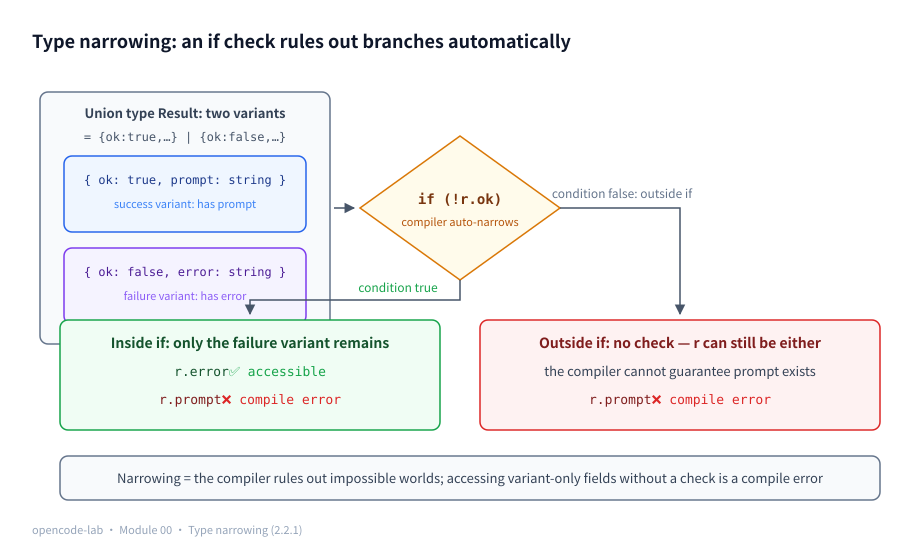
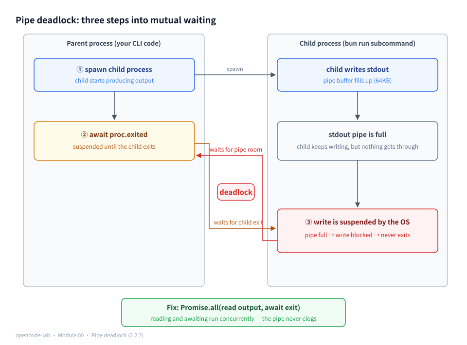
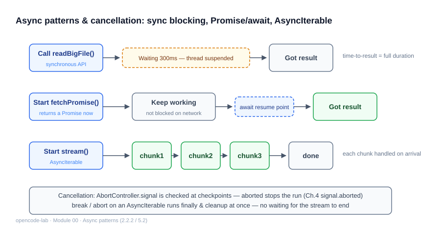
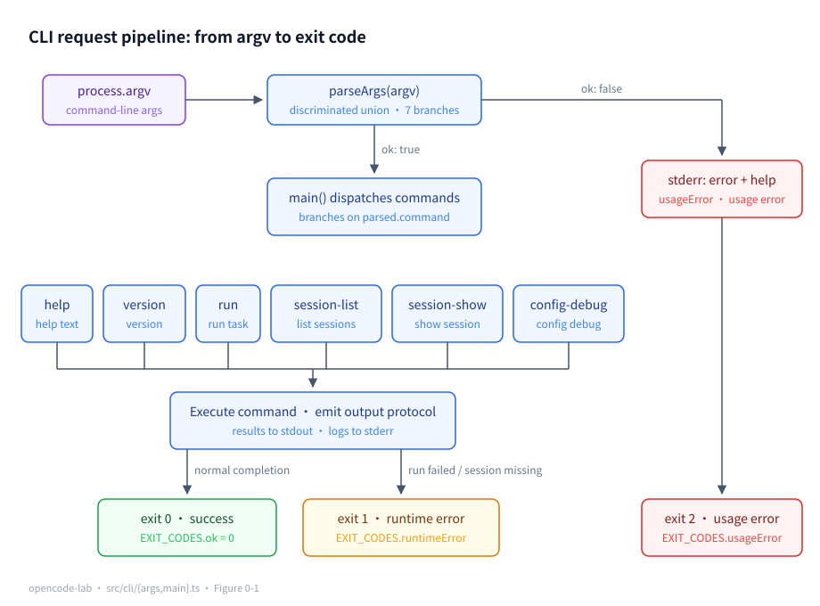
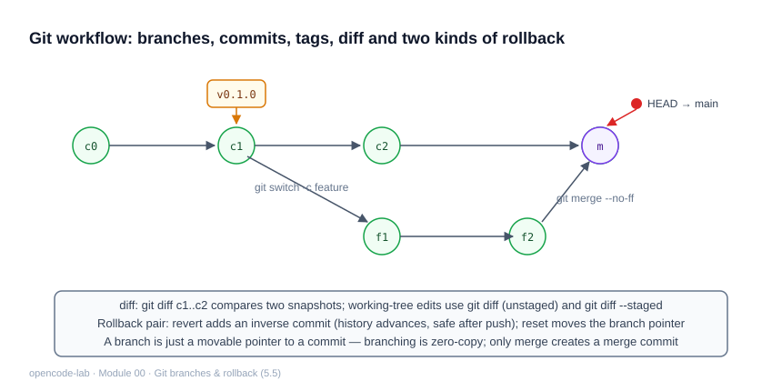
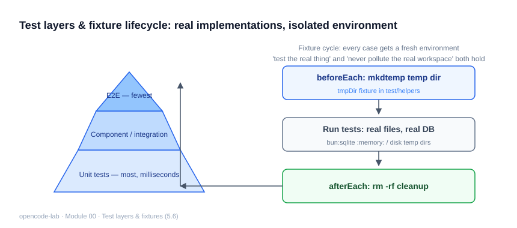
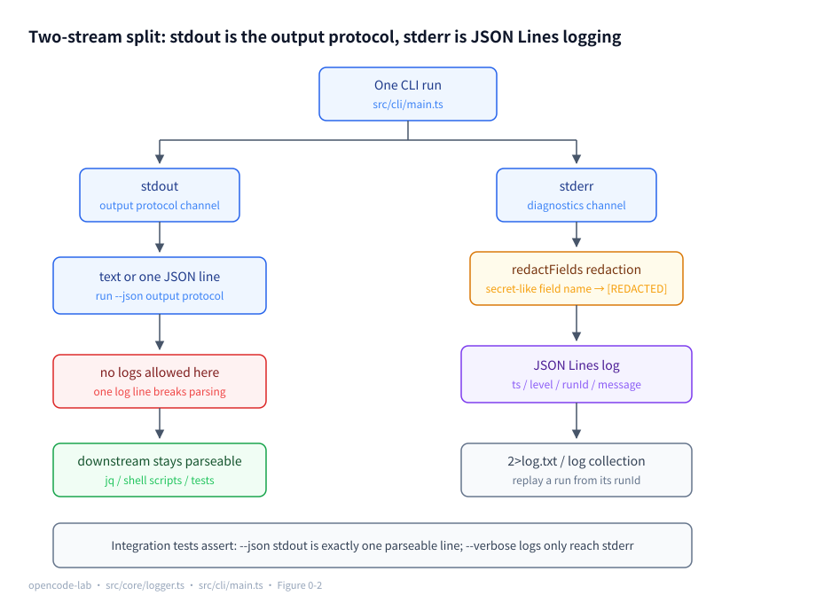
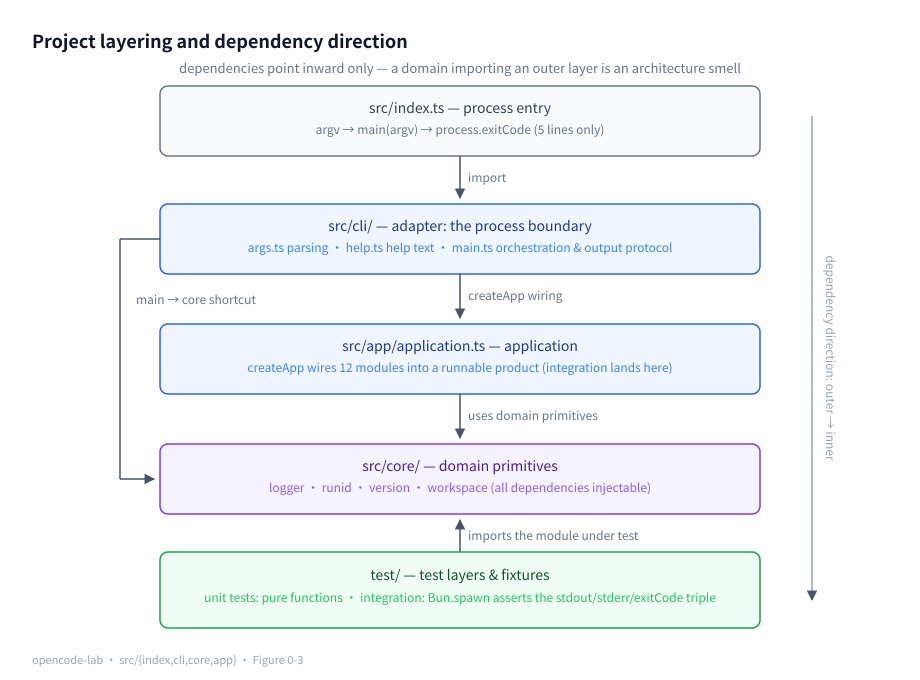

# Chapter 0: Engineering basics and the course environment

## 1. Chapter positioning

- Module: 00 Engineering basics and the course environment
- Study time: 8–10 hours (including the from-zero foundations in Section 2)
- Difficulty: beginner — **this chapter is the starting point of the course and assumes no TypeScript / Agent background**; readers already familiar with TS and the terminal can skim Section 2.2 quickly
- Prerequisite chapters: none
- Corresponding OpenCode version/commit: `70a24697ea0028e19f22712fd63059538cb4bee7` (`dev` branch)
- Corresponding milestone in this project: `v0.1-cli`

## 2. Prerequisites

> This is the first chapter, and Section 2.2 builds the foundations used in the rest of the chapter **from zero**. You will reuse these topics (TypeScript types, async, the terminal trio, regex) in every later chapter, so it is worth actually running the examples yourself.

### 2.1 Glossary for this chapter

| Term | Plain-language one-liner | Where it is used in this chapter |
|---|---|---|
| type | a "shape label" stuck on data; the compiler uses it to check you didn't misuse the value | 5.1 argument parsing |
| union type | "this value may be one of several shapes, A or B" | 5.1 modeling parse results |
| discriminated union | every member of the union carries a tag field; members are told apart by the tag | 5.1 `ParsedArgs` |
| type narrowing | after an `if` check, the compiler automatically rules out impossible branches | 5.1 `if (!parsed.ok)` |
| generics | "parameterizing" types — passing types as arguments into utility types | 5.1 `Record` |
| Promise | a claim ticket for "a result not yet in hand"; `await` waits for it to redeem | 5.2 awaiting a child process |
| stdout / stderr | the program's two output pipes: results go to stdout, diagnostics to stderr | 5.4 / 5.7 |
| exit code | the numeric signal when a program ends: 0 = success, non-zero = failure | 5.4 CLI protocol |
| JSON Lines | a log format with one complete JSON object per line | 5.7 structured logging |
| regular expression | a mini-language that describes "what text looks like" with a string of symbols | 5.7 redaction matching |

### 2.2 Foundations (from zero)

#### 2.2.1 TypeScript: sticking "shape labels" on data

The problem with JavaScript: a function claims to take a "user", you pass in a number, and things blow up halfway through the run. TypeScript's (TS) solution: **stick shape labels on data so checks happen in the compile stage, before the program runs**.

Start with three foundational concepts:

```ts
// Type annotation: declare "what shape the parameter has"
function greet(name: string) {
  return `你好, ${name}`
}
greet(123) // compile error right away: a number cannot be passed to a string parameter
```

**Union types** (`A | B`): a value may be one of several shapes. For example, "the parse result may be a success object, or it may be `{ error: string }`".

**String literals can also serve as types** — the most surprising point for newcomers. `"help"` is not just a string value; it can also be a **type** (the value can only be that exact string):

```ts
type Command = "help" | "version" | "run"
// a value of type Command can only be one of these three strings; write "hepl" and the compile fails immediately
```

Combine the two and you get this chapter's core weapon — the **discriminated union**: each member carries a tag field (here `ok`); different tag, different shape:

```ts
type Result =
  | { ok: true; prompt: string }   // prompt exists only on success
  | { ok: false; error: string }   // error exists only on failure
```

Why is it so useful? Look at **type narrowing** — the compiler follows your `if` checks and automatically rules out impossible branches:

```ts
declare const r: Result
if (!r.ok) {
  // inside this branch the compiler already knows ok is false → only the failure member remains
  console.log(r.error) // ✅ valid
  console.log(r.prompt) // ❌ compile error: Property 'prompt' does not exist on type '{ ok: false; error: string }'
}
console.log(r.prompt) // ❌ same error here: r may still be the failure branch, so prompt may not exist
```

The second `console.log(r.prompt)` above is what we call an **"intentional compile-error demo"**: access a success-branch-only field without narrowing and the compiler stops you. Save this code as `demo.ts` and run `bunx tsc --noEmit demo.ts` to see the exact error text.

Save the `Result` type definition together with the code above as `/tmp/narrow-demo.ts` and verify with a real compile:

```bash
bunx tsc --noEmit --strict /tmp/narrow-demo.ts
```

```text
Output (excerpt):
narrow-demo.ts(8,17): error TS2339: Property 'prompt' does not exist on type '{ ok: false; error: string; }'.
narrow-demo.ts(10,15): error TS2339: Property 'prompt' does not exist on type 'Result'.
  Property 'prompt' does not exist on type '{ ok: false; error: string; }'.
```

The error positions `(8,17)` and `(10,15)` correspond exactly to the two `r.prompt` occurrences in the code: the first is inside the `if` block (after narrowing only the failure member remains), the second is outside the `if` (no narrowing, so `r` may still be either member). These two lines of output are direct evidence that "narrowing is the compiler's reasoning, not a runtime check" — the program never even ran, yet the errors were already caught.

Finally, **generics**: passing types as arguments. The most common utility type is `Record<K, V>` — "an object whose keys are exactly the K's and whose values are V":

```ts
type LogLevel = "debug" | "info" | "warn" | "error"
const LEVEL_ORDER: Record<LogLevel, number> = { debug: 10, info: 20, warn: 30, error: 40 }
// a missing key, an extra key, or a typo — all fail the compile immediately
```

One-sentence summary: **union types bound the "possible worlds", tag fields tell the worlds apart, narrowing locks in one world, and Record guarantees the key list is complete**. The core data structures of every later chapter (messages, events, tool results) all use this trick.



*Figure 0-P1: Type narrowing — once `if (!r.ok)` holds, the compiler keeps only the failure member: inside the block `r.error` is accessible while `r.prompt` is a compile error; outside the if there is no narrowing, r may still be either member, and variant-specific fields are compile errors all the same. Narrowing is the compiler ruling out "impossible worlds" for you.*

#### 2.2.2 Async: ordering takeout and Promise

Synchronous code is like getting food at a canteen counter: queue, get served, leave — one step stuck and everything is stuck. Async code is like ordering takeout: after placing the order (starting the call) you go do something else, **the Promise is your meal-claim ticket**, and `await` means "wait until the ticket redeems, then continue":

```ts
const p = fetchOrder()      // start: returns a Promise (the ticket) immediately; the work proceeds in the background
const order = await p       // wait: execution continues only once the result is in
```

Two key points:

1. An `async` function's return value is **always a Promise** — the `Promise<number>` in `async function main(): Promise<number>` is not optional decoration; it is an honest description.
2. `await` only pauses the current function and **does not block the whole program** — other things (say, other IO) keep making progress.

**`Promise.all`: waiting for several things at once**. Put multiple Promises into an array and await them together; done means all done — that is "concurrency":

```ts
const [a, b] = await Promise.all([readFileA(), readFileB()]) // both tasks run at the same time
```

**Why does this chapter need it right away? — pipe deadlock**. First understand this classic trap in three steps:

1. The OS pipe (a conveyor belt for data between parent and child processes) has **limited capacity** (usually 64KB);
2. The child writes into the pipe: **once it is full and nobody is draining it, the OS suspends the write** (the child is stuck inside write);
3. If the parent's code is "first wait for the child to exit, then read the output" — the child waits for "pipe room" before it can finish writing and exit, while the parent waits for "child exit" before it starts reading → **the two wait on each other, stuck forever**.

The conclusion follows naturally: **reading the output and waiting for exit must happen at the same time** — exactly why the three-line `Promise.all` snippet in Section 5.2 exists.

One piece of background knowledge: `import { main } from "./cli/main"` at the top of a TS file is **ESM** (ECMAScript Modules, the standard module system); old-style Node code uses `require()`, which is CommonJS. Bun runs `.ts` files as ESM directly, so top-level `await` works at module scope (CommonJS cannot). This course uses ESM throughout.



*Figure 0-P2: Pipe deadlock in three steps — after the child fills the 64KB pipe buffer its write is suspended, while the parent is still at `await proc.exited`: one waits for exit, the other waits for pipe room; the mutual waits form a cycle, which is the deadlock. The fix is `Promise.all` doing "read output" and "await exit" at the same time.*

#### 2.2.3 The terminal trio: stdout, stderr, and exit codes

Every command-line program is born with **two output pipes**:

- **stdout (standard output)**: carries "results for the consumer" — what a human or a downstream program wants;
- **stderr (standard error)**: carries "diagnostics" — logs, errors, progress.

Why two pipes? Because in the terminal world the pipe `|` **connects to stdout only**:

```bash
opencode-lab run "任务" --json | jq .runId   # jq only receives stdout
opencode-lab run "任务" --verbose 2>log.txt  # 2> redirects stderr into a file; logs never pollute the pipe
```

If logs sneak into stdout, `jq` errors the moment it hits a log line — that is the entire meaning of this chapter's "stdout is the protocol".

**Exit code**: the numeric signal when a program ends, `0` = success, non-`0` = failure (by convention `1` runtime error, `2` usage error). The previous command's exit code is stored in `$?`:

```bash
bun src/index.ts nope; echo $?   # prints 2 — scripts branch on this number, far more reliable than "looking for error text"
```

```text
Output (excerpt):
错误: 未知命令: nope
… (the full help text goes here, written to stderr along with the error)
2
```

The `2` on the last line comes from `echo $?`. Note that the error and the full help text are both written to **stderr**, leaving stdout perfectly clean — this is the "usage error → stderr + exit code 2" protocol in action; a shell script never has to read any text, seeing `2` tells it to print help.

Two bits of common knowledge: **PATH** is the directory list the system searches for commands (Bun installs into `~/.bun/bin`; if it is not in the default list you need `export PATH="$HOME/.bun/bin:$PATH"`); **jq** is a command-line JSON processor (`jq .runId` pulls a field out of JSON).

#### 2.2.4 JSON Lines: a machine-friendly log format

**JSON Lines (NDJSON)**: many lines in one file, **each line on its own a complete JSON object**.

Why not free-form text like `printf("错误: %s 时间: %s")`? Because free text needs "format guessing" (regex) before a program can read it again; with one JSON object per line, `grep`, `jq`, and log systems can query fields directly:

```bash
grep '"level":"error"' log.txt | jq -r .message   # pull out every error message in seconds
```

Every line of the course log looks like this (fields: timestamp, level, run ID, message, extra data):

```json
{"ts":"2026-01-01T00:00:00.000Z","level":"info","runId":"run-x","message":"cli_started"}
```

#### 2.2.5 Regex basics: describing "what text looks like" with symbols

Regex is a "mini-language" that describes a class of strings with a string of symbols; `.test(string)` returns "match or not". This chapter's redaction logic uses only six constructs; take the real code apart piece by piece (compare `SECRET_KEY` in Section 5.7):

```ts
/(^|[-_])(api[-_]?key|token|secret|authorization|password)$/i
```

| Fragment | Meaning |
|---|---|
| `api[-_]?key` | `api` + **one optional** `-` or `_` (`?` = the preceding item appears 0 or 1 times) + `key` → matches `apiKey`, `api_key`, `api-key` |
| `token\|secret\|...` | the vertical bar `|` = **pick one of many**; parentheses group the alternatives into one set |
| `(^\|[-_])` | start of string (`^` is the start anchor) **or** immediately preceded by `-`/`_` — guarantees we match the **trailing word** of a field name, not a fragment that merely happens to appear inside `mytoken_note` |
| `$` | end anchor: stop here, no other characters may follow |
| `/.../i` | the `i` flag = case-insensitive (`Token`, `TOKEN` also count) |

Master these four — pick-one-of-many, optional, anchors, flags — and you can read seventy or eighty percent of the regex in this course; the more complex pieces (character classes, quantifiers) can be picked up on the spot when Chapters 3 and 6 need them.

Run three field names against the real `SECRET_KEY` to verify the table (`apiKey` matches thanks to the `i` flag; `my_token_note` does not match because of the `$` anchor — `token` is not at the tail; `password` hits the pick-one-of-many):

```bash
bun -e 'const SECRET_KEY=/(^|[-_])(api[-_]?key|token|secret|authorization|password)$/i; console.log(SECRET_KEY.test("apiKey"), SECRET_KEY.test("my_token_note"), SECRET_KEY.test("password"))'
```

```text
Output:
true false true
```

### 2.3 Pre-read checks

This chapter is the starting point; there is no "recap of the previous module", just two environment checks:

```bash
bun --version      # >= 1.4 (if missing, go back to GUIDE.md §2 to install it)
cd opencode-lab && bun test   # 327+ cases all green = the code baseline is intact
```

---

## 3. Learning objectives

- Understand: why an AI coding agent must be a "repeatable command" rather than a one-off script; why the stdout protocol and stderr logging must be separated.
- Be able to implement: a Bun/TypeScript CLI with argument parsing, help text, exit codes, structured logging, and run IDs.
- Be able to test: exhaust argument parsing with unit tests and verify the stdout/stderr protocol with subprocess integration tests.
- Be able to explain: which downstream consumers exit codes, JSON Lines logs, and secret redaction each serve (shell scripts, log queries, security audit).

## 4. Problem statement

First, the reference point: **OpenCode is an open-source AI coding agent** (give it "fix this bug for me" in the terminal and it reads code, edits files, and runs tests on its own); this course rebuilds its core pipeline from scratch. The course codebase `opencode-lab` is our own implementation, and the OpenCode source serves only as a reading reference.

The next 13 modules keep adding to the skeleton: providers, tools, the agent loop, permissions, persistence. If lesson one writes all logic into one big script, prints logs to stdout, and skips tests, every later step pays back that debt. OpenCode's entrypoint `packages/opencode/src/index.ts` and `packages/opencode/src/cli/bootstrap.ts` also make "separating the process entry from business orchestration" the very first thing they do.

This chapter answers three engineering questions:

1. **Entry vs. logic**: `src/index.ts` only hands `process.argv` to `main()` and sets the exit code; all testable logic lives in `main()` and pure functions.
2. **Output protocol**: stdout emits only "content for downstream programs to consume" (a text reply or one line of JSON); all diagnostics go to stderr as JSON Lines logs.
3. **Observability**: every run gets a `runId`; logs carry a level, a timestamp, and auto-redacted secret fields, so a run can be reconstructed afterwards from its `runId`.

## 5. Core concepts

This chapter corresponds to the 8 knowledge entries in Section 8.1 of the design document. First the "concept ↔ source file ↔ test file" mapping table, then each entry in turn; every concept is covered in four parts — "Concept → How this project implements it → Common pitfalls → Self-check questions" — and all code excerpts come from the real source in `opencode-lab/`.

| Concept | Source files (relative to opencode-lab/) | Test files |
|---|---|---|
| TypeScript types and narrowing | `src/cli/args.ts`, `src/core/logger.ts` | `test/args.test.ts`, `test/logger.test.ts` |
| Async programming | `src/index.ts`, `src/cli/main.ts` | `test/cli.integration.test.ts` |
| Bun runtime | `package.json`, `test/cli.integration.test.ts` (Bun.spawn/Bun.write) | `test/cli.integration.test.ts` |
| CLI design | `src/cli/args.ts`, `src/cli/help.ts`, `src/cli/main.ts` | `test/args.test.ts`, `test/cli.integration.test.ts` |
| Git workflow | the course repository itself (no runtime source; milestone tags in `curriculum/curriculum.yaml`) | — |
| Test layering and fixtures | this chapter's 4 test files under `test/` | all of them |
| Structured logging and run IDs | `src/core/logger.ts`, `src/core/runid.ts` | `test/logger.test.ts`, `test/runid.test.ts` |
| Project layering | `src/index.ts`, `src/cli/main.ts`, `src/core/`, `src/app/application.ts` | `test/cli.integration.test.ts` |

### 5.1 TypeScript basics: types, union types, generics, and type narrowing

**Concept**

The type system's value is "shifting errors left": for data with a fixed shape — CLI parse results, log lines — once the shape is written into types, misusing a field is caught at compile time instead of blowing up at runtime. Discriminated unions, narrowing, and `Record` were built up from zero in 2.2.1; here, look straight at the practical problem they solve together:

**Usage errors should return data, not throw.** A parse failure returns `{ ok: false, error }` instead of `throw`ing or returning `null` — callers are **forced by the types** to handle the failure branch first (without handling it they cannot access success fields; the code won't compile), and accidents like "forgot the null check and undefined spread everywhere" disappear at the root.

**How this project implements it**

`src/cli/args.ts` models all parse results with a discriminated union — 7 branches covering every possibility:

```ts
export type ParsedArgs =
  | { ok: true; command: "help"; flags: CliFlags }
  | { ok: true; command: "version"; flags: CliFlags }
  | { ok: true; command: "run"; prompt: string; flags: CliFlags; options: RunOptions }
  | { ok: true; command: "session-list"; flags: CliFlags }
  | { ok: true; command: "session-show"; id: string; flags: CliFlags }
  | { ok: true; command: "config-debug"; flags: CliFlags }
  | { ok: false; error: string }
```

What does the discriminated union look like in action? The demo `ch00/01-args.ts` parses one success set and one failure set of arguments and prints the results (runnable directly as the first unit of Studio 7.1):

```text
Output (bun demos/ch00/01-args.ts):
{
  "ok": true,
  "command": "run",
  "prompt": "hello world",
  "flags": {
    "json": true,
    "verbose": false
  },
  "options": {
    "allowAll": false
  }
}
{
  "ok": false,
  "error": "run 命令需要一个提示词参数"
}
✓ Cell done: success branch has prompt, missing-param branch has error
```

Field by field against the type definition above: in the `ok: true` branch, `command: "run"` is the discriminant, and it means this result line **can only** access `prompt` and `options` (the `session-show` branch would expose `id` instead) — that is exactly narrowing's semantics; `prompt: "hello world"` is the two positional arguments `hello` and `world` joined back with `join(" ")`; in `flags`, `json: true` comes from the `--json` boolean flag, and `verbose: false` is the explicit default when `-v` was not passed (not undefined — callers need no further null check); `options.allowAll: false` likewise corresponds to the absent `--allow-all`/`-y`. The second output demonstrates the failure branch: a missing prompt returns `ok: false` plus a human-readable `error` message, which `main` writes to stderr and exits 2 — note the failure branch **has no** `command`/`prompt` fields; trying to take `prompt` off it is rejected outright by the compiler. That is the whole meaning of "errors as data".

The caller `src/cli/main.ts` must narrow before using success-branch fields:

```ts
export async function main(argv: string[], io: MainIo = defaultIo): Promise<number> {
  const parsed = parseArgs(argv)
  if (!parsed.ok) {
    io.stderr.write(`错误: ${parsed.error}\n\n${HELP_TEXT}`)
    return EXIT_CODES.usageError
  }
```

The minimal generics instance lives in `src/core/logger.ts`: `Record` turns "the set of log levels" into a compile-time constraint — omit `error` from the level-comparison table and the compile fails:

```ts
const LEVEL_ORDER: Record<LogLevel, number> = { debug: 10, info: 20, warn: 30, error: 40 }
```

**Common pitfalls**

- Symptom: accessing `parsed.prompt` before `if (!parsed.ok)` — compile error "property does not exist". Cause: the union is not narrowed; `prompt` exists only on the run success branch. Fix: handle the error branch and return early; narrowing happens automatically (revisit the intentional-error demo in 2.2.1).
- Symptom: wrapping parse results in `try/catch` everywhere. Cause: treating type information as exceptions. Fix: expected errors go through `{ ok: false }`; only genuinely unexpected bugs throw (in `src/cli/args.ts` even `ArgError` is converted into the error branch only at the `parseArgs` boundary).

**Self-check questions**

1. Why does `ParsedArgs` use the boolean `ok` field as the discriminant instead of `"kind": "error" | "help" | ...`? → Reference points: `ok` maps directly to the "can we continue" control flow; a single `if (!parsed.ok)` line narrows, and every success branch shares it.
2. What happens if `error: 40` is missing from `Record<LogLevel, number>`? → Reference points: a compile error (missing property); the generic utility type turns "keys must be complete" into a compile-time check.
3. Why is `flags: CliFlags` extracted into its own type? → Reference points: every command shares the same flag set; extracting it means adding a flag touches one place instead of copying the shape across 7 branches.

### 5.2 Async programming: Promise, async/await, AsyncIterable, and cancellation

**Concept**

For the definitions of Promise / await / `Promise.all` see 2.2.2; two more concepts are planted here as seeds for later chapters:

- **AsyncIterable**: an async sequence consumable one item at a time with `for await...of` — a stream processed "as each item arrives". Chapter 1's model replies are exactly such an event stream (`AsyncIterable<LlmEvent>`); for now it is enough to know "it is the abstraction of a stream".
- **Cancellation and timeout**: a Promise itself cannot be cancelled (no un-ordering once placed); in practice `AbortSignal` broadcasts a "stop doing this" signal — receivers voluntarily halt at a suitable moment (cooperative cancellation). Chapter 1's request timeout uses it; for this chapter, awaiting the child via the "process-exit Promise" `proc.exited` is enough.

**How this project implements it**

The process entry `src/index.ts` is only 5 lines: top-level `await` waits for the orchestration result, then sets the exit code.

```ts
#!/usr/bin/env bun
import { main } from "./cli/main"

const code = await main(process.argv.slice(2))
process.exitCode = code
```

`main` in `src/cli/main.ts` is an async function that returns the exit code instead of exiting the process itself:

```ts
export async function main(argv: string[], io: MainIo = defaultIo): Promise<number> {
```

The integration test reads the child's three results concurrently (`test/cli.integration.test.ts`):

```ts
const [stdout, stderr, exitCode] = await Promise.all([
  new Response(proc.stdout).text(),
  new Response(proc.stderr).text(),
  proc.exited,
])
```

Why must these three lines be `Promise.all` (compare the three deadlock steps in 2.2.2): if you `await proc.exited` first and read the pipes afterwards — the child writes into the 64KB pipe, the write is suspended once it is full with nobody reading, and "exit" never arrives; the parent, meanwhile, waits for exit before it starts reading. **Reading the streams and awaiting exit advance concurrently; neither blocks the other.**



*Figure 0-4: The three async patterns — a synchronous call leaves the thread suspended in waiting; Promise separates "starting" from "waiting", and code after await resumes once the result is ready; AsyncIterable delivers the result in chunks as a stream with the lowest time-to-first-byte. Cancellation propagates along AbortController.signal; a checkpoint stops as soon as it sees aborted.*

**Common pitfalls**

- Symptom: integration tests hang occasionally. Cause: awaiting the exit code before reading stdout/stderr; once the pipe buffer fills, the child cannot write. Fix: read concurrently with `Promise.all` as above.
- Symptom: the last few log lines go missing after `process.exit()` inside `main`. Cause: `exit` terminates the process immediately, giving async writes/buffer flushes no chance. Fix: return the exit code and let the entry set `process.exitCode`.

**Self-check questions**

1. Why must an `async function` returning `number` be typed `Promise<number>`? → Reference points: an async function's return value is auto-wrapped into a Promise; the type must say so truthfully so callers can `await`.
2. Why is top-level `await` legal here? → Reference points: Bun runs `.ts` as ESM directly, which supports top-level await; CommonJS scripts cannot (see the ESM note in 2.2.2).
3. Where does this chapter plant the AsyncIterable seed? → Reference points: `run --json`'s "exactly one line" output protocol already treats stdout as a message stream; from Chapter 1 on, model replies become event streams consumed with `for await`.

### 5.3 The Bun runtime: scripts, file API, process API, tests, and workspaces

**Concept**

Bun is a three-in-one "runtime + package manager + test framework":

- **Runs TypeScript directly**: `bun src/index.ts` needs no precompilation; the shebang `#!/usr/bin/env bun` lets the file be invoked directly as a command via the `bin` field.
- **Bun API**: `Bun.spawn` starts a child process with stdout/stderr as readable streams; `Bun.write` writes a file in one line — replacing node's child_process/fs boilerplate.
- **bun test**: a built-in test runner, `import { test, expect } from "bun:test"`, no jest/vitest install needed.
- **workspace**: in a monorepo (one repository holding several packages), the packages share one lockfile and node_modules. The OpenCode main repository organizes `packages/opencode`, `packages/core`, and the rest with Bun workspaces; opencode-lab deliberately stays a single package to keep the first lesson's cognitive load minimal.

**How this project implements it**

`package.json` declares the entry and scripts; runtime dependencies are near zero:

```json
"bin": {
  "opencode-lab": "./src/index.ts"
},
"scripts": {
  "start": "bun src/index.ts",
  "test": "bun test",
  "typecheck": "tsc --noEmit"
}
```

The integration test runs the CLI as a real process with `Bun.spawn` and clears the secret environment variable (`test/cli.integration.test.ts`):

```ts
const proc = Bun.spawn({
  cmd: ["bun", join(projectRoot, "src/index.ts"), ...args],
  cwd,
  stdout: "pipe",
  stderr: "pipe",
  env: { ...process.env, OPENCODE_LAB_API_KEY: "" },
})
```

The temporary workspace lays down test files with `Bun.write` (`tempWorkspace` in `test/cli.integration.test.ts`):

```ts
await Bun.write(abs, content)
```

**Common pitfalls**

- Symptom: `bun: command not found` on CI or a fresh machine. Cause: Bun usually installs into `~/.bun/bin`, which is not on the default PATH (see the PATH note in 2.2.3). Fix: `export PATH="$HOME/.bun/bin:$PATH"`.
- Symptom: confusing `bun test` with `bun run test`. Cause: the former is the test runner's built-in command, the latter executes package.json scripts — in this project the two happen to be equivalent, but the semantics differ and another project may trip you up.
- Treating `tsc --noEmit` as a compile step and expecting `.js` output. Fix: `noEmit` only type-checks; running is always Bun's job.

**Self-check questions**

1. Why can `bin` point straight at a `.ts` file? → Reference points: the shebang on the file's first line points at the bun interpreter, and Bun executes TypeScript directly — no build artifacts needed.
2. What problem does `Bun.spawn`'s `stdout: "pipe"` solve? → Reference points: it turns child output into readable streams the parent can assert on; otherwise output goes straight to the parent's terminal and the test has nothing to verify.
3. How do the OpenCode main repo and opencode-lab differ in package organization? → Reference points: the former is a multi-package Bun workspace (core/protocol/server/opencode…, with a constrained dependency direction), the latter a single-package teaching project.

### 5.4 CLI design: commands, arguments, stdin/stdout/stderr, and exit codes

**Concept**

- **The CLI trio**: commands (`run`/`studio`/`session`/`config`/`help`), options (`--json`, `--model x`), positional arguments (the prompt). This project's convention: options may appear anywhere, the first non-option token is the command, and the remaining positionals are joined.
- **Division of streams**: stdout is the protocol channel (results consumed by humans or programs), stderr the diagnostics channel (logs, errors). The pipe `|` connects to stdout only — one stray log line and downstream JSON parsing crashes (the why in 2.2.3).
- **Exit-code convention**: 0 success; 1 runtime error (the task failed); 2 usage error (bad arguments). Shell scripts branch on it; "looking for error text in the terminal" is unreliable.
- **Short-circuit flags**: `--help`/`--version` take effect immediately wherever they appear, bypassing normal parsing.
- **The `studio` subcommand**: starts the browser-based interactive Playground (the gateway to Section 7.1 of this chapter). `--port <n>` is a value option defaulting to 7800; an occupied port or a non-numeric value is treated as a usage error (exit code 2) — the CLI protocol applies to new commands just the same.

**How this project implements it**

Exit codes are defined once as constants so magic numbers never scatter (`src/cli/args.ts`):

```ts
export const EXIT_CODES = {
  ok: 0,
  runtimeError: 1,
  usageError: 2,
} as const
```

The main parse loop recognizes only four kinds of token: boolean flags, value options, short-circuit flags, and positionals (`src/cli/args.ts`):

```ts
while (i < argv.length) {
  const arg = argv[i]
  if (arg === "--json") flags.json = true
  else if (arg === "--verbose" || arg === "-v") flags.verbose = true
  else if (arg === "--help" || arg === "-h") return { ok: true, command: "help", flags }
  else if (arg === "--version") return { ok: true, command: "version", flags }
  ...
  else if (arg.startsWith("--")) return { ok: false, error: `未知选项: ${arg}` }
  else if (command === undefined) command = arg
  else positional.push(arg)
  i++
}
```

(The full loop also handles value options like `--provider`/`--model`/`--max-steps`/`--session` plus `--allow-all`.)

Usage errors write to stderr and return 2 (`src/cli/main.ts`); the `--json` result goes to stdout as exactly one line, and the integration test asserts `stdout.trim().split("\n")).toHaveLength(1)` specifically.

```ts
if (!parsed.ok) {
  io.stderr.write(`错误: ${parsed.error}\n\n${HELP_TEXT}`)
  return EXIT_CODES.usageError
}
```

What does this protocol look like in a real process? Run each of the following in the `opencode-lab/` directory (`runId`/`sessionId`/timestamps differ every run and are masked with …):

```bash
bun src/index.ts --help
```

```text
Output (first 13 lines):
opencode-lab — 教学版 AI 编程 Agent

用法:
  opencode-lab run <提示词> [选项]      执行一次 Agent 任务
  opencode-lab run <提示词> --session <id>   恢复会话继续
  opencode-lab studio [--port <n>]      启动交互式代码 Playground（浏览器）
  opencode-lab session list            列出本项目的会话
  opencode-lab session show <id>       查看会话完整记录（JSON）
  opencode-lab config debug            显示配置与来源
  opencode-lab help | version

选项:
  --json                 以单行 JSON 输出结果（stdout 协议）
```

The `studio` line is the launch point for the Section 7.1 Playground: `bun src/index.ts studio --port 7800` (`--port` may be omitted). It takes no prompt and runs no agent loop; instead it starts a `Bun.serve` HTTP service (`src/studio/server.ts`) that renders the demo units under `demos/` into editable, runnable web pages. Note that `--port` goes through the same value-option parsing path as `--model` — adding a subcommand requires no new parsing rules; that is the extensibility the "trio" convention buys.

```bash
bun src/index.ts --version
```

```text
Output:
opencode-lab 0.1.0
```

```bash
bun src/index.ts run "帮我写一个函数" --json -y   # -y = --allow-all, allows permissions (demo only)
```

```text
Output (stdout is exactly one line; runId/sessionId differ each run):
{"runId":"run-2026…（每次不同）","sessionId":"sess_…（每次不同）","status":"completed","finalText":"这是 Mock Provider 的演示回复。配置环境变量 OPENCODE_LAB_API_KEY（及 opencode-lab.json 的 provider 配置）即可接入真实模型。","turns":2,"usage":{"inputTokens":158,"outputTokens":36},"changedFiles":[],"snapshotCreated":false}

At the same moment, stderr carries the JSON Lines logs (first and last lines excerpted):
{"ts":"…（每次不同）","level":"info","runId":"run-2026…","message":"cli_started","argv":["run","帮我写一个函数","--json","-y"],"version":"0.1.0"}
{"ts":"…（每次不同）","level":"info","runId":"run-2026…","message":"run_finished","sessionId":"sess_…","status":"completed","turns":2}
```

Note that under `--json` stdout carries **only this one result line** — the human-readable text reply is tucked into the `finalText` field and all logs go to stderr — the two streams never pollute each other, which is why `jq .runId` can consume this line directly; when no real key is configured, the built-in Mock Provider takes over automatically, so the whole flow runs without network access.

```bash
# config debug: drop a minimal config file in any empty directory, run with a path pointing at opencode-lab
echo '{"provider": {"model": "glm-4.6"}}' > opencode-lab.json
bun /path/to/opencode-lab/src/index.ts config debug
```

```text
Output (excerpt):
opencode-lab 配置来源（default < global < project < env < cli，右层覆盖左层）:

  provider.name = openai-compatible  [default]
  provider.model = glm-4.6  [project]
  provider.baseUrl = https://api.openai.com/v1  [default]
… (the remaining entries list the value and source layer for agent/permissions/rules/log)
```

The bracket at the end of each line is that entry's **source layer**: `provider.model` is overridden to `glm-4.6` by the project file and tagged `[project]`, while the rest keep their built-in defaults tagged `[default]` — the config system's "layer-by-layer override, traceable sources" principle is visible at a glance (details in Chapter 5).

**Common pitfalls**

- Symptom: `echo $?` is always 0. Cause: `main`'s return value was never wired to `process.exitCode`. Fix: one line in the entry, `process.exitCode = code`.
- Symptom: downstream `jq` reports parse errors. Cause: logs leaked into stdout. Fix: the log stream is always `process.stderr`.
- Symptom: `--provider` without a value silently swallowed the next token. Cause: the value option was never validated. Fix: `requireValue` explicitly checks for `undefined` and the `--` prefix and reports a usage error.

**Self-check questions**

1. Why does `run` without a prompt return 2 instead of 1? → Reference points: a missing argument is the caller's usage error; 1 is reserved for "the task itself failed", letting scripts decide whether to print help.
2. Why is the `--help` short-circuit inside the parse loop rather than checked after parsing? → Reference points: so `run x --help` also shows help immediately, without having to pass run's argument validation first.
3. Why `join(" ")` multiple positional arguments into one prompt? → Reference points: users habitually type `run 修复 这个 bug` without quotes; the shell has already split on spaces, and the parser's job is to join them back.



*Figure 0-1: The CLI pipeline from argv to exit code (0 success · 1 runtime error · 2 usage error).*

### 5.5 Git workflow: branches, commits, diff, tags, and rollback

**Concept**

- **Commits and branches**: a commit is an immutable checkpoint; a branch is a movable pointer to a commit. Commit at every verifiable milestone and you can always roll back.
- **Tag**: a permanent name for a milestone (`v0.1-cli` in this chapter). Tags and branches both point at commits; the difference is that a branch moves forward with new commits while a tag is permanently fixed.
- **diff**: compares any two checkpoints. Reviewing "what Module 01 changed relative to Module 00" is just `git diff v0.1-cli v0.2-provider`.
- **Three tiers of rollback**: `git restore <file>` discards working-directory changes; `git revert <commit>` creates a reverse commit (safe, preserves history); `git reset --hard` rewinds everything (dangerous, loses commits).
- **Branch policy**: this repository requires short lowercase hyphenated branch names (e.g. `cli-skeleton`) without `feat/`-style type prefixes; the development trunk is `dev`.

**How this project implements it**

This chapter has no Git-related runtime source — Git is part of the course's engineering process: after each module passes all tests it gets a milestone tag recorded in `curriculum/curriculum.yaml` (`tag: v0.1-cli` for this chapter, `tag: v0.2-provider` for the next). While following along, run this against the course repository:

```bash
git checkout -b cli-skeleton              # open a branch
git add -A && git commit -m "feat: cli skeleton with json protocol"
git tag v0.1-cli                          # tag the milestone
git diff --stat v0.1-cli v0.2-provider    # review the diff between the two chapters
```

This mental model — "commit = checkpoint, diff = changes made visible" — becomes code in Chapter 9: the snapshot mechanism in `src/git/snapshot.ts` is essentially "programmatic commit + diff", taking a snapshot before and after each file change by the agent (for now just note the direction; details in Chapter 9).



*Figure 0-5: Git branches and rollback — a branch is just a movable pointer to a commit (branching copies nothing), tags pin important versions, and diff compares any two snapshots; the two rollback tools: revert creates a reverse commit (history advances), reset moves the branch pointer (history rewritten, local only).*

**Common pitfalls**

- Symptom: experimental code gone after `git reset --hard`. Cause: reset discards unpushed commits and they are hard to recover. Fix: do experiments on a branch; undo committed work with `git revert`.
- Symptom: `git diff v0.1-cli` does not show the full diff up to the next chapter. Cause: a single ref compares against the working directory. Fix: give two refs, `git diff v0.1-cli v0.2-provider`.
- Commit messages like "update". Cause: impossible to trace back later. Fix: conventional commits, e.g. `fix(cli): keep stdout protocol clean`.

**Self-check questions**

1. Tags and branches both point at commits — what is the difference? → Reference points: a branch moves forward with commits, a tag stays fixed; milestones need "unchanging", so they get tags.
2. Why prefer revert over reset for rollback? → Reference points: revert preserves auditable history; reset rewrites history — a disaster for already-shared commits.
3. Why is "tag only when all tests are green" recommended? → Reference points: a tag is a permanent statement; tagging a red commit means checking it out later walks you straight into a pit.

### 5.6 Test layering: unit tests, integration tests, fixtures, and temp directories

**Concept**

- **Unit tests**: test pure functions, exhausting inputs and outputs in milliseconds. Argument parsing, log formatting, and runId generation all live at this layer.
- **Integration tests**: test "real behavior after assembly". A CLI's value sits exactly at the process boundary (streams, exit codes, environment variables), so a real child process must be spawned with `Bun.spawn` and the stdout/stderr/exitCode triple asserted.
- **Test fixture**: a controlled environment prepared for tests. Two kinds: in-memory fixtures (in-memory streams that capture logs) and filesystem fixtures (`mkdtemp` temp directories cleaned up uniformly in `afterAll`).
- **Dependency injection**: code under test does not create its own dependencies (clock, output stream, IO) — it **accepts them from outside**. Why? Look at a counter-example without injection:

```ts
// ❌ Counter-example: using the real clock directly — this test almost certainly fails
function greet() {
  return `现在是 ${new Date().toLocaleTimeString()}`   // the result differs every run
}
test("greet 包含 12:00:00", () => {
  expect(greet()).toContain("12:00:00")                 // you cannot control what time it is
})

// ✅ With the clock injected — the assertion is fully deterministic
function greet(now: () => Date = () => new Date()) {
  return `现在是 ${now().toLocaleTimeString()}`
}
test("greet 包含 12:00:00", () => {
  expect(greet(() => new Date("2026-01-01T12:00:00"))).toContain("12:00:00")   // passes forever
})
```

**How this project implements it**

The in-memory stream fixture keeps log tests off real stderr and asserts exact strings (`test/logger.test.ts`):

```ts
// In-memory stream that captures writes: keeps log tests off real stderr.
function capture() {
  const lines: string[] = []
  return { lines, stream: { write: (s: string) => void lines.push(s) } }
}
```

Clock injection makes time-related assertions fully deterministic (`test/logger.test.ts`):

```ts
const logger = createLogger({ runId: "run-x", stream: cap.stream, now: () => new Date("2026-01-01T00:00:00Z") })
```

Process-level tests build an isolated temp workspace with `mkdtemp` and clean up uniformly in `afterAll` (`test/cli.integration.test.ts`):

```ts
async function tempWorkspace(files: Record<string, string> = {}) {
  const dir = await mkdtemp(join(tmpdir(), "lab-cli-"))
  ...
  cleanups.push(() => rm(dir, { recursive: true, force: true }))
  return dir
}
```

This chapter's 4 test files hold 30 cases in total: `args` 14, `logger` 4, `runid` 3, CLI integration 9.



*Figure 0-6: Test layers and the fixture lifecycle — unit tests at the bottom are the most numerous and the fastest; higher up, fewer cases run ever closer to reality; around every case a fixture builds a temp directory, runs the real implementation, and cleans up the scene, so "testing the real thing" and "not polluting the environment" hold at once.*

**Common pitfalls**

- Symptom: integration tests leave `sessions.db` and temp files in the project directory. Cause: run executes directly in the repository cwd. Fix: build a temp workspace per case and register cleanup.
- Symptom: time-related assertions fail occasionally. Cause: asserting the real "current time". Fix: inject `now` and assert a fixed value (the greet counter-example above).
- Symptom: with all IO mocked, "tests are green but the CLI doesn't work". Cause: the CLI's tested behavior is the process boundary itself. Fix: test boundary behavior with a real child process; mocks only for unit-layer dependencies.

**Self-check questions**

1. Why don't logger tests write to real stderr and read it back? → Reference points: a process's own stderr cannot be asserted from inside the process; only an injected in-memory stream exposes the exact written content.
2. Why are cleanup functions collected into the `cleanups` array and deferred to `afterAll`? → Reference points: each case registers its own cleanup and they all run at the end; a case failing midway still leaves nothing behind.
3. Name a defect only integration tests can catch. → Reference points: logs mistakenly written to stdout — at the unit layer each stream is correct on its own; once assembled into a process the protocol is polluted.

### 5.7 Structured logging: log levels, trace ID (runId), and error context

**Concept**

- **Structured logging**: one self-contained JSON object per line (JSON Lines, see 2.2.4); fields can be queried directly by `jq` and log systems — versus printf text logs that need "format guessing" before parsing.
- **Log levels**: debug < info < warn < error; info by default, debug only with `--verbose`. Filtering happens "before the object is built", saving serialization and IO.
- **Trace ID**: one `runId` per run, carried by every log line. It stitches one run together across files and processes — during an incident, `grep <runId>` replays the whole chain.
- **Error context**: error logs must carry enough fields (which command, which argument, which stage) but never secrets — once a secret (e.g. a model-service key starting with `sk-`) lands in a log file, it gets shared, backed up, and uploaded along with the file; that is a leak. Redaction happens by field name before serialization.

**How this project implements it**

One log line from `src/core/logger.ts` = timestamp + level + runId + message + redacted fields:

```ts
function emit(level: LogLevel, message: string, fields?: Record<string, unknown>) {
  if (LEVEL_ORDER[level] < LEVEL_ORDER[minLevel]) return
  const line = {
    ts: now().toISOString(),
    level,
    runId: options.runId,
    message,
    ...(fields ? redactFields(fields) : {}),
  }
  stream.write(JSON.stringify(line) + "\n")
}
```

Redaction matches on field names and replaces values before they enter JSON (`src/core/logger.ts`; the regex is taken apart piece by piece in 2.2.5):

```ts
const SECRET_KEY = /(^|[-_])(api[-_]?key|token|secret|authorization|password)$/i

// Any field whose name looks like a secret must be redacted before it enters the log.
export function redactFields(fields: Record<string, unknown>) {
  const out: Record<string, unknown> = {}
  for (const [key, value] of Object.entries(fields)) {
    out[key] = SECRET_KEY.test(key) ? "[REDACTED]" : value
  }
  return out
}
```

The three-part runId design in `src/core/runid.ts`: the time prefix guarantees "sorted order is time order", and the random suffix keeps same-second concurrent runs collision-free:

```ts
export function createRunId(now = new Date()) {
  const date = `${now.getFullYear()}${pad(now.getMonth() + 1)}${pad(now.getDate())}`
  const time = `${pad(now.getHours())}${pad(now.getMinutes())}${pad(now.getSeconds())}`
  const rand = Math.random().toString(36).slice(2, 8)
  return `run-${date}-${time}-${rand}`
}
```

**Common pitfalls**

- Symptom: `sk-…` shows up in a log file. Cause: request headers/response bodies concatenated straight into fields. Fix: every field goes through `redactFields`; bare `console.error` is forbidden.
- Symptom: error logs get "filtered" out of existence. Cause: the level comparison is inverted, or `minLevel` was set to a high threshold under the belief that debug would still show. Fix: only levels below the threshold are filtered — `LEVEL_ORDER[level] < LEVEL_ORDER[minLevel]`.
- Symptom: sorted runIds are not in time order. Cause: a purely random ID with no time prefix. Fix: time prefix and random suffix each do their own job.

**Self-check questions**

1. Why does redaction match field names instead of scanning values for `sk-`? → Reference points: name-based redaction covers secret fields of every shape without false-positives on body text; Chapter 1 adds a second net at the error-message layer that "scans values for `sk-`/`Bearer`" — the two layers complement each other (for now, just know a second line of defense exists).
2. Why is level filtering placed before the JSON is constructed? → Reference points: debug is a high-frequency call; returning early saves object construction, serialization, and writing.
3. Logs go to stderr rather than straight to a file — who owns persistence? → Reference points: the Unix convention "the process only handles streams" — redirection (`2>log.txt`) or a collection system is the caller's decision, keeping the process simple and composable.



*Figure 0-2: The two-stream split — stdout is the output protocol, stderr is JSON Lines logging, and redactFields redacts by field name before anything is written.*

### 5.8 Project layering: domain, application, adapter, infrastructure

**Concept**

First, the problem these four layers solve: as a program grows, "business rules" (how to parse a task) and "technical details" (how to read env vars, how to make network requests) grow into each other, and changing either side means reading all of it. Layering puts them into circles of different responsibility and decrees that **dependencies may only point from the outer circles inward**:

- **domain**: pure business rules and types, no IO, synchronously testable. — innermost circle
- **application**: orchestrates domain objects and adapters and defines the flow of "one run"; it does not care about HTTP payloads or SQL details.
- **adapter**: translates the outside world into internal types — the CLI is the "process-boundary adapter", the Provider the "model-service adapter".
- **infrastructure**: where concrete technology lands — SQLite, the filesystem, Git. — outermost circle

The one-line test: **the inner circle does not know the outer circles exist**. If a domain file imports an adapter, the direction is reversed — that is an "architecture smell". OpenCode's counterparts: `packages/core` is the domain layer, `packages/opencode/src/session` the application orchestration, `packages/opencode/src/provider` the adapter. opencode-lab honors the same direction throughout.

**How this project implements it**

This chapter's skeleton is layering in embryo; the final shape (paths relative to `opencode-lab/`):

```text
src/index.ts            # process entry: argv -> main -> exitCode (the boundary inside the boundary)
src/cli/                # adapter: the process boundary (argument parsing, help, output protocol)
src/core/               # domain primitives: logger, runid, version (all dependencies injectable)
src/app/application.ts  # application: createApp wires every module into a product
```

`src/cli/main.ts` isolates the process boundary behind an injected IO abstraction — `main` is unit-testable without importing `process.stdout`:

```ts
export type MainIo = {
  stdout: { write(s: string): void }
  stderr: { write(s: string): void }
  stdin?: { isTTY: boolean; read(): Promise<string> }
}
```

The self-description at the top of the application file `src/app/application.ts` is a footnote for layering:

```ts
// Application layer: wires the 12 modules into one runnable product.
// This is where "integration" lands — the CLI and E2E tests face only createApp, never the internal modules.
```

**Common pitfalls**

- Symptom: all logic crammed into `index.ts`. Cause: the entry file is the most convenient place. Fix: the entry only does "argv → main → exitCode"; logic sinks into testable modules.
- Symptom: `process.env` or `fetch` showing up in domain files. Cause: reaching for the environment/network directly for convenience. Fix: inject environment and network as parameters; keep domain logic pure functions.
- Symptom: reading layering as "create four empty directories on day one". Fix: layering is a dependency-direction constraint; directories grow with the modules (this chapter only has cli/core; app and the rest come with later modules).

**Self-check questions**

1. `parseArgs` lives in `src/cli/` rather than `src/core/` — which layer does that make it? → Reference points: adapter — it parses "process arguments", a shape from the outside world, not a domain rule.
2. Why does `main` return the exit code instead of calling `process.exit` itself? → Reference points: exiting is a process side effect and belongs to the entry's duties; `main` stays unit-testable outside a process.
3. Find an instance of "dependency direction" in this chapter's code. → Reference points: `src/cli/main.ts` imports `src/core/logger`, while logger imports nothing from cli — outer depends on inner, one-way.



*Figure 0-3: Project layering and dependency direction — outer layers depend on inner ones, one-way with no turning back; tests import only the inner layer under test.*

## 6. Reading the OpenCode source

Read in order; for each file answer "where is the entry, what does it do, where do errors go":

| File | Reading focus | Think about |
|---|---|---|
| `packages/opencode/src/index.ts` | how the entry dispatches to CLI commands | Why does it distinguish `Development` from production error output? |
| `packages/opencode/src/cli/bootstrap.ts` | global preparation before startup (error handling, logging) | Which initialization failures should exit immediately rather than continue? |
| `packages/opencode/src/cli/cmd/run.ts` | how the `run` command is assembled | Why do command files only orchestrate and not implement business logic? |
| `packages/opencode/src/cli/error.ts` | how errors become user-readable output and exit codes | Where is the exit-code convention defined? |

Reading method (works for every later chapter): first look at the file's exported symbols, then find where it is imported, and finally find a test or command entry that calls it — read backwards along the execution path.

## 7. Minimal walkthrough

### 7.1 Studio demo units for this chapter

> 💡 Start the interactive Playground: `cd opencode-lab && bun src/index.ts studio`, open `http://localhost:7800` in your browser, and pick this chapter to run the units below. Each unit lets you edit the code, hit ▶ to run and see real output, and hit 🔍 Core to view the core source implementation.

| # | Unit | Demo content | Lesson anchor | Core source |
|---|---|---|---|---|
| 1 | `args` | Parameter Parsing — argv to discriminated union | §5.1 | `cli/args.ts` |
| 2 | `logger` | Structured Logging — JSON Lines & redaction | §5.7 | `core/logger.ts` |
| 3 | `runid` | RunId Generation — time prefix + random suffix | §5.7 | `core/runid.ts` |
| 4 | `exit-codes` | Exit Codes — 0/1/2 protocol | §5.4 | `cli/args.ts` |
| 5 | `narrowing` | Type Narrowing — discriminated union runtime check | §2.2.1 | `cli/args.ts` |
| 6 | `regex` | Regex Redaction — field name matching | §2.2.5 | `core/logger.ts` |

The project skeleton (the real artifact once this chapter is done, located at `docs/refAgentCode/opencode-lab/`):

```text
opencode-lab/
├── package.json          # bin entry, test/typecheck scripts
├── tsconfig.json         # strict mode, only for tsc --noEmit
├── src/
│   ├── index.ts          # process entry: argv -> main -> exitCode
│   ├── cli/
│   │   ├── args.ts       # pure-function argument parsing
│   │   ├── help.ts       # help text
│   │   └── main.ts       # orchestration: parse -> log -> dispatch
│   └── core/
│       ├── logger.ts     # JSON Lines logging + redaction
│       ├── runid.ts      # run ID
│       └── version.ts
└── test/                 # unit + process-level integration tests
```

Core code — the argument-parsing union (`src/cli/args.ts`):

```ts
export type ParsedArgs =
  | { ok: true; command: "help"; flags: CliFlags }
  | { ok: true; command: "version"; flags: CliFlags }
  | { ok: true; command: "run"; prompt: string; flags: CliFlags; options: RunOptions }
  | { ok: true; command: "session-list"; flags: CliFlags }
  | { ok: true; command: "session-show"; id: string; flags: CliFlags }
  | { ok: true; command: "config-debug"; flags: CliFlags }
  | { ok: false; error: string }

export function parseArgs(argv: string[]): ParsedArgs {
  // options may appear anywhere; the first non-option token is the command
  ...
}
```

Once the caller holds a `ParsedArgs`, it must handle the error branch with `if (!parsed.ok)` first — TypeScript's type narrowing guarantees you cannot forget (the theory and the demo are in 2.2.1).

The core logging constraints (`src/core/logger.ts`):

```ts
// logs go to stderr only, never stdout — stdout belongs to the CLI's output protocol
const SECRET_KEY = /(^|[-_])(api[-_]?key|token|secret|authorization|password)$/i
```

## 8. Exercises

1. **Task 1**: from a clean directory, run `bun src/index.ts` and confirm the help is shown with exit code 0.
2. **Task 2**: run `bun src/index.ts run "帮我写一个函数" --json` and extract the run ID from the output with `jq .runId`; then run `... --verbose 2>log.txt` and check that every line of `log.txt` is valid JSON and contains no unredacted secrets.
3. **Task 3**: deliberately pass bad arguments (`bun src/index.ts run`, `bun src/index.ts nope`, `bun src/index.ts --wat`), use `echo $?` to observe whether the exit code is 2, and confirm the error message lands on stderr.

## 9. Implementation steps

Every step is already implemented and tested in the code; what follows explains "which file changed, and why":

1. **`package.json`**: declares `bin` (`opencode-lab -> ./src/index.ts`) plus the `test` and `typecheck` scripts. The only runtime dependency is `effect`, introduced later in Module 12 — Bun itself provides the runtime, testing, and SQLite; dev dependencies are just `typescript` and `@types/bun`.
2. **`src/cli/args.ts`**: a hand-written parser. commander/yargs were avoided because this way every parsing rule is fully testable and the learner can see each boundary (unknown option, missing argument, the `--help` short-circuit).
3. **`src/core/runid.ts`**: `run-YYYYMMDD-HHmmss-6 random chars`. The time prefix keeps log sorting in time order; the random suffix keeps multiple runs within the same second collision-free. The `now` parameter exists so tests can inject a clock.
4. **`src/core/logger.ts`**: `createLogger({ runId, minLevel, stream })`. `stream` defaults to `process.stderr` but is injectable — unit tests assert the JSON content through an in-memory stream without touching a real terminal. `redactFields` replaces secret fields with `[REDACTED]` before serialization.
5. **`src/cli/main.ts`**: `main(argv, io)` returns `Promise<number>` (the exit code) and never calls `process.exit` directly. `io` injects stdout/stderr so the orchestration logic is unit-testable. At this chapter's milestone `run` returns only a fixed reply; the final code hands it to the full agent pipeline in `src/app/application.ts` (replaced step by step from Chapter 4 on), while `main` always does dispatch and the output protocol only.
6. **`src/index.ts`**: 5 lines. The shebang `#!/usr/bin/env bun`, an import of `main`, a top-level `await` call, and assigning the return value to `process.exitCode`.

## 10. Testing and debugging

Test commands (run inside `docs/refAgentCode/opencode-lab/`):

```bash
bun test            # all tests
bun run typecheck   # tsc --noEmit
```

To feel how fast one unit-test layer runs on its own (argument parsing exhausts 14 cases, done in milliseconds):

```bash
bun test test/args.test.ts
```

```text
Output (tail summary):
 14 pass
 0 fail
 24 expect() calls
Ran 14 tests across 1 file. […ms]
```

The scenarios covered by the four test files:

| File | Scenarios |
|---|---|
| `test/args.test.ts` | no arguments / run parsing / option and `--max-steps` validation / flag positions / `--help` short-circuit / session and config subcommands / unknown command / unknown option / missing prompt / exit-code convention |
| `test/logger.test.ts` | JSON line structure, level filtering, secret redaction, non-secret fields untouched |
| `test/runid.test.ts` | format regex, clock injection, 200 runs without collision |
| `test/cli.integration.test.ts` | subprocess-level: help and exit codes, `--json` exactly one parseable line, sessions visible via `session list/show` after persisting, `config debug` leaks no secrets, unknown command returns 2, `--verbose` logs go to stderr only |

Debugging tips:
- Logs not appearing? Check `minLevel` — debug-level output requires `--verbose`.
- `--json` failing to parse? Most likely logs leaked into stdout; go back to the "stdout is exactly one line" assertion in `cli.integration.test.ts`.

## 11. Milestone acceptance

- [x] In a clean directory, `bun install && bun src/index.ts --help` runs.
- [x] `run` returns 0 for a normal task and 2 for bad arguments.
- [x] `--json` output parses with `JSON.parse` and is exactly one line.
- [x] Logs appear on stderr only, carry a runId, and secrets are auto-redacted.
- [x] Under `bun test`, all 30 cases across this chapter's 4 test files pass; `tsc --noEmit` reports no errors.

## 12. Common errors

| Symptom | Cause | Locate | Fix |
|---|---|---|---|
| Downstream `JSON.parse` fails | logs written into stdout | the integration test's "one line" assertion | the log stream is always `process.stderr` |
| Script always exits with code 0 | forgot to set `process.exitCode` | `echo $?` | `main` returns the exit code and the entry assigns it |
| Tests fail occasionally (time-related) | the real clock is in use | the runid tests | the constructor accepts an injected clock |
| Secrets leak into logs | fields skipped `redactFields` | grep the logs for `sk-` | always go through `createLogger`; bare `console.error` is forbidden |

## 13. Post-lesson challenges

- Basic: add a `--quiet` option to the CLI (suppress non-error logs) and add tests for it.
- Advanced: implement an interactive REPL: with no arguments, enter a read-eval loop; `/exit` quits.
- Research: add output buffering and flush semantics to the logger, and think about why `process.exit()` exiting immediately can lose logs.

## 14. Chapter summary

This chapter laid the engineering foundation for the whole course: **a thin entry, pure logic, a clean protocol, observable logs, and layered tests**. The Section 2 foundations — TypeScript types, async, the terminal, and regex — run through every later chapter; flip back whenever you forget. Each following module just adds a directory under `src/` and a command to `main.ts`'s dispatch; the engineering shape never changes again. The next chapter plugs the first "real" capability into this skeleton: the LLM Provider — Chapter 1 likewise opens with a "Prerequisites" section that builds the LLM-world basics (tokens, HTTP, streaming) from zero.

## 15. Generation metadata

```yaml
module_id: "00-engineering-basics"
lesson_id: "00-cli-skeleton"
source_commit: "70a24697ea0028e19f22712fd63059538cb4bee7"
source_paths:
  - packages/opencode/src/index.ts
  - packages/opencode/src/cli/bootstrap.ts
  - packages/opencode/src/cli/cmd/run.ts
  - packages/opencode/src/cli/error.ts
prerequisites: []   # this chapter carries its own from-zero prerequisites (Section 2)
outputs:
  - src/index.ts
  - src/cli/args.ts
  - src/cli/help.ts
  - src/cli/main.ts
  - src/core/logger.ts
  - src/core/runid.ts
  - src/core/version.ts
tests:
  - test/args.test.ts
  - test/logger.test.ts
  - test/runid.test.ts
  - test/cli.integration.test.ts
acceptance:
  - CLI installs and runs from a clean directory
  - --json output parses and stdout has no log pollution
  - exit-code convention 0/1/2 in effect
```
