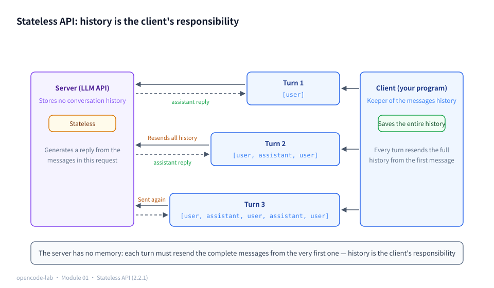
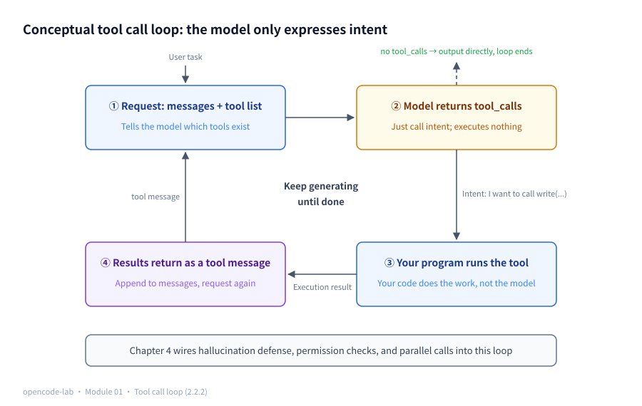
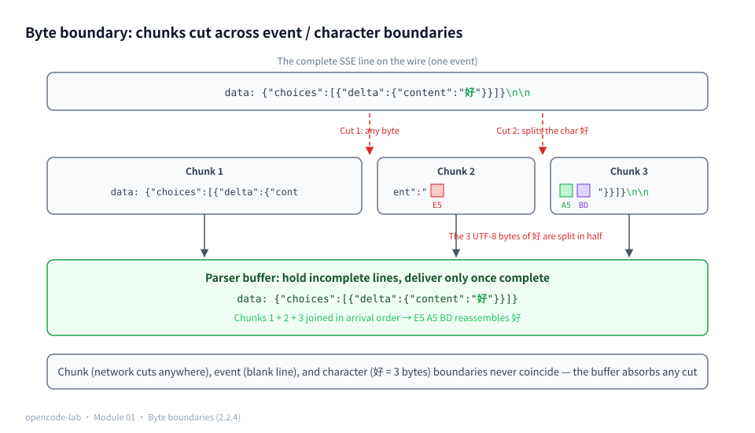
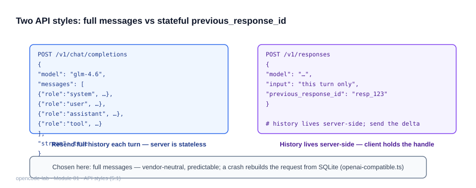
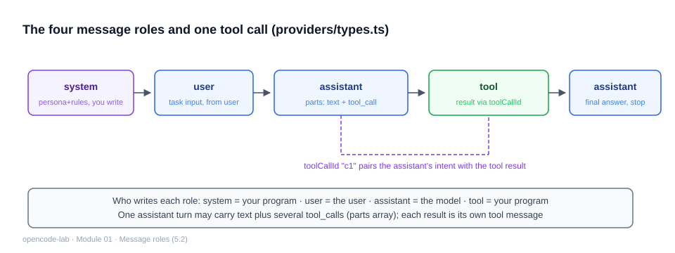
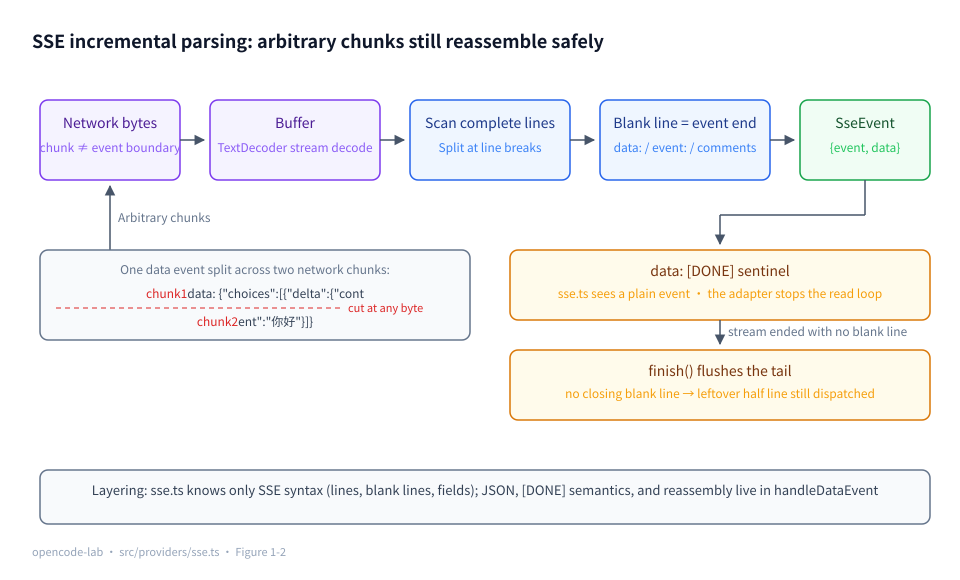
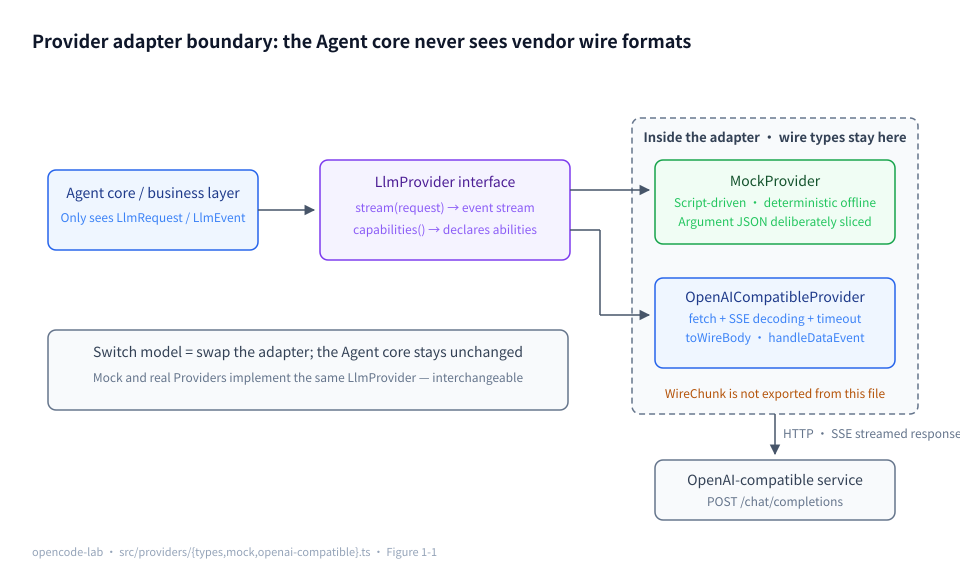
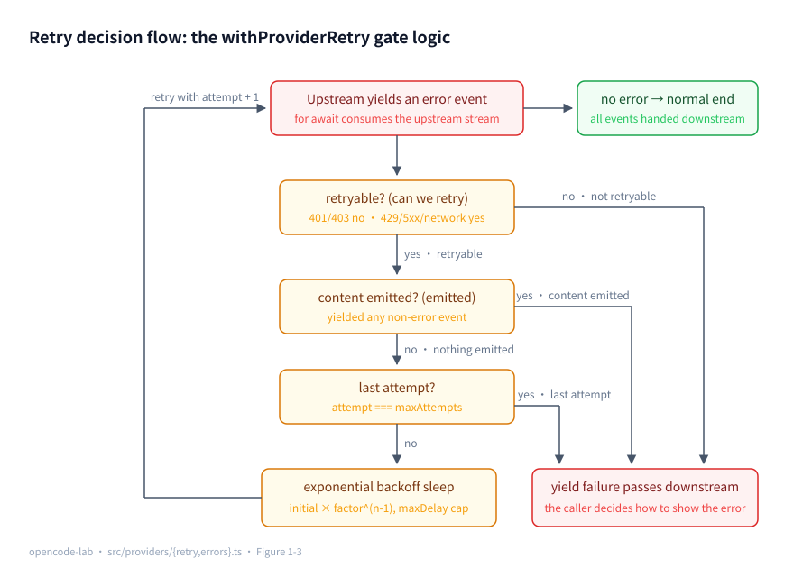
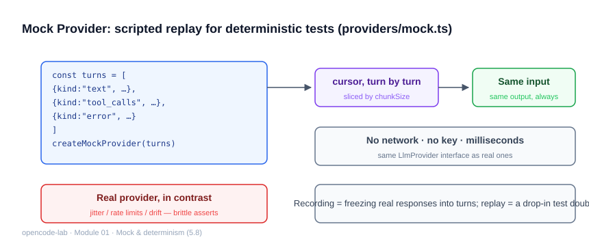

# Chapter 1: LLM Provider and the Streaming Model Interface

## 1. Chapter overview

- Module: 01 LLM Provider
- Study time: 10–12 hours (including the Section 2 LLM/HTTP from-zero primer)
- Difficulty: medium — Section 2 explains LLMs, tokens, HTTP, and SSE from scratch; readers who have never touched an LLM API should be sure to read it first
- Prerequisite chapter: Chapter 0 (CLI skeleton, structured logging)
- Corresponding OpenCode commit: `70a24697ea0028e19f22712fd63059538cb4bee7`
- Corresponding stage of this project: `v0.2-provider`

## 2. Prerequisites

> This is the course's first contact with "model services". Section 2.2 lays the four foundations — how LLMs work, tokens, the HTTP protocol, and SSE streaming — from zero; they are not just for this chapter: Chapters 3, 4, and 8 all rest on them.

### 2.1 Glossary for this chapter

| Term | In one plain sentence | Where it is used in this chapter |
|---|---|---|
| LLM | A probability model that has read massive amounts of text and is good at "continuing the text" | The protagonist of the whole chapter |
| token | The "building block" models count text in; the unit for billing and rate limits | 5.1 usage, 5.8 |
| Context window | The upper bound on the tokens a model can "see" at once, like the size of a whiteboard | 5.6 capabilities |
| messages / chat API | The standard format for talking to a model: a sequence of role-tagged messages | 5.2 |
| function calling / tool call | The model outputs the structured intent "I want to call tool X + arguments", **executing nothing itself** | 5.3 |
| Hallucinated call | The model requests a tool it was never offered | 5.3 pitfalls |
| Streaming | The server sends while generating; no need to wait for the full text | Whole chapter |
| SSE | A one-way server-pushed text stream protocol (Server-Sent Events) | 5.5 |
| HTTP status code | The three-digit code the server answers with (401/429/500…) | 5.7 error classification |
| Bearer / `sk-` | The HTTP auth header scheme / prefix of OpenAI-style keys | 5.4 |
| Adapter | An intermediate layer that translates A's format into B's format | 5.6 |
| AsyncIterable / generator | The abstraction of an "async sequence" / a function that produces values step by step with `yield` | 5.5 |
| Exponential backoff | Retry intervals that grow longer each time (100ms→200ms→400ms) | 5.7 |

### 2.2 Foundations (LLM and HTTP from zero)

#### 2.2.1 What an LLM is: tokens, the context window, and the stateless API

An LLM (large language model) is at bottom a "continue-the-text machine": give it a passage of text and it predicts what most likely comes next, popping out one word at a time. The Chat API is its standard usage — you send over a sequence of **role-tagged messages**, and it generates one reply back.

**Tokens: the currency of the model world.** Models process text neither by "character" nor by "word" but by **tokens** — the building blocks text is cut into. Rules of thumb: 1 English word ≈ 1.3 tokens; 1 Chinese character ≈ 1–2 tokens. Three things are measured in tokens: **billing** (you pay per input/output token), **rate limits** (how much you may use per minute), and the **context window**.

**Context window: the size of the whiteboard.** There is an upper limit to what a model can "see" at once (anywhere from a few thousand to over a million tokens), like a whiteboard that gets erased once full. This explains why two later chapters exist: Chapter 8's "context compaction" summarizes old content to make room when the whiteboard is nearly full.

**Stateless: the waiter doesn't remember you.** The Chat API's server **does not store conversation history** — every request must send the complete `messages` from the very beginning, and only then does it "remember" what was said before. This property runs through the whole course: Chapter 4's loop resends the full history every turn, Chapter 7 stores messages in a database, Chapter 8 trims history — all because "history is the client's responsibility".

**Why streaming?** Generating one long reply can take ten-plus seconds. Waiting for the full text before returning leaves the user staring at a blank screen; pushing small pieces over while generating drops first-token latency from ten-plus seconds to under one second — that is "streaming", the protagonist of this chapter.



*Figure 1-P1: Stateless API — the server stores no conversation history at all; the client is the only "keeper of history": every turn's request must resend the complete messages starting from the first one, and the history only grows as the chat continues.*

#### 2.2.2 The four message roles and the tool call mechanism

A "chat" is a sequence of messages, each with a role:

| Role | Who is speaking | Plain language |
|---|---|---|
| `system` | You (the program) | "You are a coding assistant; run the tests after changing code" — sets identity and rules |
| `user` | The user | "Fix this bug for me" |
| `assistant` | The model | The reply; in one turn it can "speak and propose tool calls at the same time" |
| `tool` | You (the program) | Tool execution results, sent back to the model |

**The key insight about function calling (tool calls): the model only expresses intent, it executes nothing.** You list the available tools in the request (name + description + parameter description); if the model thinks it needs a tool, it outputs a piece of structured data in its reply: "I want to call `write` with arguments `{path:"a.ts", ...}`". **What actually executes is your program**; after execution the result is sent back as a `tool` message, and the model continues. This "request → intent → execute → return → continue" loop is the heart of an Agent (Chapter 4 is entirely about it).

**Hallucinated calls**: occasionally the model requests a tool you never offered it (it is a probability machine, after all) — the protocol does not force it to choose only from the list. Chapter 2's tool registry and Chapter 6's permission layer both defend against this.



*Figure 1-P2: The conceptual tool call loop — the model only returns the tool_calls intent and executes nothing itself; your program does the actual work, and once the execution result is sent back as a tool message the model continues generating, until a reply contains no more tool_calls and the loop ends.*

#### 2.2.3 HTTP crash course: requests, status codes, and authentication

Calling a model API is just sending HTTP requests (the same protocol a browser uses to open web pages). One request = **method + URL + headers + body**:

```text
POST https://api.example.com/v1/chat/completions     ← method + URL (POST = submit data)
Authorization: Bearer sk-xxxx                        ← header (the key goes here)
Content-Type: application/json                       ← header (declares the body is JSON)
{"model": "glm-4.6", "messages": [...], "stream": true}   ← body
```

The **status code** in the response's status line tells you the outcome; remembering these five is enough for this chapter:

| Code | Meaning | What to do in this chapter |
|---|---|---|
| 2xx | Success | Parse the streamed response |
| 401 / 403 | Wrong key / no permission | **Retrying is pointless** (get a working key first) |
| 429 | Rate limited: rejected for requesting too hard | Retry with **exponential backoff** |
| 5xx | The server itself failed | Back off and retry (usually transient) |

**Bearer authentication**: `Authorization: Bearer <key>` is HTTP's most common way of "presenting your key"; OpenAI-style keys start with `sk-` — once one leaks into logs/screenshots the key is as good as copied, which is exactly why Chapter 0 introduced redaction.

#### 2.2.4 SSE: what a streamed response looks like

Streaming uses **SSE (Server-Sent Events)**: a protocol where the server pushes text lines continuously in one direction. First, a **complete real sample** (what an OpenAI-compatible service's streamed return looks like — exactly what this chapter parses):

```text
data: {"choices":[{"delta":{"role":"assistant","content":"你"}}]}

data: {"choices":[{"delta":{"content":"好"}}]}

data: {"choices":[{"delta":{},"finish_reason":"stop"}]}

data: {"choices":[],"usage":{"prompt_tokens":10,"completion_tokens":2}}

data: [DONE]

```

There are only four rules: after `data:` comes the payload (a piece of JSON); a **blank line** marks the end of an event; lines starting with `:` are heartbeat comments (ignore them); OpenAI-style streams end with `data: [DONE]`.

**The byte boundary problem (foreshadowing this chapter's technical core)**: the network delivers bytes in chunks whose sizes have **nothing to do** with SSE event boundaries — the second `data:` line above may arrive split into the two chunks `data: {"choices":[{"delta":{"cont` and `ent":"好"}}]}\n\n`. So the parser must "hold incomplete lines and stitch them when the next chunk arrives". Tougher still: one Chinese character occupies 3 UTF-8 bytes on the wire, so even "a single character" can be cut in half — this is exactly why `TextDecoder`'s `stream: true` exists later on.

(Besides SSE you may hear about WebSocket — that is a bidirectional long-lived connection, suited to chat rooms; an LLM API only needs a one-way "server → me" stream, where SSE is simpler and runs over plain HTTP.)



*Figure 1-P3: Byte boundaries — network chunks may cut at any byte, even straight through the middle of the 3 UTF-8 bytes (E5 A5 BD) of the character "好"; the parser buffer stitches chunks back in arrival order and delivers only complete lines. Chunk boundaries, event boundaries (blank lines), and character boundaries never coincide.*

#### 2.2.5 AsyncIterable and generators: `yield` in three lines

TypeScript uses **AsyncIterable** (an async sequence) to represent "a series of things arriving over time", consumed with `for await...of`. The most natural way to produce one is an **async generator** — a function with `yield`: each `yield` produces a value and pauses, resuming when the consumer asks for the next:

```ts
async function* count(): AsyncIterable<number> {
  yield 1   // produce 1, pause right here
  yield 2   // only runs when the consumer asks for the next value
}
for await (const n of count()) {
  console.log(n)   // prints 1, then 2
}
```

Without writing any file, `bun -e` verifies this semantics directly — the generator yields one at a time, `for await` consumes one at a time:

```bash
bun -e 'async function* count() { yield 1; yield 2 }; for await (const n of count()) console.log(n)'
```

```text
Output:
1
2
```

This chapter defines "one model reply" as an `AsyncIterable<LlmEvent>` — every kind of thing arriving over the stream (text fragments, tool call shards, usage, the end) is an event. **The yield pause point** also naturally matches the stream semantics of "a consumer may stop reading halfway".

### 2.3 Recap of the previous module

- Chapter 0's **discriminated union + narrowing** (`{ok:true,...} | {ok:false,error}`) is exactly how this chapter models `LlmEvent` and `LlmError`;
- **Promise.all concurrent waiting** becomes "stream reading racing a timeout" in this chapter;
- **the stdout protocol / stderr logging** guarantee that keys never leak into the pipe when calling the real API;
- **dependency injection** (the `io`/`now` parameterization) is upgraded in this chapter to `fetchImpl` injection — tests never make a real network request from start to finish.

---

## 3. Learning objectives

- Understand: the Provider Adapter pattern — why the Agent core must never know "what OpenAI's JSON looks like"; the SSE streaming protocol and the byte boundary problem.
- Be able to implement: a unified `LlmProvider` interface, a script-driven MockProvider, an OpenAI-compatible HTTP Provider (including SSE decoding and fragmented tool call reassembly), and exponential backoff retries.
- Be able to test: all Provider logic offline, using an injected `fetchImpl` and recorded streams.
- Be able to explain: how error classification (network/timeout/auth/rate_limit/provider/protocol) drives retry decisions, and why one must "never retry after content has been emitted".

## 4. Problem statement

All later Agent capabilities (tool calls, the multi-turn loop, context compaction) are built on "sending requests to the model and receiving streamed events". Vendors' API formats differ and keep evolving; hard-code the OpenAI format into the Agent loop and switching models = rewriting the core. OpenCode solves the same problem with `packages/opencode/src/provider/` + `packages/opencode/src/session/llm/ai-sdk.ts`: **the business layer sees only the internal event model; vendor formats stop inside the adapter**.

The chapter's three engineering difficulties (the foundations are all in place now, so each can be stated in one sentence):

1. **Stream decoding**: chunk boundaries are unrelated to SSE event/character boundaries (2.2.4), so the parser must buffer incrementally; tool call arguments also arrive in shards addressed by index slot (walkthrough in 5.5).
2. **Error semantics**: status code classification drives retries — retrying 401 is pointless, 429 must back off, and a broken stream splits into "content was emitted" vs "nothing emitted" (2.2.3 + the worked example in 5.7).
3. **Testability**: never call the real API just to test — `fetchImpl` injection makes every path testable offline.

## 5. Core concepts

This chapter corresponds to the eight knowledge entries in Section 8.2 of the design document. First comes the "concept ↔ source file ↔ test file" mapping table, then each entry in turn; every concept follows the four-part structure "Concept → How this project implements it → Common pitfalls → Self-check questions", and all code excerpts come from the real source of `opencode-lab/`.

| Concept | Source files (relative to opencode-lab/) | Test files |
|---|---|---|
| Chat Completions vs Responses-style APIs | `src/providers/openai-compatible.ts` | `test/providers/openai.test.ts` |
| messages and system/user/assistant/tool | `src/providers/types.ts`, `src/providers/openai-compatible.ts` | `test/providers/openai.test.ts` |
| Tool definitions and function calls | `src/providers/types.ts`, `src/providers/openai-compatible.ts` | `test/providers/openai.test.ts`, `test/providers/collect.test.ts` |
| HTTP headers, auth, timeouts, and retries | `src/providers/openai-compatible.ts`, `src/providers/errors.ts` | `test/providers/openai.test.ts`, `test/providers/retry.test.ts` |
| SSE/streaming and AsyncIterable | `src/providers/sse.ts`, `src/providers/openai-compatible.ts` | `test/providers/sse.test.ts` |
| Provider Adapter, Capability, and Model Catalog | `src/providers/types.ts`, `src/providers/mock.ts`, `src/cli/args.ts` | `test/providers/mock.test.ts`, `test/providers/openai.test.ts` |
| Error classification | `src/providers/errors.ts`, `src/providers/retry.ts` | `test/providers/openai.test.ts`, `test/providers/retry.test.ts` |
| Mock Provider, record-and-replay, and deterministic testing | `src/providers/mock.ts`, `src/providers/collect.ts` | `test/providers/mock.test.ts`, `test/providers/collect.test.ts` |

### 5.1 Chat Completions and Responses-style APIs

**Concept**

Mainstream LLM HTTP APIs come in two styles:

- **Chat Completions** (settled by OpenAI in 2023, the de facto standard): `POST /chat/completions`, the body carries `model`, `messages`, `tools`, `stream`; the server is stateless ("the waiter doesn't remember you" from 2.2.1) — the complete conversation history must be resent every turn. DeepSeek, GLM, Kimi, vLLM, and Ollama (`/v1`) are all compatible with it.
- **Responses style** (OpenAI `/responses` and vendors' "stateful session" interfaces): conversation state lives server-side and the client sends only the delta; the event model is also finer-grained (per-item event streams).

Why the course picks Chat Completions: it is the greatest common denominator — master it and you can connect to most model services; when you meet other formats such as Anthropic Messages, you just add one more adapter under the same `LlmProvider` interface and the Agent core changes zero lines. One more detail: in streaming mode, usage (token counts) is not returned by default — you must explicitly pass `stream_options: { include_usage: true }`, or token statistics will be 0 forever.

**See the whole protocol once with your own eyes** — call it directly with curl (you can run this too once you have a key):

```bash
curl -N https://open.bigmodel.cn/api/paas/v4/chat/completions \
  -H "Authorization: Bearer $OPENCODE_LAB_API_KEY" \
  -H "Content-Type: application/json" \
  -d '{"model":"glm-4.6","messages":[{"role":"user","content":"你好"}],"stream":true}'
# the terminal will progressively print data: {...} lines like those in Section 2.2.4 — exactly what this chapter's code parses
```

> This command **needs a real key to run; it is shown here only to display the request format**; keys belong in environment variables only — never in command history, scripts, or documents.

**How this project implements it**

`src/providers/openai-compatible.ts` declares up front that it targets exactly this one wire format:

```ts
// OpenAI-compatible Provider: targets any Chat Completions + SSE streaming endpoint
// (OpenAI, DeepSeek, GLM, vLLM, Ollama /v1, etc. are all compatible).
```

The request body is built uniformly by the exported pure function `toWireBody`, which pins `stream: true` and requests usage:

```ts
export function toWireBody(request: LlmRequest, defaultModel: string) {
  return {
    model: request.model || defaultModel,
    messages: [{ role: "system", content: request.system }, ...request.messages.map(toWireMessage)],
    ...(request.tools && request.tools.length > 0
      ? { tools: request.tools.map((t) => ({ type: "function", function: { name: t.name, description: t.description, parameters: t.parameters } })) }
      : {}),
    stream: true,
    stream_options: { include_usage: true },
    ...(request.temperature !== undefined ? { temperature: request.temperature } : {}),
    ...(request.maxTokens !== undefined ? { max_tokens: request.maxTokens } : {}),
  }
}
```



*Figure 1-4: The two API styles — the full-messages style is stateless server-side and resends the entire history every turn (the client is the keeper of history); the stateful style keeps history server-side, with the client sending only deltas and holding a previous_response_id handle. This project picks the former: vendor-neutral, and a crash can rebuild the request from SQLite.*

**Common pitfalls**

- Symptom: after switching to another "OpenAI-compatible" service, usage is all 0. Cause: the request lacked `stream_options.include_usage`. Fix: always carry it as above.
- Symptom: assuming that adopting the Responses API is just swapping the URL. Cause: the two differ completely in state ownership and event model. Fix: write a separate adapter for it; do not add if/else inside the existing adapter.
- Symptom: the business layer assembles Chat Completions JSON directly. Cause: the adapter boundary has been breached. Fix: the business layer sees only `LlmRequest`; wire-format types (`WireChunk` etc.) are not exported and never leave `openai-compatible.ts`.

**Self-check questions**

1. Why is `toWireBody` exported? → Reference points: it is a pure function; exporting it lets tests assert the request JSON shape directly, without spinning up HTTP.
2. What does Chat Completions' statelessness make the caller responsible for? → Reference points: resending the complete `messages` history every turn (2.2.1) — Chapter 4's loop and Chapter 8's compaction are both built on this.
3. What scenario does `model: request.model || defaultModel` cover? → Reference points: falling back to the Provider's configured default model when the caller specifies none.

### 5.2 messages and the four roles: system, user, assistant, tool

**Concept**

The four roles' duties were covered in 2.2.2 (system sets rules, user asks, assistant replies, tool returns results). Engineering adds three hard constraints:

- **One assistant turn can "speak and propose calls at the same time"**: a single turn may contain "both text and multiple tool calls", so it cannot be modeled as a single string.
- **Tool results must be standalone messages carrying `tool_call_id`** — paired one-to-one with the calls the assistant initiated, not appended into the next user message. The model relies on this id to know "which result answers which call".
- **History is resent in full every turn** (stateless API), so the message model's shape directly determines how hard persistence and compaction will be — which is why it is defined in the Provider-layer types.

**How this project implements it**

The internal message model in `src/providers/types.ts`: the assistant uses a `parts` array; tool results are standalone messages:

```ts
export type LlmMessage =
  | { role: "system"; content: string }
  | { role: "user"; content: string }
  | { role: "assistant"; parts: AssistantPart[] }
  // each tool result is its own message, linked to the assistant's tool_call via toolCallId
  | { role: "tool"; toolCallId: string; content: string; isError?: boolean }
```

When sent over the wire, `toWireMessage` translates role by role (`src/providers/openai-compatible.ts`): the assistant's text and tool_calls merge into the wire format; when there are only tool calls, `content` is set to `null` (some compatible services return 400 for an empty string). The `Extract<typeof p, { type: "text" }>` in the code is a TS conditional-type utility: it "picks out of union `p` the member whose type is text" — combined with the type predicate `(p): p is ...`, the array after filter automatically gets the precise type:

```ts
case "assistant": {
  const text = msg.parts
    .filter((p): p is Extract<typeof p, { type: "text" }> => p.type === "text")
    .map((p) => p.text)
    .join("")
  const calls = msg.parts.filter((p): p is Extract<typeof p, { type: "tool_call" }> => p.type === "tool_call")
  return {
    role: "assistant",
    content: text === "" && calls.length > 0 ? null : text,
    ...(calls.length > 0
      ? {
          tool_calls: calls.map((c) => ({
            id: c.toolCallId,
            type: "function",
            function: { name: c.tool, arguments: JSON.stringify(c.input ?? {}) },
          })),
        }
      : {}),
  }
}
```



*Figure 1-5: The four messages roles — system is the persona and rules you write, user is the user's input, assistant is produced by the model (it can hold text and multiple tool_calls at once), tool is filled in by your program after execution; the toolCallId dashed line pairs the assistant's call intent with the tool result.*

**Common pitfalls**

- Symptom: the model complains about a "tool message without a corresponding tool_call". Cause: the tool result was appended into a user message, or `tool_call_id` was lost. Fix: standalone tool messages + strict id pairing.
- Symptom: turns where the assistant "spoke and called tools" lose content. Cause: the internal model had only a single `content` field. Fix: a `parts` array holding text and multiple tool calls side by side.
- Symptom: resending a tool-call-only turn gets a 400 from the server. Cause: `content` was sent as an empty string. Fix: set it to `null` (see the code above).

**Self-check questions**

1. Why does `isError?: boolean` sit on the tool message? → Reference points: tool execution can fail; the flag lets the model distinguish "an empty result" from "execution failed", and thus decide whether to change approach or retry.
2. Why is system kept separately in `LlmRequest.system` instead of being stuffed into messages? → Reference points: system is "configuration", not "history"; history trimming/compaction should never touch it.
3. What is the message order with multiple parallel tool calls? → Reference points: one assistant message (multiple tool_call parts) → several tool messages (one per call).

### 5.3 Tool definitions and function calls

> 📊 Figure: for the conceptual loop of tool definitions and function calls, see Figure 1-P2 in Section 2.2 — this section covers its wire-format details.

**Concept**

The mechanism was covered in 2.2.2 (the model only returns call intent, executes nothing). The protocol's two directions:

- **Request direction**: the `tools` array tells the model "which tools are callable"; each entry is `{ type: "function", function: { name, description, parameters } }`; `parameters` is JSON Schema — a declarative vocabulary for "describing what JSON should look like using JSON" (`type` sets the type, `properties` lists the fields, `required` lists the mandatory ones).
- **Response direction**: `tool_calls[i]` carries `id`, `function.name`, and `function.arguments`. Note that `arguments` is a JSON **string**, not an object (streamed shards can only be concatenated as strings), and it arrives in shards.
- **description is the model's main basis for choosing a tool**: write it vaguely and the model will pick the wrong tool or invent argument values.

**How this project implements it**

The internal tool type; Chapter 2's Tool Registry will reuse the same structure (`src/providers/types.ts`):

```ts
export type ToolDefinitionForModel = {
  name: string
  description: string
  parameters: ToolParameters
}
```

The request-direction mapping is in 5.1's `toWireBody`; the test's assertion on the wire format (`test/providers/openai.test.ts`):

```ts
expect(body.tools).toEqual([
  { type: "function", function: { name: "write", description: "写文件", parameters: request.tools![0].parameters } },
])
```

The argument string is parsed into an object by `collectTurn` once the shards are complete (`test/providers/collect.test.ts`):

```ts
expect(turn.toolCalls).toEqual([{ toolCallId: "c1", tool: "write", input: { path: "a.ts" } }])
```

**Common pitfalls**

- Symptom: using the model-returned `arguments` directly as an object gets you a string. Cause: forgetting that it is a JSON string. Fix: after the shards are complete, `JSON.parse` (`applyArguments` in `src/providers/collect.ts`).
- Symptom: the model invents argument values. Cause: the `parameters` schema lacks `required`, and the description is vague. Fix: put mandatory fields into `required` and describe the expected value format clearly.
- Symptom: the model requests a tool not listed in `tools`. Cause: a hallucinated call (2.2.2); the protocol does not force it to pick only from the list. Fix: the Provider passes it through without filtering; when Chapter 2's registry cannot find it at execution time, it fails in a structured way.

**Self-check questions**

1. Why does the protocol design `arguments` as a string rather than an object? → Reference points: streamed shards can only be concatenated as strings; "when it is complete" is delimited by finish_reason/[DONE], and an object cannot be assembled incrementally.
2. What is the `id` of `tool_calls` for? → Reference points: pairing the assistant's call with the later tool result message; parallel calls never cross wires.
3. If the model returns an unregistered tool name, who reports the error? → Reference points: the Provider passes it through without filtering; the Registry fails in a structured way when the lookup misses at execution time (a Chapter 2 acceptance item).

### 5.4 HTTP headers, authentication, timeouts, and retries

> 📊 Figure: for the complete timeout/retry decision (which errors are retryable, why already-emitted content passes through), see the retry decision flow in Figure 1-3 in Section 5.7.

**Concept**

HTTP's structure was covered in 2.2.3; here it lands as engineering parameters:

- **Authentication**: the `Authorization: Bearer <key>` header. The key is Provider configuration; it must never end up in a URL query, a source constant, or logs.
- **content-type**: if the body is JSON, declare `application/json`; some gateways route or validate on it.
- **Timeouts**: network calls must carry a deadline (`AbortSignal.timeout(ms)` — a timer that fires the abort signal automatically when time is up), otherwise one hung request can stall the whole Agent loop; the error thrown on timeout is named `TimeoutError`/`AbortError`, and classification must rely on that.
- **Which layer retries**: the Provider's wrapper layer (`withProviderRetry`), not the business layer; and only requests that have "not yet emitted any content downstream" are retried (see 5.7 for the invariant in action).

**How this project implements it**

The fetch call lives in exactly one place, headers and timeout in plain sight (`src/providers/openai-compatible.ts`):

```ts
response = await (options.fetchImpl ?? fetch)(options.baseUrl.replace(/\/$/, "") + "/chat/completions", {
  method: "POST",
  headers: {
    "content-type": "application/json",
    authorization: `Bearer ${options.apiKey}`,
  },
  body: JSON.stringify(body),
  signal: AbortSignal.timeout(timeoutMs),
})
```

Error bodies are redacted before being echoed into messages (`src/providers/errors.ts`):

```ts
// the error body may echo the auth header; redact before anything becomes user-visible
export function redactSecrets(text: string) {
  return text
    .replace(/sk-[A-Za-z0-9_-]{8,}/g, "sk-[REDACTED]")
    .replace(/Bearer\s+\S+/gi, "Bearer [REDACTED]")
}
```

`fetchImpl` is injectable (the `fetchImpl?: FetchLike` of `OpenAICompatibleOptions`) — tests inject fake Responses and never touch the network; timeout classification is done by `networkError`: `TimeoutError`/`AbortError` → the retryable `timeout`, everything else → `network`.

**Common pitfalls**

- Symptom: `sk-…` shows up in logs or error text. Cause: raw response bodies/headers were concatenated into messages. Fix: pass through `redactSecrets` before any user-visible text.
- Symptom: the Agent hangs forever on network jitter. Cause: fetch had no timeout. Fix: `AbortSignal.timeout`, classified as retryable.
- Symptom: the business layer hand-rolls "just retry on failure". Cause: retries scattered across places, ignorant of the "already emitted" constraint. Fix: always go through the `withProviderRetry` decorator.

**Self-check questions**

1. Why is apiKey injected via options instead of read from `process.env` inside the Provider? → Reference points: dependency injection keeps the Provider testable and composable; reading environment variables stays in the application layer (Chapter 5's config system).
2. What does `baseUrl.replace(/\/$/, "")` guard against? → Reference points: an extra trailing `/` in user config would produce the broken path `//chat/completions`.
3. Why is a timeout classified as retryable? → Reference points: timeouts are usually transient load problems, so a backed-off retry has a high chance of being meaningful; and a timeout guarantees nothing was emitted yet.

### 5.5 SSE/streaming and AsyncIterable

**Concept**

- The **SSE protocol**'s complete sample and its four rules are in 2.2.4 (`data:` payloads, blank-line dispatch, `:` heartbeats, the `[DONE]` finale).
- **The byte boundary problem**: what arrives from the network are byte chunks, whose boundaries are unrelated to SSE event boundaries and even to the boundaries of single multi-byte characters. The parser must buffer incrementally — the number-one source of streaming parse bugs.
- **AsyncIterable / generators** (the three-line `yield` intro in 2.2.5): the unified interface `stream(request): AsyncIterable<LlmEvent>` makes the local Mock and real HTTP indistinguishable in the caller's eyes.
- **TextDecoder's `stream: true`**: one Chinese character is 3 UTF-8 bytes and may be cut in half by a chunk boundary; `stream: true` lets the decoder remember "a few bytes are still missing", finish the character when the next chunk arrives, and output without mojibake.

**How this project implements it**

The incremental parser = buffer + line scanning; `push` emits only complete events "already closed by a blank line", `finish` flushes the tail (`src/providers/sse.ts`):

```ts
return {
  // feed any chunk; get back the events it completed
  push(chunk: string): SseEvent[] {
    buffer += chunk
    return takeCompleteLines()
  },
  // when the stream ends, flush the last event that never saw a closing blank line
  finish(): SseEvent[] { ... },
}
```

Run the real parser on a minimal input (from the `opencode-lab/` directory): one text event plus one `[DONE]`, each followed by a blank line. You can see the parser dispatch two events at the blank lines, and at this layer `[DONE]` is just an ordinary `data` event — the "it is the end sentinel" semantics is interpreted by the adapter layer (the evidence for self-check question 1 in 5.5):

```bash
bun -e 'import("./src/providers/sse.ts").then(m => console.log(JSON.stringify(m.parseSseText("data: {\"a\":1}\n\ndata: [DONE]\n\n"))))'
```

```text
Output:
[{"event":"message","data":"{\"a\":1}"},{"event":"message","data":"[DONE]"}]
```

The read loop feeds the byte stream into the parser, then translates event by event (`parseWireStream` in `src/providers/openai-compatible.ts`):

```ts
readLoop: while (!stopped) {
  const { done: streamEnd, value } = await reader.read()
  if (streamEnd) break
  for (const sse of parser.push(decoder.decode(value, { stream: true }))) {
    const result = handleDataEvent(sse.data, state)
    for (const ev of result.events) yield ev
    if (result.stop) {
      stopped = result.stop
      break
    }
  }
}
```

**Fragment reassembly walkthrough** (the twistiest spot of the chapter — step through it with real data). Suppose the model wants to call `write` with the full arguments `{"path":"a.ts"}`, and the network splits it into two chunks. The state of each layer at every step:

| Step | What happens | State of slot 0 | Outward events |
|---|---|---|---|
| Chunk 1 arrives | `data: {...tool_calls:[{index:0,id:"c1",function:{name:"write",arguments:"{\"pa"}}]}` | first sight of index 0 → **open a slot**: `{toolCallId:"c1", tool:"write", args:"{\"pa"}` | `tool_call_start(c1, write)` + `tool_call_delta(c1, "{\"pa")` |
| Chunk 2 arrives | `data: {...tool_calls:[{index:0,function:{arguments:"th\":\"a.ts\"}"}}]}` | index 0 already exists → **no new slot**, `args += "th\":\"a.ts\"}"` → the complete `{"path":"a.ts"}` assembles | `tool_call_delta(c1, "th\":\"a.ts\"}")` |
| finish_reason | `data: {...,"finish_reason":"tool_calls"}` | record the end reason | (none) |
| Flush after `[DONE]` | the stream ends; settle all slots in index order | — | `tool_call_end(c1, write, rawArguments='{"path":"a.ts"}')` → `done(tool_calls)` |

Afterwards `collectTurn` runs `JSON.parse` on `rawArguments`, producing the structured `input: { path: "a.ts" }`. **Open slots by index, append strings into slots, settle at stream end** — three jobs, each in its proper place; parallel calls are just side-by-side slots (index 0, 1, 2…).

**Common pitfalls**

- Symptom: occasional `Unexpected token` crashes that only appear on a real network. Cause: assuming chunks align with event or newline boundaries. Fix: incremental buffering + blank-line dispatch + `finish()` flushing, covered by tests that cut at every single byte.
- Symptom: the last event is always lost. Cause: the server dropped the stream without a closing blank line. Fix: `finish()` treats the leftover half line as a line and dispatches it.
- Symptom: calling `JSON.parse` directly inside `tool_call_delta`. Cause: a fragment is not valid JSON. Fix: reassembly happens only in the slot accumulator and in `collectTurn`.

**Self-check questions**

1. Why is `[DONE]` just an ordinary data event in `sse.ts`? → Reference points: layered responsibilities — the SSE parser only knows protocol syntax; the semantics of `[DONE]` is interpreted by the adapter layer's `handleDataEvent`.
2. What happens if you drop `stream: true` from `decoder.decode(value, { stream: true })`? → Reference points: a Chinese character/emoji cut across chunks is immediately replaced with mojibake ("incomplete UTF-8 sequence") (the character-cutting problem from 2.2.4).
3. Why do the events include both `tool_call_delta` and `tool_call_end`? → Reference points: delta serves "display while receiving"; end carries the complete `rawArguments` for "structured consumption" — each consumer takes what it needs.



*Figure 1-2: SSE incremental parsing — the buffer stitches arbitrary chunks back together and dispatches events at blank lines; the [DONE] sentinel and the finish() flush each do their own job.*

### 5.6 Provider Adapter, Capability, and Model Catalog

**Concept**

- **The Adapter pattern**: a bidirectional translator between the internal types (`LlmRequest`/`LlmEvent`) and the vendor wire format — like a travel power adapter: wall sockets (vendor APIs) have a different shape in each country, each adapter handles its own adaptation inside, and your appliance (the Agent core) only knows the unified socket. The Agent core imports only internal types; "switch models without touching the core" is exactly this sentence turned into engineering.
- **Capability**: the Provider declares what it supports (streaming or not, tool calls or not, the context limit) and upper layers decide from that (whether tools can be used, when to trigger compaction). Start from the minimal three fields and add when a real consumer appears; do not presuppose a kitchen sink.
- **Model Catalog**: the model registry. OpenCode uses the models.dev online catalog plus a local fallback (`packages/opencode/src/provider/provider.ts`); the course version is deliberately minimal: `--provider`/`--model` options + a config file + the three-field `capabilities()`.

**How this project implements it**

The unified interface and capability declaration (`src/providers/types.ts`):

```ts
export type ProviderCapabilities = {
  streaming: boolean
  toolCalling: boolean
  maxContextTokens: number
}

export interface LlmProvider {
  readonly name: string
  stream(request: LlmRequest): AsyncIterable<LlmEvent>
  capabilities(): ProviderCapabilities
}
```

The two implementations each declare their own capabilities (`src/providers/mock.ts`; the same in `src/providers/openai-compatible.ts`):

```ts
capabilities: () => ({ streaming: true, toolCalling: true, maxContextTokens: options?.maxContextTokens ?? 128000 })
```

The "catalog" entry point for model selection sits on the CLI options (`src/cli/args.ts`); config merge rules belong to Chapter 5:

```ts
export type RunOptions = {
  provider?: string
  model?: string
  maxSteps?: number
  session?: string
  allowAll: boolean
}
```

**Common pitfalls**

- Symptom: `openai` SDK types appear in business code. Cause: adapter leakage. Fix: wire-format types never leave the adapter file (`WireChunk` is not exported).
- Symptom: `capabilities()` returns dozens of fields nobody reads. Cause: over-engineering. Fix: start from three fields; add when a consumer appears (e.g. Chapter 8 reads `maxContextTokens`).
- Symptom: model names hard-coded inside the Agent. Cause: conflating "the model catalog" with "request parameters". Fix: the model is a runtime parameter (options/config), not a code constant.

**Self-check questions**

1. Why is `capabilities()` a method rather than a field? → Reference points: it leaves room for runtime computation (e.g. returning dynamically per the requested model); implementations can defer decisions.
2. What does OpenCode's Model Catalog have that the course version does not? → Reference points: the online catalog and fallback, per-model pricing/context/capability metadata; the course version is minimal on purpose to focus on the structure.
3. Where should a dual-Provider fallback be added? → Reference points: the Provider wrapper layer (a decorator like `withProviderRetry`), invisible to the business layer — see the after-class challenges.



*Figure 1-1: The Provider adapter boundary — the business layer sees only LlmRequest/LlmEvent; vendor wire formats stop inside the adapter.*

### 5.7 Error classification: network, auth, rate limit, provider, and protocol errors

**Concept**

- **Classify first**: sort failures into a finite set — `network`/`timeout`/`auth`/`rate_limit`/`provider`/`protocol`/`exhausted` — then let policy read the class. The retry decision looks only at the `retryable` flag, which the caller can override.
- **Semantic differences** (against the status code table in 2.2.3): 401/403 means the key is wrong — retrying is utterly pointless; 429 is the server saying "not so fast" — retrying immediately just pours fuel on the fire, while exponential backoff (100ms→200ms→400ms…) gives the server breathing room and staggers the crowd; 5xx is a transient server fault — back off and retry; 2xx with illegal content is a protocol error — retrying is just as useless.
- **The exponential backoff formula**: `delay = min(initial * factor^(attempt-1), maxDelay)` — factor grows the interval, maxDelay caps it as a safety net.
- **The most critical invariant**: once the stream has emitted any content event downstream, never retry wholesale. Why? Walk through a concrete scenario:
  1. First attempt: the server pushed `text_delta("Hel")` (already yielded downstream, "Hel" already printed on the CLI screen), then the connection dropped;
  2. If we retried wholesale: the second attempt fully succeeded, pushing `text_delta("Hello")`;
  3. Downstream `collectTurn` concatenated the two runs of deltas → got `"HelHello"`;
  4. This dirty text is **written into history** as an assistant message, and from then on the model sees "HelHello" on every request — pollution that cannot self-heal.
  So the correct behavior: once content was emitted, **pass the failure through** and let the upper layer decide (Chapter 4's loop lets the model/user start over); never silently retry.

**How this project implements it**

Status code classification and the retryable lookup (`src/providers/errors.ts`):

```ts
const RETRYABLE_KINDS = new Set<LlmErrorKind>(["network", "timeout", "rate_limit", "provider"])

export function classifyHttpStatus(status: number, body: string): LlmError {
  if (status === 401 || status === 403) return llmError("auth", `鉴权失败(${status})，请检查 API key`)
  if (status === 429) return llmError("rate_limit", `被限流(429)，请退避后重试`, { status })
  if (status >= 500) return llmError("provider", `模型服务错误(${status}): ${redactSecrets(body).slice(0, 200)}`, { status })
  return llmError("protocol", `协议错误(${status}): ${redactSecrets(body).slice(0, 200)}`, { status })
}
```

Run the 429 classification for real and look at the structured error it produces (`retryable: true` is exactly the "back off, then retry" signal the retry layer reads):

```bash
bun -e 'import("./src/providers/errors.ts").then(m => console.log(JSON.stringify(m.classifyHttpStatus(429, "x"), null, 2)))'
```

```text
Output:
{
  "kind": "rate_limit",
  "message": "被限流(429)，请退避后重试",
  "status": 429,
  "retryable": true
}
```

The backoff formula (`src/providers/retry.ts`):

```ts
export function backoffDelay(policy: RetryPolicy, attempt: number) {
  return Math.min(policy.initialDelayMs * policy.backoffFactor ** (attempt - 1), policy.maxDelayMs)
}
```

Plug in the policy the tests use (100ms initial, 2x factor, 400ms cap) and actually compute five attempts:

```bash
bun -e 'import("./src/providers/retry.ts").then(m => { const p = { maxAttempts: 3, initialDelayMs: 100, maxDelayMs: 400, backoffFactor: 2 }; console.log(JSON.stringify([1, 2, 3, 4, 5].map(a => m.backoffDelay(p, a)))) })'
```

```text
Output:
[100,200,400,400,400]
```

The first three runs double per the formula, 100→200→400; from the 4th attempt on, `maxDelayMs` pins it at 400 — that is exactly what the formula's second half, `min(..., maxDelayMs)`, the "capping safety net", exists for: preventing astronomical intervals by the 8th or 10th retry.

Inside the `withProviderRetry` stream loop, `emitted` tracks "whether any non-error event has been yielded"; the gate logic:

```ts
const last = attempt === policy.maxAttempts
if (last || !failure.error.retryable || emitted) {
  yield failure
  return
}
await sleep(backoffDelay(policy, attempt))
```

This "never retry after content was emitted" invariant has a dedicated test guarding it (10 cases including the backoff sequence and immediate pass-through for non-retryable):

```bash
bun test test/providers/retry.test.ts
```

```text
Output (tail summary):
 10 pass
 0 fail
 26 expect() calls
Ran 10 tests across 1 file. […ms]
```

**Common pitfalls**

- Symptom: requests hammer ever harder during 429s. Cause: no backoff or no cap. Fix: the `backoffDelay` formula; the test asserts the sleep sequence `[100, 200]` directly.
- Symptom: every retry adds one more half-written assistant message to history. Cause: retries never checked "already emitted" (exactly the "HelHello" scenario above). Fix: the `emitted` gate as above.
- Symptom: even 401 is retried three times before failing. Cause: treating every non-2xx as retryable. Fix: auth/protocol explicitly `retryable: false`; look it up rather than guess.

**Self-check questions**

1. What is `exhausted` the kind of? → Reference points: the Mock script ran out — a test-infrastructure error, non-retryable, so tests never loop silently.
2. Why are both `withRetry` and `withProviderRetry` needed? → Reference points: the former targets "ordinary async operations that throw" (to test the backoff formula); the latter targets "streams that express failure as error events" and must also maintain emitted.
3. If a 429 response carries a `Retry-After` header, what is the ideal handling? → Reference points: `Retry-After` is the server explicitly saying "come back after this long"; honor it first, and only then fall back to the local backoff formula (not implemented in the course version — see the extension challenges).



*Figure 1-3: The retry decision flow — not retryable, content already emitted, and last attempt all pass straight through; only "retryable and nothing emitted" backs off and retries.*

### 5.8 Mock Provider, record-and-replay, and deterministic testing

**Concept**

- **Fake at the boundary**: the test double targets the `LlmProvider` interface — every module after this one can be tested under "no network, no keys, millisecond speed" conditions; this is the infrastructure that lets the course "keep every chapter's tests green before moving on".
- **Script-driven**: `MockTurn[]` declares what each turn returns (text / tool calls / errors), consumed in call order; running out produces an `exhausted` error, so a wrong call count can never be masked by silent repetition.
- **Deliberate slicing**: the Mock emits text and tool argument JSON sliced into small pieces by `chunkSize`. The value of this: the downstream "fragment reassembly" logic (the slot mechanism in 5.5) is **genuinely driven in every single test** — if the Mock only emitted complete objects, the reassembly code would never be executed by a test, and it would crash on the first real network shards while the tests stayed green.
- **Record-and-replay**: store real SSE response text as test data and replay it with a `ReadableStream` behind an injected `fetchImpl`. This chapter's `sseResponse(chunks)` helper is its embryo; the after-class challenge turns it into fixture files.

**How this project implements it**

Script consumption and run-out protection (`src/providers/mock.ts`):

```ts
const chunkSize = options?.chunkSize ?? 5
let cursor = 0

async function* stream(request: LlmRequest): AsyncIterable<LlmEvent> {
  if (cursor >= turns.length) {
    yield { type: "error", error: { kind: "exhausted", message: "Mock 脚本已用尽", retryable: false } }
    return
  }
```

Tool argument JSON is emitted sliced, so the reassembly logic is genuinely driven (`src/providers/mock.ts`):

```ts
for (const [i, call] of turn.calls.entries()) {
  const toolCallId = call.toolCallId ?? `mock_call_${turnIndex}_${i}`
  const raw = JSON.stringify(call.input ?? {})
  yield { type: "tool_call_start", toolCallId, tool: call.tool }
  for (let j = 0; j < raw.length; j += chunkSize) {
    yield { type: "tool_call_delta", toolCallId, fragment: raw.slice(j, j + chunkSize) }
  }
  yield { type: "tool_call_end", toolCallId, tool: call.tool, rawArguments: raw }
}
```

The record-and-replay embryo: a faked SSE response (`test/providers/openai.test.ts`):

```ts
function sseResponse(chunks: string[], init?: ResponseInit) {
  const encoder = new TextEncoder()
  const stream = new ReadableStream<Uint8Array>({
    start(controller) {
      for (const chunk of chunks) controller.enqueue(encoder.encode(chunk))
      controller.close()
    },
  })
  return new Response(stream, { status: 200, ...init })
}
```



*Figure 1-6: The Mock Provider — a response sequence frozen into a turns script (text / tool_calls / error); a cursor consumes turn by turn and slices by chunk to simulate streaming; it implements the same interface as the real Provider, tests can swap it in seamlessly, and identical input always yields identical output.*

**Common pitfalls**

- Symptom: everything green under the Mock, crash on the first real service. Cause: the Mock yielded complete events in one go, never covering shards and cuts. Fix: `chunkSize` slicing + byte-by-byte SSE cutting tests.
- Symptom: tests fail inexplicably at "turn N". Cause: the script's turn count does not match the Agent's actual request count, and the run-out error got swallowed. Fix: `exhausted` fails explicitly; assert the request count when necessary.
- Symptom: real keys appear in recorded files. Cause: raw curl output saved straight to disk. Fix: recordings pass `redactSecrets` first; keys live only in environment variables.

**Self-check questions**

1. Why does the Mock's default `toolCallId` include the turn index (`mock_call_0_0`)? → Reference points: ids never collide across a multi-turn script, and log triage can pinpoint "which call of which turn".
2. Why does `estimateTokens` dare to be this crude? → Reference points: the Mock only needs usage of the right order of magnitude to drive downstream logic; the precise tokenizer is left to Chapter 8's budget system (2.2.1 covered where order-of-magnitude token estimates are enough).
3. How do you upgrade "record-and-replay" from a function to a file? → Reference points: store `chunks` as a JSON/text fixture and have the test read the file to construct `sseResponse` — that is challenge task three.

## 6. Reading the OpenCode source

| File | Reading focus | Question to ponder |
|---|---|---|
| `packages/opencode/src/session/llm.ts` | How the model-call coordination layer hides Provider differences | What trade-offs does it make between streaming and retries? |
| `packages/opencode/src/session/llm/ai-sdk.ts` | Using the Vercel AI SDK as the "protocol adaptation layer" | Which part of it does our hand-written SSE decoding correspond to? |
| `packages/opencode/src/provider/provider.ts` | Provider registration, model catalog, capability negotiation | Why do capabilities() need only 3 fields in the course version? |
| `packages/opencode/src/provider/error.ts` | Error classification and user-facing messages | How do its kind sets compare with this chapter's `errors.ts`? |
| `packages/core/src/provider.ts` | The core layer's minimal abstraction over Providers | Why must Core not import any SDK? |

## 7. Minimal walkthrough

### 7.1 Studio demo units for this chapter

> 💡 Launch the interactive Playground: `cd opencode-lab && bun src/index.ts studio`, open `http://localhost:7800` in a browser, and select this chapter to run the units below. In each unit you can edit the code, click ▶ Run to see real output, and click 🔍 Core to inspect the core source implementation.

| # | Unit | What it demonstrates | Lesson anchor | Core source |
|---|---|---|---|---|
| 1 | `sse-parse` | SSE Parsing — text to event array | §5.5 | `providers/sse.ts` |
| 2 | `byte-cut` | Byte Boundary — arbitrary chunk reassembly | §5.5 | `providers/sse.ts` |
| 3 | `mock-stream` | Mock Stream — for-await event consumption | §5.8 | `providers/mock.ts` |
| 4 | `collect` | Fragmented Tool Call Reassembly — collectTurn | §5.5 | `providers/collect.ts` |
| 5 | `errors` | Error Classification — status codes to LlmError | §5.7 | `providers/errors.ts` |
| 6 | `backoff` | Exponential Backoff — delay sequence | §5.7 | `providers/retry.ts` |
| 7 | `redact` | Secret Redaction — redactSecrets | §5.7 | `providers/errors.ts` |

This chapter's output (`src/providers/`):

```text
providers/
├── types.ts              # unified LlmProvider / LlmRequest / LlmEvent / LlmError types
├── errors.ts             # status codes / network errors -> LlmError classes + redaction + user messages
├── sse.ts                # incremental SSE parser (safe against arbitrary byte chunking)
├── mock.ts               # script-driven MockProvider (argument JSON deliberately fragmented)
├── collect.ts            # collectTurn: event stream -> CollectedTurn
├── retry.ts              # withRetry + withProviderRetry (exponential backoff)
└── openai-compatible.ts  # real HTTP Provider (injectable fetchImpl)
```

The unified interface (`types.ts`):

```ts
export interface LlmProvider {
  readonly name: string
  stream(request: LlmRequest): AsyncIterable<LlmEvent>
  capabilities(): ProviderCapabilities
}
```

The key code for streamed reassembly (`handleDataEvent` in `openai-compatible.ts`, a pure function with no IO; for the shard walkthrough see the table in 5.5):

```ts
for (const tc of choice?.delta?.tool_calls ?? []) {
  const index = tc.index ?? 0
  let open = state.openCalls.get(index)
  if (!open) {
    open = { toolCallId: tc.id ?? `call_${index}`, tool: tc.function?.name ?? "", args: "" }
    state.openCalls.set(index, open)
    events.push({ type: "tool_call_start", toolCallId: open.toolCallId, tool: open.tool })
  }
  const fragment = tc.function?.arguments ?? ""
  if (fragment !== "") {
    open.args += fragment
    events.push({ type: "tool_call_delta", toolCallId: open.toolCallId, fragment })
  }
}
```

Using the Mock Provider (all later modules' tests rely on it):

```ts
const provider = createMockProvider([
  { kind: "tool_calls", calls: [{ tool: "write", input: { path: "a.ts", content: "hi" } }] },
  { kind: "text", text: "文件已创建" },
])
```

## 8. Exercises

1. **Task 1**: run `bun test test/providers/sse.test.ts`, then modify `sse.ts` so that `push` returns a wrong result in the middle of a chunk, and observe which tests fail — to understand why the "byte boundary" tests are designed the way they are.

   Baseline state (record the all-green picture before changing anything):

   ```bash
   bun test test/providers/sse.test.ts
   ```

   ```text
   Output (tail summary):
    10 pass
    0 fail
    15 expect() calls
   Ran 10 tests across 1 file. […ms]
   ```

2. **Task 2**: in `openai.test.ts`, move the tool argument shard boundary by two more positions (e.g. 5 characters per shard) and confirm the reassembly test still passes (predict the outcome against the walkthrough table in 5.5). Before and after the change, you can verify with just the `跨 SSE 块` (cross-SSE-chunk) reassembly test:

   ```bash
   bun test test/providers/openai.test.ts -t "跨 SSE 块"
   ```

   ```text
   Output (tail summary):
    1 pass
    15 filtered out
    0 fail
    4 expect() calls
   Ran 1 test across 1 file. […ms]
   ```

   `-t` filters tests by name: 1 of 16 matched, the rest skipped — after moving the shard boundary this one still passes, showing the reassembly logic is insensitive to where the split lands (exactly the design goal of the slot mechanism).
3. **Task 3**: delete the `emitted` check from `withProviderRetry`, run `retry.test.ts`, find the "prevent duplicate writes" test, and explain why it fails (compare with the "HelHello" scenario in 5.7).

## 9. Implementation steps

1. **`types.ts`**: define the interface before writing implementations. `LlmMessage`'s assistant uses a `parts` array rather than fixed fields, because one turn can hold both text and multiple tool calls — the foundation for the later Agent Loop's message persistence.
2. **`errors.ts`**: `classifyHttpStatus` + `networkError` (distinguishing `TimeoutError`/`AbortError`). `retryable` comes from a per-kind lookup, overridable by the caller. `redactSecrets` filters `sk-`/`Bearer` before any message reaches user eyes.
3. **`sse.ts`**: incremental parser = buffer + line scanning. `push()` returns only complete events "already closed by a blank line"; `finish()` flushes the tail event that never saw a blank line (real servers do not always finish cleanly).
4. **`mock.ts`**: a `MockTurn[]` script; text sliced into `chunkSize` pieces; tool argument JSON sliced the same way (`tool_call_delta`) — so the downstream reassembly logic genuinely runs in every test. A used-up script returns an `exhausted` error instead of repeating silently.
5. **`collect.ts`**: event stream → `CollectedTurn`. Illegal JSON arguments do not throw: `inputParseError` records the raw fragment and `input` becomes an empty object, letting the model repair itself on the next turn (real models do occasionally emit bad JSON in production). When `tool_call_end` is missing, fall back to the accumulated fragments.
6. **`retry.ts`**: the general `withRetry` (tests the backoff formula) + the streaming `withProviderRetry`. The latter tracks `emitted` in the loop: an error event with nothing emitted → back off and try again; otherwise pass through.
7. **`openai-compatible.ts`**: `toWireBody` (internal → wire format, exported for tests) + `handleDataEvent` (pure function, SSE data → events) + `parseWireStream` (read loop + slot flushing + done). Timeouts use `AbortSignal.timeout`, classified as `timeout` by `networkError`.

## 10. Testing and debugging

```bash
bun test test/providers/     # all Module 01 tests (50 of them)
bun run typecheck
```

| File | Key scenarios |
|---|---|
| `sse.test.ts` | whole vs byte-by-byte chunking, CRLF, the `event:` field, comment lines, multi-line data, finish flushing |
| `mock.test.ts` | text/tool turns, script exhaustion, error pass-through, event order |
| `collect.test.ts` | text merging, **cross-fragment JSON reassembly**, illegal JSON tolerance, parallel calls, error priority, missing-end fallback |
| `retry.test.ts` | backoff sequence [100,200], capping, non-retryable throws immediately, **no retry after content emitted**, attempts exhausted |
| `openai.test.ts` | request construction (system first / tool_calls / Bearer header), **tool argument reassembly across SSE chunks**, 401/429/500 classification, network errors, real AbortSignal timeout, key never leaks |

Debugging tips:
- When stream parsing misbehaves, first run the whole SSE text through `createSseParser` with different chunkings in a test, to pin down whether it is a "line boundary" or a "JSON reassembly" problem.
- When retries behave unexpectedly, inject a `sleep` that records its arguments, and assert the backoff sequence directly.

## 11. Stage acceptance

- [x] The Mock and OpenAI-compatible Providers implement the same `LlmProvider` interface and are interchangeable without touching callers.
- [x] Tool call JSON fragmented across SSE chunks and index slots reassembles correctly into structured `input`.
- [x] 401 never retries; 429/5xx/network/timeout retry with exponential backoff; never retry after content was emitted.
- [x] The API key never appears in any error message or log.
- [x] 50 Provider tests pass (the full baseline grows with the course).

## 12. Common errors

| Symptom | Cause | How to locate | Fix |
|---|---|---|---|
| Tool arguments parse into `undefined` fields | Reassembly happened in the wrong layer (e.g. inside the text accumulator) | Print `tool_call_end.rawArguments` | Reassemble only in the slot accumulator and `collectTurn` |
| Every retry adds one more assistant message | Retries never checked "already emitted" | Test #2 in `retry.test.ts` | The `emitted` flag |
| Occasional SSE parse failures | The parser assumed chunks align with newlines | Byte-by-byte chunking tests | Incremental buffer + `finish()` flushing |
| 429 retry storm | Backoff not applied or uncapped | Assert the sleep sequence | Capping in `backoffDelay` |
| sk-… appears in logs | The error body was concatenated into messages | grep the logs | `redactSecrets` |

## 13. After-class challenges

- Basic: add a `usage` override option to MockProvider and test the token statistics path.
- Advanced: implement dual-Provider fallback (automatically switch to a backup model when the primary times out), reusing `withProviderRetry`.
- Research: use `curl -N` to capture one real OpenAI-compatible service's SSE response (compare the curl example in 5.1), save it to a file, and write a "record-and-replay" test.

## 14. Chapter summary

The Provider layer establishes the model-calling contract for the whole system: `LlmRequest → AsyncIterable<LlmEvent> → CollectedTurn`. Section 2's tokens, status codes, SSE, and generators are the common language of every later chapter. From the next chapter on, the Agent core faces only this contract. The Mock Provider makes every later module's tests run deterministically — the infrastructure that lets the course "pass each chapter's tests before moving on".

## 15. Generation metadata

```yaml
module_id: "01-llm-provider"
lesson_id: "01-provider-adapter"
source_commit: "70a24697ea0028e19f22712fd63059538cb4bee7"
source_paths:
  - packages/opencode/src/session/llm.ts
  - packages/opencode/src/session/llm/ai-sdk.ts
  - packages/opencode/src/provider/provider.ts
  - packages/opencode/src/provider/error.ts
  - packages/core/src/provider.ts
prerequisites: ["00-engineering-basics"]   # Section 2 of this chapter includes from-zero LLM/HTTP/SSE basics
outputs:
  - src/providers/types.ts
  - src/providers/errors.ts
  - src/providers/sse.ts
  - src/providers/mock.ts
  - src/providers/collect.ts
  - src/providers/retry.ts
  - src/providers/openai-compatible.ts
tests:
  - test/providers/sse.test.ts
  - test/providers/mock.test.ts
  - test/providers/collect.test.ts
  - test/providers/retry.test.ts
  - test/providers/openai.test.ts
acceptance:
  - Mock and real Provider interfaces are interchangeable
  - Fragmented tool call JSON reassembles correctly
  - Timeouts and 429 retry per policy
  - No API key leakage
```
