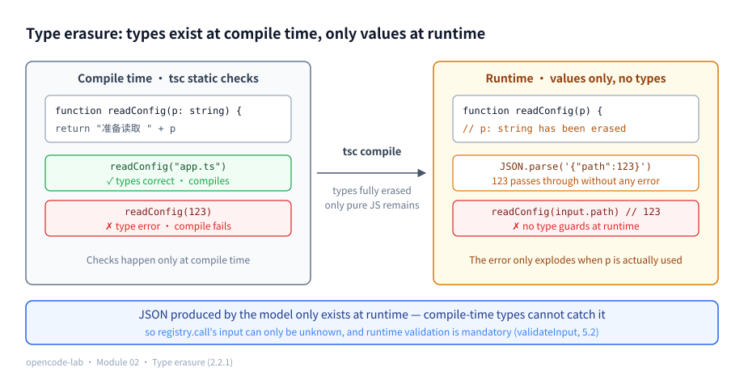
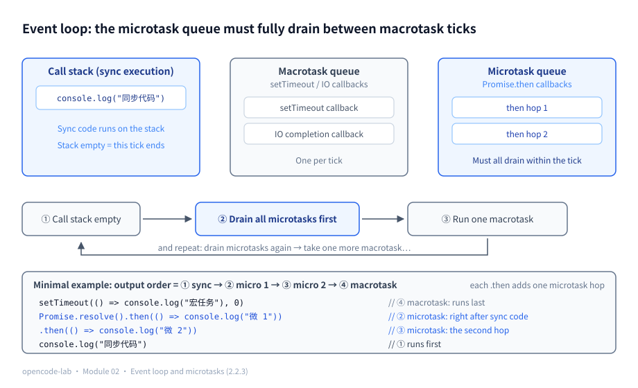
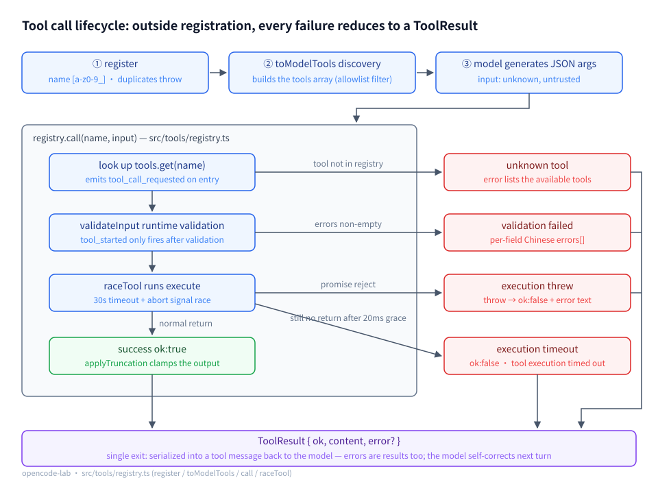
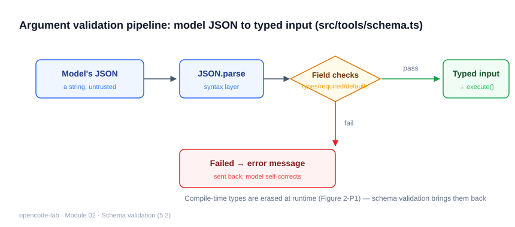
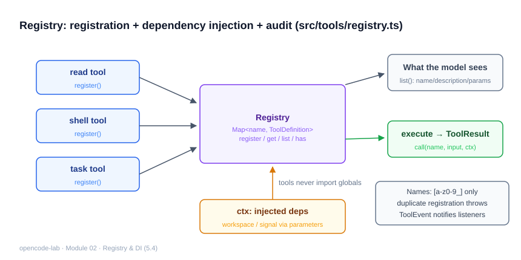
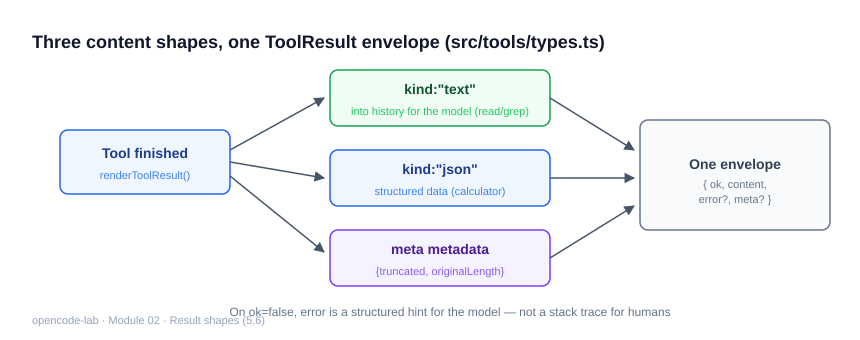
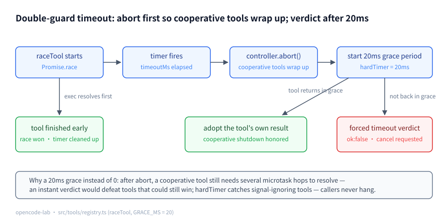

# Chapter 2: Tool Protocol, Schema, and Registry

## 1. Chapter positioning

- Module: 02 Tool Protocol / Registry
- Study time: 6–8 hours (including the Section 2 prerequisites)
- Difficulty: medium — Section 2 builds five foundations from scratch (type erasure, idempotency, microtasks, closures, the observer pattern), and every design judgment and coding pattern in this chapter rests on them
- Prerequisite chapter: Chapter 1 (the Provider's `ToolDefinitionForModel` type)
- Corresponding OpenCode commit: `70a24697ea0028e19f22712fd63059538cb4bee7`
- Corresponding project stage: `v0.3-tools`

## 2. Prerequisites

> This chapter starts writing the code that catches "the model's output". Five foundations are taught **from scratch**: **type erasure** (why TS cannot help at runtime — the foundation of this chapter's first design judgment), **idempotency** (why some tools must not be retried carelessly), **the event loop and microtasks** (the complete theory behind the 20ms grace period), **closures and factory functions** (how the Registry is implemented), and **the observer pattern** (how audit events are implemented). The first two determine "why this chapter is designed this way"; the last three determine "why this chapter's code is written this way".

### 2.1 Glossary for this chapter

| Term | Plain-language one-liner | Where this chapter uses it |
|---|---|---|
| Type erasure | TS types exist only at compile time; at runtime they are "erased" and nothing gets stopped | 2.2.1, 5.2 |
| `unknown` / `any` | a safe placeholder for "don't know what this is" / the escape hatch that turns checks off | 5.1 `input: unknown` |
| JSON Schema | an industry-standard vocabulary describing "what valid JSON looks like" | 5.2 |
| Ajv / Zod | the mainstream JSON Schema validator / a TS-first schema library (one definition yields both the type and the validator) | 5.2 (where they fit) |
| Idempotency | whether doing the same operation once or many times produces the same result | 2.2.2, 5.7 |
| Replay | the upper layer executes an already-executed call again (happens in crash recovery and retries) | 5.7 |
| Event loop | JS's single-threaded dispatcher: takes tasks in turn and runs them | 2.2.3 |
| Macrotask / microtask | a two-level task queue: timers and IO callbacks are macrotasks; Promise callbacks are microtasks, fully drained between macrotask ticks | 2.2.3, 5.7 |
| `Promise.race` | several Promises race; whoever settles first (success or failure) decides the outcome | 5.7 double-guard timeout |
| AbortSignal / cooperative cancellation | broadcasts a "stop doing that" signal; the receiver chooses its own moment to stop | 5.7 |
| Closure | a function remembers the variable environment it was born in | 2.2.4, 5.4 |
| Factory function | called once, returns an object carrying private state | 2.2.4, 5.4 |
| `ReturnType<typeof f>` | lets TS infer the type backwards from a function's return value | 5.4 |
| Observer pattern (pub-sub) | keeps an array of listeners and notifies each one when an event fires | 2.2.5, 5.8 |
| Single source of truth | exactly one place in the project knows a given class of facts; everything else asks it | 5.4 |
| few-shot prompting | putting examples directly in the prompt so the model imitates them | 5.3 |
| Recursive-descent parser | per the grammar, a small set of mutually calling functions that consume tokens one by one | Section 9 |
| Audit event / trace | structured behavior records / using callId to chain one call's records into a thread | 5.8 |
| Discriminated union / narrowing | a multi-shape type with a tag field / after an `if` check the compiler automatically excludes branches (covered in Chapter 0, 2.2.1) | 5.1, 5.5 |

### 2.2 Foundations

#### 2.2.1 Type erasure: the security gate only opens at compile time

**Plain-language definition**: TS type annotations exist only during compilation; after compiling (or running directly with Bun), all type information is erased from the executed code — at runtime it is exactly the same JavaScript as if you had never written annotations.

Run a counterexample first (save as `demo.ts`, run with `bun demo.ts`):

```ts
function readConfig(path: string) {
  return `准备读取 ${path}`
}
const input = JSON.parse('{"path": 123}') // at runtime this is just { path: 123 }; the compiler never sees it
console.log(readConfig(input.path))       // prints "准备读取 123" as usual, with no error at all
```

```text
Output (excerpt):
准备读取 123
```

(The process exits normally with no error at all — the "prints as usual" claimed in the comment is the real result of running it, not a hypothesis.)

`readConfig` clearly declares `path: string`, yet the incoming 123 sails straight through. The reason, in two steps:

1. Writing `readConfig(123)` directly gets intercepted by `tsc` — **the check only happens at compile time**;
2. Here 123 comes from `JSON.parse`; the data is "born" out of a string and the compiler has never seen it — **at runtime there is no type information available, so the annotation is effectively decorative**.

The danger comes in the second half: a wrongly-typed value lies dormant until the code actually uses string methods (say `path.split("/")` throws a `TypeError` on 123), and by then the crime scene is several call frames away. This chapter's `registry.call` receives `input` that is exactly such data — it comes from model-generated JSON (Chapter 1's `collectTurn` just assembled the fragments into it), so the only honest static type is `unknown`.

**`unknown` vs `any`**: both can hold a "don't know what this is" value; the difference is how you may treat it afterwards —

```ts
const a: any = input
a.foo.bar.baz // the compiler stays silent; it blows up at runtime — any is the escape hatch that turns checks off

const u: unknown = input
u.foo // compile error: nothing is allowed directly on unknown — prove the shape before using it
```

`unknown`'s attitude is "admit ignorance, narrow before use"; `any`'s is "stop asking, just use it". For all boundary data (model input, network responses), this project always uses `unknown` + runtime validation — `validateInput` in 5.2 is exactly that checkpoint.



*Figure 2-P1: Type erasure — at compile time `tsc` can intercept `readConfig(123)`, but after compilation all types vanish and the runtime executes `{path:123}` without complaint; therefore JSON coming from the model must be validated at runtime.*

#### 2.2.2 Idempotency: is doing it once the same as doing it many times?

**Plain-language definition**: idempotent means performing the same operation once or many times yields the same final result. An elevator button is idempotent — press once or five times in a row, the elevator comes once; an ATM transfer is not — confirming twice moves money twice. A minimal function for each property, side by side for comparison:

```ts
let saved = false
function saveOnce() {
  // idempotent: repeat calls are harmless — the second call returns immediately
  if (saved) return
  saved = true
  console.log("写入")
}
let lines = 0
function appendLog() {
  // not idempotent: each call appends one more line
  lines++
}
```

The web world knows this pair well: HTTP GET is idempotent (refresh the page a hundred times, server state unchanged), POST is not (submit the form a hundred times, a hundred orders) — "will double-clicking the submit button place duplicate orders" is an idempotency question.

**How this chapter uses it**: calculator is naturally idempotent — `(1+2)*3` evaluates to 9 however many times you run it; write/shell are not — writing a file twice or executing a command twice stacks side effects. Section 5.7 connects this property to "does the upper layer dare replay a tool call".

#### 2.2.3 Event loop, macrotasks, and microtasks: the "hops" of a Promise chain

**Plain-language definition**: JS is single-threaded and relies on the **event loop**, a dispatcher that runs tasks in turn. Tasks live in a two-level queue: **macrotasks** (`setTimeout` callbacks, IO completion callbacks) run one per tick; **microtasks** (Promise `.then` callbacks) have higher priority — **after each macrotask tick ends and before the next begins, the microtask queue must be fully drained**.

Run it and you can feel it (output order in the comments):

```ts
setTimeout(() => console.log("宏任务"), 0)
Promise.resolve().then(() => console.log("微任务第 1 跳"))
  .then(() => console.log("微任务第 2 跳"))
console.log("同步代码")
// output: 同步代码 -> 微任务第 1 跳 -> 微任务第 2 跳 -> 宏任务
```

```text
Output (excerpt):
同步代码
微任务第 1 跳
微任务第 2 跳
宏任务
```

(The real execution order matches the comment: sync code first, then both microtask hops fully drained before the macrotask.)

**What "a few more microtask hops in the Promise chain" means**: every `.then` attached to the chain adds one more microtask hop before the result reaches its destination. A tool that must "clean up and then return" after receiving a cancellation signal may be 2–4 microtask hops away from the signal before it truly resolves.

**`Promise.race`**: put several Promises in a race together; **whoever settles first (success or failure)** decides the whole race's outcome, and the losers' later results are simply ignored.

Assembling the three pieces gives the foreshadowing for 5.7: in the timeout race, "time is up" happens in a macrotask (the timer callback), while a cooperative tool's "wrap-up complete" happens several microtask hops later — if we declared timeout the instant the timer fired, the wrap-up would lose to the timer every time; granting a short grace period (20ms — an eternity for microtasks, imperceptible to the caller) makes both sides' timing work out.



*Figure 2-P2: The event loop — once the call stack empties, all microtasks drain first, then one macrotask is taken; each `.then` on a Promise chain adds a microtask hop, hence the output order sync → micro 1 → micro 2 → macrotask.*

#### 2.2.4 Closures and factory functions: a private little box hidden inside a function

**Plain-language definition**: a **closure** means a function remembers the variable environment it was born in — after the outer function returns, the inner function can still read and write the outer variables. A **factory function** exploits exactly this: "call it once, get back an object with private state".

```ts
function makeCounter() {
  let n = 0 // private state hidden inside the closure
  return () => ++n
}
const next = makeCounter()
next() // 1
next() // 2 — n is remembered, yet the outside world cannot touch it
```

**Compared with class**: a class declares privacy with the `private` keyword; a factory function achieves privacy through "out of scope, out of reach" — the variable lives inside the function body, no outside name can reference it, and you literally cannot write the code to bypass it. The two are equivalent in power, and the factory function also skips a layer of `this`.

**`ReturnType<typeof makeCounter>`**: lets TS **infer backwards** the type from a function's return value, so you never hand-write an identical interface:

```ts
function makeCounter() {
  let n = 0
  return () => ++n
}
type Next = ReturnType<typeof makeCounter> // () => number — derived automatically; change the function without touching the type
```

The `ToolRegistry` type in 5.4 is derived exactly this way.

#### 2.2.5 The observer pattern: keep a listener array, notify each in turn

**Plain-language definition**: the **observer pattern** (publish-subscribe) is the most common decoupling idiom: the owner of the data only "announces that an event happened", caring nothing about who listens or what they do with it; anyone interested registers in advance (subscribes) and gets called one by one when events arrive. The minimal implementation is just a listener array plus the two methods `on`/`emit`:

```ts
function createBus() {
  const listeners: ((msg: string) => void)[] = [] // the listener array
  return {
    on(l: (msg: string) => void) {
      listeners.push(l) // subscribe
    },
    emit(msg: string) {
      for (const l of listeners) l(msg) // notify each in turn
    },
  }
}
const bus = createBus()
bus.on((m) => console.log(`[日志] ${m}`))
bus.emit("hello") // [日志] hello
```

**How this chapter uses it**: the Registry's `onEvent` + `emit` is exactly this (5.8) — audit events are what gets "published"; logs, metrics, and test assertions are all "subscribers".

### 2.3 Recap of the previous module

- Chapter 1's `collectTurn` assembled the **fragments** of streaming tool arguments into complete JSON and then `JSON.parse`d it into an object — so the `input` this chapter's `registry.call` receives is `unknown` where "any shape may appear" (the 2.2.1 counterexample is its daily reality);
- The `LlmError` discriminated union used `kind` + `retryable` to drive retry decisions; this chapter applies the same move to tool results — `ToolResult.ok` + `error` text: **errors are data too**;
- The Mock Provider's deliberately-fragmented testing philosophy carries over into this chapter: every failure path (unknown tool / bad arguments / thrown exception / timeout) must be genuinely driven by a test, not just the happy path.

---

## 3. Learning goals

- Understand: the full tool calling lifecycle (register → discover → model generates arguments → runtime validation → execute → result/error returned); why "TS compile-time checks" are useless for model output.
- Be able to implement: tool self-description (JSON Schema), the registry (name constraints / conflict detection), a runtime validator, double-guard timeout, output truncation, audit events.
- Be able to test: with bad inputs (unknown tool / missing params / wrong types / thrown exceptions / timeouts), verify that every failure path returns a structured result.
- Be able to explain: why tool errors are "returned to the model" instead of thrown at the user.

## 4. Problem statement

The tool arguments a model returns are **untrusted input**: fields may be missing, types wrong, hallucinated parameter names may appear, and it may not even be valid JSON. Tools themselves may throw exceptions or loop forever. OpenCode's answer, in `packages/opencode/src/tool/tool.ts` + `registry.ts` + `schema.ts`, is to converge all of this into one protocol:

```text
Model generates JSON arguments
  -> Registry.call(name, input)
  -> runtime schema validation (trust no input)
  -> execute(input, ctx) (with timeout/cancellation)
  -> ToolResult { ok, content, error? }
  -> serialized into a tool message and returned to the model
```

The key design judgment: **errors are results too**. Validation failures, tool crashes, and timeouts all become `ok:false + error text` returned to the model, and the model self-corrects in the next round (different arguments, a different tool, or asking the user for help). Only when this path works smoothly can an Agent be "multi-step".

## 5. Core concepts

Section 8.3 of the design blueprint lists 8 mandatory knowledge points for this chapter. First the mapping table "knowledge point ↔ source file ↔ test file" (paths relative to `opencode-lab/`), then each point in turn:

| # | Knowledge point | Main source | Tests |
|---|---|---|---|
| 1 | The full tool calling lifecycle | `src/tools/types.ts`, `src/tools/registry.ts` | `test/tools/registry.test.ts` |
| 2 | JSON Schema / Zod and other schema technologies | `src/providers/types.ts`, `src/tools/schema.ts` | `test/tools/schema.test.ts` |
| 3 | Tool name, description, and parameter design | `src/tools/registry.ts`, `src/tools/echo.ts`, `src/tools/calculator.ts` | `test/tools/registry.test.ts`, `test/tools/builtin.test.ts` |
| 4 | Registry, dependency injection, and lifecycle | `src/tools/registry.ts` | `test/tools/registry.test.ts` |
| 5 | Argument parsing, default values, type narrowing, and errors | `src/tools/schema.ts` | `test/tools/schema.test.ts` |
| 6 | Expressing tool results as text, JSON, files, and artifacts | `src/tools/types.ts`, `src/tools/calculator.ts` | `test/tools/builtin.test.ts` |
| 7 | Idempotency, timeout, cancellation, and max output | `src/tools/registry.ts`, `src/tools/truncate.ts` | `test/tools/registry.test.ts` |
| 8 | Tool audit events and trace | `src/tools/registry.ts` | `test/tools/registry.test.ts` |

### 5.1 The full tool calling lifecycle

**Concept**

In an ordinary program "calling a function" is a one-step operation; in an Agent, "calling a tool" is a chain across five stages: **registration** (the developer hands the tool definition to the Registry) → **discovery** (the Registry turns the tool list into the `tools` array of the Provider request, so the model knows what it can use) → **model generates arguments** (the model outputs a piece of JSON text declaring which tool it wants to call with which arguments) → **runtime validation and execution** (the Registry looks up the table, validates, and executes `execute` under a timeout) → **result returned** (the `ToolResult` is serialized into a tool message and enters the next conversation round).

The reason to teach this as a "lifecycle" is that each stage fails completely differently: duplicate or illegal names at registration are developer bugs and should fail fast; model generation produces hallucinated arguments, illegal JSON, and type mismatches; execution throws exceptions, times out, and explodes in output size. Only when the stages are drawn clearly can each failure path land in its right place — hence this chapter's core judgment: **except during registration, every failure converges into an `ok:false` ToolResult returned to the model**, not thrown at the caller. Only by seeing structured errors can the model self-correct in the next round; the Agent's "multi-step" ability is built on exactly this path.

**How this project implements it**

`src/tools/types.ts` defines the protocol, and `call` in `src/tools/registry.ts` is the chain's skeleton. First the protocol itself — five fields, one job each: `name`/`description` for model "discovery", `parameters` for runtime validation, `risk` for the permission layer's policy, and `execute` as the only active part that touches the real world:

```ts
export type ToolDefinition = {
  // unique name, [a-z0-9_], validated at registration
  name: string
  description: string
  parameters: ToolParameters
  // risk tier for the permission layer (Module 06) to decide the default policy
  risk: ToolRisk
  execute(input: Record<string, unknown>, ctx: ToolContext): Promise<ToolResult>
}
```

(All you need to know about `risk` right now: it marks how dangerous this tool is, so the later permission layer can decide "allow by default or ask the user first" — expanded in Chapter 6.)

Now the first half of `call` (`src/tools/registry.ts`) — the "discovery failure" and "validation failure" branches both end before `execute`:

```ts
  async function call(name: string, input: unknown, ctx: ToolContext): Promise<ToolResult> {
    const callId = `tool_${++callCounter}`
    const at = () => new Date().toISOString()
    emit({ type: "tool_call_requested", tool: name, input, callId, at: at() })

    const tool = tools.get(name)
    if (!tool) {
      const available = [...tools.keys()].join(", ") || "无"
      const error = `未知工具: ${name}。可用工具: ${available}`
      emit({ type: "tool_failed", tool: name, callId, error, at: at() })
      return { ok: false, content: { kind: "text", text: "" }, error }
    }

    const validated = validateInput(tool.parameters, input)
    if (!validated.ok) {
      const error = `参数校验失败: ${validated.errors.join("; ")}`
      emit({ type: "tool_failed", tool: name, callId, error, at: at() })
      return { ok: false, content: { kind: "text", text: "" }, error }
    }

    emit({ type: "tool_started", tool: name, callId, at: at() })
```

Three details worth chewing on: first, the static type of `input` is `unknown` — it comes from model-generated JSON, and before validation no assumption is allowed (2.2.1 covered why types cannot help here); second, validation failure happens **before** `tool_started`, and `execute` is never called, so the audit event stream alone distinguishes "call failed" from "execution failed" after the fact; third, no branch of the function ever throws — everything returns a structured result, so the caller (the Agent Loop) can be written as pure sequential logic. The second half (execution, timeout, truncation) is expanded in 5.7.

These two failure branches don't have to be imagined from source — run them for real (save as demo.ts under the `opencode-lab/` directory or execute with `bun -e`):

```ts
import { createToolRegistry } from "./src/tools/registry"
import { echoTool } from "./src/tools/echo"
import { calculatorTool } from "./src/tools/calculator"

const registry = createToolRegistry()
registry.register(echoTool)
registry.register(calculatorTool)

// ① missing required param: the validation branch intercepts before execute
const missing = await registry.call("echo", {}, { workspace: process.cwd() })
console.log(missing.ok, "|", missing.error)
// ② unregistered tool name: the lookup branch intercepts
const ghost = await registry.call("ghost", {}, { workspace: process.cwd() })
console.log(ghost.ok, "|", ghost.error)
```

```text
Output (excerpt):
false | 参数校验失败: 缺少必填参数 "message"
false | 未知工具: ghost。可用工具: echo, calculator
```

Both failures return `ok:false` + Chinese error text, and the process threw no exception. The second error carries the list of available tools — once the model sees it, it knows which tool to switch to next round; this is exactly "errors are raw material for self-correction".



*Figure 2-1: The complete lifecycle from registration to result return; the four failure paths and the success path all reduce uniformly to a ToolResult.*

**Common pitfalls**

- **Symptom**: assuming the Provider validates arguments for you. **Cause**: the `tools` in an OpenAI/Anthropic request is just "an instruction sheet for the model to read"; the server does not intercept schema-violating output. **Fix**: validation can only happen in your own runtime, inside `registry.call`.
- **Symptom**: treating "tool not found" and "tool execution failed" as the same kind of error. **Cause**: not distinguishing lifecycle stages. **Fix**: the former fails before `tool_started`, the latter after it; the audit event stream can tell them apart.
- **Symptom**: `throw`ing directly on validation failure. **Cause**: carrying over programming instinct. **Fix**: throwing takes the "tool crashed" branch and loses the per-field errors; return the `errors[]` array instead.

**Self-check questions**

1. Which three audit events does a successful `registry.call` emit, in order?
   > Key points: `tool_call_requested` → `tool_started` → `tool_finished` (matches the test "audit events emitted in order").
2. When validation fails, did `execute` run? What is the evidence?
   > Key points: no; the `return` happens before `emit tool_started`.
3. Why does the unknown-tool error carry the list of available tools?
   > Key points: the error text goes back to the model; the list lets the model pick the right tool next round (raw material for self-correction).

### 5.2 JSON Schema / Zod and other schema technologies

**Concept**

First, where each of the three terms fits: **JSON Schema** is a declarative vocabulary for describing JSON structure — keywords like `type`/`properties`/`required`/`enum` state "what valid data looks like"; it can both be embedded into a Provider request for the model to generate against and be used programmatically for runtime validation. **Ajv** is the mainstream validator implementation for JSON Schema (it compiles a schema into a fast validation function). **Zod** is a TS-first schema library — one definition derives both the compile-time type and the runtime validator. In one sentence: JSON Schema is the "vocabulary standard"; Ajv/Zod are "ready-made wheels".

Why must an Agent have schema technology? Look back at the 2.2.1 counterexample: type annotations are erased at runtime, and `{path:123}` walks straight into a function that declares `path: string` — and model output is exactly such data, "born" out of network JSON, never seen by the compiler. So "without runtime schema validation, so-called type safety is an illusion" is not rhetoric but literal fact: **what the compiler checks is always "how our own code uses this value", never "the value itself that the model gave us"**. To intercept the latter, you must set another checkpoint at runtime. Production projects use Ajv or Zod; the teaching version deliberately hand-writes a subset validator so that every step of "validating model input at runtime" stays visible and testable.

**How this project implements it**

The teaching schema subset is declared in `src/providers/types.ts` (seen in Chapter 1); it covers exactly what the Provider request needs:

```ts
export type ToolParamSchema = {
  type: "string" | "number" | "boolean" | "array" | "object"
  description?: string
  enum?: (string | number)[]
  items?: ToolParamSchema
}

export type ToolParameters = {
  type: "object"
  properties: Record<string, ToolParamSchema>
  required?: string[]
}
```

The validator lives in `src/tools/schema.ts`; the entry point is a pure function, and both success and failure travel through the return value:

```ts
export function validateInput(schema: ToolParameters, input: unknown): ValidationResult {
  if (typeof input !== "object" || input === null || Array.isArray(input)) {
    return { ok: false, errors: ["工具参数必须是一个 JSON 对象"] }
  }
  const errors: string[] = []
  const record = input as Record<string, unknown>
  const allowed = Object.keys(schema.properties)

  for (const key of Object.keys(record)) {
    if (!allowed.includes(key)) {
      errors.push(`未知参数 "${key}"（允许的参数: ${allowed.join(", ") || "无"}）`)
    }
  }
```

Note how the error messages are written: field names, allowed values, written in Chinese for the **model** to read — this is raw material for self-correction, not a developer log. `items` supports recursive validation of array elements (errors shaped like `"tags[1]"`); `type: "object"` in the teaching version only checks shape and does not recurse into sub-schemas — sufficient, with clear boundaries; a production version would complete it with Ajv/Zod.



*Figure 2-3: The argument validation pipeline — the model's JSON is parsed first, then validated field by field (types/required/defaults); on failure the structured error explanation is returned so the model can self-correct next round; only after passing does strongly-typed input enter execute — schema is the only channel that invites compile-time types "back" into the runtime.*

**Common pitfalls**

- **Symptom**: believing that defining a TS interface equals having validation. **Cause**: unaware of type erasure (the 2.2.1 counterexample is the evidence). **Fix**: interfaces exist only at compile time; at runtime a function like `validateInput` must stand guard.
- **Symptom**: after adopting Ajv/Zod, passing the library's English errors straight back to the model. **Cause**: default library errors address developers. **Fix**: error messages are part of the prompt — write them as sentences (in Chinese) the model can act on to fix its arguments.
- **Symptom**: writing schemas too loosely (all-optional strings). **Cause**: fear of model mistakes. **Fix**: the more precise the constraints, the higher the model's one-shot success rate; `required` and `enum` are free prompt engineering.

**Self-check questions**

1. What does the teaching schema subset support, and how does it differ from full JSON Schema?
   > Key points: type/required/enum/items/description; it does not support nested object sub-schemas, pattern, minLength, or other advanced keywords.
2. What does `validateInput(schema, [1,2])` return?
   > Key points: `ok:false` with the error "工具参数必须是一个 JSON 对象" — arrays and null do not count as a valid top-level object.
3. Why is the validator designed as a pure function instead of a validator class?
   > Key points: stateless and independently testable (the 9 cases in `schema.test.ts` never go through the Registry); the Registry handles composition, the validator only judges once.

### 5.3 Tool name, description, and parameter design

**Concept**

A tool's `name`/`description`/per-parameter `description` are not documentation — they are **part of the prompt**: the model relies entirely on them to decide "when to use this tool and what arguments to pass". A vague description directly causes the wrong tool to be chosen or wrong arguments passed, and then a whole conversation round is wasted on correction. Naming needs engineering constraints: names get embedded in prompts, logs, and permission rules, the charset must be controllable, and names must be unique. The principle of parameter design differs from writing an API — API parameters are written for programmers (with IDE completion); tool parameters are written for a probability sampler (it only sees text), so putting examples, enums, units, and boundaries into the description beats any type declaration.

**How this project implements it**

The name constraint lives in `src/tools/registry.ts`, validated immediately at registration (fail fast):

```ts
const NAME_PATTERN = /^[a-z0-9_]+$/

  function register(tool: ToolDefinition) {
    if (!NAME_PATTERN.test(tool.name)) {
      throw new Error(`工具名称 "${tool.name}" 不合法，只允许 [a-z0-9_]`)
    }
    if (tools.has(tool.name)) {
      throw new Error(`工具已注册: ${tool.name}`)
    }
    tools.set(tool.name, tool)
  }
```

`NAME_PATTERN` is readable with the regex knowledge from Chapter 0, 2.2.5: `^` and `$` are the start/end anchors (the whole string must match), `[a-z0-9_]` is a character class (one lowercase letter, digit, or underscore), and `+` means the previous item appears at least once — combined: "the whole string consists only of lowercase letters, digits, and underscores, and is non-empty".

The templates for description design are the two built-in tools. `src/tools/echo.ts` states semantics and purpose in one sentence: "return the input text as-is; used to test whether the tool call pipeline works." `src/tools/calculator.ts` puts a format example directly into the description — this is called **few-shot prompting** (rather than describing the format with rules, just place an example for the model to imitate), which preempts format trial-and-error on the model's behalf:

```ts
  description: "计算整数与小数的四则运算表达式，支持 + - * / % 和括号。例如 (1+2)*3",
  parameters: {
    type: "object",
    properties: {
      expression: { type: "string", description: "算术表达式，例如 (1+2)*3 或 10 % 3" },
    },
    required: ["expression"],
  },
```

Note the contrast between the two registration-time throws and `call`'s "never throw": registration is developer code, and mistakes should blow up at startup; model input is the untrusted data that deserves gentle treatment.

**Common pitfalls**

- **Symptom**: a one-line vague description written for humans ("handles files"). **Cause**: not realizing this is the prompt. **Fix**: state the semantics, applicable scenarios, and division of labor with other tools, and give parameter examples.
- **Symptom**: camelCase, spaces, or hyphens in tool names. **Cause**: reusing function-naming habits. **Fix**: the `[a-z0-9_]` allowlist charset, validated at registration, prevents ambiguity or injection surface when names enter prompts/rule files.
- **Symptom**: silently overwriting the old tool on duplicate registration. **Cause**: taking the shortcut with `map.set`. **Fix**: throw on the same name so configuration errors surface immediately at startup (the test "duplicate registration of the same tool name throws").

**Self-check questions**

1. Why does the name constraint throw inside `register`, while argument validation returns structured errors?
   > Key points: the former is a developer bug (fail fast); the latter is untrusted runtime input (returned to the model).
2. Why does calculator's description include "e.g. (1+2)*3"?
   > Key points: the example is few-shot; the model generates correctly formatted expressions from it, saving a round of trial and error.
3. Is a parameter's `description` field used by the validator?
   > Key points: no; it only enters the Provider request via `toModelTool`, and its audience is the model.

### 5.4 Registry, dependency injection, and lifecycle

**Concept**

The Registry is the **single source of truth** for tools — in plain words: exactly one place in the project knows "which tools exist right now", and anything elsewhere that wants to know about tools must ask it, avoiding multiple ledgers that each tell their own story. Registration, discovery, invocation, and the cross-cutting policies (timeout, truncation, audit events) all converge in this one object. It is also the dependency injection boundary — the Agent Loop, the permission layer, and MCP adapters depend only on `registry.call` and `registry.toModelTools`, never importing concrete tool files; that way "swapping in a batch of tools" or "trimming the tool list per Agent" requires no changes to callers. For its lifecycle, the Registry follows "assemble at startup, read-only at runtime": tools are registered at application startup, after which the registry never changes, and every `call` is just a table lookup plus execution. The implementation uses a **factory function + closure** (2.2.4) rather than a class: the `Map`, the listener array, and the call counter are all locked inside the closure, the outside world can only reach them through the returned methods, and state privacy is guaranteed by the way the object is constructed.

**How this project implements it**

The factory function in `src/tools/registry.ts` gathers all state into the closure:

```ts
export function createToolRegistry(options: RegistryOptions = {}) {
  const timeoutMs = options.timeoutMs ?? 30_000
  const maxOutputChars = options.maxOutputChars ?? 20_000
  const tools = new Map<string, ToolDefinition>()
  const listeners: ToolListener[] = []
  let callCounter = 0
```

Compare 2.2.4's `makeCounter`: `callCounter` is that `n` — hidden in the closure, readable and writable only through the returned methods. External capabilities are exposed through the returned object, with the type derived directly via `ReturnType` (2.2.4 covered the benefit: the factory's returned shape is the interface, no parallel definition to maintain):

```ts
  return {
    register,
    registerAll,
    list,
    has,
    toModelTools,
    call,
    onEvent(listener: ToolListener) {
      listeners.push(listener)
    },
  }
}

export type ToolRegistry = ReturnType<typeof createToolRegistry>
```

`toModelTools` is the injection point of the "discovery layer": it exports all tools by default but can also filter by allowlist — the foundation of "each Agent only sees its own tool allowlist" in Module 10 (expanded in Chapter 10; for now just know: the list only affects what the model can **see**):

```ts
  // build the tools array for the Provider request; filterable by allowlist (Module 10's per-Agent tool allowlist)
  function toModelTools(allowed?: string[]) {
    const defs = allowed ? allowed.map((name) => tools.get(name)).filter((t) => t !== undefined) : list()
    return defs.map(toModelTool)
  }
```



*Figure 2-4: The Registry — a Map from name to definition (duplicate registration throws immediately, names limited to [a-z0-9_]); register adds / list shows the model the inventory / call executes and normalizes into a ToolResult; tool dependencies are injected via ctx rather than imported globally, and ToolEvent notifications reach listeners for auditing.*

**Common pitfalls**

- **Symptom**: writing a class and making the `tools` Map public. **Cause**: the encapsulation boundary was never thought through. **Fix**: any code that executes `execute` directly, bypassing `call`, skips validation/timeout/auditing; closure privacy makes "no way around it" a fact.
- **Symptom**: creating a global Registry at module top level and registering tools into it. **Cause**: convenience. **Fix**: tests pollute each other (say `maxOutputChars` was changed by a previous case); each test/app creates its own `createToolRegistry()`.
- **Symptom**: believing that the `toModelTools(["a"])` allowlist can stop the model calling tool b. **Cause**: conflating the "discovery layer" with the "execution layer". **Fix**: it only filters the list the model can see; enforcement at execution time is the permission layer's job (Module 06) — expanded in Chapter 6; for now just know "visible ≠ callable".

**Self-check questions**

1. Where does `callCounter` live, and why does it guarantee globally increasing unique callIds?
   > Key points: a closure variable; all `call`s on the same Registry instance share one `++callCounter` (matches the test "callId globally increasing and unique").
2. Why is the `ToolRegistry` type `ReturnType<typeof createToolRegistry>` instead of a hand-written interface?
   > Key points: the factory's returned shape is the interface; hand-writing adds a parallel definition to keep in sync, and the project style also avoids unnecessary interfaces.
3. What is the Registry's "lifecycle"?
   > Key points: assembled at startup (register/registerAll), read-only table lookup at runtime; no runtime deregistration or hot swapping — the simplicity is deliberate.

### 5.5 Argument parsing, default values, type narrowing, and errors

> 📊 Figure: for the validation pipeline from JSON to strongly-typed data see Figure 2-3 in Section 5.2 — this section's default values and narrowing happen at its "field checks" step.

**Concept**

The "error report" produced after failed validation is one of this chapter's most important artifacts. Three design points: **collect all errors in one pass** (how many required fields are missing, how many types are wrong — say it all at once to reduce model round trips); **errors address the model** (in Chinese, with field names and allowed values, so the model can fix things directly); **errors and values travel on separate branches** (`ok:true` carries `value`, `ok:false` carries `errors[]`; the caller narrows with the discriminated union, no try/catch needed).

The third point deserves its own spotlight — **why not try/catch**? In plain words: branching means the "value carried on success" and the "error carried on failure" sit in different variants of the same return type, and the caller checks the variant before reading the payload. try/catch has three unpatchable holes for this job:

```ts
// try/catch version: TS cannot force the caller to catch; a missed catch throws straight through the roof
function parse(s: string): number {
  throw new Error("缺 path") // the failure exit hides anywhere in the body
}
// branching version: without checking ok first, the compiler won't let you read value (narrowing from Chapter 0, 2.2.1)
// { ok: true; value: X } | { ok: false; errors: string[] }
```

① **No type defense**: the compiler doesn't care whether you catch; miss it and the exception tears through at runtime; in the branching version you cannot read `value` without checking `ok` — a compile error outright. ② **Control-flow jumps**: a throw flies out from the middle of the function, and while reading the code the failure exit is invisible; the branching version's failure exit is written right in the return type. ③ **One throw at a time**: three wrong fields still report only the first (unless you build a custom aggregate error class); `errors[]` naturally holds many.

Default values and type narrowing sit downstream of validation: the teaching validator does not support `default` (left as Exercise 3), "supply a default when an optional parameter is absent" is handled by each tool layer on its own; after validation passes, `value` is still `Record<string, unknown>`, and tools narrow explicitly with `String(input.x)`, `typeof === "number"` — the validator guarantees the type contract while the tool code stays defensive; the two layers do not conflict.

**How this project implements it**

The three loops in `src/tools/schema.ts` handle unknown parameters, missing required fields, and per-field types respectively:

```ts
  for (const key of schema.required ?? []) {
    if (!(key in record)) errors.push(`缺少必填参数 "${key}"`)
  }

  for (const [key, value] of Object.entries(record)) {
    const prop = schema.properties[key]
    if (!prop) continue // unknown param already reported
    const violation = checkValue(key, value, prop)
    if (violation) errors.push(violation)
  }

  return errors.length > 0 ? { ok: false, errors } : { ok: true, value: record }
```

The type check `checkValue` recurses into arrays element by element, with the index in the error message (`"tags[1]"`), so the model can pinpoint which element is wrong:

```ts
  if (prop.type === "array") {
    if (!Array.isArray(value)) return `参数 "${key}" 必须是数组`
    if (!prop.items) return undefined
    for (const [i, item] of value.entries()) {
      const violation = checkValue(`${key}[${i}]`, item, prop.items)
      if (violation) return violation
    }
    return undefined
  }
```

The Registry merges `errors[]` into a single error text for the return trip (see 5.1's `参数校验失败: ...`); for in-tool narrowing see `src/tools/echo.ts`: `String(input.message)`. Next chapter's `read.ts` will show the complete `clampInt(value, fallback, min, max)` pattern of "parse + default + clamp".

"Collect all errors in one pass" and "errors and values on separate branches" verified with real calls (run under the `opencode-lab/` directory):

```ts
import { validateInput } from "./src/tools/schema"
import { echoTool } from "./src/tools/echo"

console.log(JSON.stringify(validateInput(echoTool.parameters, { message: 123, extra: true })))
console.log(JSON.stringify(validateInput(echoTool.parameters, { message: "hi" })))
```

```text
Output (excerpt):
{"ok":false,"errors":["未知参数 \"extra\"（允许的参数: message）","参数 \"message\" 必须是字符串"]}
{"ok":true,"value":{"message":"hi"}}
```

The first line: one invalid input brings back two errors (unknown param + wrong type), so the model can fix everything in a single round; on the second line, only the `ok:true` branch carries `value` — without checking `ok` first, this field is simply unreachable.

**Common pitfalls**

- **Symptom**: returning on the first error found. **Cause**: the "fail fast" instinct. **Fix**: every model conversation round is expensive; only all-errors-at-once gets fixed in one round (the test "type errors reported per field" asserts three fields appear together).
- **Symptom**: after validation passes, using `input.path` directly as a string. **Cause**: assuming validation equals narrowing. **Fix**: what the validator guarantees is "the contract holds"; tool code should still read values explicitly with `String(input.path)`, defending against future schema changes.
- **Symptom**: wrapping validation in `try/catch` and passing errors by exception. **Cause**: not internalizing the three holes above. **Fix**: the `ValidationResult` discriminated union lets the caller narrow with `if (!validated.ok)`; errors are ordinary return values.

**Self-check questions**

1. For the all-wrong input `{ path: 123, line: "x", force: "yes" }`, how many entries land in errors?
   > Key points: 3, reported per field (one each for `"path"`, `"line"`, `"force"`).
2. Why reject unknown parameters instead of ignoring them?
   > Key points: an unknown parameter is almost certainly a hallucinated parameter name; silently ignoring it makes the model believe it passed the right thing, and the error persists until the task fails.
3. Why is default-value support Exercise 3 rather than part of the core validator?
   > Key points: the teaching version secures the minimal testable core first; default is a pure increment (fill in a value when the key is absent), well suited as a "write the test first, then change the implementation" exercise.

### 5.6 Expressing tool results as text, JSON, files, and artifacts

**Concept**

A tool result ultimately serializes into the conversation's tool message, and "which form expresses the result" directly affects how well the model understands it and the context cost. Common forms ascend in four levels: **text** (universal, what models read best), **JSON** (structured data that preserves field boundaries, more accurate for model extraction), **file references** (when results are too big, write to disk and return only the path and a summary), **artifacts** (product objects of production systems, carrying metadata, renderable by UIs). The teaching version implements the first two levels: `ToolResultContent` is a text | json discriminated union; files and artifacts are the production direction (OpenCode stores large output as files referenced from the message), but the idea that "output must have a budget, and big results cannot be stuffed wholesale back into context" is instilled from this chapter onward (5.7's truncation, Chapter 3's per-tool limits).

**How this project implements it**

The result content definition in `src/tools/types.ts` — four fields, one job each: `ok` for success/failure, `content` for what the model sees, `error` for the failure explanation given to the model, `meta` for metadata consumed by the runtime and tests:

```ts
export type ToolResultContent =
  | { kind: "text"; text: string }
  | { kind: "json"; data: unknown }

export type ToolResult = {
  ok: boolean
  content: ToolResultContent
  // structured error explanation for the model when ok=false (the model uses it to self-correct arguments next round)
  error?: string
  // metadata such as truncation info: { truncated: true, originalLength: 99999 }
  meta?: Record<string, unknown>
}
```

The two built-in tools happen to demonstrate the two forms: echo returns text (`src/tools/echo.ts`); calculator returns json, placing both expression and value into structured fields (`src/tools/calculator.ts`):

```ts
    return { ok: true, content: { kind: "json", data: { expression: input.expression, value: outcome.value } } }
```

What calculator's json form really returns (run under the `opencode-lab/` directory):

```ts
import { createToolRegistry } from "./src/tools/registry"
import { calculatorTool } from "./src/tools/calculator"

const registry = createToolRegistry()
registry.register(calculatorTool)
const ok = await registry.call("calculator", { expression: "(1+2)*3" }, { workspace: process.cwd() })
console.log(JSON.stringify(ok))
```

```text
Output (excerpt):
{"ok":true,"content":{"kind":"json","data":{"expression":"(1+2)*3","value":9}}}
```

Expression and value each occupy a structured field — when the model needs to extract `value`, it doesn't have to parse a number out of prose.

On the return side, the serialization rule lives in `renderToolResult` in `src/agent/loop.ts`: text as-is, json via `JSON.stringify(data, null, 2)`; **only `content` enters the model message**; `meta` is metadata consumed by the runtime, tests, and persistence. Truncation (5.7) also applies only to text content — for json results, the tool author guarantees the size.

What a failure looks like is also worth seeing with your own eyes once — division by zero is rejected at the parse stage (under the `opencode-lab/` directory, continuing right after the previous snippet):

```ts
const div0 = await registry.call("calculator", { expression: "1/0" }, { workspace: process.cwd() })
console.log(JSON.stringify(div0))
```

```text
Output (excerpt):
{"ok":false,"content":{"kind":"text","text":""},"error":"无法解析表达式: 1/0"}
```

`content` degrades to empty text, and the error travels separately in the `error` field — "errors are results too" holds at the tool-level failure as well; division by zero threw no exception.



*Figure 2-5: Three ToolResult content forms — kind:"text" for the model to read, kind:"json" for machines to consume, meta carrying truncation and other metadata; the uniform envelope { ok, content, error?, meta? } normalizes the success and failure paths, and error is a correction hint for the model rather than a stack trace for humans.*

**Common pitfalls**

- **Symptom**: `JSON.stringify`ing every result into one big string for the return trip. **Cause**: using only the text form. **Fix**: structured numbers/status use `kind:"json"`; the model extracts fields more accurately, and escaping noise disappears.
- **Symptom**: stuffing an entire file's content into content and hoping the model "picks out the highlights itself". **Cause**: no budget awareness. **Fix**: land big content on disk or truncate it; return a summary plus clues for further reading (Chapter 3's windowed read is exactly this idea).
- **Symptom**: believing the model sees `meta`. **Cause**: conflating runtime metadata with the conversation body. **Fix**: `renderToolResult` renders only `content`; truncation info the model needs must be appended to the text tail (`TRUNCATION_HINT` does exactly this).

**Self-check questions**

1. Why does calculator return json instead of text?
   > Key points: `{ expression, value }` is structured data; the test directly asserts `content.data` equals the full object.
2. When `ok:false`, is `content` still useful?
   > Key points: yes; loop.ts returns `error + body`, and partial output in content (like shell's stderr) can help the model diagnose.
3. What problem do the file/artifact forms solve?
   > Key points: the conflict between result size and the context budget — land big objects on disk, keep only references and summaries in the message; that is production OpenCode's approach, replaced by truncation in the teaching version.

### 5.7 Idempotency, timeout, cancellation, and max output

**Concept**

Tools are code that "touches the real world": networks stall, commands loop forever, output explodes, so the caller must assume everything will fail. Four properties, one job each:

- **Timeout** gives every execution an upper bound — when time is up there must be a verdict; the caller cannot wait forever;
- **Cancellation** (AbortSignal) lets cooperative tools wrap up gracefully before the timeout — "cooperative" means the tool itself chooses the right moment to check the signal and stop (mentioned in Chapter 0, 2.2.2);
- **Max output** prevents a single result from eating the whole context (the context window is a finite resource, Chapter 1, 2.2.1);
- **Idempotency** (2.2.2) decides "is replaying the same call once safe".

**Who replays tool calls** — idempotency is not abstract purity; it maps to three real scenarios: ① **crash recovery**: the process crashed after the tool executed but before the result was written to history; after a restart this step must be redone (Chapter 4's Agent Loop and Chapter 7's persistence specifically handle this boundary — expanded in Chapter 7; for now just know "replay" really exists); ② **upper-layer retries**: retry logic after a failed request, if it doesn't distinguish tools, turns a retried write into another file write; ③ **model self-correction**: seeing `ok:false`, the model changes arguments and **calls again** — strictly speaking this is a new call, not a replay, but it equally demands that "the same tool being executed repeatedly" has predictable consequences. Conclusion: calculator is naturally idempotent (`(1+2)*3` evaluates to 9 however many times), write/shell are not (side effects stack) — the upper layer's retry policy must distinguish per tool.

**Double-guard timeout — this chapter's most delicate design**. First, what problem does it solve? The naive version is a pure race:

```ts
Promise.race([exec, timeoutPromise]) // timeoutPromise resolves "timed out" the moment it fires
```

The flaw is in the timing (compare 2.2.3): "time is up" happens in a **macrotask** (the timer callback); if the callback synchronously resolves the timeout branch, the verdict is decided on the spot; meanwhile a cooperative tool that received `abort()` needs several **microtask** hops for its resolve to reach the race's finish line. Within the same tick, a synchronous resolve always precedes microtasks — **in a pure race, a wrapping-up cooperative tool always loses**: it may be just one or two hops away from delivering its "I finished wrapping up" result, yet gets declared timed out, and the wrap-up work is wasted.

The fix has four steps:

1. **When time is up, `abort()` first** — tell the cooperative tool to wrap up, but **do not declare timeout yet**;
2. **Set a separate 20ms hardTimer** — the grace period, waiting for microtasks to drain;
3. **exec resolves within the grace period** → `Promise.race` adopts the tool's own result (the wrap-up is honored);
4. **Still no response after 20ms** → hardTimer resolves timeout → the caller gets a structured error, and signal-ignoring dead tools are caught by the backstop too.

A step-by-step timing walkthrough (one pass for each kind of tool):

| Time | Timeout branch | Cooperative tool (listening on abort) | Tool that ignores the signal |
|---|---|---|---|
| t=0 | set the timer (fires after timeoutMs) | starts executing | starts executing |
| t=timeoutMs | timer callback (macrotask): `controller.abort()`; **does not resolve**, sets hardTimer=20ms | abort listener fires synchronously, wrap-up begins | no reaction at all |
| a few microtask hops later | keeps waiting | wrap-up done, exec resolves → **race adopts the tool's result** | still pending |
| t=timeoutMs+20ms | hardTimer callback: resolves timeout → **race rules timeout** | (returned long ago) | the caller gets "tool timed out" and is no longer stuck |
| after either side wins | clean up the timer in `.finally`, no dangling timers left | same as left | same as left |

The feel of 20ms (recall 2.2.3): one microtask hop takes less than 1ms, so 20ms is enough for a wrap-up chain dozens of hops long to finish; for the caller, 20ms is short enough to be imperceptible — just right on both ends.

**How this project implements it**

`raceTool` in `src/tools/registry.ts` (read it line by line against the four steps and the table above):

```ts
function raceTool(
  tool: ToolDefinition,
  input: Record<string, unknown>,
  ctx: ToolContext,
  timeoutMs: number,
  controller: AbortController,
): Promise<RaceOutcome> {
  const GRACE_MS = 20
  let hardTimer: ReturnType<typeof setTimeout> | undefined
  const timeout = new Promise<RaceOutcome>((resolve) => {
    const timer = setTimeout(() => {
      controller.abort()
      hardTimer = setTimeout(() => resolve({ kind: "timeout" }), GRACE_MS)
    }, timeoutMs)
    hardTimer = timer
  })
  const exec = tool.execute(input, ctx).then(
    (result): RaceOutcome => ({ kind: "result", result }),
    (err): RaceOutcome => ({
      kind: "result",
      result: {
        ok: false,
        content: { kind: "text", text: "" },
        error: `工具执行出错: ${err instanceof Error ? err.message : String(err)}`,
      },
    }),
  )
  return Promise.race([exec, timeout]).finally(() => {
    if (hardTimer !== undefined) clearTimeout(hardTimer)
  })
}
```



*Figure 2-2: Double-guard timeout — when time is up, abort first so cooperative tools can wrap up; only if they still haven't returned after the 20ms grace is the timeout verdict forced.*

The exception mapping happens right in `exec`'s second callback: a tool throw is converted into an `ok:false` result — the test "a tool throwing does not punch through the caller" verifies exactly this path.

The timeout path can be verified by hand anytime — the test suite ships a slow tool that completely ignores the signal (run under the `opencode-lab/` directory):

```bash
cd opencode-lab && bun test test/tools/registry.test.ts -t "慢工具"
```

```text
Output (excerpt):
(pass) ToolRegistry > 慢工具被超时终止且调用方不挂起 […ms]

 1 pass
 13 filtered out
 0 fail
 2 expect() calls
Ran 1 test across 1 file. […ms]
```

(This real run took about 74ms in total: 50ms timeout + 20ms grace period + a little framework overhead; the millisecond count varies by machine. The process was not dragged down by the hung slow tool — the most direct evidence of the "hard backstop".)

Max output is implemented by `src/tools/truncate.ts`; the core is "truncation must be discoverable":

```ts
export const TRUNCATION_HINT = (originalLength: number, maxChars: number) =>
  `\n...[输出已截断：原始 ${originalLength} 字符，仅保留前 ${maxChars} 字符。请用更精确的参数缩小结果范围]`
```

The Registry's `applyTruncation` runs uniformly on the success path: it truncates only text content, and writes `truncated` and `originalLength` into `meta` — the tail hint is for the model to read, the meta for tests and logs; one truncation, two consumers.

**Common pitfalls**

- **Symptom**: only `Promise.race([exec, sleep])` without cleaning up the timer. **Cause**: ignoring the timer lifecycle. **Fix**: `clearTimeout` in `finally` after the race ends, otherwise the test process lingers on timers and refuses to exit.
- **Symptom**: calling `controller.abort()` on timeout and assuming all is well. **Cause**: assuming all tools cooperate. **Fix**: a hard backstop is mandatory (declare timeout after 20ms); verify with a tool like `() => new Promise(() => {})` in tests that completely ignores the signal.
- **Symptom**: truncation that only adds meta without touching the text. **Cause**: forgetting that content is what the model actually sees. **Fix**: the hint must be appended to the text tail, so the model knows to "use more precise arguments" instead of retrying the same thing forever.

**Self-check questions**

1. A signal-ignoring slow tool and a cooperative slow tool — how do their returns differ after the timeout?
   > Key points: the former gets the "tool timed out" error after the 20ms grace; the latter, if it resolves within the grace, has its own return (like "was cancelled") adopted (two matching tests).
2. Why choose a 20ms-scale grace period rather than 0 or 2 seconds?
   > Key points: with a 0 grace period (instant verdict), the timeout branch resolves synchronously in the timer callback and necessarily beats the cooperative tool's wrap-up microtasks (2.2.3: one hop per `.then`), so the tool never gets to hand over its result; a seconds-long grace lets a completely signal-ignoring dead tool stall the caller just as long. 20ms is "always enough" for microtasks (a hop takes less than 1ms) and nearly imperceptible to the caller.
3. Is the shell tool idempotent? What does that affect?
   > Key points: not idempotent (the side effect is real execution); the upper layer must not blindly retry, while calculator is idempotent so retries are harmless — retry policy must be distinguished per tool (the three replay scenarios above).

### 5.8 Tool audit events and trace

> 📊 Figure: for when ToolEvents fire at each lifecycle stage see Figure 2-1 in Section 5.1 (the four failure paths emit events too).

**Concept**

Tool calls are the most observation-worthy behavior in the process: what is the model calling, with what arguments, taking how long, failing where. Audit events are the **structured side-channel record** of this control flow — `tool_call_requested` (call intent received, with the raw input), `tool_started` (validation passed, execution begun), `tool_finished` (completed successfully, with duration), `tool_failed` (the unified exit of the four failure paths, with the error text). Every event carries a globally increasing `callId` and an ISO timestamp, so any single call can be chained into a complete trace by callId.

The implementation uses the **observer pattern** (2.2.5: keep a listener array, notify each in turn): the Registry keeps the listener array, and `emit` notifies each listener; logs, metrics, and permission audits each subscribe, and the Registry itself depends on no logging library.

**Why not just `console.log` directly in the code?** A pro/con comparison makes it clear. The anti-pattern (printing at each call site) has three problems: tests cannot assert — output goes to the process stderr, unreachable from test code; formats scatter — each call site builds its own strings, and changing the format means N edits; consumers are welded in — today you want JSON Lines logs (Chapter 0, 5.7), tomorrow you want to send metrics, and both require editing the Registry itself. The pattern (onEvent subscription) dissolves each one: a test pushes a listener into an array and can assert the exact event sequence; format belongs to the subscriber; the Registry neither knows nor cares who subscribes. This is exactly "**events are the protocol, logs are an implementation detail**" — the event shape (types, fields, order) is stable and dependable, while the log format can change anytime.

**How this project implements it**

The event type is a discriminated union (`src/tools/registry.ts`); the fields carried by each variant are precisely described by the type:

```ts
export type ToolEvent =
  | { type: "tool_call_requested"; tool: string; input: unknown; callId: string; at: string }
  | { type: "tool_started"; tool: string; callId: string; at: string }
  | { type: "tool_finished"; tool: string; callId: string; ok: boolean; durationMs: number; at: string }
  | { type: "tool_failed"; tool: string; callId: string; error: string; at: string }
```

Emission points map strictly to the control flow of 5.1/5.7: `requested` fires upon entering `call`; lookup or validation failure adds `failed`; otherwise `started` fires, and after execution either `finished` (with `durationMs`) or `failed` according to the outcome. The test is the minimal practice of "subscribe + record" — `recordEvents` returns a listener that pushes into an array, and assertions go straight at the array (`test/tools/registry.test.ts`):

```ts
function recordEvents() {
  const events: ToolEvent[] = []
  return { events, listener: (e: ToolEvent) => void events.push(e) }
}
```

```ts
  test("审计事件按序发出：requested -> started -> finished", async () => {
    const registry = createToolRegistry()
    const { events, listener } = recordEvents()
    registry.onEvent(listener)
    registry.register(makeTool("alpha"))
    await registry.call("alpha", { value: "v" }, ctx)
    expect(events.map((e) => e.type)).toEqual(["tool_call_requested", "tool_started", "tool_finished"])
```

A debugging methodology falls out of this too: when a tool behaves strangely, look at the event sequence first — `requested` present but no `finished/failed` means execution is hanging; a scrambled order means the control flow is wrong.

**Common pitfalls**

- **Symptom**: emitting events uniformly in `finally`, or forgetting them on failure paths. **Cause**: treating audit as casual logging. **Fix**: events are the protocol; every failure path must explicitly emit `tool_failed`; the test "failure paths emit tool_failed with an error explanation" covers both kinds of failure.
- **Symptom**: using timestamps or random numbers for callIds. **Cause**: sorting and dedup never considered. **Fix**: a globally increasing integer (`tool_1`, `tool_2`…) is naturally sortable and dedupable; the whole implementation is one closure counter.
- **Symptom**: each tool console.log-ing instead of events. **Cause**: no unified observation surface. **Fix**: tools only return results, the Registry emits events uniformly; subscribers (Chapter 4's Agent Loop event stream — expanded in Chapter 4; for now just know "that side consumes these events") own the presentation.

**Self-check questions**

1. Why does `tool_call_requested` fire before the table lookup?
   > Key points: even when the tool doesn't exist, "the model requested it" is a fact that must be recorded; only then can the trace fully reconstruct model behavior.
2. How do you tell from events that a call is "stuck"?
   > Key points: `requested`/`started` present while `finished`/`failed` never arrive — execution is hanging; if even `started` is missing, it was a validation/lookup failure.
3. Where is `durationMs` measured, and with which event is it published?
   > Key points: the delta from `started = Date.now()` in `call` to the race returning, published with `tool_finished` (the test asserts `>= 0`).

## 6. Reading the OpenCode source

| File | Reading focus | Discussion questions |
|---|---|---|
| `packages/opencode/src/tool/tool.ts` | The Tool interface's full fields (title/meta, direct return vs streaming) | Which production fields did the course version cut, and why? |
| `packages/opencode/src/tool/registry.ts` | Registration, lookup, cross-source (built-in/MCP/custom) merging | How does OpenCode handle name conflicts? |
| `packages/opencode/src/tool/schema.ts` | Parameter schema definition and conversion | Which library does it use for runtime validation? |
| `packages/opencode/src/tool/truncate.ts` | Truncation strategy | How does its hint wording differ from this chapter's `truncate.ts`? |
| `packages/opencode/src/tool/invalid.ts` | Handling of illegal tool calls | Which failure path in this chapter does it correspond to? |

## 7. Minimal walkthrough

### 7.1 Studio demo units for this chapter

> 💡 Launch the interactive Playground: `cd opencode-lab && bun src/index.ts studio`, open `http://localhost:7800` in a browser, pick this chapter, and run the units below. Each unit lets you edit code, click ▶ to run and see real output, and click 🔍 Core to inspect the core source implementation.

| # | Unit | Demo | Lesson anchor | Core source |
|---|---|---|---|---|
| 1 | `echo` | Echo Tool — full pipeline | §5.1 | `tools/registry.ts` |
| 2 | `missing-param` | Missing Param — structured error | §5.2 | `tools/schema.ts` |
| 3 | `unknown-tool` | Unknown Tool — available list | §5.2 | `tools/registry.ts` |
| 4 | `calculator` | Calculator — arithmetic & errors | §5.3 | `tools/calculator.ts` |
| 5 | `timeout` | Timeout — slow tool killed | §5.7 | `tools/registry.ts` |
| 6 | `audit-events` | Audit Events — requested/started/finished | §5.8 | `tools/registry.ts` |
| 7 | `truncate` | Output Truncation — meta preserved | §5.6 | `tools/truncate.ts` |

Chapter outputs (`src/tools/`):

```text
tools/
├── types.ts       # ToolDefinition / ToolResult / ToolContext / risk
├── schema.ts      # runtime validator (hand-written teaching version)
├── registry.ts    # registry + timeout + truncation + audit events
├── truncate.ts    # discoverable output truncation
├── echo.ts        # pipeline verification tool
└── calculator.ts  # recursive-descent safe calculator (never eval)
```

Core call path (`call` in `registry.ts`):

```ts
const tool = tools.get(name)
if (!tool) return { ok: false, /* error: unknown tool + available list */ }
const validated = validateInput(tool.parameters, input)
if (!validated.ok) return { ok: false, /* error: per-field errors */ }
const outcome = await raceTool(tool, validated.value, {...ctx, signal}, timeoutMs, controller)
// timeout / throw / success all normalize into a ToolResult
```

Wire in a new tool in 6 lines:

```ts
registry.register({
  name: "echo",
  description: "原样返回输入的文本",
  risk: "low",
  parameters: { type: "object", properties: { message: { type: "string" } }, required: ["message"] },
  async execute(input) {
    return { ok: true, content: { kind: "text", text: String(input.message) } }
  },
})
```

It is callable the moment registration returns. The whole chain (create Registry → register → `call` → structured result) takes only a few lines from the `opencode-lab/` directory:

```ts
import { createToolRegistry } from "./src/tools/registry"
import { echoTool } from "./src/tools/echo"

const registry = createToolRegistry()
registry.register(echoTool)
const result = await registry.call("echo", { message: "你好，工具链路" }, { workspace: process.cwd() })
console.log(JSON.stringify(result))
```

```text
Output (excerpt):
{"ok":true,"content":{"kind":"text","text":"你好，工具链路"}}
```

(echo returns the text form: `execute`'s return value passes through validation, the timeout race, and truncation in turn, becoming the tool message body the model sees, as-is. Swap the `echoTool` above for any `ToolDefinition`, and the integration cost is exactly those 6 registration lines.)

## 8. Exercises

1. **Exercise 1**: write a `failing` tool (always `ok:false`), call it through the Registry, and confirm the audit event is `tool_failed` rather than an exception.
2. **Exercise 2**: set `maxOutputChars` to 10, echo long text back with the echo tool, and check `meta.truncated` and the hint; then have the model (MockProvider) change its arguments after seeing the truncated result — groundwork for Chapter 4's "error-driven loop".
3. **Exercise 3**: add `default` value support to the validator (fill in the default when missing); write the test first, then change the implementation.

## 9. Implementation steps

1. **`types.ts`**: `execute` takes `Record<string, unknown>` rather than a generic — arguments come from model JSON, and any "strong typing" would be an illusion (2.2.1); after validation, each tool asserts its own reads.
2. **`schema.ts`**: the pure function `validateInput(schema, input) → { ok, value } | { ok, errors[] }`. Error messages are written for the **model** to read (in Chinese, with field names and allowed values) — raw material for self-correction.
3. **`truncate.ts`**: truncation must be discoverable: `meta.originalLength` + a tail hint to "narrow the result with more precise arguments".
4. **`registry.ts`**: factory function + closure state (Map + listeners + counter). For `raceTool`'s double-guard timeout motivation and timing walkthrough see 5.7: a pure race always loses for wrapping-up cooperative tools (the timeout branch resolves synchronously, ahead of the microtasks), hence the 20ms grace period after abort.
5. **`echo.ts` / `calculator.ts`**: echo verifies the pipeline; calculator replaces eval with a **recursive-descent parser**. What recursive descent is: per the grammar (`expr → term → factor`, the layered rule that "an expression consists of terms, a term consists of factors"), write a small set of mutually calling functions, each responsible for digesting one structure and consuming tokens one by one — `parseExpr` calls `parseTerm` when handling plus/minus, `parseTerm` calls `parseFactor` when handling multiply/divide, sinking level by level. Why eval is never used: eval **executes** the string as code — `expression: "process.exit(1)"` or `"rm -rf /"` would take effect directly, elevating model output into executable code with an unbounded injection surface; recursive descent only accepts digits and `+ - * / % ( )`, rejecting everything else as "illegal character" (tests verify both `eval('rm -rf')` and `rm -rf /` are rejected). Division by zero / illegal characters / broken parentheses all produce clear errors.

## 10. Testing and debugging

```bash
bun test test/tools/    # all Module 02 tests (34)
```

| File | Key scenarios |
|---|---|
| `schema.test.ts` | valid / missing required / type errors / enum / unknown fields / non-object input / recursive array elements / object boundary |
| `registry.test.ts` | registration conflicts, illegal names, unknown tools, bad arguments, **a tool throwing does not punch through**, **signal-ignoring tools caught by the hard timeout**, cooperative tools cancel gracefully, truncation metadata, audit event order, callId uniqueness, toModelTools allowlist |
| `builtin.test.ts` | calculator precedence / modulo / unary minus / decimals / division by zero / illegal input (`rm -rf /`, `eval(...)` all rejected as "illegal character"), echo end-to-end |

Debugging tips:
- When a tool behaves strangely, look at the audit event sequence first (`onEvent` logged to stderr); a wrong event order means a wrong control flow.
- Flaky timeout tests usually mean `timeoutMs` is too close to the tool's duration; leave a 4x margin in tests.

## 11. Milestone acceptance

- [x] Calling an unregistered tool returns a structured error listing the available tools.
- [x] Missing required fields / wrong types / enum violations all return per-field error explanations.
- [x] Tool exceptions and infinite loops never exit the process or hang the caller.
- [x] Overlong output is truncated with clues kept for narrowing the next query.
- [x] All four audit event types present, with unique callIds.
- [x] 34 tool tests pass (107 in total).

## 12. Common errors

| Symptom | Cause | Diagnosis | Fix |
|---|---|---|---|
| The model keeps saying "the tool is broken" | error message only says "invalid input" | read the error text | per-field Chinese errors + allowed-value list |
| The caller stays pending forever | relying only on signal cancellation | slow-tool test | hard race + grace period |
| After truncation the model keeps re-requesting the same big file | truncation not discoverable | check meta and the hint | originalLength + narrow-the-result hint |
| The Agent loops forever calling the same tool | error thrown to the user instead of returned to the model | audit events missing | `ok:false` is a normal return value too |
| Tests fail with random timeouts | race margin too tight | gap between sleep and timeout | 4x margin |

## 13. Challenge problems

- Basic: add a "keep the tail" mode to `truncateText` (for log-like output, the tail matters more).
- Advanced: implement parallel tool calls (`Promise.all` over multiple `registry.call`s) while keeping the event stream sortable.
- Research: compare the quality of Ajv's error messages for the same schema, and discuss how error messages affect model self-repair.

## 14. Chapter summary

The Registry establishes the tool protocol: **self-described, runtime-validated, structured errors, timeout protection, auditable**. From the next chapter on, each Coding Tool is just one more `ToolDefinition` added to the registry — the protocol no longer changes. The `risk` field has already planted the seed for the permission layer (expanded in Chapter 6). Next chapter's tools will touch the user's filesystem and Shell for the first time, and Chapter 3 likewise opens with a "Prerequisites" section, teaching symlinks, globs, signals, command injection, and other safety and systems fundamentals from zero.

## 15. Generation metadata

```yaml
module_id: "02-tool-registry"
lesson_id: "02-tool-protocol"
source_commit: "70a24697ea0028e19f22712fd63059538cb4bee7"
source_paths:
  - packages/opencode/src/tool/tool.ts
  - packages/opencode/src/tool/registry.ts
  - packages/opencode/src/tool/schema.ts
  - packages/opencode/src/tool/truncate.ts
  - packages/opencode/src/tool/invalid.ts
# Foundations not covered by the prerequisites (type erasure / microtasks / closures / observers, etc.) are in Section 2 of this chapter
prerequisites: ["01-llm-provider"]
outputs:
  - src/tools/types.ts
  - src/tools/schema.ts
  - src/tools/registry.ts
  - src/tools/truncate.ts
  - src/tools/echo.ts
  - src/tools/calculator.ts
tests:
  - test/tools/schema.test.ts
  - test/tools/registry.test.ts
  - test/tools/builtin.test.ts
acceptance:
  - 未注册工具不能调用
  - 缺少必填参数结构化失败
  - 工具异常不会无提示退出
  - 输出超限保留截断信息
```
