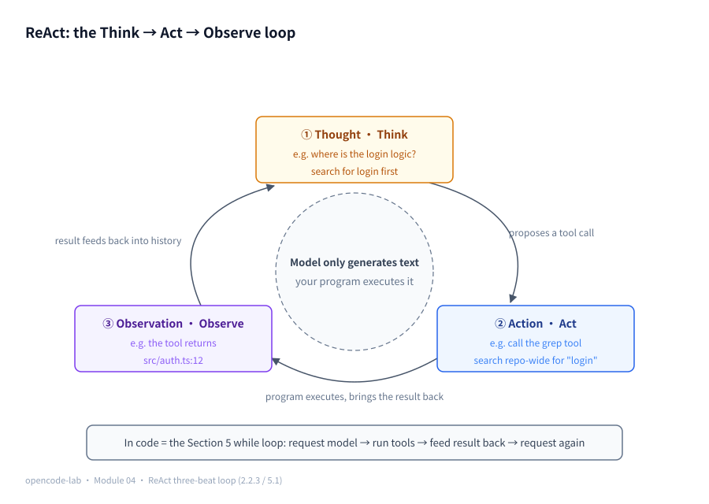
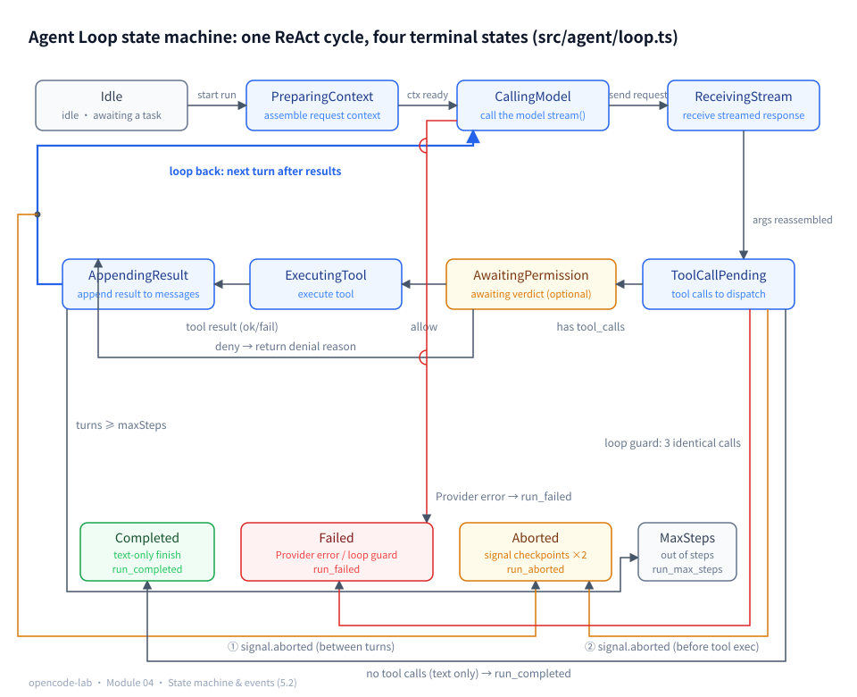
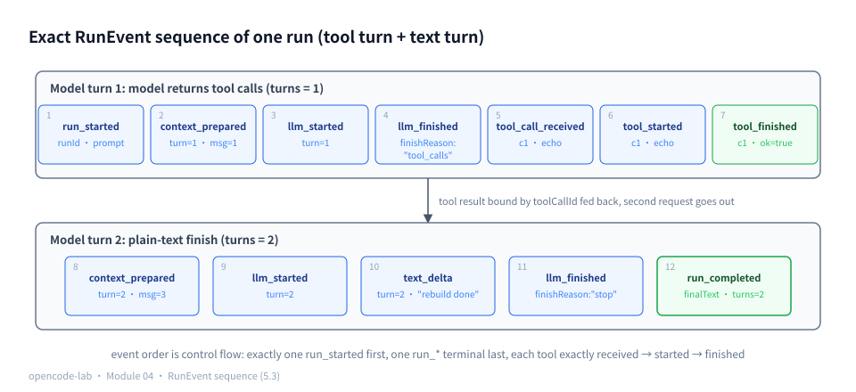
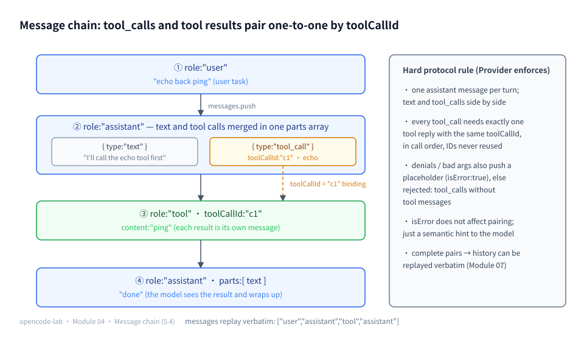
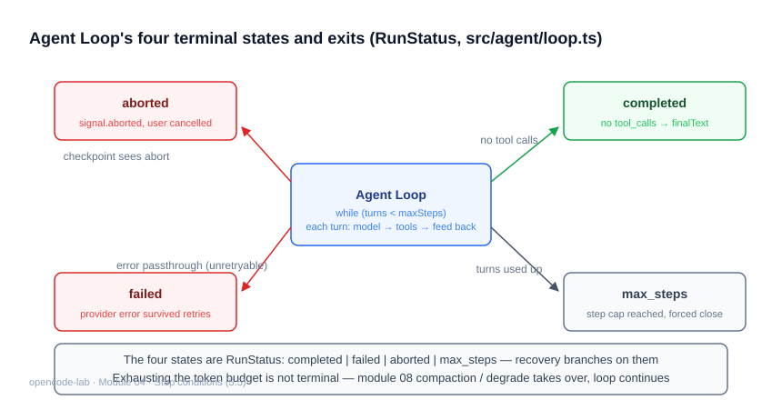
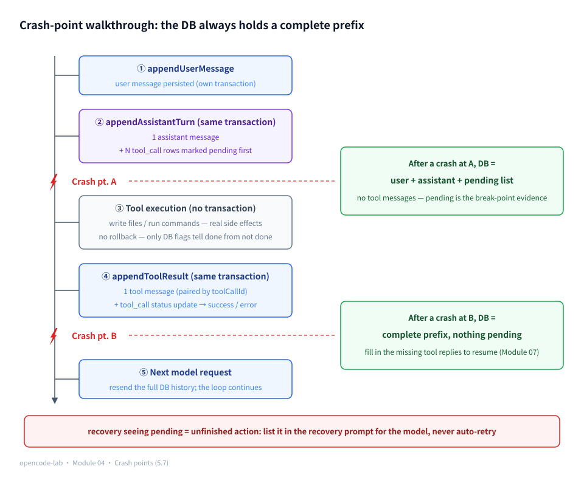
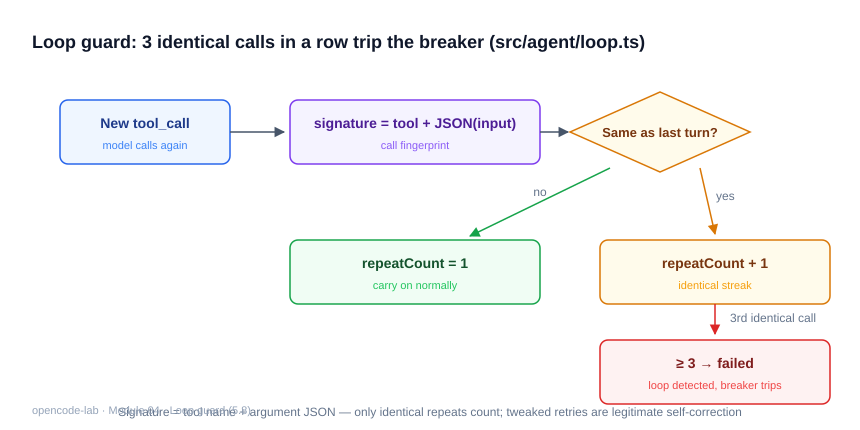

# Chapter 4: Agent Loop — Making the Model Complete Tasks Continuously

## 1. Where this chapter fits

- Module: 04 Agent Loop
- Study time: 10–12 hours (two weeks of material, including the Section 2 prerequisites)
- Difficulty: high (the course's first "core of the core") — Section 2 builds the four foundations of state machines, event-driven design, ReAct, and transactions from zero
- Prerequisites: Chapter 1 (Provider), Chapter 2 (Registry), Chapter 3 (Coding Tools)
- Corresponding OpenCode commit: `70a24697ea0028e19f22712fd63059538cb4bee7`
- Corresponding milestone in this project: `v0.6-agent`

## 2. Prerequisites

> This chapter is the hub of the whole course. Section 2.2 builds four foundations from zero: state machines and event-driven design are the key to reading the event protocol and the state diagrams; ReAct is the soul of the Agent loop; transactions underpin the later persistence discussion (Chapter 7 covers transactions in depth — for this chapter, the one-line version is enough).

### 2.1 Glossary for this chapter

| Term | One-line plain explanation | Where it is used in this chapter |
|---|---|---|
| State machine | Describes "how far along" something is with a few explicit states; it is in at most one at any moment | 2.2.1; the 5.2 state machine diagram |
| State / transition / terminal state | The stage itself / jumping from one stage to another / an end stage you never leave | 2.2.1; the four `RunStatus` terminal values |
| Event-driven / publish-subscribe | Every state change broadcasts an event; registered subscribers each handle it | 2.2.2; the 14 `RunEvent` kinds in 5.2 |
| Observer pattern | The subject actively notifies registered observers when it changes (mentioned in Chapter 2) | 2.2.2 |
| ReAct | The Agent runtime paradigm of the "reason → act → observe" three-beat loop | 2.2.3; 5.1 |
| Thought / Action / Observation | The model thinks one step / issues one tool call / the action's result is fed back to the model | 2.2.3; the 5.1 walkthrough table |
| Transaction | Several database writes bundled into one unit: either all succeed, or none happened | 2.2.4; 5.7 persistence |
| Persist to DB / persistence | Writing in-memory state into the database so it survives a process restart | 5.7 |
| pending | The persisted status marking "this tool call has not finished executing" | the 5.7 crash walkthrough |
| Discriminated union | A union type where each member carries a tag field (Chapter 0, 2.2.1) | the 14 event types in 5.2 |
| Generator / AsyncIterable | A function that produces values step by step with `yield` / an async sequence (Chapter 1, 2.2.5) | 5.7 `forwardTextDeltas` |
| Call stack / stack depth | The stack of "bookkeeping frames" for function calls; the deeper the recursion, the higher it stacks | 5.1 while loop vs. recursion |
| token / usage | The model's unit for metering text / the count of tokens used for input and output (Chapter 1, 2.2.1) | 5.5 stop conditions |
| Snapshot (shallow copy) | Copying the first level of an array/object, as opposed to "sharing the same reference" | 5.4 test assertions |

### 2.2 Foundations (starting from zero)

#### 2.2.1 State machines: states, transitions, terminal states

**Definition**: a state machine writes "the progress of a task" as **a finite set of explicit states**, occupying exactly one at any moment; external events (a timer fires, data arrives, the user cancels) trigger **transitions** — jumps from one state to another; a **terminal state** is an end state with no transitions out — once entered, it never changes again.

**Analogy**: a traffic light. It has exactly three states {red, green, yellow}; "the timer fires" triggers transitions (green→yellow→red→green, cycling forever); a traffic light has no terminal state — it never stops. An example with terminal states is an online order: awaiting payment → (payment succeeds) → paid → (receipt confirmed) → **completed**; or awaiting payment → (payment times out) → **cancelled**. "Completed" and "cancelled" are both terminal states, and at any moment the order is in exactly one of them.

**The `A -> B` notation**: read the arrow as "after something happens, transition from state A to state B". The state machine diagram in the `loop.ts` header comment (`Idle -> PreparingContext -> ...`) uses exactly this notation; `...` means "continues in the same fashion"; the parentheses in `(AwaitingPermission)` mark an optional state — one that exists only under certain configurations.

**Minimal walkthrough** (an order state machine, 6 lines):

```ts
type OrderState = "待支付" | "已支付" | "已完成" | "已取消"
const TERMINAL: OrderState[] = ["已完成", "已取消"]   // terminal states: no transitions out
const transitions: Record<string, OrderState> = { "待支付|支付成功": "已支付", "待支付|超时": "已取消" }
let state: OrderState = "待支付"
state = transitions["待支付|支付成功"]   // one transition: state + event -> new state
```

**How this chapter uses it**: Section 5.2 draws runAgent's execution as a state machine (Idle → CallingModel → ExecutingTool → …); the four terminal values (completed/failed/aborted/max_steps) are terminal states in the state-machine sense — the run is over and the state is final.

#### 2.2.2 Event-driven design and publish-subscribe

**Definition**: publish-subscribe is a loosely coupled communication style — the source of an event (the **publisher**) does not call any handler directly; it only broadcasts "X happened". Whoever wants to handle it registers in advance (**subscribes**) and handles it upon receipt.

**Connection to Chapter 2**: when covering the tool registry, Chapter 2 mentioned the **observer pattern** — the moment the subject's state changes, it actively notifies every registered observer. Publish-subscribe extends the same idea (strictly speaking, the latter adds an event channel in the middle; in everyday engineering the two terms are used interchangeably). This chapter consistently treats it as "broadcast to whoever registered".

**Key elaboration: every state transition emits one event.** Broadcast every jump of the state machine, and the outside world can follow the entire run from the event stream alone — without reading the loop's internal variables. That is "event-driven": the information flow driving the system is events, not some shared mega-object.

**Minimal walkthrough** (7 lines):

```ts
const listeners: ((e: string) => void)[] = []
function subscribe(fn: (e: string) => void) { listeners.push(fn) }
function emit(e: string) { for (const fn of listeners) fn(e) }   // the publisher only broadcasts; it knows no subscribers
subscribe((e) => console.log("UI 更新:", e))
subscribe((e) => console.log("写审计:", e))
emit("tool_started")   // both subscribers receive it, independently of each other
```

**How this chapter uses it**: runAgent's `onEvent` callback is the broadcast port; subscribers include the CLI display (typewriter effect), persistence (Chapter 7 wires in the database), and tests (the event stream alone can assert the whole run).

#### 2.2.3 ReAct: Thought / Action / Observation

**Definition**: ReAct (Reasoning + Acting) is the classic runtime paradigm for LLM Agents (introduced by the 2022 paper of the same name): the model works in a **three-beat loop** — **Thought** (think one step: what should be done now), **Action** (act: issue one tool call), **Observation** (observe: get the action's result). The observation feeds the next beat's thinking, alternating until the task is done.

**A plain-language version of the paper's original paradigm** (back then Action was still plain text, with only a few verbs available):

```text
Question: count the .ts files under src
Thought: I need to list all matching files first.
Action: glob[pattern: "src/**/*.ts"]
Observation: a.ts, b.ts, c.ts
Thought: The list has 3 files — I can answer now.
Action: finish[answer: "3"]
```

Read it once and you can feel it: every Thought builds on the previous Observation — exactly what a "single question, single answer" cannot do. Modern Agent engineering moved the three beats into the message protocol: Thought maps to the model's text output (sometimes omitted), Action becomes a structured tool call (Chapter 1, 2.2.2: the model only expresses intent, it does not execute), and Observation is the tool message sent back.

**How this chapter uses it**: Section 5.1 maps the three beats statement by statement onto a while loop — ReAct is not mysticism; it is a 200-line loop.



*Figure 4-P1: the ReAct loop — Thought (think one step) → Action (issue a tool call) → Observation (result fed back into history), and back to Thought; the hub of the ring is the key division of labor: the model only generates text, execution is your program's job. The engineering form is the while loop in Section 5.1.*

#### 2.2.4 Transactions: all done or never happened

**Definition**: a transaction bundles several database writes into an **indivisible unit**: they take effect only if all succeed; if any step fails midway (even if the process loses power), it is as if **none of them ever happened**. This property is called **atomicity**.

**Analogy**: a money transfer. "Debit 100 from your account" and "credit 100 to the recipient" must live and die together — the transaction guarantees you never see the half-done state "your money gone, recipient paid nothing".

**Minimal walkthrough** (SQL skeleton, 6 lines):

```sql
BEGIN;                      -- start a transaction: the writes below first land on a "draft"
INSERT INTO message ...;    -- step one
INSERT INTO tool_call ...;  -- step two
COMMIT;                     -- commit: both steps take effect together
-- a crash after BEGIN but before COMMIT: neither step took effect, the DB keeps no half-record
```

**How this chapter uses it**: every persistence step in Section 5.7 is one such small transaction. Chapter 7 digs into SQLite's transaction implementation; for now, remember just this line: **a transaction = all done or never happened**.

### 2.3 Recap of the previous module

- In Chapter 3 a tool's return value is a ToolResult: **failure is also a result** — `ok: false` is a normal return value, not an exception; this chapter's loop converts it into a tool message for the model, and the run does not crash because of it.
- Every tool in Chapter 3 carries a **risk tier** (risk: low / medium / high), one of the inputs the Chapter 6 permission layer uses to decide allow / ask / deny (expanded in Chapter 6; for now just know the tier is already in place).
- Chapter 2's philosophy that "even failed argument validation returns data" extends in this chapter to the model-argument layer: if the model's argument JSON itself fails to parse, it is likewise handled as "errors are results" (5.6).

---

## 3. Learning goals

- Understand: the ReAct loop (reason → act → observe → reason again); why "tool failure" is normal control flow rather than an exception; what message-chain integrity (toolCallId binding) means for recovery.
- Be able to implement: the `runAgent(input, deps)` state machine — multi-turn tool calls, maxSteps, user cancellation, permission denial, invalid-argument feedback, infinite-loop detection, event stream.
- Be able to test: script "model behavior" with a Mock Provider and exhaust every termination path (completed/failed/aborted/max_steps).
- Be able to explain: how an event sequence fully reconstructs a run; why assistant messages use a parts array.

## 4. Problem statement

The first four chapters supply the parts: the model can stream output (Chapter 1) and tools can execute safely (Chapters 2 and 3). But a real Agent is a **loop**: the model sees the tool results and keeps reasoning until the task is done. The OpenCode counterparts are `packages/opencode/src/session/processor.ts` (the session-advance state machine) + `packages/core/src/session/runner/` (model execution and message conversion).

The engineering problems this chapter solves:

1. **Message-chain integrity**: every tool call in an assistant message must be answered, among the messages that follow, by exactly one tool message with the same `toolCallId` — a hard constraint of the model-service protocol; if one is missing or mismatched, the next request is rejected outright (with an error like "tool_calls without tool messages"). The pairing has a side benefit: as long as the history pairs are complete, resending the history verbatim resumes the task — crash recovery is built on exactly this (Chapter 7 expands on persistence; for now just know "complete pairs = replayable history").
2. **Failure is control flow**: tool failure, permission denial, invalid argument JSON — all are converted into tool messages and sent back so the model decides the next step (change arguments / switch tools / explain to the user). The only direct failure is a Provider error.
3. **It must be bounded**: maxSteps backstops infinite loops; 3 consecutive identical calls are judged an infinite loop and terminate immediately; after the user cancels, no tool executes again.

## 5. Core concepts

This section expands the knowledge catalog of Section 8.5 of the design doc item by item, explained against its "core state machine" diagram. First the overview table (source paths relative to `opencode-lab/`), then each item in depth.

| Topic | Source files | Test files |
|---|---|---|
| 5.1 The Agent loop and the ReAct idea | `src/agent/loop.ts` | `test/agent/loop.test.ts` |
| 5.2 State machine and event-driven design | `src/agent/events.ts`, `src/agent/loop.ts` | `test/agent/loop.test.ts` |
| 5.3 The boundary between a model turn and a tool turn | `src/agent/loop.ts`, `src/providers/collect.ts` | `test/agent/loop.test.ts` |
| 5.4 Tool call IDs, message correlation, and ordering | `src/providers/types.ts`, `src/agent/loop.ts` | `test/agent/loop.test.ts` |
| 5.5 Stop conditions (final text / maxSteps / token / abort / error) | `src/agent/loop.ts`, `src/context/budget.ts` | `test/agent/loop.test.ts` |
| 5.6 Automatic retry and error recovery | `src/providers/retry.ts`, `src/agent/loop.ts`, `src/providers/collect.ts` | `test/providers/retry.test.ts`, `test/agent/loop.test.ts` |
| 5.7 Streaming output and persistence ordering | `src/agent/loop.ts`, `src/session/persistence.ts` | `test/agent/loop.test.ts` |
| 5.8 Preventing repeated tool calls and infinite loops | `src/agent/loop.ts` | `test/agent/loop.test.ts` |
| 5.9 The closed loop of goal, plan, execution, verification | `src/providers/mock.ts`, `src/agent/loop.ts` | `test/agent/loop.test.ts` |

### 5.1 The Agent loop and the ReAct idea

> 📊 Figure: for the full picture of the ReAct loop see Figure 4-P1 in Section 2.2 — this section lands that same ring as while-loop code.

**Concept**

ReAct (Reasoning + Acting; for the three-beat definition and the text example see 2.2.3) is the Agent's basic runtime paradigm: the model first reasons (deciding what to do next), then acts (actually calling a tool), gets the observation (the tool output), and keeps reasoning, alternating until done.

Why is this necessary? A single LLM call is "one question, one answer": ask, answer, done. It inherently cannot handle multi-step tasks like "edit code → run tests → see the failure → edit again" — the model cannot see the results of its own actions, so its reasoning is a castle in the air. The essence of ReAct is to **feed the action's observation back into the conversation history**, so every round of reasoning builds on new information.

In engineering it lands as a `while` loop rather than recursion, for three reasons. First, a loop can put the step cap and the cancellation checks at a fixed spot in every round; no `continue` or exception path can escape the loop condition. Second, call-stack safety: every function call pushes a "bookkeeping frame" onto the **call stack**, popped when the function returns; a recursive ReAct pushes one more layer on every "ask the model again" — the longer the task, the deeper the stack, and past the limit the process crashes outright (stack overflow) — while a `while` loop can turn ten thousand times with constant stack depth. Third, the four terminal states return from the same function, keeping the control flow transparent.

**Reading tip**: the details start here. Read the **loop skeleton** in Section 7 "Minimal walkthrough" first (about 20 lines of abridged pseudocode showing the whole while shape at a glance), then come back and compare against the code below.

**How this project implements it**

The comment at the top of `src/agent/loop.ts` is the loop contract; the body of `runAgent` is a `while` bounded by `maxSteps`:

```ts
// Agent Loop: request the model -> run tools -> feed results back -> keep reasoning, until a terminal condition.
while (turns < maxSteps) {
    if (deps.signal?.aborted) return await finishAborted()
    turns++
```

**A full-turn walkthrough**: mapping the three ReAct beats statement by statement onto the loop (all excerpts verbatim from `src/agent/loop.ts`). Scenario: the model first issues a tool call, sees the result, then finishes with an answer — a two-turn task.

| ReAct beat | Corresponding loop statements (verbatim excerpts) | What happens in this step |
|---|---|---|
| Thought (reasoning) | `const collected = await collectTurn(`; `forwardTextDeltas(deps.provider.stream(request), (text) =>` | Send the current complete history and tool list to the model and reduce its streamed reply — the model's text and "which tools it wants to call" are this beat's products |
| Action (acting) enters history | `parts.push({ type: "tool_call", toolCallId: call.toolCallId, tool: call.tool, input: call.input })`; `messages.push({ role: "assistant", parts })` | The model's chosen actions are assembled into **one** assistant message that enters history |
| Observation (observing) | `const result = await deps.registry.call(call.tool, call.input, { workspace: deps.workspace })`; `messages.push({` `role: "tool",` `toolCallId: call.toolCallId,` | **The program** (not the model) executes the tool; the result is fed back into history as a tool message |
| Back to Thought | the `while (turns < maxSteps)` body ends, returning to the top carrying the Observation | The next request's messages have two more entries, assistant + tool — the model "sees" the result of its own action |
| Task complete | `if (collected.toolCalls.length === 0)` | In some turn the model replies with text only and proposes no tools → the run ends |

Grounding the walkthrough in data: when this two-turn task ends, the `messages` array looks like this (read alongside the Section 7 skeleton and the 5.4 message model):

```text
[0] user       "创建 a.ts"
[1] assistant  parts = [tool_call: write(a.ts)]     ← turn 1's Action enters history
[2] tool       result paired with write's toolCallId ← Observation fed back
[3] assistant  parts = [text: "文件已创建"]          ← turn 2: the model sees [0]–[2] and wraps up
```

The second request goes out carrying the three entries [0]–[2] — exactly the `["user", "assistant", "tool"]` asserted by 5.4's request snapshot; after the task ends, [3] also stays in history for recovery and audit.

One iteration of the loop body corresponds to one complete ReAct beat. Reasoning and acting are not two code paths but two segments executed in sequence within the same turn — this is exactly where the "loop" and "recursive" implementations of ReAct differ: recursion turns "ask the model again" into a function self-call, where the step cap and cleanup logic are easy to miss.

**Common pitfalls**

- Symptom: writing the loop as `runAgent` recursively calling itself. Cause: wanting to reuse the "one turn" assembly code. Fix: advance `turns` with a `while`; the four terminal states return from the same function, and maxSteps plus the cancellation checks naturally cover everything.
- Symptom: the model says "I will now run the tests" but nothing happens. Cause: treating the model's verbal promise as an action. Fix: the only carrier of action is a structured tool call; plain text is just reasoning made visible.
- Symptom: the model repeats the same words every turn. Cause: the tool result was never appended to `messages`, so the model "forgets" each turn. Fix: the Observation must become part of the next request.

**Self-check questions**

- Which data structure in the loop corresponds to ReAct's Observation? → The `LlmMessage` with `role: "tool"`, bound to its `toolCallId` and appended to the `messages` array.
- Why is the loop condition `turns < maxSteps` rather than `while (true)` with an inner break? → It makes the step cap a loop invariant that no branch can bypass; when the loop exits naturally, the `run_max_steps` fallback return still applies.
- How many times does the loop body execute when the model replies with plain text? → Once; `collected.toolCalls.length === 0` returns completed immediately (the test "calls the model exactly once and completes when it returns only text" verifies `result.turns === 1`).

### 5.2 State machine and event-driven design

**Concept**

A state machine makes "where the run is" explicit (for the state/transition/terminal-state definitions see 2.2.1). First the problem scenario: without a state machine, progress signals like "waiting on the model", "waiting on permission", "executing a tool" lie scattered in local variables across the code — the UI cannot show progress, tests cannot assert intermediate states, and recovery after a crash has nothing to go on.

Event-driven design (2.2.2) is the state machine's output side: every state transition emits one event, and the outside world — CLI display, persistence, debugger, tests — consumes only the event stream, never invading the loop's internals.

This project goes one step further and treats events as the **acceptance criteria**. Unpacked, that is three individually checkable rules:

1. **It opens with `run_started`**: broadcast as soon as the run begins; subscribers initialize from it;
2. **It closes with exactly one `run_*` terminal event**: one and only one of the four terminal events completed / failed / aborted / max_steps — the run never "has no ending" and never "produces two endings";
3. **Every actually executed tool in between gets exactly the triple**: `tool_call_received → tool_started → tool_finished` — call received, execution started, execution finished; not one more, not one less.

When all three hold, "event order is control flow" is true: replaying the event stream in time order re-enacts every step of the run; tests compare `recorder.types()` item by item against the expected sequence, and any branch that omits or duplicates an event fails on the spot.

**How this project implements it**

The design doc's state machine diagram appears verbatim in the `src/agent/loop.ts` header comment:

```ts
// State machine corresponding to Module 04 of the design doc:
//   Idle -> PreparingContext -> CallingModel -> ReceivingStream
//        -> ToolCallPending -> (AwaitingPermission) -> ExecutingTool
//        -> AppendingResult -> CallingModel -> ... -> Completed/Failed/Aborted/MaxSteps
```



*Figure 4-1: the Agent Loop state machine in full — a serpentine main loop with a blue loop-back edge, the four terminal states color-grouped (green Completed / red Failed / amber Aborted / gray MaxSteps), small hop arcs on the red line marking crossings without intersection; a Provider error is the only external error that fails the run, and loop detection and cancellation each have their own entry.*

The event protocol is defined in `src/agent/events.ts`, 14 kinds in total, each an object with a `type` tag — a discriminated union (the modeling approach from Chapter 0, 2.2.1: different tags, different shapes):

```ts
export type RunEvent =
  | { type: "run_started"; runId: string; prompt: string; at: string }
  | { type: "context_prepared"; turn: number; messageCount: number; at: string }
  | { type: "llm_started"; turn: number; at: string }
  | { type: "text_delta"; turn: number; text: string; at: string }
  | { type: "llm_finished"; turn: number; finishReason: string; at: string }
  | { type: "llm_failed"; turn: number; error: LlmError; at: string }
  | { type: "tool_call_received"; turn: number; toolCallId: string; tool: string; input: unknown; at: string }
  | { type: "permission_requested"; toolCallId: string; tool: string; at: string }
  | { type: "tool_started"; toolCallId: string; tool: string; at: string }
  | { type: "tool_finished"; toolCallId: string; tool: string; ok: boolean; summary: string; at: string }
  | { type: "run_completed"; runId: string; finalText: string; turns: number; at: string }
  | { type: "run_failed"; runId: string; error: string; at: string }
  | { type: "run_aborted"; runId: string; reason: string; at: string }
  | { type: "run_max_steps"; runId: string; maxSteps: number; at: string }
```

Mapping the state diagram to code: `PreparingContext` → `emit({ type: "context_prepared", ... })`; `CallingModel`/`ReceivingStream` → the span between `llm_started` and `llm_finished`; the parentheses around `AwaitingPermission` mean optional — it exists only when `deps.permission` is configured; each of the four terminal states maps to one `run_*` event. On the test side, `createEventRecorder` collects events and `types()` makes exact-sequence assertions.

Rules on paper are one thing; seeing a real run is better. Below, a Mock Provider actually runs a two-turn Agent (turn 1 issues an echo tool call, turn 2 finishes with plain text) and prints every event the run produces — the experiment most worth running by hand in this chapter (the imports use absolute paths into this project; adjust `$ROOT` to your checkout; printing omits the `at` timestamp and `runId` that every event carries, for readability):

```bash
ROOT=/home/wilton/diskWD1/codeWorkspace/opencode/docs/refAgentCode   # adjust to your checkout location
cat > /tmp/agent-events-demo.ts <<EOF
import { createMockProvider } from "$ROOT/opencode-lab/src/providers/mock"
import { createToolRegistry } from "$ROOT/opencode-lab/src/tools/registry"
import { echoTool } from "$ROOT/opencode-lab/src/tools/echo"
import { runAgent } from "$ROOT/opencode-lab/src/agent/loop"
import { createEventRecorder } from "$ROOT/opencode-lab/src/agent/events"

const provider = createMockProvider([
  { kind: "tool_calls", calls: [{ toolCallId: "c1", tool: "echo", input: { message: "你好，工具" } }] },
  { kind: "text", text: "工具已调用，任务完成" },
])
const registry = createToolRegistry()
registry.register(echoTool)
const recorder = createEventRecorder()

const result = await runAgent(
  { prompt: "调用 echo 工具打个招呼" },
  { provider, registry, systemPrompt: "你是演示 Agent", workspace: "/tmp/agent-demo-ws", onEvent: recorder.listener },
)

for (const event of recorder.events) {
  const { at, runId, ...rest } = event as Record<string, unknown>   // drop the two fields at and runId
  console.log(JSON.stringify(rest))
}
console.log("---")
console.log("事件类型序列:", JSON.stringify(recorder.types()))
console.log("status:", result.status, "| turns:", result.turns, "| finalText:", JSON.stringify(result.finalText))
EOF
bun /tmp/agent-events-demo.ts
```

Output (excerpt):

```text
{"type":"run_started","prompt":"调用 echo 工具打个招呼"}
{"type":"context_prepared","turn":1,"messageCount":1}
{"type":"llm_started","turn":1}
{"type":"llm_finished","turn":1,"finishReason":"tool_calls"}
{"type":"tool_call_received","turn":1,"toolCallId":"c1","tool":"echo","input":{"message":"你好，工具"}}
{"type":"tool_started","toolCallId":"c1","tool":"echo"}
{"type":"tool_finished","toolCallId":"c1","tool":"echo","ok":true,"summary":"你好，工具"}
{"type":"context_prepared","turn":2,"messageCount":3}
{"type":"llm_started","turn":2}
{"type":"text_delta","turn":2,"text":"工具已调用"}
{"type":"text_delta","turn":2,"text":"，任务完成"}
{"type":"llm_finished","turn":2,"finishReason":"stop"}
{"type":"run_completed","finalText":"工具已调用，任务完成","turns":2}
---
事件类型序列: ["run_started","context_prepared","llm_started","llm_finished","tool_call_received","tool_started","tool_finished","context_prepared","llm_started","text_delta","text_delta","llm_finished","run_completed"]
status: completed | turns: 2 | finalText: "工具已调用，任务完成"
```

Check the three rules against this real sequence one by one: `run_started` leads (rule 1); the only terminal event, `run_completed`, closes it, with no second ending (rule 2); the echo tool in the middle gets exactly the `tool_call_received → tool_started → tool_finished` triple (rule 3). The type sequence matches the `toEqual` assertions of the "event stream can fully rebuild" case in `loop.test.ts` item for item — that assertion shows only one `text_delta` because the test raises the Mock's `chunkSize` to 100 and the whole text goes out in one piece; the default slice is 5 characters, hence two here. `context_prepared`'s `messageCount` rising from 1 to 3 is exactly the event-side evidence that "the second request carries the two new assistant + tool messages".

**Common pitfalls**

- Symptom: tests assert only `RunResult` and never notice a wrong event sequence. Cause: treating events as "logs". Fix: events are the protocol — assert item by item with `recorder.types()).toEqual([...])` (see the "event stream can fully rebuild a run" case).
- Symptom: the UI shows "executing" forever. Cause: some branch emitted `tool_started` without `tool_finished`. Fix: of the three "do not execute" branches (parse failure / loop detection / permission denial), the first two and the denial branch must also emit `tool_finished` (ok:false).
- Symptom: the same `toolCallId` gets two `tool_started` events. Cause: retry logic placed in the loop layer. Fix: the loop does not retry (see 5.6); each call gets exactly one round of tool events.

**Self-check questions**

- Which of the 14 events occur exactly once? → `run_started` exactly once; exactly one of the four terminal events (`run_completed`/`run_failed`/`run_aborted`/`run_max_steps`).
- Why is `AwaitingPermission` drawn in parentheses in the state diagram? → It is an optional state: when `deps.permission` is not injected, the loop skips the permission stage entirely (most test cases pass no permission).
- Why is the events' `at` field injected via `deps.now` instead of a direct `new Date()`? → Tests can inject a fixed clock for deterministic assertions, and production orders the audit by real time.

### 5.3 The boundary between a model turn and a tool turn

**Concept**

"Turn" has two granularities: a **model turn** (the complete reduction of one stream request-response) and a **tool turn** (executing one tool call and feeding back the result). One model turn may produce 0, 1, or many tool calls, but they all count as the same turn — `turns` increments by exactly 1. Only with a clean boundary can you answer "what does maxSteps actually count": it counts **model turns**, not tool executions. There is also a protocol reason to separate "receiving the stream" from "executing tools": you must wait for the whole stream to end and for the complete tool call arguments (reassembled from fragments) before executing — you cannot execute while still receiving.

**How this project implements it**

At the start of every turn, `src/agent/loop.ts` first announces "a new turn has begun":

```ts
emit({ type: "context_prepared", turn: turns, messageCount: messages.length, at: at() })
emit({ type: "llm_started", turn: turns, at: at() })
```

`messageCount` is free diagnostic information the event hands its subscribers: without reading loop internals you know how many history entries this request carries — when debugging "why does the context keep growing", this run of numbers in the event stream is first-hand evidence (in the previous section's real run it rose from 1 to 3).

Stream reduction happens in `src/providers/collect.ts`, whose header comment states the responsibility boundary:

```ts
// Reduce a stream of LlmEvents into one complete assistant turn.
// The Agent Loop (Module 04) calls collectTurn once per model request.
// Responsibilities: text concatenation, tool-argument JSON reassembly with tolerant parsing, usage/finishReason extraction.
```

The reduction's product, `CollectedTurn`, is the complete snapshot of the turn:

```ts
export type CollectedTurn = {
  text: string
  toolCalls: CollectedToolCall[]
  usage?: Usage
  finishReason: FinishReason | "error"
  error?: LlmError
}
```

`error` is a separate field on the snapshot, not the status of some `toolCalls` member — Provider failure (the whole turn is void) and tool failure (a normal result) are split into two channels at the type level, and one `if` routes the loop to different terminal states (5.5).

Only after the loop holds the snapshot does tool execution begin; the inner `for` processes all of the turn's calls (one tool message per call), then control returns to the top of the `while` to issue the next model request — the nesting of the two `for`/`while` loops is exactly the "model turn ⊇ tool turn" boundary.

**Common pitfalls**

- Symptom: a task with `maxSteps: 3` executes 3 tools in turn 3 and gets cut off. Cause: counting tool executions as steps. Fix: steps = model requests; multiple calls in the same turn are all processed inside the inner `for`.
- Symptom: tools start executing before the stream ends, with half-missing arguments. Cause: executing while still receiving events. Fix: reduce to the end of the turn with `collectTurn` first; execute only after the tool arguments' JSON fragments are fully reassembled.
- Symptom: text goes missing when `text_delta` and `tool_call_delta` interleave. Cause: text concatenation coupled to tool-argument reassembly. Fix: in collect.ts text accumulates separately, and tool arguments accumulate per `toolCallId` in a `Map`.

**Self-check questions**

- How many tool messages can one turn produce at most? → Equal to that turn's `toolCalls` count; calls that fail parsing or are denied also get their own "placeholder result" message — not one more, not one less.
- Where does `turns` increment? → At the top of the `while` body, after the abort check — an iteration cancelled before its time returns before ever reaching `turns++`.
- What does collectTurn do when the Provider never sends `tool_call_end`? → The fallback parses the arguments from the accumulated `tool_call_delta` fragments ("fall back to accumulated fragments when the protocol is broken"); no call is lost.



*Figure 4-3: the exact RunEvent sequence of a "tool turn + text turn" run (each of the two swimlanes corresponds to one model turn). The sequence matches the `recorder.types()` assertions in `test/agent/loop.test.ts` item for item: it opens with `run_started`, closes with `run_completed`, and every tool in between gets exactly `tool_call_received → tool_started → tool_finished`.*

### 5.4 Tool call IDs, message correlation, and ordering

**Concept**

A hard constraint of the Provider protocol: every `tool_call` in an assistant message must be answered, among the messages that follow, by **exactly one** tool message with the same `toolCallId`, in the same order as the calls. Missing, extra, or mismatched IDs — the next request is rejected outright by the Provider (typical error "tool_calls without tool messages").

Why is this constraint also the foundation of crash recovery? Because the model service is **stateless** (Chapter 1, 2.2.1): it keeps no conversation; every request resends the complete history. So "recovery" needs no magic — as long as the assistant's tool_calls and the tool results pair up completely by ID, resending the database history verbatim lets the task continue (Chapter 7 expands on storage; for now just know "complete pairs = replayable").

`isError` does not change the protocol — the Provider only checks role/ID pairing; it is merely a semantic hint to the model that "this is not a successful output".

**How this project implements it**

The message model is defined in `src/providers/types.ts`:

```ts
// one assistant turn can carry text and multiple tool calls at once
export type AssistantPart = TextPart | ToolCallPart

export type LlmMessage =
  | { role: "system"; content: string }
  | { role: "user"; content: string }
  | { role: "assistant"; parts: AssistantPart[] }
  // each tool result is its own message, correlated to the assistant's tool_call via toolCallId
  | { role: "tool"; toolCallId: string; content: string; isError?: boolean }
```



*Figure 4-2: the message chain — an assistant's text and tool_calls are merged into the parts array of a single message, tool results are separate messages, and a dashed line marks the `toolCallId:"c1"` binding; a fully paired history can be replayed verbatim, the foundation of crash recovery (Module 07).*

Each turn, `src/agent/loop.ts` first assembles the text and all calls into **one** assistant message:

```ts
const parts: AssistantPart[] = []
if (collected.text !== "") parts.push({ type: "text", text: collected.text })
for (const call of collected.toolCalls) {
    parts.push({ type: "tool_call", toolCallId: call.toolCallId, tool: call.tool, input: call.input })
}
messages.push({ role: "assistant", parts })
```

The inner loop then pushes the results one by one in call order, IDs matching one to one:

```ts
const body = renderToolResult(result)
messages.push({
    role: "tool",
    toolCallId: call.toolCallId,
    content: result.ok ? body : `${result.error ?? "工具执行失败"}\n${body}`,
    isError: !result.ok,
})
```

A test uses a request snapshot to verify "the second request really saw the ID-bound result" (`test/agent/loop.test.ts`):

```ts
const second = captured.requests()[1]
expect(second.messages.map((m) => m.role)).toEqual(["user", "assistant", "tool"])
const toolMsg = second.messages[2]
if (toolMsg.role === "tool") {
    expect(toolMsg.toolCallId).toBe("c1")
```

Why `messages` must be **snapshotted** here deserves a word in the main text (no longer hidden in a self-check answer): in JS, arrays are **references** — when the loop hands the `messages` array to `provider.stream(request)` it does not copy it, and later turns keep pushing into the same array. If a test saved only the reference, its assertion would read "the final history after the run ended" rather than "the history at the moment the second request went out". `[...request.messages]` copies the array itself at the instant of the request (the elements are not modified after this point, so copying the first level suffices), so the assertion sees the true snapshot — that is what the glossary means by "snapshot (shallow copy)".

The message chain need not stay a diagram — take the 5.2 script and swap the closing printout for "one line per message", and look at the `messages` array at the end of a real run (exactly the four entries predicted by the 5.1 walkthrough table):

```bash
ROOT=/home/wilton/diskWD1/codeWorkspace/opencode/docs/refAgentCode   # adjust to your checkout location
cat > /tmp/agent-roles-demo.ts <<EOF
import { createMockProvider } from "$ROOT/opencode-lab/src/providers/mock"
import { createToolRegistry } from "$ROOT/opencode-lab/src/tools/registry"
import { echoTool } from "$ROOT/opencode-lab/src/tools/echo"
import { runAgent } from "$ROOT/opencode-lab/src/agent/loop"

const provider = createMockProvider([
  { kind: "tool_calls", calls: [{ toolCallId: "c1", tool: "echo", input: { message: "你好，工具" } }] },
  { kind: "text", text: "工具已调用，任务完成" },
])
const registry = createToolRegistry()
registry.register(echoTool)

const result = await runAgent(
  { prompt: "调用 echo 工具打个招呼" },
  { provider, registry, systemPrompt: "你是演示 Agent", workspace: "/tmp/agent-demo-ws" },
)

console.log("roles:", JSON.stringify(result.messages.map((m) => m.role)))
for (const [i, m] of result.messages.entries()) {
  const detail = m.role === "assistant"
    ? JSON.stringify(m.parts)
    : m.role === "tool"
      ? "toolCallId=" + m.toolCallId + " content=" + JSON.stringify(m.content)
      : JSON.stringify(m.content)
  console.log("[" + i + "] " + m.role.padEnd(9) + " " + detail)
}
EOF
bun /tmp/agent-roles-demo.ts
```

Output (excerpt):

```text
roles: ["user","assistant","tool","assistant"]
[0] user      "调用 echo 工具打个招呼"
[1] assistant [{"type":"tool_call","toolCallId":"c1","tool":"echo","input":{"message":"你好，工具"}}]
[2] tool      toolCallId=c1 content="你好，工具"
[3] assistant [{"type":"text","text":"工具已调用，任务完成"}]
```

The `[2]` tool message's `toolCallId=c1` pairs exactly with the tool_call ID in `[1]` — "the second request saw the ID-bound result" is directly visible even without snapshot assertions.

**Common pitfalls**

- Symptom: the Provider reports "tool_calls without tool messages". Cause: some branch (most often permission denial) entered the next turn without pushing a tool message. Fix: every path must answer — this project's parse-failure and permission-denial branches both push a placeholder result with `isError: true`.
- Symptom: the model attributes A's result to B. Cause: result order misaligned with call order, or reused IDs. Fix: push one by one in `calls` order inside the inner `for`, passing `toolCallId` through verbatim without regenerating it.
- Symptom: stuffing multiple results into one tool message to "save messages". Cause: not understanding that the protocol pairs by ID. Fix: each result gets its own tool message.

**Self-check questions**

- When an assistant turn has text and 2 tool calls at once, how does `messages` change? → First push one assistant message with `parts = [text, tool_call, tool_call]`, then push 2 independent tool messages in order.
- Does `isError: true` affect the Provider's protocol validation? → No; the protocol only checks role and `toolCallId` pairing; `isError` is content semantics only.
- Why must `captureRequests` snapshot `messages` (`[...request.messages]`) in tests? → The loop holds the same array reference and keeps pushing; without a snapshot the assertion sees the final state after the run (the explanation has been moved up into this section's main text).

### 5.5 Stop conditions: final text, maxSteps, token limit, abort, error

**Concept**

Of the five stop paths, four map to explicit terminal states (`RunStatus` = completed / failed / aborted / max_steps), each with its own terminal event. First, two easily confused state vocabularies: **RunStatus** is the in-memory state when a run ends, four values; **SessionStatus** is the session state after persistence (Chapter 7), also four values but without max_steps — max_steps maps to failed when persisted.

Design principles: **completion is the model's call** (a turn that asks for no tools means done; the loop does not guess "is the task finished"); **failure is layered** (only a Provider error fails the run; tool failure is a normal result); **boundedness is infrastructure** (maxSteps / cancellation / loop detection backstop it; see 5.8).

The fifth kind of "stop" is the token dimension — it is actually **not** a loop stop condition. A token is the model's unit for metering text; usage is the count of "how many tokens this run used for input/output" (Chapter 1, 2.2.1). The loop only accumulates each turn's usage for statistics. And "history too long to fit the model's context window"? That judgment and trimming happen before the request is assembled and are Chapter 8's job (expanded in Chapter 8; for now just know: over-limit trimming is not the loop's business).

All five paths in one table:

| Stop path | Trigger | RunStatus | Terminal event | Persisted SessionStatus |
|---|---|---|---|---|
| Complete | a turn with no tool calls at all | completed | `run_completed` | completed |
| Provider error | `collected.error` exists | failed | `run_failed` | failed |
| User cancel | `signal.aborted` (one of the two checkpoints hit) | aborted | `run_aborted` | aborted |
| Step cap | the `while` loop exits naturally | max_steps | `run_max_steps` | failed (mapped) |
| Token over limit | — not a loop stop condition | no terminal state | — (usage recorded only) | — (trimming is Chapter 8's) |

**How this project implements it**

All four terminal paths live in `src/agent/loop.ts`. Completion (final text, i.e. the turn has no tool calls):

```ts
if (collected.toolCalls.length === 0) {
    emit({ type: "run_completed", runId, finalText: collected.text, turns, at: at() })
    await deps.persistence?.updateStatus("completed")
    return { status: "completed", finalText: collected.text, turns, messages, usage }
}
```

Provider error (the `kind` classification is preserved; this is the only "external error" that fails the run):

```ts
if (collected.error) {
    emit({ type: "llm_failed", turn: turns, error: collected.error, at: at() })
    return await finishFailed(`[${collected.error.kind}] ${collected.error.message}`)
}
```

Cancellation has **two checkpoints** — the top of the loop (between turns) and before each tool executes (between tools of the same turn):

```ts
while (turns < maxSteps) {
    if (deps.signal?.aborted) return await finishAborted()
```

maxSteps is the fallback terminal state when the loop exits naturally:

```ts
emit({ type: "run_max_steps", runId, maxSteps, at: at() })
await deps.persistence?.updateStatus("failed")
return {
    status: "max_steps",
    finalText: "",
    turns,
    messages,
    usage,
    error: `达到最大步数 ${maxSteps}，任务未收敛`,
}
```

The maxSteps backstop is not just words on paper: make the Mock demand a tool every turn with `maxSteps: 2`, and the run is guaranteed to stop after two turns —

```bash
ROOT=/home/wilton/diskWD1/codeWorkspace/opencode/docs/refAgentCode   # adjust to your checkout location
cat > /tmp/agent-maxsteps-demo.ts <<EOF
import { createMockProvider } from "$ROOT/opencode-lab/src/providers/mock"
import { createToolRegistry } from "$ROOT/opencode-lab/src/tools/registry"
import { echoTool } from "$ROOT/opencode-lab/src/tools/echo"
import { runAgent } from "$ROOT/opencode-lab/src/agent/loop"
import { createEventRecorder } from "$ROOT/opencode-lab/src/agent/events"

const provider = createMockProvider([
  { kind: "tool_calls", calls: [{ toolCallId: "c1", tool: "echo", input: { message: "1" } }] },
  { kind: "tool_calls", calls: [{ toolCallId: "c2", tool: "echo", input: { message: "2" } }] },
])
const registry = createToolRegistry()
registry.register(echoTool)
const recorder = createEventRecorder()

const result = await runAgent(
  { prompt: "永远干不完的任务" },
  { provider, registry, systemPrompt: "你是演示 Agent", workspace: "/tmp/agent-demo-ws", maxSteps: 2, onEvent: recorder.listener },
)
console.log("终态事件:", recorder.types().at(-1))
console.log("status:", result.status, "| turns:", result.turns)
console.log("error:", result.error)
EOF
bun /tmp/agent-maxsteps-demo.ts
```

Output (excerpt):

```text
终态事件: run_max_steps
status: max_steps | turns: 2
error: 达到最大步数 2，任务未收敛
```

`turns` equals `maxSteps` exactly — after the loop exits naturally, the fallback return above is what runs, and the terminal event `run_max_steps` corresponds one to one with the `RunStatus`.

The token dimension is only recorded, for the later budget module to consume:

```ts
if (collected.usage) {
    usage.inputTokens += collected.usage.inputTokens
    usage.outputTokens += collected.usage.outputTokens
}
```

The accumulation sits **before** the error check — even if the turn ends up failed, the tokens already consumed count toward the statistics; `usage` only aggregates, never decides — nowhere in the loop is there a single branch on a token value. That is "recording and governance separated" (governance belongs to Chapter 8) put into practice.



*Figure 4-4: the four terminal states — a reply with no tool_calls is completed (finalText produced); signal.aborted seen at a checkpoint is aborted; a Provider error that still fails after retries is failed; an exhausted step budget forces a max_steps close. An exhausted token budget is not terminal — compaction/degradation takes over.*

**Common pitfalls**

- Symptom: asserting `status === "failed"` for a run that ended `max_steps`. Cause: treating max_steps as a subclass of failed. Fix: `RunStatus` has four independent terminal values; only at persistence time, because `SessionStatus` lacks max_steps, is it written as failed (the two vocabularies in this section's concept part).
- Symptom: a tool still executes after cancellation. Cause: checking the signal only at the top of the loop. Fix: dual checkpoints — the "no next tool executes after the user cancels" test aborts right inside the `tool_finished` event, exercising the second checkpoint.
- Symptom: expecting the loop to stop automatically when tokens run over. Cause: conflating recording with governance. Fix: the loop only accumulates usage; history trimming is done by `trimToBudget` in `src/context/budget.ts` before the request is assembled (expanded in Chapter 8; for now just know "over-limit trimming happens outside the loop").

**Self-check questions**

- If `finishReason` is `"length"` (output truncated), does the loop terminate? → Not necessarily; the loop only checks `collected.toolCalls.length === 0`, never the finishReason string — a truncated turn with calls executes them as usual.
- What is the session state in the database when a run ends `max_steps`? → failed (`updateStatus("failed")`), because `SessionStatus` only has active/completed/failed/aborted.
- Between which branches does the second cancellation checkpoint sit? → After loop detection, before the permission check — a call already at the execution edge gets one last chance to back out before actually executing.

### 5.6 Automatic retry and error recovery

> 📊 Figure: for which errors are retryable and when a failure must pass through, see the retry decision flow in Figure 1-3 of Chapter 1.

**Concept**

Errors come in two classes with completely different strategies: **transient errors** (network jitter, rate limiting) are retried automatically at the Provider layer with a mechanical policy; for **semantic errors** (broken argument JSON, permission denial, tool failure) mechanical retry is meaningless — they are sent back to the model to decide: change arguments, switch tools, or explain to the user. This is the essential difference between an Agent and a traditional program: failure information is context too.

Layering principle: the Provider layer retries "requests that have not emitted any content yet"; the loop layer **never** retries model requests — it only turns various failures into tool messages. The argument for "the loop does not retry" is worth walking in full (the original aside "it would write half-finished duplicates" compresses three steps):

1. When `collected.error` arrives, the loop's error check runs **before** `messages.push({ role: "assistant", parts })` — none of the failed turn's half-finished content has entered history; history is clean at that moment;
2. Suppose the loop retried: the new request would stream out "a second version of the same turn's answer", while the first attempt's half text has already gone to the UI and the persistence layer via `text_delta` events — the two versions disagree;
3. More fundamentally, "is this failure safe to retry" depends on whether the stream **has already emitted content events** (the `emitted` check in Chapter 1's retry.ts) — information only the Provider layer itself has; the loop layer cannot know it.

Hence the layering: the Provider layer retries mechanically at "zero content" (completely invisible downstream, as if the request had never failed); the loop layer treats failure as terminal (`finishFailed`) and leaves "should the whole task be re-run" to the layer above — which re-runs against clean history, safe by construction.

**How this project implements it**

Provider-layer retry lives in `src/providers/retry.ts`; its header comment names the key constraint:

```ts
// Retry policy: exponential backoff + "only retry requests that have emitted no content yet".
// Key constraint (matching a design-doc common error): retrying wholesale after the stream
// has already emitted content events would make downstream write duplicate half-finished
// assistant messages — so never retry after emitted.
```

The decision logic retries only "zero-content and retryable" failures:

```ts
if (last || !failure.error.retryable || emitted) {
    yield failure
    return
}
```

If any of the three conditions holds, retrying is abandoned and the failure is forwarded as-is: `last` means this was the final attempt (retries exhausted); `!failure.error.retryable` means the error itself declares "retrying is useless" (e.g. an auth failure); `emitted` means the stream already emitted content events — a wholesale retry now would deliver two half-finished copies downstream (what 5.7's persistence fears most).

Recovery from semantic errors happens in `src/agent/loop.ts`'s tool loop. The model supplied invalid JSON arguments (`inputParseError` is set by `applyArguments` in `src/providers/collect.ts` when `JSON.parse` fails): do not execute — send the error back and let it retry:

```ts
// the model gave invalid JSON arguments: do not execute, send the error back and let it retry
if (call.inputParseError) {
    messages.push({
        role: "tool",
        toolCallId: call.toolCallId,
        content: `参数解析失败: ${call.inputParseError}。请重新生成合法的 JSON 参数。`,
        isError: true,
    })
```

In `test/agent/loop.test.ts`, `brokenArgsProvider` first sends `fragment: "{oops"` to simulate a real model's bad output, then the script has the model "give up calling after the error feedback" — verifying the recovery path truly works: tool executions are 0 and the run completes.

**Common pitfalls**

- Symptom: two half-finished assistant messages in history after a retry. Cause: wholesale retry after the stream already emitted content events. Fix: wrap the Provider with `withProviderRetry`; never retry after `emitted`.
- Symptom: a tool throwing an exception takes down the whole run. Cause: propagating a tool exception as a run exception. Fix: `registry.call` catches execute exceptions into a `ok: false` ToolResult (Chapter 2), and the loop converts it into a tool message.
- Symptom: the model retries bad arguments endlessly. Cause: single-shot recovery with no global backstop. Fix: single-error feedback (this section) plus identical-call detection and maxSteps (5.8, 5.5) backstop it together.

**Self-check questions**

- Who consumes the `LlmError.retryable` field? → The Provider layer's `withProviderRetry` (deciding whether to back off and retry); the loop layer does not consume it — it only formats `[kind] message` into `run_failed`.
- Who produces `inputParseError`, and where does the raw fragment go? → `applyArguments` in collect.ts: on parse failure it sets `call.input = {}` and records `inputParseError` (including the first 120 characters of the raw fragment); the error text goes back to the model with the placeholder tool message.
- Why does a permission denial `continue` while loop detection goes straight to `finishFailed`? → A denial means "not this time" — the model can route around it and still finish; consecutive identical calls mean feedback can no longer correct the model, and continuing only burns tokens (see 5.8).

### 5.7 Streaming output and persistence ordering

**Concept**

Two "ordering" questions.

**Streaming**: `text_delta` must be forwarded to the UI as it arrives (the typewriter effect), not delivered in one lump after the turn ends — forwarding and reducing are two consumers on the same stream.

**Persistence**: persistence means writing in-memory state into the database (jargon: "persist to DB") so the state survives a process restart. This chapter's requirement: as each step completes, write that step to the database as one **transaction** (a transaction = all done or never happened; see 2.2.4). The step list: user message → assistant turn (one message + N tool calls) → each tool result → terminal state, in exactly the logical order. Then if the process crashes at any step, the database holds the state of "the last completed step" — never the half-done intermediate states like "half an assistant message" or "message present, tool-call record lost" (how to continue from the database state is Chapter 7's business; for now just know the database is always complete at crash time). When the assistant turn is persisted, its tool calls are first recorded as **pending** (the marker for "this call has not finished executing") — it is the sole basis on which recovery logic judges "where the break happened"; the crash walkthrough at the end of this section actually walks two break points.

**How this project implements it**

Streaming forwarding is a **pass-through generator** in `src/agent/loop.ts` (generator basics in Chapter 1, 2.2.5): it takes the provider's event stream and `yield`s every event unchanged to the downstream reducer, doing exactly one extra thing on `text_delta` — calling the `onText` callback. One stream, two consumers (forwarding and reducing), no need to buffer the stream into an array:

```ts
// forward the text_delta events of the provider stream to onEvent (observable streaming output)
async function* forwardTextDeltas(events: AsyncIterable<LlmEvent>, onText: (text: string) => void): AsyncIterable<LlmEvent> {
    for await (const ev of events) {
        if (ev.type === "text_delta") onText(ev.text)
        yield ev
    }
}
```

Persistence call sites are distributed across `runAgent` in time order, all injected optionally via `deps.persistence?.`: at the start `await deps.persistence?.appendUserMessage(input.prompt)`; after the assistant message is assembled:

```ts
await deps.persistence?.appendAssistantTurn(
    parts,
    collected.toolCalls.map((c) => ({ toolCallId: c.toolCallId, tool: c.tool, input: c.input })),
)
```

After each tool result, `appendToolResult(call.toolCallId, ..., status)` (status is success/error/denied/skipped); at the terminal state, `updateStatus(...)`. Laid out in run order, each step is an independent transaction (2.2.4):

```text
appendUserMessage ──► appendAssistantTurn ──► appendToolResult × N ──► updateStatus
   user message         assistant message      one tool message per result   terminal state
                        + N pending calls      + call status flips to success/...
```

The order matches the logical order exactly. The "safe boundaries" the original comment mentions are precisely these four persistence points: crashes **between** them are fine (the database holds the previous step's complete state), and the persistence actions **themselves** leave no half records thanks to transactions. The adapter `src/session/persistence.ts` maps these five calls onto the repository's transactional methods; its header comment states the crash semantics:

```ts
// Adapt SessionRepository into the Agent Loop's persistence interface.
// The loop calls these five methods at the right moments, each an independent transaction —
// after a process crash the database always holds "the last complete boundary".
```

The repository layer's two transaction boundaries, verbatim (`src/session/repository.ts`):

```ts
  // one assistant turn = one message + N pending tool calls, same transaction
```

```ts
  // tool result = one tool message + tool_call status/result update, same transaction
```

**Crash-point walkthrough: what the database keeps, what recovery logic sees**

Claiming "a crash at any moment is recoverable" is empty talk; better to pick two break points and walk them. Setup: the session is mid-turn, and the model has proposed two tool calls, c1 and c2.

- **Crash point A: power lost after `appendAssistantTurn` persists, before any tool executes.** What the database has: the user message, this turn's assistant message (parts carrying the two tool_calls c1/c2), two `tool_call` rows both with status `pending`; no tool messages at all. The recovery logic (`src/context/recovery.ts`) first reads history and suspended calls:

  ```ts
  const history = repository.toLlmMessages(sessionId)
  const pendingToolCalls = repository.listPendingToolCalls(sessionId)
  const interrupted = session.status === "active" || session.status === "failed" || pendingToolCalls.length > 0
  ```

  It sees the pending list is [c1, c2], decides `interrupted = true`, and the recovery prompt lists item by item "the process was interrupted before executing the following tool calls", explicitly stating "do not auto-retry" — the model thereby knows these two calls **did not finish executing** and will not mistake undone work for done.

- **Crash point B: power lost after c1's `appendToolResult` persists, during c2's execution.** The database has, beyond A: c1's tool message, c1's `tool_call` row flipped to `success`; c2 is still `pending` with no tool message. Recovery sees the pending list is down to [c2] — it can tell precisely "c1 finished, c2 did not", and the recovery prompt lists only c2.

What both break points share: because each step is one transaction, the database never holds a "half record"; the `pending` status is the entirety of what recovery logic uses to locate the break. Filling in the missing tool replies and deciding which actions to re-execute is later work in the recovery flow (Chapter 7 expands; for now just know "break-point information is never lost"). The two break points side by side:

| | Crash point A (after the assistant turn persists, before tools run) | Crash point B (after c1's result persists, before c2) |
|---|---|---|
| Messages in the DB | user + assistant (parts hold 2 tool_calls) | user + assistant + c1's tool message |
| tool_call row status | both c1 and c2 pending | c1 = success, c2 = pending |
| Pending list recovery sees | [c1, c2] | [c2] |
| What the recovery prompt tells the model | neither call finished executing | only c2 did not finish |



*Figure 4-P2: crash-point walkthrough — five persistence/execution steps laid out along a timeline, with the red lightning bolts A/B placed in the gaps between transactions. After a crash at A the DB = "user + assistant + pending list"; after B = "complete prefix, nothing pending"; recovery treats pending as an unfinished action and must not auto-retry.*

The walkthrough need not stay on paper — a script can open a `:memory:` SQLite database, actually perform point A's persistence steps, then query the database to verify (this is the repository layer Chapter 7 will dig into; here we just look at the results):

```bash
ROOT=/home/wilton/diskWD1/codeWorkspace/opencode/docs/refAgentCode   # adjust to your checkout location
cat > /tmp/crash-point-a.ts <<EOF
import { openDatabase } from "$ROOT/opencode-lab/src/session/db"
import { createSessionRepository } from "$ROOT/opencode-lab/src/session/repository"

const db = openDatabase(":memory:")
const repo = createSessionRepository(db)
const projectId = repo.ensureProject("/tmp/agent-demo-project")
const session = repo.createSession({ projectId, agent: "build", title: "崩溃点 A 演示" })

repo.appendUserMessage(session.id, "修复测试并运行")
// the model proposes tool calls c1/c2, the assistant turn persists — the point A crash happens after this
repo.appendAssistantTurn(
  session.id,
  [
    { type: "tool_call", toolCallId: "c1", tool: "edit", input: { path: "a.ts" } },
    { type: "tool_call", toolCallId: "c2", tool: "test", input: {} },
  ],
  [
    { toolCallId: "c1", tool: "edit", input: { path: "a.ts" } },
    { toolCallId: "c2", tool: "test", input: {} },
  ],
)

const messages = db.query("SELECT COUNT(*) AS n FROM message WHERE session_id = ?").get(session.id)
const toolMessages = db.query("SELECT COUNT(*) AS n FROM message WHERE session_id = ? AND role = 'tool'").get(session.id)
const toolCalls = db.query("SELECT COUNT(*) AS n FROM tool_call WHERE session_id = ?").get(session.id)
const pending = repo.listPendingToolCalls(session.id)
console.log("message 行数:", messages.n, "| 其中 tool 消息:", toolMessages.n)
console.log("tool_call 行数:", toolCalls.n)
console.log("pending 调用:", pending.map((c) => c.id + "(" + c.tool + ") status=" + c.status).join(", "))
EOF
bun /tmp/crash-point-a.ts
```

Output (excerpt):

```text
message 行数: 2 | 其中 tool 消息: 0
tool_call 行数: 2
pending 调用: c1(edit) status=pending, c2(test) status=pending
```

Every item matches the "crash point A" column of the table above: two messages, user + assistant, no half tool messages, c1/c2 both pending. `listPendingToolCalls` returns `["c1", "c2"]` — the `interrupted` decision and the recovery prompt in `recovery.ts` consume exactly this real query result.

**Common pitfalls**

- Symptom: UI text appears in lumps with no streaming effect. Cause: forwarding text only after `collectTurn` finishes reducing. Fix: `forwardTextDeltas` wraps outside `collectTurn`, forwarding event by event before reduction.
- Symptom: during recovery, a pending tool_call has no matching tool message and the data looks corrupt. Cause: not understanding what pending means. Fix: pending is precisely the marker of "the crash happened around tool execution"; recovery logic (`src/context/recovery.ts`) lists the unfinished calls in the recovery prompt accordingly (the crash walkthrough in this section has the full pass).
- Symptom: the database state is completed but `RunResult.status` is max_steps. Cause: mixing up the terminal-state mapping. Fix: completed/failed/aborted persist as-is; max_steps persists as failed (5.5).

**Self-check questions**

- When an assistant turn persists, what is the tool calls' initial status? → pending; `appendAssistantTurn` inserts the assistant message and N tool_call rows with `status: 'pending'` in the same transaction.
- When does the loop persist the assistant message? → After assembling parts and pushing into `messages`, before deciding completion — guaranteeing the turn's messages are complete before "completed" is persisted.
- Is persistence a required dependency? → No; it is an optional injection typed `deps.persistence?`; most unit tests pass none (purely in-memory `messages`), and SQLite enters from Chapter 7 on.

### 5.8 Preventing repeated tool calls and infinite loops

**Concept**

The typical infinite-loop script: the tool keeps returning the same failure, the model does not change tack, and each turn repeats the call with exactly the same arguments, burning a model call each round for nothing. Protection has two layers: a **passive cap** (maxSteps, which every loop eventually hits) and **active detection** (the same call signature appearing consecutively terminates early).

Detection has three steps: serialize each call into a **signature** — `tool name + JSON.stringify(arguments)`; compare with the previous call's signature — equal means count +1, different resets to 1; when the count reaches the threshold (3), terminate the run immediately.

Why a threshold of 3 rather than 1: the first two identical calls execute as usual and their failure results are returned as usual — giving the model a chance to "see the feedback and adjust the arguments"; by the third identical call, feedback has demonstrably failed to correct the model's approach, so continuing is pure repeated cost, and the run terminates.

The boundary of signature comparison deserves a word too: `JSON.stringify` emits keys in their written order, so two calls with identical argument content but different key order have different signatures and do not count as repeats. This lenient direction is deliberate: better to miss a repeat (treat it as a new call and keep watching) than to misjudge a genuinely changed call as an infinite loop.

**How this project implements it**

The threshold constants and the detection logic both live in `src/agent/loop.ts`:

```ts
const DEFAULT_MAX_STEPS = 12
const MAX_IDENTICAL_CALLS = 3
```

```ts
// infinite-loop guard: several exactly identical calls in a row
const signature = `${call.tool}:${JSON.stringify(call.input)}`
repeatCount = signature === lastSignature ? repeatCount + 1 : 1
lastSignature = signature
if (repeatCount >= MAX_IDENTICAL_CALLS) {
    return await finishFailed(`循环检测：连续第 ${MAX_IDENTICAL_CALLS} 次完全相同的调用 ${call.tool}，停止执行`)
}
```

The check sits after the parse-failure branch and before the cancellation check — i.e. it intercepts before any real execution happens. The test (`test/agent/loop.test.ts`) baits the model into repeat calls with an "always-failing tool" and asserts the third call never executed:

```ts
expect(result.status).toBe("failed")
expect(result.error).toContain("循环检测")
expect(executions).toBe(2) // the 3rd call was intercepted, never executed
```

You can also reproduce it by hand outside the tests — build an "always-failing tool" to bait the model into repeating same-argument calls (the Mock script fires three rounds of identical tool_calls):

```bash
ROOT=/home/wilton/diskWD1/codeWorkspace/opencode/docs/refAgentCode   # adjust to your checkout location
cat > /tmp/agent-loop-guard-demo.ts <<EOF
import { createMockProvider } from "$ROOT/opencode-lab/src/providers/mock"
import { createToolRegistry } from "$ROOT/opencode-lab/src/tools/registry"
import { runAgent } from "$ROOT/opencode-lab/src/agent/loop"

let executions = 0
const flakyTool = {
  name: "flaky",
  description: "总是失败的工具",
  risk: "low" as const,
  parameters: { type: "object", properties: { q: { type: "number" } }, required: ["q"] },
  async execute() {
    executions++
    return { ok: false, content: { kind: "text" as const, text: "" }, error: "服务暂不可用" }
  },
}
const provider = createMockProvider([
  { kind: "tool_calls", calls: [{ toolCallId: "c1", tool: "flaky", input: { q: 1 } }] },
  { kind: "tool_calls", calls: [{ toolCallId: "c2", tool: "flaky", input: { q: 1 } }] },
  { kind: "tool_calls", calls: [{ toolCallId: "c3", tool: "flaky", input: { q: 1 } }] },
])
const registry = createToolRegistry()
registry.register(flakyTool)

const result = await runAgent(
  { prompt: "查一下数据" },
  { provider, registry, systemPrompt: "你是演示 Agent", workspace: "/tmp/agent-demo-ws", maxSteps: 10 },
)
console.log("status:", result.status)
console.log("error:", result.error)
console.log("工具真实执行次数:", executions)
EOF
bun /tmp/agent-loop-guard-demo.ts
```

Output (excerpt):

```text
status: failed
error: 循环检测：连续第 3 次完全相同的调用 flaky，停止执行
工具真实执行次数: 2
```

The third call is intercepted before executing — `executions` stops at 2, matching the test assertion; the first two failures remain intact as tool messages in `result.messages`, the message chain unaffected by the termination.



*Figure 4-5: the anti-infinite-loop sentinel — each call computes a signature (tool name + argument JSON); same as the previous one means count +1, different resets to 1; 3 consecutive identical calls (MAX_IDENTICAL_CALLS) trip the breaker into failed. Retrying with slightly changed arguments is permitted self-correction; a perfectly identical loop is the disease.*

**Common pitfalls**

- Symptom: the model's second call with changed arguments is also judged an infinite loop. Cause: mistaking "tool failed" for "same signature". Fix: the signature compares only `tool + JSON.stringify(input)`; changed arguments mean a changed signature, and the count resets to 1.
- Symptom: loop detection never fires and the run goes all the way to maxSteps. Cause: the check placed after `registry.call` (compared only after executing). Fix: the check must run before execution — in this project, after the parse-failure branch and before the abort check.
- Symptom: steps stayed under the cap but tokens burned through. Cause: maxSteps limits turns only, not per-turn token consumption. Fix: the token dimension belongs to the context budget (`src/context/budget.ts`; expanded in Chapter 8; for now just know: the budget trims when history cannot fit the context window — it governs "length", maxSteps governs "turns"; complementary).

**Self-check questions**

- Which identical call gets intercepted, and did it execute? → The 3rd; the first two executed and returned results, the 3rd hits `finishFailed` before executing, and the test asserts `executions === 2`.
- Why "consecutively identical" rather than "identical somewhere in history"? → Legitimate repeats spaced apart (e.g. paginated reads of the same file) are a normal working mode; only "immediate repetition" shows feedback can no longer correct the model.
- Where does `repeatCount` reset? → At every signature comparison: `signature === lastSignature ? repeatCount + 1 : 1` — a different signature resets it to 1 immediately.

### 5.9 The closed loop of goal, plan, execution, and verification

**Concept**

The loop itself only provides the mechanism for "acting continuously"; completing a task needs a closed loop: **goal** (user prompt) → **plan** (the model forms a sequence of actions from the system prompt and the goal) → **execution** (tool calls) → **verification** (run tests, read results), and on verification failure, back to execution carrying the failure information. The loop's responsibility to this cycle is to keep it **spinning and spinnable to completion**: every execution result is fed back (verification has grounds), failure does not interrupt (it is fixable), and steps are bounded (it will not spin away). Making "plan" a separate role is Chapter 10 material (expanded there; for now just know: this chapter's "plan" is only part of the model's reasoning, not modeled separately). This chapter uses the Mock Provider to stage a minimal closed-loop story: create file → tests fail → fix → rerun passes → summarize — exactly the embryo of Module 13's E2E.

**How this project implements it**

The Mock Provider (`src/providers/mock.ts`) returns per the script turn by turn, making "model behavior" orchestrable:

```ts
export type MockTurn =
  | { kind: "text"; text: string }
  | { kind: "tool_calls"; calls: { toolCallId?: string; tool: string; input: unknown }[] }
  | { kind: "error"; error: LlmError }
```

The "multi-turn tool calls all execute" case in `test/agent/loop.test.ts` verifies the loop turning through two beats: two model turns each carrying one call, both tools actually executing (`countingTool` counts 1 each), closing with text:

```ts
const provider = createMockProvider([
    { kind: "tool_calls", calls: [{ toolCallId: "a", tool: "echo", input: { message: "1" } }] },
    { kind: "tool_calls", calls: [{ toolCallId: "b", tool: "calculator", input: { expression: "2*3" } }] },
    { kind: "text", text: "两步完成" },
])
```

The verification beat's grounds come from the tool's `ToolResult`: `ok/error/content` become a tool message via `renderToolResult`, and the model decides from it whether to "fix and retry" or "report to the user". The "message chain intact and model can continue when a tool fails" case (calculator failing on 1/0 → the model replies "division by zero cannot be computed; explained to the user") is this closed loop's minimal sample. The cross-chapter full loop is in `test/agent/multi.test.ts`: the build main Agent delegates investigation to explore → writes FINDINGS.md from its conclusions.

**Common pitfalls**

- Symptom: the task "looks done" but no verification step ran. Cause: the system prompt never demanded verification. Fix: the cycle's "verify" beat is driven by the prompt — the build role's systemPrompt explicitly says "run tests to verify after changes" (`src/agent/definitions.ts`).
- Symptom: one failure and the whole task gives up. Cause: treating tool failure as a termination condition. Fix: feed failures back (5.6) so the model can fix and retry; assert with `countingTool` that the retry really executed.
- Symptom: hard-coding "plan first, execute after" into the loop code. Cause: conflating mechanism with policy. Fix: the loop handles mechanism only (spin the ring, keep it bounded, keep it observable); planning policy belongs to prompts and role definitions (Chapters 5 and 10).

**Self-check questions**

- Where does the cycle's "verification" information come from? → The tool's `ToolResult` (`ok`/`error`/`content`), rendered by `renderToolResult` into a tool message that enters the next request.
- What happens when the Mock script runs out? → It returns a `kind: "exhausted"` error ("Mock 脚本已用尽", i.e. "Mock script exhausted"), and the loop takes the Provider-error path to failed — when staging a story, the script must be long enough to cover the closing text turn.
- How does this chapter's cycle relate to Chapter 10? → Chapter 10 splits "investigate/plan" off to a read-only subagent, and the parent context receives only conclusions — the role-specialized version of the cycle.

## 6. Reading the OpenCode source

| File | Reading focus | Thought questions |
|---|---|---|
| `packages/opencode/src/session/processor.ts` | session advancement, tool call dispatch, retry boundary | At which layer does it distinguish "tool errors" from "run errors"? |
| `packages/core/src/session/runner/index.ts` | message assembly for one model execution | Which step does the teaching version's `context_prepared` correspond to? |
| `packages/core/src/session/runner/to-llm-message.ts` | internal message → LLM message conversion | Why must a tool result carry a toolCallId? |
| `packages/opencode/src/session/run-state.ts` | run state and cancellation | Where are the cancellation checkpoints placed? |
| `packages/opencode/src/session/status.ts` | the outward-facing state machine | How does it map to this chapter's four terminal states? |

## 7. Minimal walkthrough

### 7.1 Studio demo units for this chapter

> 💡 To start the interactive playground: `cd opencode-lab && bun src/index.ts studio`, open `http://localhost:7800` in the browser, pick this chapter, and run the units below. Each unit lets you edit the code, click ▶ to run and see real output, and click 🔍 Core to inspect the core source implementation.

| # | Unit | Demo | Lesson anchor | Core source |
|---|---|---|---|---|
| 1 | `full-events` | Full Agent Events — 13 events from 2 turns | §5.2 | `agent/loop.ts` |
| 2 | `message-chain` | Message Chain — role sequence | §5.4 | `agent/loop.ts` |
| 3 | `max-steps` | Max Steps — terminal state | §5.5 | `agent/loop.ts` |
| 4 | `loop-detect` | Loop Detection — 3 identical calls | §5.5 | `agent/loop.ts` |
| 5 | `crash-point` | Crash Point — SQLite state after interruption | §5.7 | `session/repository.ts` |

This chapter's output (`src/agent/`):

```text
agent/
├── events.ts   # 14 RunEvent kinds + event recorder
└── loop.ts     # runAgent state machine (about 200 lines of core logic)
```

The loop skeleton (`loop.ts`, abridged; what 5.1's "skeleton first, details after" refers to):

```ts
while (turns < maxSteps) {
  if (deps.signal?.aborted) return finishAborted()
  turns++
  const collected = await collectTurn(deps.provider.stream({ system, messages, tools }))
  if (collected.error) return finishFailed(...)          // Provider error → stop
  messages.push({ role: "assistant", parts })             // text + tool_calls
  if (collected.toolCalls.length === 0) return completed  // text only → done
  for (const call of collected.toolCalls) {
    if (call.inputParseError) { push parse error back; continue }   // do not execute
    if (3rd identical call in a row) return finishFailed("循环检测")
    if (deps.signal?.aborted) return finishAborted()
    if (permission denied) { push denial reason back; continue }    // do not execute
    const result = await deps.registry.call(call.tool, call.input, ...)
    messages.push({ role: "tool", toolCallId: call.toolCallId, content, isError: !result.ok })
  }
}
return maxSteps
```

Running a two-step task (real usage from the tests):

```ts
const provider = createMockProvider([
  { kind: "tool_calls", calls: [{ tool: "write", input: { path: "a.ts", content: "..." } }] },
  { kind: "text", text: "文件已创建" },
])
const result = await runAgent({ prompt: "创建 a.ts" }, { provider, registry, systemPrompt, workspace, onEvent })
```

This code is not a sketch — `write` is Chapter 3's real tool; register it into the registry, point workspace at a temp directory, and it really runs (note the minimal `deps` set: provider, registry, systemPrompt, workspace — everything else is optional):

```bash
ROOT=/home/wilton/diskWD1/codeWorkspace/opencode/docs/refAgentCode   # adjust to your checkout location
cat > /tmp/agent-minimal-demo.ts <<EOF
import { mkdirSync } from "node:fs"
import { createMockProvider } from "$ROOT/opencode-lab/src/providers/mock"
import { createToolRegistry } from "$ROOT/opencode-lab/src/tools/registry"
import { writeTool } from "$ROOT/opencode-lab/src/tools/write"
import { runAgent } from "$ROOT/opencode-lab/src/agent/loop"

const workspace = "/tmp/agent-minimal-ws"
mkdirSync(workspace, { recursive: true })

const provider = createMockProvider([
  { kind: "tool_calls", calls: [{ toolCallId: "c1", tool: "write", input: { path: "a.ts", content: "export const a = 1\n" } }] },
  { kind: "text", text: "文件已创建" },
])
const registry = createToolRegistry()
registry.register(writeTool)

const result = await runAgent(
  { prompt: "创建 a.ts" },
  { provider, registry, systemPrompt: "你是演示 Agent", workspace },
)
console.log("status:", result.status, "| turns:", result.turns, "| finalText:", JSON.stringify(result.finalText))
console.log("文件确实写入了:", await Bun.file(workspace + "/a.ts").text())
EOF
bun /tmp/agent-minimal-demo.ts
```

Output (excerpt):

```text
status: completed | turns: 2 | finalText: "文件已创建"
文件确实写入了: export const a = 1
```

Two turns, one real file written to disk — the 5.1 walkthrough table cashed out on a real filesystem.

## 8. Exercises

1. **Task 1**: get the "event stream can fully rebuild a run" test passing, then comment out the `run_completed` event in `loop.ts` and see which tests fail — to feel that the event protocol is the acceptance criteria.
2. **Task 2**: change `MAX_IDENTICAL_CALLS` from 3 to 2, watch how the loop-detection test's `executions` assertion changes, then change it back.
3. **Task 3**: script a complete story with the Mock + a temp workspace: "create file → run tests (fail) → fix → rerun (pass) → summarize" (the embryo of Module 13's E2E — assemble it manually first).

## 9. Implementation steps

1. **`events.ts` first**: the event protocol is the loop's only window to the outside (CLI display, persistence, debugging); define the protocol before writing the implementation.
2. **Main loop**: `while (turns < maxSteps)`; each turn `collectTurn` reduces the event stream (Chapter 1's infrastructure reused here); `forwardTextDeltas` forwards while streaming so the CLI displays in real time.
3. **Assistant parts assembly**: text and tool calls merge into one assistant message — strictly aligned with the Provider wire format (Chapter 1's `toWireMessage`).
4. **The three "do not execute" branches**: inputParseError / loop detection / permission denial — all intercepted before execution, with the error returned as a tool message (loop detection terminates directly).
5. **Four-way terminal split**: completed/failed/aborted/max_steps, each with its own event and RunResult fields.
6. **Pre-wired permission interface**: `PermissionGate.check() → allow|deny`; Chapter 6 provides the full implementation (expanded there; for now just know the loop depends only on this two-value interface and does not care how permissions are decided).

## 10. Testing and debugging

```bash
bun test test/agent/    # 14 cases
```

A real run (this chapter's 14 cases all live in the single file `loop.test.ts`; the `test/agent/` directory also contains `multi.test.ts` added by later chapters, hence pointing precisely at this chapter's file):

```bash
bun test test/agent/loop.test.ts
```

Output (excerpt):

```text
 14 pass
 0 fail
 51 expect() calls
Ran 14 tests across 1 file. […ms] (elapsed, differs per run)
```

| Case group | Key scenarios |
|---|---|
| Basic flow | text-only single turn, **tool executes before the second request (message snapshot verification)**, complete chain on tool failure, multi-turn |
| Termination and protection | maxSteps always stops, **no next tool after cancellation**, **3 identical calls intercepted (3rd never executed)**, Provider failure keeps its classification |
| Permissions and invalid input | denial does not execute + reason returned, **bad JSON arguments not executed, recoverable** (a scripted Provider simulates a real model's bad output) |
| Request assembly | allowedTools allowlist, system/user injection, usage accumulation, **exact 14-event sequence** |

Debugging tips:
- When the loop behaves strangely, print `recorder.types()` first — the event sequence is the control flow.
- Verifying "what the second request saw" requires snapshotting messages (the loop passes a reference; see 5.4's main text and the in-test comments).

## 11. Milestone acceptance

- [x] A text-only answer calls the model exactly once.
- [x] A tool call always executes first, its result binds the toolCallId, and only then is the next request sent.
- [x] After tool failure / permission denial / bad arguments, the message chain is intact and the model can continue.
- [x] maxSteps always stops; no next tool executes after cancellation; infinite loops are intercepted.
- [x] The event stream can fully rebuild a run.
- [x] 14 new tests pass (179 in total).

## 12. Common errors

| Symptom | Cause | Diagnosis | Fix |
|---|---|---|---|
| Model reports "tool_calls without tool messages" | a tool result missing its ID binding or never sent | inspect the second request snapshot | one tool message per call |
| Agent stops outright after a tool failure | a tool error raised as a run error | the event sequence lacks tool_finished | failure is also a result; feed it back to the model |
| Cannot recover after a crash | assistant/tool messages never saved (only text stored) | check RunResult.messages | persist the parts array completely (Chapter 7 expands) |
| Agent hangs | no maxSteps or too few cancellation checkpoints | the maxSteps test | dual checkpoints + loop detection |
| Duplicate messages after a retry | retrying at the loop layer (belongs to the Provider layer) | compare with Chapter 1's retry constraint | the loop never retries model requests |

## 13. Challenges

- Basic: add an `events` snapshot field to RunResult (return all events when the run ends).
- Advanced: execute one turn's multiple tool calls in parallel (`Promise.all`) while keeping tool message order aligned with call order.
- Research: implement a "plan-execute" two-phase design (the model first outputs a plan JSON; the loop validates it and executes step by step).

## 14. Chapter summary

The Agent Loop is the hub of the whole course: downstream it consumes the Provider contract and the Tool Registry; upstream it produces the event stream and the complete message history. The `PermissionGate` interface is pre-wired; the next chapter solves "how an Agent adapts to different projects" (configuration and rules), and Chapter 6 installs the real permission system.

## 15. Generation metadata

```yaml
module_id: "04-agent-loop"
lesson_id: "04-agent-loop"
source_commit: "70a24697ea0028e19f22712fd63059538cb4bee7"
source_paths:
  - packages/opencode/src/session/processor.ts
  - packages/core/src/session/runner/index.ts
  - packages/core/src/session/runner/to-llm-message.ts
  - packages/opencode/src/session/run-state.ts
prerequisites: ["01-llm-provider", "02-tool-registry", "03-coding-tools"]
outputs:
  - src/agent/events.ts
  - src/agent/loop.ts
tests:
  - test/agent/loop.test.ts
acceptance:
  - text-only single turn stops
  - tool execution order and message binding correct
  - maxSteps / cancellation / loop detection all enforced
  - event stream can rebuild the run
```
