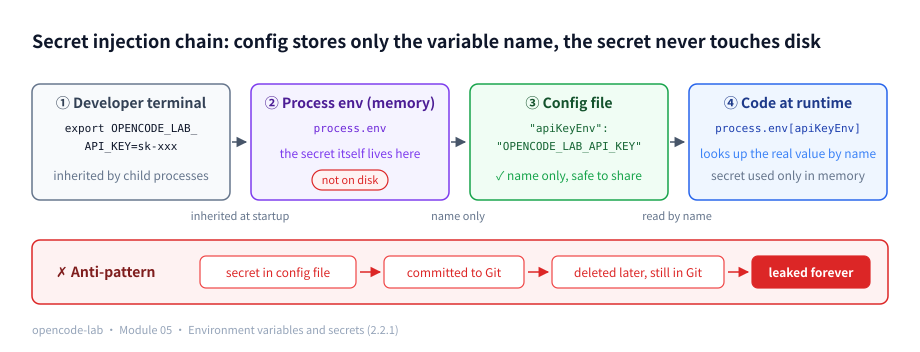
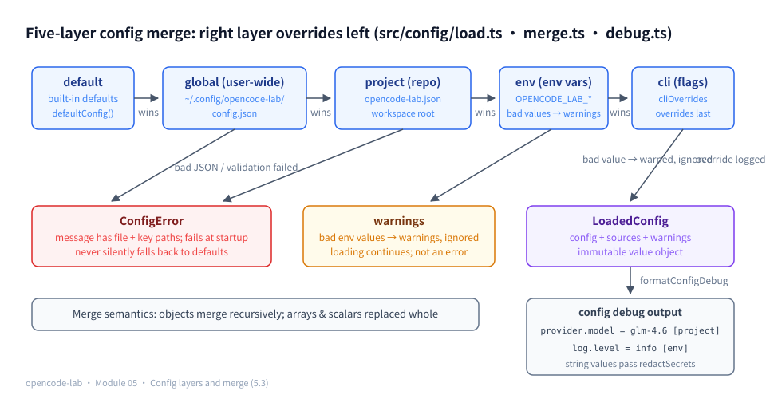
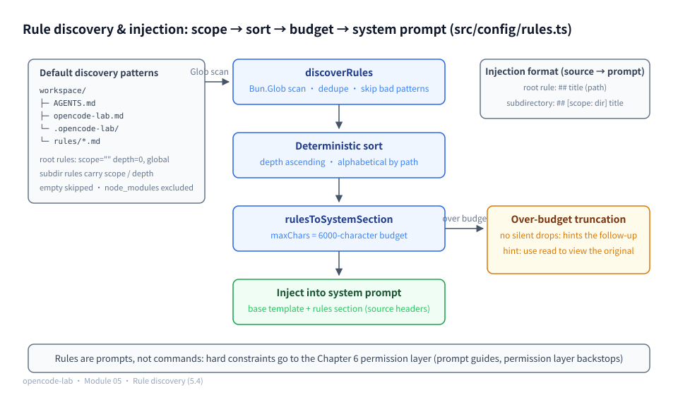
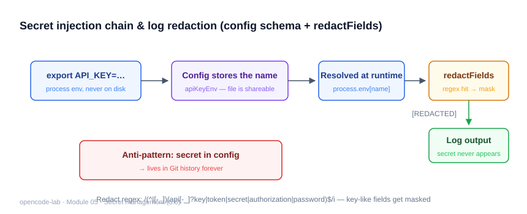
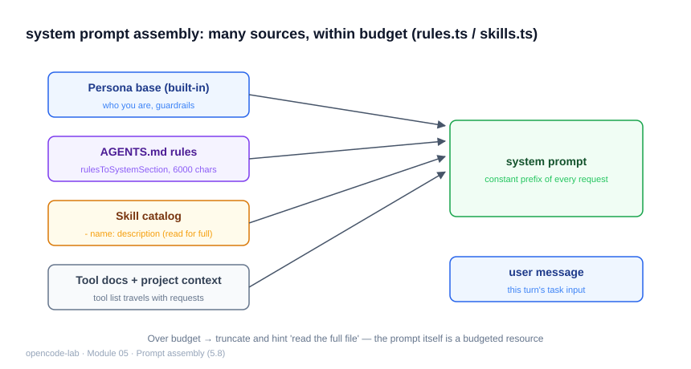

# Chapter 5: Project Rules and Config — Adapting the Agent to Each Project

## 1. Where this chapter fits

- Module: 05 Project Rules and Config
- Study time: 6–8 hours (including the Section 2 primer)
- Difficulty: intermediate — Section 2 builds four foundations from scratch: environment variables, XDG config directories, immutable merging vs. shallow copies, and dot paths
- Prerequisite: Chapter 4 (the Agent Loop consumes systemPrompt)
- Corresponding OpenCode commit: `70a24697ea0028e19f22712fd63059538cb4bee7`
- Corresponding milestone in this project: `v0.7-config`

## 2. Prerequisites

> This chapter teaches the Agent to adapt to its surroundings: different projects load different models, permissions, and rules. Section 2 builds four foundations from scratch: environment variables (the carrier for secret management), the XDG config directory (the convention for where global config lives), immutable merging vs. shallow copies (the precondition for merge semantics), and dot paths (the addressing scheme behind error diagnostics and source tracking).

### 2.1 Glossary for this chapter

| Term | In one plain sentence | Where it appears in this chapter |
|---|---|---|
| Environment variable | A key-value "ID card" the OS gives each process; children inherit it from their parent | 2.2.1; secrets in 5.6, env layer in 5.2 |
| export | A shell command: puts a variable onto the "ID card" so every child process started afterwards can see it | 2.2.1 |
| XDG config directory | A Linux convention: user-level config lives in `~/.config/<app-name>/` | 2.2.2; global path in 5.2 |
| Layered config | Config comes from multiple layers (defaults/user/project/env/CLI), each overriding the previous in a fixed order | 5.2 |
| Deep merge | Overlaying two config trees: objects merge recursively level by level instead of being replaced wholesale | 5.3 |
| Shallow copy | `{...base}` copies only the first level; nested objects are still the same shared one | 2.2.3; 5.3 |
| Immutable merge | Merging modifies none of the inputs and returns a brand-new object | 2.2.3; 5.3 |
| Dot path | `a.b.c` notation for the location of a value inside nested objects | 2.2.4; error messages in 5.1 |
| Leaf key | The value at the end of a dot path that "is no longer an object" (arrays count as leaves in this project) | 2.2.4; source table in 5.3 |
| Schema / runtime validation | Declares which keys exist, their types and ranges; blocks non-compliant input at load time | 5.1 |
| Type erasure | TS types vanish after compilation; the compiler has no say over what runtime JSON looks like | 5.1 |
| Token / context window | The model's unit of text / how much content a model can see at once (Chapter 1, Section 2.2.1) | budgets in 5.4 and 5.8 |
| Glob pattern | A mini-language of `*`-style wildcards describing "which files" (Chapter 3) | rule discovery in 5.4 |
| Discriminated union | A union type where each member carries a tag field (Chapter 0, Section 2.2.1) | `ConfigValidation` in 5.1 |

### 2.2 Foundations (the config world from zero)

#### 2.2.1 Environment variables and export: where a process's environment comes from

**Definition**: An environment variable is a **key-value "ID card"** the operating system hands to every process — the process inherits a copy from its parent the moment it is born (started) and can read it at any time while running. `process.env` reads exactly this card.

**export**: In a shell, `export FOO=bar` means "put FOO onto the card"; every **child process** started from this shell afterwards can see FOO. A variable assigned without `export` stays in the current shell's hands only — child processes never see it. Inspect with `printenv` (all variables, or a single one).

**Minimal walkthrough**:

```bash
export OPENCODE_LAB_API_KEY=sk-demo-1234   # onto the current shell's card
printenv OPENCODE_LAB_API_KEY              # → sk-demo-1234
bun src/index.ts run "任务"                # this child process inherits the same value
```

**The CI secrets convention**: Continuous-integration platforms such as GitHub Actions inject "secrets" into the build process as environment variables — this is the industry-standard way to deliver secrets. Storing only variable names in config files and putting the secret itself in the environment is precisely a use of this convention (all of 5.6 is about it).

**How this chapter uses it**: `provider.apiKeyEnv` stores the variable **name**; at runtime `env[apiKeyEnv]` fetches the real value from the card. The 7 variables such as `OPENCODE_LAB_MODEL` form the config's env layer (5.2).



*Figure 5-P1: The secret injection chain — the developer `export`s it into the process environment (memory only, never on disk), the config file stores only the variable name `apiKeyEnv` (safe to share freely), and the code looks up the real value by name at runtime; once a secret is written into a config file it enters Git history and leaks forever.*

#### 2.2.2 The XDG config directory spec: where Linux keeps configuration

**Definition**: Among the XDG conventions (a set of Linux desktop standards) is the **Base Directory spec**: user-level configuration goes uniformly into `~/.config/<app-name>/`, instead of each app scattering dotfiles across the home directory; setting the `XDG_CONFIG_HOME` environment variable moves `~/.config` elsewhere.

**Other systems in one sentence**: The Windows counterpart is `%APPDATA%`, macOS uses `~/Library/Application Support/` — "user config has a fixed home" is the idea shared across systems; non-Linux readers can reason by analogy.

**Minimal walkthrough**:

```bash
echo $XDG_CONFIG_HOME   # empty on most machines → falls back to ~/.config
ls ~/.config            # git, bun... each app's config directory lives here
```

**How this chapter uses it**: The global config path `~/.config/opencode-lab/config.json` is resolved exactly this way; the priority in `defaultGlobalPath`: use `XDG_CONFIG_HOME` if set, otherwise fall back to `.config` under HOME (5.2).

#### 2.2.3 Immutable merging and shallow copies: `{...base}` copies only one level

**Definition**: `{ ...base }` (a spread copy) is a **shallow copy** — only the first level of the object is copied: the top level becomes a new object, but nested objects/arrays remain **the same shared reference**.

**Minimal demo** (4 lines, to see "only one level is copied"):

```ts
const base = { log: { level: "info" }, rules: ["a.md"] }
const copy = { ...base }             // shallow copy: first level is new, nested levels are shared
copy.rules = ["b.md"]                // change the first level: base is unaffected
copy.log.level = "debug"             // change a nested level: base.log.level becomes "debug" too!
```

**Immutable merging** means the merge function **modifies none of the objects passed in** and instead returns a brand-new object (every recursion level allocates anew). The counter-example is "mutating in place" — directly changing fields of a passed-in object; because nested levels are shared (see line 4 of the demo above), in-place mutation causes **cross-layer contamination**: the defaults layer's nested objects get changed too, and every later read suffers.

**How this chapter uses it**: `deepMerge` in 5.3 implements immutable merging with `{ ...base }` + returning new objects recursively, and the test "recursive merge does not modify the originals" guards this property.

#### 2.2.4 Dot paths and leaf keys: how `a.b.c` addresses a value

**Definition**: A **dot path** is a dot-separated series of keys denoting "the location of a value inside nested objects", e.g. `permissions.shell`, `provider.apiKeyEnv`. A **leaf key** is the value at the end of the path that "is no longer an object" — numbers, strings, booleans, arrays (this project treats arrays as whole values, so they count as leaves too).

**Minimal walkthrough** (5 lines):

```ts
const cfg = { agent: { maxSteps: 12 } }
// reading dot path "agent.maxSteps": split on ".", descend level by level
cfg["agent"]["maxSteps"]   // → 12
// "agent.maxSteps" is a leaf key (it ends in a number); "agent" is not a leaf (you can keep descending)
```

**How this chapter uses it**: Validation error messages look like this — `permissions.shell 必须是 allow | deny | ask 之一` ("permissions.shell must be one of allow | deny | ask") — the user can fix things by following the path (5.1); the keys of the source-tracking table and every line of `config debug` output use dot paths too (5.3).

### 2.3 Recap of the previous module

- Chapter 4's `RunResult.messages` is the **complete message history** — the user/assistant/tool roles pair up one-to-one via `toolCallId`, and terminal states split four ways: completed/failed/aborted/max_steps. This chapter's config such as `agent.maxSteps` is where the parameters fed to `runAgent` come from.
- Tokens and the context window (Chapter 1, Section 2.2.1: what a model can "see" at once has a token cap) reappear in this chapter as "the length budget for rule injection" — what is budgeted is the context (5.4).
- The two-valued `PermissionGate` interface planted in Chapter 4 gets its policy from this chapter's `permissions.*` config section (Chapter 6 builds out the permission engine; for now you only need to know: this chapter's job is to spell out "the default allow/deny/ask for each tool").

---

## 3. Learning objectives

- Understand: why the config hierarchy (default → global → project → env → cli) must be deterministic and explainable; the semantics of discovering rule files by directory scope.
- Be able to implement: config validation with path-level diagnostics, deep merge + source tracking, environment-variable overrides, AGENTS.md rule discovery and injection, and `config debug` output.
- Be able to test: use temp directories to fake global/project config files; exhaustively cover merge priority and bad-config paths.
- Be able to explain: why config stores only `apiKeyEnv` (an environment variable name) and never the secret itself.

## 4. Problem statement

The same Agent must work across different projects: project A uses pnpm, project B runs its tests in containers, project C has a team convention banning `any`. These differences must not be hard-coded into the code. OpenCode maps to `packages/opencode/src/config/` (parsing, paths, merging) + `packages/core/src/config/` (schema). This chapter implements the teaching equivalent.

Three engineering decisions:

1. **JSON instead of YAML**: zero dependencies, native parsing via `Bun.file().json()`; YAML is a take-home challenge (OpenCode supports more formats).
2. **Secrets never enter config**: `provider.apiKeyEnv` stores only an environment variable name; the validator rejects the `apiKey` field outright.
3. **Bad config fails loudly**: invalid JSON/invalid values throw `ConfigError` (with file path + key path) and never silently fall back to defaults — silence makes users believe the config took effect.

## 5. Core concepts

Section 8.6 of the design blueprint lists 8 knowledge points for Module 05. The table below maps "knowledge point ↔ source file ↔ test file" (paths relative to `opencode-lab/`); each point is then expanded one by one.

| Knowledge point | Source file | Test file |
|---|---|---|
| Config schema and defaults | `src/config/schema.ts` | `test/config/schema.test.ts` |
| Config layers (defaults/user/project/env vars/CLI) | `src/config/load.ts` | `test/config/load-rules.test.ts` |
| Config merging, overrides, and conflict diagnostics | `src/config/merge.ts`, `src/config/load.ts`, `src/config/debug.ts` | `test/config/schema.test.ts`, `test/config/load-rules.test.ts` |
| Markdown project rules and instruction discovery | `src/config/rules.ts` | `test/config/load-rules.test.ts` |
| Provider, Agent, Tool, Permission config | `src/config/schema.ts`, `src/app/application.ts` | `test/config/schema.test.ts` |
| Sensitive config and secret management | `src/config/schema.ts`, `src/config/debug.ts`, `src/providers/errors.ts` | `test/config/schema.test.ts`, `test/config/load-rules.test.ts` |
| Hot reload and config versions | `src/config/load.ts` (teaching-version boundary, see 5.7) | `test/config/load-rules.test.ts` |
| Prompt templates and context injection | `src/config/rules.ts`, `src/app/application.ts` | `test/config/load-rules.test.ts` |

### 5.1 Config schema and defaults

**Concept**

Config files are written by hand; typos, wrong types, and out-of-range values happen all the time. Without validation, the scariest outcome is not an error but silent ineffectiveness — the user believes the config applied while the program actually runs on defaults.

Why are "TypeScript types not enough"? Because of **type erasure** (the Section 2.1 glossary): TS types exist only at compile time and vanish once compiled into running code; a config file is JSON read at runtime, and the compiler has no say over its shape. So we need a **hand-written runtime validator**: it declares "which keys exist, of what type, within what range", keeps non-compliant input out at load time, and produces error messages **with dot paths** (e.g. `permissions.shell 必须是 allow | deny | ask 之一`), so users can fix things by following the message. This project keeps the same philosophy as Chapter 2's tool-argument validation: trust no external input — a config file is fundamentally no different from tool arguments sent by the model. Defaults solve "usable with zero config": the Agent runs even with no config file at all, and `defaultConfig()` is itself an executable document.

**How this project implements it**

`src/config/schema.ts` first declares the types (the ideal merged shape), then the defaults, and finally guards the boundary with a runtime validator:

```ts
export type Config = {
  provider: {
    name: string
    model: string
    baseUrl: string
    apiKeyEnv: string
    timeoutMs: number
  }
  agent: {
    default: string
    maxSteps: number
    temperature: number
  }
  permissions: {
    shell: PermissionMode
    // ... write / edit / apply_patch / test follow the same shape, omitted
  }
  rules: string[]
  log: {
    level: LogLevel
  }
}
```

The validator runs type/enum/range checks on every known path (excerpt):

```ts
checkNumber(record, "agent.maxSteps", errors, { min: 1, max: 200 })
checkNumber(record, "agent.temperature", errors, { min: 0, max: 2 })
for (const tool of ["shell", "write", "edit", "apply_patch", "test"] as const) {
  checkEnum(record, `permissions.${tool}`, errors, PERMISSION_MODES as unknown as string[])
}
```

Every `check*` first goes through `atPath` to fetch the value by dot path and returns immediately when it is missing (`undefined`) — a missing key is a legal partial override, and the validator only blocks values that "are present but invalid"; that errors can pinpoint a leaf path like `agent.maxSteps` also relies on the same `atPath` addressing.

A bad config alongside its errors, to feel what "with key paths" looks like (both errors are collected, not just the first):

```json
{ "agent": { "maxSteps": 999 }, "permissions": { "shell": "maybe" } }
```

```text
agent.maxSteps 必须在 1—200 之间
permissions.shell 必须是 allow | deny | ask 之一
```

This is not a documentation mock-up but the validator's real return value — a bun script calls `validateConfig` directly:

```bash
ROOT=/home/wilton/diskWD1/codeWorkspace/opencode/docs/refAgentCode   # adjust to your checkout location
cat > /tmp/config-validate-demo.ts <<EOF
import { validateConfig } from "$ROOT/opencode-lab/src/config/schema"

const bad = { agent: { maxSteps: 999 }, permissions: { shell: "maybe" } }
console.log(JSON.stringify(validateConfig(bad), null, 2))
EOF
bun /tmp/config-validate-demo.ts
```

Output (excerpt):

```json
{
  "ok": false,
  "errors": [
    "agent.maxSteps 必须在 1—200 之间",
    "permissions.shell 必须是 allow | deny | ask 之一"
  ]
}
```

Both errors carry a dot path (Section 2.2.4) and state the expected value — users can fix things without reading the code. Three design intents, spelled out one by one:

- **What gets validated is a "partial override"**: config files may write only the few keys they want to change; a full set is not required. Implementation-wise, the validator uses `atPath` to fetch values by dot path (Section 2.2.4) and skips the check when the key is missing — so a config containing only `{"log": {"level": "debug"}}` is legal, and defaults fill in the rest.
- **Unknown top-level keys are rejected outright**, with the allowed keys listed in the error: this prevents the silent failure of "config written but key name misspelled".
- **The defaults themselves must pass validation**: the "default config passes validation" test in `test/config/schema.test.ts` guards that schema and defaults never drift apart.

**Common pitfalls**

- Symptom: a misspelled nested key (e.g. `agent.maxStep`) raises no error and has no effect. Cause: the validator only rejects unknown top-level keys; unknown keys in nested objects are outside its scope. Fix: understand this boundary; the extension direction is an allowlist for every nested object.
- Symptom: believing the validator requires every field to be filled in. Cause: treating the `Config` type as a mandatory checklist. Fix: the type describes the final merged shape; `validateConfig`'s input may omit keys (partial-override semantics).
- Symptom: after adding a new config field, invalid values still get through. Cause: only the type was changed, not `validateConfig` (type erasure — runtime validation is the only line of defense). Fix: when adding a field, update three places in sync — the type, `defaultConfig()`, and the validation branch.

**Self-check questions**

1. Why does `validateConfig` take `unknown` rather than `Config`? → Reference points: TypeScript types vanish at compile time (type erasure); runtime JSON is untrusted across the board; the validator is the real runtime type guard.
2. Why do `checkString`/`checkNumber`/`checkEnum` return immediately on `undefined`? → Reference points: a missing key is legal (partial-override semantics); the validator only ensures "values that are present must be valid".
3. Why do error messages use dot paths (`permissions.shell`) instead of line numbers? → Reference points: JSON has no stable line-number semantics; dot paths map directly back to the config hierarchy the user edits (dot paths defined in Section 2.2.4).

### 5.2 Config layers: defaults, user, project, directory, command line, environment variables

**Concept**

One and the same configuration logically comes from several places: the program's built-in defaults, personal preferences in the user's home directory, team conventions in the project repository, process environment variables, and one-off command-line arguments. Layering exists to **keep everything in its right place**: team conventions go into the project repo (version-controlled, reviewable), personal preferences stay in the user directory (keeping the repo clean), and temporary experiments go on the command line (never touching disk).

Why exactly these five layers, and why this order? One criterion decides: **the more specific a layer's scope and the shorter its lifetime, the higher its priority**. This matches everyday tool behavior: in an editor, "the option ticked just for this search" beats "workspace settings", which in turn beat "user-global settings" — "what was explicitly said this time" wins over "the usual general setting". Applying this layer by layer: default is the program author's generic defaults (broadest); global (`~/.config`, Section 2.2.2) is "my personal preferences on this machine"; project (files inside the repo) is "this team's conventions" — more specific than personal preferences, and it travels with the repo and is reviewable; env is the value "the environment of this particular run" provides (the ID card from Section 2.2.1); cli is "what was explicitly typed in this command" — the most specific and the shortest-lived. Hence the order is fixed as `default < global < project < env < cli`, with right-hand layers overriding left-hand ones.

The premise is that the override order must be **deterministic and explainable** — the blueprint's common mistake "config merging uses implicit order; users cannot predict the result" is exactly this. The blueprint's "directory" layer shows up in the teaching version as the directory scope of rule files (see the scope/depth in 5.4), not as a separate config layer.

To watch layer-by-layer override on one concrete value — keep your eye on the single key `provider.model` and see who rewrites it along the way (matches Exercise 1):

| Layer | What this layer writes | provider.model value | Source label |
|---|---|---|---|
| default | built-in default `gpt-4o-mini` | gpt-4o-mini | default |
| global | `~/.config/opencode-lab/config.json` sets `glm-4.6` | glm-4.6 | global |
| project | this repo does not set this key | glm-4.6 (inherited) | global (kept) |
| env | `OPENCODE_LAB_MODEL=qwen-max` | qwen-max | env |
| cli | in `cliOverrides`, `--model deepseek-chat` | deepseek-chat | cli |

**How this project implements it**

The main flow of `src/config/load.ts` is the layer order itself (the order doubles as documentation):

```ts
let merged = defaults
const globalPath = options.globalPath ?? defaultGlobalPath(options.env)
merged = await applyFileLayer(merged, sources, globalPath, "global", warnings)
merged = await applyFileLayer(merged, sources, `${options.workspace}/${PROJECT_CONFIG_FILE}`, "project", warnings)

const envLayer = envOverrides(options.env ?? process.env, warnings)
if (Object.keys(envLayer).length > 0) {
  merged = deepMerge(merged, envLayer)
  overlaySources(envLayer, sources, "env")
}
```

`applyFileLayer` returns `merged` unchanged when the file does not exist — "no global/project config file written" is the norm, not an error; only when a file exists but fails JSON parsing or validation does it throw a `ConfigError` carrying the path.

Every file layer passes through `validateConfig` first; a bad file throws `ConfigError` with the file path in the message. The env layer only recognizes the `OPENCODE_LAB_` prefix (7 mappings such as `OPENCODE_LAB_MODEL`, `OPENCODE_LAB_MAX_STEPS`), converts numeric types, and records bad values into `warnings` and ignores them — environment variables are often set by the outside environment, so degrading beats crashing. The subtlest is the command-line layer: it validates the **merged whole** once more:

```ts
if (options.cliOverrides && Object.keys(options.cliOverrides).length > 0) {
  const cliValid = validateConfig(deepMerge(merged, options.cliOverrides))
  if (!cliValid.ok) throw new ConfigError(`命令行配置无效: ${cliValid.errors.join("; ")}`)
  merged = deepMerge(merged, options.cliOverrides)
  overlaySources(options.cliOverrides, sources, "cli")
}
```

The global path is resolved per the XDG spec (`defaultGlobalPath`: use `XDG_CONFIG_HOME` if set, otherwise fall back to `~/.config/opencode-lab/config.json`). Both `globalPath` and `env` can be injected via `LoadOptions`, so tests never touch the real HOME (see `tempGlobalConfig` + `emptyEnv` in `test/config/load-rules.test.ts`).

No need to memorize the layer order — run the layering table above for real with a script (global sets model-a, project sets model-b, the environment provides model-c; workspace and globalPath are all injected, the real HOME untouched):

```bash
ROOT=/home/wilton/diskWD1/codeWorkspace/opencode/docs/refAgentCode   # adjust to your checkout location
cat > /tmp/config-layers-demo.ts <<EOF
import { mkdirSync } from "node:fs"
import { loadConfig } from "$ROOT/opencode-lab/src/config/load"

const globalDir = "/tmp/config-layers-demo/global/opencode-lab"
const projectDir = "/tmp/config-layers-demo/project"
const emptyDir = "/tmp/config-layers-demo/empty"
mkdirSync(globalDir, { recursive: true })
mkdirSync(projectDir, { recursive: true })
mkdirSync(emptyDir, { recursive: true })
await Bun.write(globalDir + "/config.json", JSON.stringify({ provider: { model: "model-a" } }))
await Bun.write(projectDir + "/opencode-lab.json", JSON.stringify({ provider: { model: "model-b" } }))
const env = { OPENCODE_LAB_MODEL: "model-c" }

const step1 = await loadConfig({ workspace: emptyDir, globalPath: globalDir + "/config.json", env: {} })
console.log("① 只有 global 层:", step1.config.provider.model, "← 来源:", step1.sources["provider.model"])

const step2 = await loadConfig({ workspace: projectDir, globalPath: globalDir + "/config.json", env: {} })
console.log("② 叠加 project 层:", step2.config.provider.model, "← 来源:", step2.sources["provider.model"])

const step3 = await loadConfig({ workspace: projectDir, globalPath: globalDir + "/config.json", env })
console.log("③ 再叠加 env 层:", step3.config.provider.model, "← 来源:", step3.sources["provider.model"])
EOF
bun /tmp/config-layers-demo.ts
```

Output (excerpt):

```text
① 只有 global 层: model-a ← 来源: global
② 叠加 project 层: model-b ← 来源: project
③ 再叠加 env 层: model-c ← 来源: env
```

Each time a higher layer overrides a value, the `sources` table swaps its stamp in step — a "value" and "where it came from" always travel as a pair. The env-layer override is visible from the CLI too (the `config debug` command is unpacked in 5.3; stderr is a single startup-log line, omitted below):

```bash
ROOT=/home/wilton/diskWD1/codeWorkspace/opencode/docs/refAgentCode   # adjust to your checkout location
cd "$(mktemp -d)"   # any project directory works; an empty directory rules out project-layer interference
OPENCODE_LAB_MODEL=env-model bun "$ROOT/opencode-lab/src/index.ts" config debug 2>/dev/null | grep "provider.model"
```

Output (excerpt):

```text
  provider.model = env-model  [env]
```

**Common pitfalls**

- Symptom: believing environment variables have the highest priority. Cause: ordering by intuition. Fix: cli comes after env; the "command line overrides everything" case in `test/config/load-rules.test.ts` pins this down.
- Symptom: a bad environment variable crashes startup. Cause: treating the env layer like a file layer. Fix: bad values in file layers are hard errors (`ConfigError`); bad env values go to `warnings` and are ignored.
- Symptom: tests read and write `~/.config` directly and pollute the machine. Cause: depending on real global state. Fix: inject temp paths via `LoadOptions.globalPath`/`env`; global state is always passed in explicitly.

**Self-check questions**

1. Why must the cli layer run `validateConfig(deepMerge(merged, cli))` before merging? → Reference points: individual override fragments may each be legal yet illegal in combination (e.g. overriding an enum field with an invalid value); the final whole must be validated.
2. Which wins between `XDG_CONFIG_HOME` and `HOME`? → Reference points: the former wins (the ternary branch in `defaultGlobalPath`); this is the standard Linux desktop convention for config paths (Section 2.2.2).
3. Why does the env layer only accept the `OPENCODE_LAB_` prefix? → Reference points: the prefix is a namespace, avoiding accidental collisions with variables that happen to share a name in the user's environment (e.g. `MODEL`).

### 5.3 Config merging, overrides, and conflict diagnostics

**Concept**

The core operation of stacking config layers is merging. It looks like a single rule — "the deeper layer overrides the shallower" — but in fact every corner needs a decision: when objects meet objects, is it a recursive merge or a wholesale replacement? What about arrays? What about `null`? The teaching version deliberately picks the **most predictable** semantics: objects merge recursively; arrays and scalars are replaced wholesale.

"Arrays don't merge" deserves a counter-example. Suppose we merged by index — splicing the two layers position by position:

```text
defaults rules:                            ["AGENTS.md", "opencode-lab.md", ".opencode-lab/rules/*.md"]
project rules:                             ["docs/rules/*.md"]
index-wise merge result (hypothetical, bad semantics):  ["docs/rules/*.md", "opencode-lab.md", ".opencode-lab/rules/*.md"]
```

Position 0 got swapped: the user's pattern knocked out the first default entry while the second and third defaults survived. The user can neither predict which entries survive nor "append one entry" without first counting how many elements the default list has. Wholesale replacement demands writing the full list, but the result can be derived line by line from the inputs — explicit beats clever.

Merging alone is not enough: when the user asks "why is this value what it is", the system must be able to answer. The answer is **source tracking**: record which layer last wrote each leaf key, then let `config debug` (this section's `debug.ts`) display that table — conflict diagnosis turns from "guessing" into "looking".

**How this project implements it**

All of `src/config/merge.ts` is barely 39 lines; three functions each mind one thing:

```ts
export function deepMerge(base: Record<string, unknown>, override: Record<string, unknown>): Record<string, unknown> {
  const out: Record<string, unknown> = { ...base }
  for (const [key, value] of Object.entries(override)) {
    const existing = out[key]
    if (isPlainObject(existing) && isPlainObject(value)) {
      out[key] = deepMerge(existing, value)
    } else {
      out[key] = value
    }
  }
  return out
}
```

Note `{ ...base }` and returning a new object recursively: this is **immutable merging** (Section 2.2.3 — a shallow copy duplicates only the first level, so every recursion level must allocate a new object for the caller's inputs to remain untouched; guarded by the "recursive merge does not modify the originals" test). Arrays fall into the `else` branch and are replaced wholesale, because `isPlainObject` explicitly excludes arrays.

This logic can be run directly, which also verifies "the passed-in objects are never modified":

```bash
ROOT=/home/wilton/diskWD1/codeWorkspace/opencode/docs/refAgentCode   # adjust to your checkout location
cat > /tmp/deepmerge-demo.ts <<EOF
import { deepMerge } from "$ROOT/opencode-lab/src/config/merge"

const defaults = { log: { level: "info" }, rules: ["AGENTS.md", "opencode-lab.md", ".opencode-lab/rules/*.md"] }
const project = { log: { level: "debug" }, rules: ["docs/rules/*.md"] }

const merged = deepMerge(defaults, project)
console.log("merged:", JSON.stringify(merged))
console.log("defaults 未被修改:", JSON.stringify(defaults))
EOF
bun /tmp/deepmerge-demo.ts
```

Output (excerpt):

```text
merged: {"log":{"level":"debug"},"rules":["docs/rules/*.md"]}
defaults 未被修改: {"log":{"level":"info"},"rules":["AGENTS.md","opencode-lab.md",".opencode-lab/rules/*.md"]}
```

The merge algorithm on concrete values, one pass for objects and one for arrays (complements the layering table in 5.2: that one shows "who wins", this one shows "how"):

```text
default: { "log": { "level": "info" }, "rules": ["AGENTS.md", "opencode-lab.md", "..."] }
project: { "log": { "level": "debug" }, "rules": ["docs/rules/*.md"] }
merged:  { "log": { "level": "debug" },          ← log is an object: merged recursively, level overridden by project
           "rules": ["docs/rules/*.md"] }        ← rules is an array: replaced wholesale, not concatenated with the defaults
```

Source tracking is two complementary traversals; the evolution of two tables shows it most directly. At the start of loading, the defaults layer is fully labeled by `recordSources` — **every leaf of the whole tree gets the default stamp**:

| Key (dot path) | Source |
|---|---|
| provider.model | default |
| provider.baseUrl | default |
| log.level | default |

Then the project layer brings `{"provider": {"model": "glm-4.6"}}`, processed by `overlaySources` — **only the leaves actually present in this layer get re-stamped**:

| Key (dot path) | Source |
|---|---|
| provider.model | **project** |
| provider.baseUrl | default (not brought in, old stamp kept) |
| log.level | default |

The division of labor in one sentence: `recordSources` stamps the whole tree (used once, on the initial defaults layer), while `overlaySources` re-stamps only the leaves present in a new layer (used once per subsequent layer):

```ts
// re-stamp the source table with the keys actually present in override (deeper default sources are kept)
export function overlaySources(override: Record<string, unknown>, sources: Record<string, ConfigSource>, source: ConfigSource, prefix = "") {
  for (const [key, value] of Object.entries(override)) {
    const path = prefix === "" ? key : `${prefix}.${key}`
    if (isPlainObject(value)) overlaySources(value, sources, source, path)
    else sources[path] = source
  }
}
```

The last link in conflict diagnostics is `formatConfigDebug` in `src/config/debug.ts`: flatten the config tree, print one `path = value [source]` line each, plus the `warnings` list — the "sources are explainable" acceptance criterion is fulfilled right here.

The CLI wraps it as the `config debug` command. Drop a project config that sets only two keys into a temp directory and run it for real (stderr is a single `cli_started` log line, omitted below; the temp-directory suffix is random, noted in parentheses):

```bash
LAB=$(mktemp -d /tmp/cfgdebug.XXXX)
printf '{"provider":{"model":"glm-4.6"},"permissions":{"shell":"allow"}}' > "$LAB/opencode-lab.json"
cd "$LAB" && bun /home/wilton/diskWD1/codeWorkspace/opencode/docs/refAgentCode/opencode-lab/src/index.ts config debug 2>/dev/null
```

Output (excerpt):

```text
opencode-lab 配置来源（default < global < project < env < cli，右层覆盖左层）:

  provider.name = openai-compatible  [default]
  provider.model = glm-4.6  [project]
  provider.baseUrl = https://api.openai.com/v1  [default]
  provider.apiKeyEnv = OPENCODE_LAB_API_KEY  [default]
  … (agent.*, the other four permissions entries, rules, log.level are all [default]; omitted)
  permissions.shell = allow  [project]

警告:
  - 已加载项目配置: /tmp/cfgdebug.1baD/opencode-lab.json (directory suffix is random)
```

The project layer set only two keys, and the output shows exactly two `[project]` lines with everything else stamped `[default]` — `overlaySources`' "re-stamp only the leaves actually present in this layer" is verified in real output. The distance between "why is this value what it is" and the answer is, from now on, a single command.

**Common pitfalls**

- Symptom: expecting `rules: ["a.md"]` to merge with the three default rules into four. Cause: assuming array merging is the default semantics. Fix: arrays are replaced wholesale; appending means writing the full list ("scalars and arrays are replaced wholesale" in `test/config/schema.test.ts`; the counter-example walkthrough in this section's Concept explains why).
- Symptom: the merge function modifies its passed-in objects, causing cross-layer contamination. Cause: in-place mutation was used (nested levels are shared; see line 4 of the Section 2.2.3 demo). Fix: shallow copy + returning new objects recursively; merging stays a pure function.
- Symptom: after a new layer overrides, every key's source changed. Cause: misusing `recordSources` (full labeling) for subsequent layers. Fix: use `overlaySources` for subsequent layers, labeling only the leaf keys present (test "overlaySources re-stamps only the leaves present in override"; the two-table evolution in this section shows exactly this scene).

**Self-check questions**

1. Why must `isPlainObject` explicitly exclude `Array`? → Reference points: `typeof [] === "object"`; without the exclusion, arrays would be treated as objects and merged index-wise with unpredictable semantics (the counter-example in this section's Concept).
2. Which layer does a key missing from the `sources` table come from? → Reference points: the default layer is fully labeled by `recordSources`, so normally nothing is missing; `?? "default"` in `debug.ts` is just a defensive fallback.
3. How do you answer "why is `permissions.shell` ask"? → Reference points: run `formatConfigDebug(loaded)`; the output `permissions.shell = ask  [default]` makes the source obvious.



*Figure 5-1: The five-layer config merge pipeline: default → global → project → env → cli override from left to right; objects merge recursively, arrays and scalars are replaced wholesale; a bad file-layer config throws ConfigError (with path diagnostics), bad env values degrade into warnings, and every leaf key records its last-writing layer, displayed by config debug.*

### 5.4 Markdown project rules and instruction discovery

**Concept**

Project rules (the AGENTS.md family) let a repo carry its team conventions "built-in" into the Agent's context: build commands, how to test, code style. Three problems to solve: **where to look** (conventional locations + config overrides, avoiding a full-repo scan), **in what order** (the order rules appear in the same context must be deterministic, otherwise results are not reproducible across machines), and **scope** (root-level rules apply globally, while deep rules like `packages/foo/AGENTS.md` are more relevant only to that subtree — the blueprint's "load by directory scope").

One more easily missed point: rules are **prompt material**, not commands. Context (Chapter 1, Section 2.2.1: what a model can "see" at once has a token cap) is a scarce resource; injecting rule texts unconditionally crowds out the task's own share (the blueprint's common mistake "concatenating all rule files into the context unconditionally"), so there must be a length budget and a degradation path — what is budgeted is the context.

**How this project implements it**

`src/config/rules.ts` defines the structure of each rule: `path` (workspace-relative path), `scope` (its directory, `""` meaning root), `depth` (directory levels), `title` (first level-1 heading), `content`. The main discovery loop:

```ts
for (const rel of filterExcluded(matches).sort()) {
  if (seen.has(rel)) continue
  seen.add(rel)
  const content = await Bun.file(`${workspace}/${rel}`).text().catch(() => "")
  if (content.trim() === "") continue
  const scope = rel.includes("/") ? rel.split("/").slice(0, -1).join("/") : ""
  found.push({
    path: rel,
    scope,
    depth: scope === "" ? 0 : scope.split("/").length,
    title: firstHeading(content) ?? rel,
    content,
  })
}
// root rules first, deeper rules later; ties sorted by path (deterministic)
return found.sort((a, b) => a.depth - b.depth || a.path.localeCompare(b.path))
```

The unremarkable `.sort()` at the top of the loop is the first half of determinism: it first arranges the matches into a stable sequence independent of the file system's return order, so that `seen` deduplication has a reproducible processing order — when the same file is hit by multiple patterns, only the earlier-sorted occurrence ever takes effect.

The default patterns are `["AGENTS.md", "opencode-lab.md", ".opencode-lab/rules/*.md"]`, overridable via `config.rules` (`rulePatternsFromConfig`); scanning uses `Bun.Glob`, and `filterExcluded` (reusing the excluded-directories table from Chapter 3's `src/tools/glob.ts`) keeps `node_modules`, `.git`, and friends out the door. The sort rule on a concrete input (the fixture behind the test "discovers root and subdirectory rules and sorts by depth"):

```text
Input files:    AGENTS.md, .opencode-lab/rules/style.md, .opencode-lab/rules/testing.md
Sorted output:  AGENTS.md                     scope=""                    depth=0   ← root rules first
                .opencode-lab/rules/style.md   scope=".opencode-lab/rules"  depth=2   ← same level, alphabetical by path
                .opencode-lab/rules/testing.md same scope, testing sorts after style
```

No matter what order the file system returns matches in, the output order is always this — that is what "deterministic" (reproducible across machines) means. The injection side, `rulesToSystemSection`, carries a budget:

```ts
let used = 0
for (const rule of rules) {
  const section = rule.scope === "" ? `## ${rule.title} (${rule.path})\n${rule.content.trim()}` : `## [作用域: ${rule.scope}] ${rule.title} (${rule.path})\n${rule.content.trim()}`
  if (used + section.length > maxChars) {
    parts.push(`（其余规则因长度限制省略，可用 read 工具查看：${rule.path}）`)
    break
  }
  used += section.length
  parts.push(section)
}
```

The default is `maxChars = 6000`; on truncation nothing is dropped quietly — the model is told "you can use the read tool to view the original", turning the budget constraint into an executable follow-up action.

Discovery and sorting can be run for real too — a temp directory recreates the same files as the fixture above, plus one rule hidden inside `node_modules` to verify the exclusion logic:

```bash
ROOT=/home/wilton/diskWD1/codeWorkspace/opencode/docs/refAgentCode   # adjust to your checkout location
cat > /tmp/rules-discover-demo.ts <<EOF
import { mkdirSync } from "node:fs"
import { discoverRules } from "$ROOT/opencode-lab/src/config/rules"

const dir = "/tmp/rules-discover-demo"
mkdirSync(dir + "/.opencode-lab/rules", { recursive: true })
mkdirSync(dir + "/node_modules/pkg", { recursive: true })
await Bun.write(dir + "/AGENTS.md", "# 团队约定\n\n用 bun 跑测试。")
await Bun.write(dir + "/.opencode-lab/rules/testing.md", "# 测试规则\n\n测试从包目录跑。")
await Bun.write(dir + "/.opencode-lab/rules/style.md", "# 风格规则\n\n不用 any。")
await Bun.write(dir + "/node_modules/pkg/AGENTS.md", "# 不该被发现的规则")

const rules = await discoverRules(dir, ["AGENTS.md", "opencode-lab.md", ".opencode-lab/rules/*.md"])
for (const rule of rules) {
  console.log(rule.path.padEnd(30), "scope=" + JSON.stringify(rule.scope).padEnd(22), "depth=" + rule.depth, "title=" + rule.title)
}
EOF
bun /tmp/rules-discover-demo.ts
```

Output (excerpt):

```text
AGENTS.md                      scope=""                     depth=0 title=团队约定
.opencode-lab/rules/style.md   scope=".opencode-lab/rules"  depth=2 title=风格规则
.opencode-lab/rules/testing.md scope=".opencode-lab/rules"  depth=2 title=测试规则
```

Line-for-line identical with the fixture walkthrough above: the root rule with `depth=0` comes first, the same level sorted alphabetically by path; the rule inside `node_modules` never appears — `filterExcluded` kept it out the door.

**Common pitfalls**

- Symptom: scanning the whole repo with `**/AGENTS.md` scoops up rules inside `node_modules` too. Cause: glob has no idea which directories are untrustworthy. Fix: results must pass through `filterExcluded` (test "rules inside node_modules are not discovered").
- Symptom: rule order differs across machines. Cause: relying on the file system's return order. Fix: two-key `depth + path` sort, a fully deterministic order (the test asserts the order down to exact paths).
- Symptom: concatenating rule texts blindly blows up the context. Cause: no notion of a budget. Fix: the `maxChars` budget + truncation hint (the test asserts the "use the read tool to view" wording); what is budgeted is the context allowance (the window cap from Chapter 1, Section 2.2.1).

**Self-check questions**

1. What do `scope === ""` and `depth === 0` mean? → Reference points: a root-level rule, applying globally; for subdirectory rules, `scope` is their directory and `depth` the number of directory levels (the `RuleFile` comments).
2. Why skip empty rule files? → Reference points: injecting empty content only wastes budget and carries no information (skipped via `content.trim() === ""`; test "custom patterns and empty-file skipping").
3. Why does an invalid glob pattern only get skipped in `discoverRules` instead of raising an error? → Reference points: patterns were already type-validated at the `validateConfig` layer; this is defense for dynamically passed patterns, and a bad pattern is not worth failing the whole discovery flow.



*Figure 5-2: Rule discovery and injection: root rules such as AGENTS.md have scope="" depth=0 and apply globally, subdirectory rules carry scope/depth; discoverRules sorts deterministically by depth + path; rulesToSystemSection assembles with a 6000-character budget, truncating overlong content with a hint to view it via read, before final injection into the system prompt.*

### 5.5 Provider, Agent, Tool, Permission config

**Concept**

A config file by itself is just declarative data; its value lies in **being consumed by the subsystems**: `provider.*` decides which model service to connect to (Chapter 1), `agent.*` decides runtime parameters (Chapter 4's loop, Chapter 10's role system), `permissions.*` decides permission policy (Chapter 6), and `rules` decides context injection (previous section). Tools have no dedicated config section in the teaching version — "which tools exist" is decided statically by the registry (Chapter 2), and a tool's per-tool "config" is simply its three-state mode inside `permissions`. This split keeps the config schema small and stable: each consuming module reads only the subtree it cares about, and adding a module requires no config-structure change. Understanding this "config → runtime object" mapping is the seam between this module and those that follow.

**How this project implements it**

The convergence point for consumption is `src/app/application.ts`. The Provider section shows the complete `apiKeyEnv` loop — config stores the **variable name**, while the real secret is fetched from the process environment (full chain in 5.6):

```ts
const apiKey = env[config.config.provider.apiKeyEnv]
const provider: LlmProvider =
  options.provider ??
  (apiKey
    ? withProviderRetry(
        createOpenAICompatibleProvider({
          baseUrl: config.config.provider.baseUrl,
          apiKey,
          model: config.config.provider.model,
          timeoutMs: config.config.provider.timeoutMs,
        }),
      )
    : createMockProvider(options.mockScript ?? defaultDemoScript()))
```

With no secret present it falls back to the Mock Provider — part of "usable with zero config" too. The Permission section maps the config verbatim into a runtime policy (the input to Chapter 6's `policyFromConfig`):

```ts
const modes = options.allowAll
  ? Object.fromEntries(Object.keys(config.config.permissions).map((tool) => [tool, "allow"])) as Record<string, PermissionMode>
  : (config.config.permissions as Record<string, PermissionMode>)
const policy = withWorkspace({ ...policyFromConfig(config.config), modes }, options.workspace)
```

`allowAll` is a one-switch allow-everything flag prepared for demos and tests; the production path adopts the three-state modes from config as-is, and `withWorkspace` adds the workspace boundary on top — every field of the policy object comes from config or explicit options, with no hidden defaults.

The Agent section passes `agent.maxSteps`/`agent.temperature` to `runAgent` (the `maxSteps: config.config.agent.maxSteps` lines in `application.ts`); `agent.default` is, in the teaching version, a named placeholder reserved for Chapter 10's Multi-Agent (expanded in Chapter 10; for now just know: the teaching version currently has a single main Agent and this field has no effect yet). The current systemPrompt is assembled from `BUILD_AGENT.systemPrompt` + the rules section + the skills section (see 5.8).

**Common pitfalls**

- Symptom: adding custom sections like `tools: { shell: { enabled: false } }` to the config. Cause: wanting config to express everything. Fix: unknown top-level keys are rejected by validation; "may it do X" belongs to permissions, "which tools exist" belongs to the registry — each to its own.
- Symptom: expecting changing `agent.default` to switch the Agent's prompt. Cause: the field name misleads. Fix: in the teaching version it is only a placeholder for Chapter 10; the current prompt is assembled and passed in by the caller.
- Symptom: confusing `permissions.test` with "a testing switch". Cause: "test" is polysemous. Fix: it is the permission mode of Chapter 3's `test` tool (which runs the project's tests), defaulting to `allow`.

**Self-check questions**

1. Why does config store `apiKeyEnv` instead of the secret itself? → Reference points: config files end up in Git and get printed by debug; a variable name is non-sensitive, while the secret lives only in the process environment (details in 5.6).
2. Which objects does a permission decision pass through from config? → Reference points: `config.permissions` → `policyFromConfig` produces `PermissionPolicy.modes` → `withWorkspace` adds the workspace → Chapter 6's `evaluatePermission` looks it up.
3. Why does the schema hard-code `permissions` to a fixed set of five tools? → Reference points: the teaching version's tool set is fixed (ten built into the registry); explicit enumeration buys path-level diagnostics in validation; the extension direction is open keys + validation against the registry.

### 5.6 Sensitive config and secret management

**Concept**

A config file's destiny is "to be shared": committed into Git, pasted into issues, screenshotted into tutorials. Hence the first iron rule: **secrets never enter config** — countless incidents of `.env` files committed into repos stem from exactly this. The teaching version's answer is to store only the environment variable **name** (`provider.apiKeyEnv`) and keep the secret itself in the process environment (the "ID card" from 2.2.1): the config can be shared freely, with a leak surface of zero.

The full chain of a secret from setup to use (read alongside 2.2.1): (1) the user `export`s `OPENCODE_LAB_API_KEY=sk-...` to put the secret into the shell (in CI this corresponds to secrets injection); (2) the config file holds only the **name** `apiKeyEnv: "OPENCODE_LAB_API_KEY"`; (3) at runtime `env[config.config.provider.apiKeyEnv]` fetches the real value from the process environment; (4) it is handed to `createOpenAICompatibleProvider` and placed into request headers. The config file never touches the secret itself along the way — it entering Git or debug output is harmless.

Two things differing by a single character, sorted out in one table (the confusion behind pitfall three):

| Thing | Where it lives | Example | Ends up in Git/screenshots? |
|---|---|---|---|
| The secret itself | process environment (export / CI secrets injection) | `sk-xxxx` | No (the repo never contains it) |
| The variable name | config file `provider.apiKeyEnv` | `OPENCODE_LAB_API_KEY` | Yes (it is non-sensitive) |

But convention alone is not enough — hands will slip — so we add defense in depth. First line: the validator sees a `provider.apiKey` field and rejects it outright, pointing the way ("please use provider.apiKeyEnv"). Second line: any path that outputs config or resource text to the user goes through `redactSecrets` redaction — error messages, debug output, and (next chapter's) audit logs all share this one function. The tests come in a pair too: "the default config contains no secret fields" guards the source, "displays values and sources without leaking secrets" guards the outlet.

**How this project implements it**

The validator's hard rejection lives in `src/config/schema.ts`:

```ts
if (looksLikeSecret("provider.apiKey", record)) errors.push('不允许在配置中存放密钥，请使用 provider.apiKeyEnv 指定环境变量名')
```

`looksLikeSecret` is a one-liner — check whether the path was assigned a value (`atPath(record, path) !== undefined`): the moment an `apiKey` key appears it is rejected regardless of the value, with no "does it look like a secret" heuristics. A slip gets caught immediately — even when the value is just a demo string:

```bash
ROOT=/home/wilton/diskWD1/codeWorkspace/opencode/docs/refAgentCode   # adjust to your checkout location
cat > /tmp/apikey-reject-demo.ts <<EOF
import { validateConfig } from "$ROOT/opencode-lab/src/config/schema"

console.log(JSON.stringify(validateConfig({ provider: { apiKey: "sk-demo-12345678" } })))
EOF
bun /tmp/apikey-reject-demo.ts
```

Output (excerpt):

```text
{"ok":false,"errors":["不允许在配置中存放密钥，请使用 provider.apiKeyEnv 指定环境变量名"]}
```

The outlet's redaction lives in `src/providers/errors.ts`:

```ts
export function redactSecrets(text: string) {
  return text
    .replace(/sk-[A-Za-z0-9_-]{8,}/g, "sk-[REDACTED]")
    .replace(/Bearer\s+\S+/gi, "Bearer [REDACTED]")
}
```

The two regexes (regex primer in Chapter 0, Section 2.2.5) each handle one secret shape: `sk-[A-Za-z0-9_-]{8,}` matches strings starting with `sk-` followed by at least 8 letters/digits/underscores/hyphens (OpenAI-style keys); `Bearer\s+\S+` matches Bearer followed by whitespace and a run of non-whitespace (the HTTP authorization header form, with the `i` flag ignoring case).

Before flattening the output, `src/config/debug.ts` runs every string value through `redactSecrets` — even though the schema already guarantees no secrets in config, defensive redaction remains a habit worth keeping (`config debug` may concatenate environment info). The default config's `apiKeyEnv: "OPENCODE_LAB_API_KEY"` is itself just a name, and `test/config/schema.test.ts` uses regexes to assert the serialized default config contains no `sk-`/`Bearer `/`password` patterns.



*Figure 5-3: The secret injection chain — the real value exists only in the process environment; the config file stores the variable name apiKeyEnv (freely shareable); at runtime it is fetched by name and, before entering logs, redacted by the redactFields regexes into [REDACTED]. The anti-pattern is writing the secret into a config file — it then leaks forever via Git history.*

**Common pitfalls**

- Symptom: putting a "test-only key" into config, planning to swap it out later. Cause: underestimating how irreversible a leak is. Fix: delete the file and the secret remains in Git history; the validator therefore rejects across the board, no exceptions.
- Symptom: guarding secrets only at the config layer, forgetting the output layer. Cause: assuming redaction is the config module's job. Fix: `redactSecrets` is the shared guard on every user-visible output path; Chapter 6's audit log reuses it directly.
- Symptom: mistaking `OPENCODE_LAB_API_KEY` for a config entry. Cause: it differs from `OPENCODE_LAB_API_KEY_ENV` by a single character. Fix: the former is the secret itself in the process environment (the env mapping table has no such key at all), the latter is the config value (the variable name).

**Self-check questions**

1. Why doesn't `looksLikeSecret` use a regex to judge "does the value look like a secret"? → Reference points: heuristics always let something slip; "an apiKey key appeared, therefore reject" is a zero-miss rule, and the cost of a false positive is merely renaming a key.
2. Secrets are already banned from config — why redact debug output too? → Reference points: defense in depth; debug's inputs include more than config (warnings and other runtime text), and future changes could break the assumption.
3. From the environment variable to the HTTP request header, which code points does the secret cross? → Reference points: `env[config.provider.apiKeyEnv]` fetch → `createOpenAICompatibleProvider` injects the request header; outside this chain the secret must not appear in any log/error/audit (the four-step chain in this section's Concept).

### 5.7 Hot reload and config versions

**Concept**

The blueprint lists "hot reload and config versions" as a knowledge point, but the teaching version **deliberately does not do it** — a boundary drawn on purpose, not an omission. Current semantics: `loadConfig` is called once at application startup, the config snapshot spans the process lifetime, and changing config requires a restart.

The real difficulty of hot reload is not "reading files" but consistency: the policy changes while the Agent is mid-tool — now what? To whom does a half-new half-old config belong? When does the rule cache invalidate? The shared answer to these questions is "**swap in an entire new config at once; tasks already running keep the old startup snapshot and switch after they finish**" — the implementation details fit the take-home challenges better than the teaching mainline. "Config versions" is similar: schema evolution (renamed fields, changed semantics) needs version numbers + migration functions, but the teaching schema is not yet stable, so adding version numbers early is a pseudo-requirement. What the teaching version lays down for that future: `loadConfig` is a **pure function with explicit inputs** (workspace, globalPath, env, cliOverrides all injected), so a watcher only needs to call it again and swap the `LoadedConfig` reference wholesale.

**How this project implements it**

The shape supporting future hot reload is exactly the `LoadOptions`/`LoadedConfig` type pair (`src/config/load.ts`):

```ts
export type LoadOptions = {
  workspace: string
  // global config path (defaults to ~/.config/opencode-lab/config.json; tests inject a temp path)
  globalPath?: string
  env?: Record<string, string | undefined>
  cliOverrides?: Record<string, unknown>
}

export type LoadedConfig = {
  config: Config
  sources: Record<string, ConfigSource>
  warnings: string[]
}
```

Three points. First, config reading has no scattered global state — apart from `process.env.HOME` it never touches the real environment directly (and env is injectable too), so calling again yields a fresh snapshot; tests stay pollution-free precisely because of this. Second, `LoadedConfig` is an **immutable value object** (config + sources + warnings bundled together); hot reload swaps the reference wholesale, so a "half-modified config" cannot exist. Third, the `warnings` array turns "what happened during this load" into data — in a hot-reload scenario it is exactly the material for notifying the user. On schema versions: the teaching `Config` has no version field; if one were added, it would go at the top of `validateConfig` (path-level diagnostics on validation failure) + a default in `defaultConfig` (see the "three places in sync" in 5.1).

**Common pitfalls**

- Symptom: config file edited, but the running Agent's behavior is unchanged. Cause: the teaching version loads once at startup. Fix: expected behavior; if you need hot reload, implement the take-home challenge's watcher, and guarantee running tasks keep using the old snapshot.
- Symptom: hot-updating by directly mutating deep fields of the global config object. Cause: treating config as mutable global state. Fix: call `loadConfig` again for a new object and swap the reference wholesale — never mutate locally (the danger of in-place mutation in Section 2.2.3).
- Symptom: a `version` field added to `Config` that nothing validates. Cause: changed the type and forgot to sync. Fix: keep validation, defaults, and the (future) migration function in sync in three places — see self-check question 3 in 5.1.

**Self-check questions**

1. Why does an "explicit-input" `loadConfig` make hot reload easier to implement? → Reference points: no hidden global dependencies, so repeated calls are naturally safe; the watcher only calls it once more and replaces `LoadedConfig`.
2. What is the most dangerous window when hot-updating permission policy? → Reference points: switching policy while the Agent is mid-tool; Chapter 6's gate holds a policy reference, and a single run should bind to one and the same policy.
3. When does a config schema genuinely need version numbers? → Reference points: when there are existing users whose "old config files must be interpreted correctly by new code"; during the teaching phase the schema evolves with the course, so version numbers are a pseudo-requirement.

### 5.8 Prompt templates and context injection

**Concept**

The system prompt is not one hard-coded string but the assembly result of **template + dynamic sections**: fixed base instructions (the base template) + a rules section that varies by project + other material. Injection must satisfy three properties: **deterministic** (same project, same config → identical assembly every time, otherwise model behavior is not reproducible); **traceable** (every section is labeled with its source, so the model can tell "system instructions" from "project conventions", and the user can see why a given sentence is in the prompt); **budgeted** (context is a scarce resource; dynamic sections need a length cap and a degradation strategy). Chapter 6 will lean on this division-of-labor principle repeatedly (expanded in Chapter 6; for now just know the next chapter consumes `permissions.*` for hard interception): rules are only prompts and **cannot enforce** behavior — to guarantee something never happens, rely on the permission layer, not on "I wrote in AGENTS.md that it's forbidden".

**How this project implements it**

The rules section is generated by `rulesToSystemSection` in `src/config/rules.ts` (its budget logic was quoted in 5.4); assembly converges in `src/app/application.ts`:

```ts
const rules = await discoverRules(options.workspace, rulePatternsFromConfig(config.config))
const skills = await discoverSkills(options.workspace)
const systemPrompt = [
  BUILD_AGENT.systemPrompt,
  rulesToSystemSection(rules),
  skillsToSystemSection(skills.skills),
]
  .filter((s) => s !== "")
  .join("\n\n")
```

What the assembled result looks like (illustrative; the rules-section header `# 项目规则（来自项目内规则文件）` is verbatim from `rules.ts`):

```text
你是一个严谨的编码 Agent，工作在用户的项目仓库里。……   ← BUILD_AGENT.systemPrompt: the fixed template
# 项目规则（来自项目内规则文件）                         ← rulesToSystemSection: varies with the project


*Figure 5-4: system prompt assembly — persona base, AGENTS.md rules (6000-character budget), skills catalog, and tool docs assembled from multiple sources under budget into the constant prefix of every request; over budget it truncates with a hint to read the full text — the prompt itself is a budgeted resource.*

## 根规则 (AGENTS.md) ……
## [作用域: .opencode-lab/rules] 风格规则 (…) ……
(skills section)                                       ← skillsToSystemSection: other dynamic material
```

Three design intents. First, `filter((s) => s !== "")` handles "the project has no rules at all" — `rulesToSystemSection` returns the empty string for an empty list, and the assembly layer filters uniformly, avoiding orphan headings or stray blank lines in the prompt. Second, every dynamic section carries its own header (the `# 项目规则（来自项目内规则文件）` literal quoted above) plus per-entry `## <title> (<path>)` or `## [scope: <dir>] <title> (<path>)` lines — source information is encoded directly into the prompt. Third, the path in a rule title is not decoration — on budget truncation the hint "you can use the read tool to view: `<path>`" lets the model proactively read the omitted rule originals; this is "injection" cooperating with "tools". `BUILD_AGENT.systemPrompt` comes from `src/agent/definitions.ts` and is the base template of Chapter 4's loop.

**Common pitfalls**

- Symptom: rule text concatenated into the prompt with no header. Cause: treating the prompt as a string-concatenation game. Fix: headerless text leaves the model unable to tell instruction layers apart, and makes "which sentence influenced the model" hard to trace; every section carries a source header.
- Symptom: truncation happens silently, and users never learn some rules missed the context. Cause: minding the budget but forgetting observability. Fix: attach the "use the read tool to view" hint on truncation (`test/config/load-rules.test.ts` asserts this wording).
- Symptom: believing that writing rules settles everything. Cause: confusing "prompting" with "enforcing". Fix: rules can be ignored by the model; hard constraints go through Chapter 6's permission layer — the prompt layer guides, the permission layer backstops.

**Self-check questions**

1. What does `rulesToSystemSection([])` return, and what must callers watch for? → Reference points: the empty string; the assembly layer must filter empty sections (`application.ts`'s `.filter((s) => s !== "")`), otherwise join leaves stray blank lines.
2. Why do rule titles include `(path)`? → Reference points: first, traceability (a human can tell which file a section came from); second, a clue left for the model to "go read the original", echoing the truncation hint.
3. Why default the budget to 6000 characters instead of "the bigger the better"? → Reference points: context is a shared resource, and rules crowd out the allowance for task-relevant content; overlong rules usually deserve splitting anyway, and a truncation hint is healthier degradation than inflating the budget.

## 6. Reading the OpenCode source

| File | Reading focus | Thought questions |
|---|---|---|
| `packages/opencode/src/config/config.ts` | config loading entry point and layers | Is its layer order the same as this chapter's? Which extra layers does it have? |
| `packages/opencode/src/config/parse.ts` | multi-format parsing (JSON/JSONC/TOML/…) | Why does the production version support comment-tolerant JSON? |
| `packages/opencode/src/config/agent.ts` | Agent-level config (prompts/tools/permissions) | What does this chapter's agent.default set up for Chapter 10? |
| `packages/opencode/src/config/markdown.ts` | Markdown rule discovery | How does its directory-scope (scope) semantics differ from this chapter's? |
| `packages/core/src/config.ts` | core schema definitions | How are validation errors organized into human-readable diagnostics? |

## 7. Minimal walkthrough

### 7.1 Studio demo units for this chapter

> 💡 To start the interactive Playground: `cd opencode-lab && bun src/index.ts studio`, open `http://localhost:7800` in a browser, and pick this chapter to run the units below. Each unit lets you edit the code, click ▶ to run and see real output, and click 🔍 Core to inspect the core source implementation.

| # | Unit | Demo | Lesson anchor | Core source |
|---|---|---|---|---|
| 1 | `deep-merge` | Deep Merge — recursive object merge | §5.3 | `config/merge.ts` |
| 2 | `validate` | Validate Config — path-level diagnostics | §5.1 | `config/schema.ts` |
| 3 | `load-layers` | Load Layers — global/project/env | §5.2 | `config/load.ts` |
| 4 | `config-debug` | Config Debug — source tracking | §5.3 | `config/debug.ts` |
| 5 | `rules-discovery` | Rules Discovery — depth-sorted | §5.4 | `config/rules.ts` |

A project config (`opencode-lab.json`):

```json
{
  "provider": { "name": "openai-compatible", "model": "glm-4.6", "baseUrl": "https://open.bigmodel.cn/api/paas/v4" },
  "agent": { "default": "build", "maxSteps": 20 },
  "permissions": { "shell": "ask", "write": "ask", "test": "allow" },
  "rules": ["AGENTS.md", "docs/rules/*.md"]
}
```

Loading and debugging:

```ts
const loaded = await loadConfig({ workspace })       // five-layer merge + source tracking
const rules = await discoverRules(workspace, rulePatternsFromConfig(loaded.config))
const system = basePrompt + "\n" + rulesToSystemSection(rules)
console.log(formatConfigDebug(loaded))               // each value + [source layer]
```

What `config debug` output looks like:

```text
provider.model = glm-4.6            [project]
provider.baseUrl = https://open...  [project]
permissions.shell = ask             [default]
log.level = info                    [env]
```

## 8. Exercises

1. **Task 1**: In a temp directory, build the three layers "global model=A → project model=B → env model=C" and assert the final value plus the three source labels.
2. **Task 2**: Write a config file containing an `apiKey` field, confirm the validator rejects it, and read the error message; then switch to `apiKeyEnv`.
3. **Task 3**: Give `rulesToSystemSection` a project with a 20KB rule, observe the truncation hint, then adjust maxChars.

## 9. Implementation steps

1. **`schema.ts`**: define `Config` and the defaults first (the defaults themselves must pass validation — a test guards this). The validator is isomorphic to Chapter 2's `validateInput`: fetch via atPath → type/enum/range checks → path-level errors.
2. **`merge.ts`**: `deepMerge` (immutable, returns a new object) + `recordSources` (fully labels the defaults layer) + `overlaySources` (subsequent layers label only the leaf keys present).
3. **`load.ts`**: read a file layer only when it exists; both JSON parse failures and validation failures throw `ConfigError` (message includes the path and the error list). The env layer converts types and degrades bad values into warnings. The cli layer validates the merged whole before applying.
4. **`rules.ts`**: `discoverRules` scans with `Bun.Glob` per the patterns (reusing Chapter 3's excluded-directories table), dedupes, and sorts by depth (deterministic); `rulesToSystemSection` injects with a 6000-character budget.
5. **`debug.ts`**: flatten the config tree → one `path = value [source]` line each, values passed through `redactSecrets` (defensive, although the schema already bans secrets).

## 10. Testing and debugging

```bash
bun test test/config/    # 28 cases
```

Real run:

```bash
bun test test/config/
```

Output (excerpt):

```text
 28 pass
 0 fail
 70 expect() calls
Ran 28 tests across 2 files. […ms] (duration varies per run)
```

| Case group | Key scenarios |
|---|---|
| schema | defaults self-consistent, default permission policy, **no secret fields at all**, unknown keys/invalid enum/range/type/**apiKey banned** |
| merge | recursive merge leaves inputs untouched, array replacement, source labeling and override semantics |
| load | five-layer priority verified layer by layer, **bad JSON errors with path**, **path-level diagnostics for invalid values**, bad env recorded as warnings, debug leaks nothing |
| rules | root + subdirectory sorting, custom patterns, empty-file skipping, overlong truncation hint, node_modules exclusion |

Debugging tips:
- "Config didn't take effect": first run `formatConfigDebug` and check the source labels.
- Env var not taking effect: check the `OPENCODE_LAB_` prefix and the type (numeric values must be integers).

## 11. Milestone acceptance

- [x] The five-layer merge order is deterministic and every value's source is explainable.
- [x] Project rules are discovered by directory scope; overlong content is truncated with a read clue.
- [x] Invalid config reports path-level errors at startup, never silently.
- [x] Config and debug output contain no secrets.
- [x] 28 new tests pass (207 in total).

## 12. Common errors

| Symptom | Cause | Locate | Fix |
|---|---|---|---|
| Config "works on and off" | merge order implicit/undetermined | debug source labels | fix the five-layer order + exhaustive tests |
| API key ends up in Git | config stored the secret | validator blocks it | store only apiKeyEnv |
| Rules blow up the context | rule texts injected unconditionally | rulesToSystemSection budget | maxChars + read hint |
| User edits config, nothing happens | bad config silently ignored | the warnings array | fail explicitly with ConfigError |
| Subdirectory rules go missing | unstable sorting | discoverRules sorting | depth + path two-key sort |

## 13. Take-home challenges

- Basic: support the `OPENCODE_LAB_TEMPERATURE` environment variable (float conversion and range warnings).
- Intermediate: implement YAML support (hand-write a minimal subset or add the `yaml` dependency) and weigh it against JSON.
- Research: implement a config watcher (inotify/polling) that hot-updates the Agent's permission policy when config changes.

## 14. Chapter summary

The Agent can now adapt to its surroundings: different projects load different models, permissions, and rules. The `permissions.*` config is in place; the next chapter implements the real permission engine to consume it.

## 15. Generation metadata

```yaml
module_id: "05-config-rules"
lesson_id: "05-config-rules"
source_commit: "70a24697ea0028e19f22712fd63059538cb4bee7"
source_paths:
  - packages/opencode/src/config/config.ts
  - packages/opencode/src/config/parse.ts
  - packages/opencode/src/config/agent.ts
  - packages/opencode/src/config/markdown.ts
  - packages/core/src/config.ts
prerequisites: ["04-agent-loop"]
outputs:
  - src/config/schema.ts
  - src/config/merge.ts
  - src/config/load.ts
  - src/config/rules.ts
  - src/config/debug.ts
tests:
  - test/config/schema.test.ts
  - test/config/load-rules.test.ts
acceptance:
  - merge priority is deterministic and explainable
  - rules are discovered by directory scope
  - config debug shows sources and hides secrets
```
