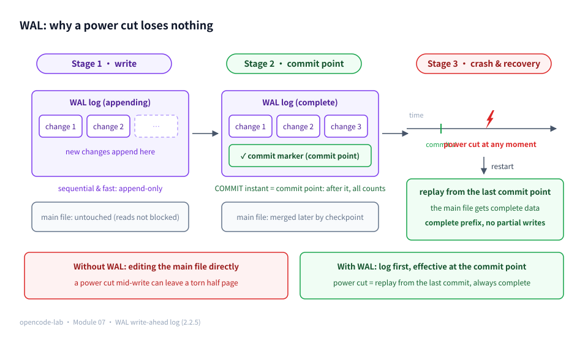
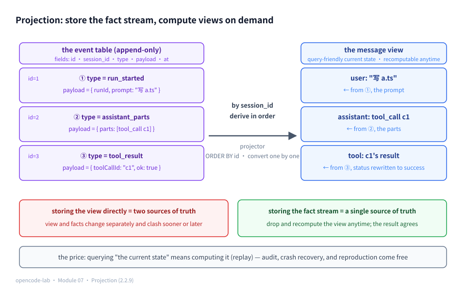
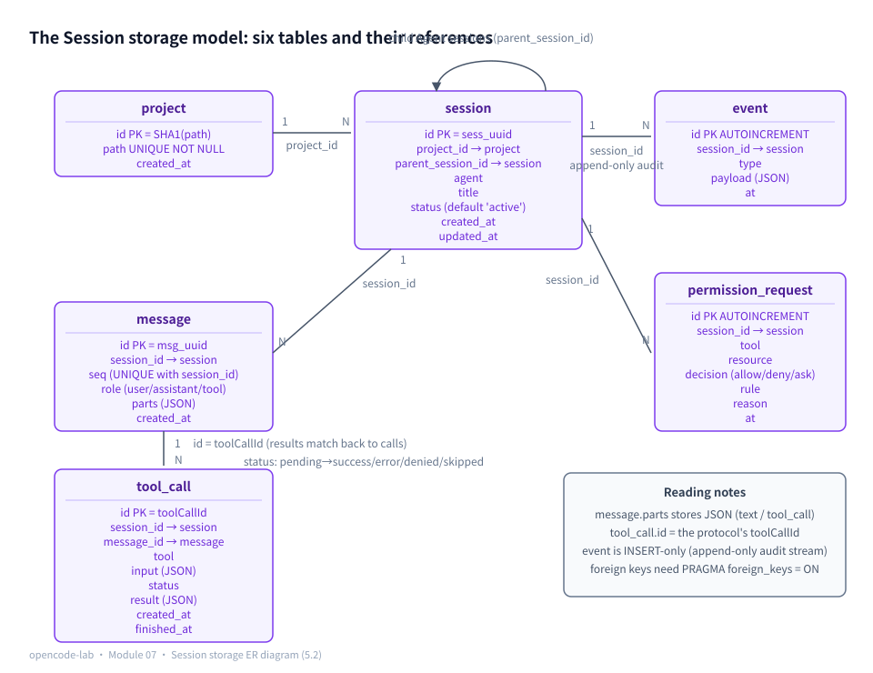
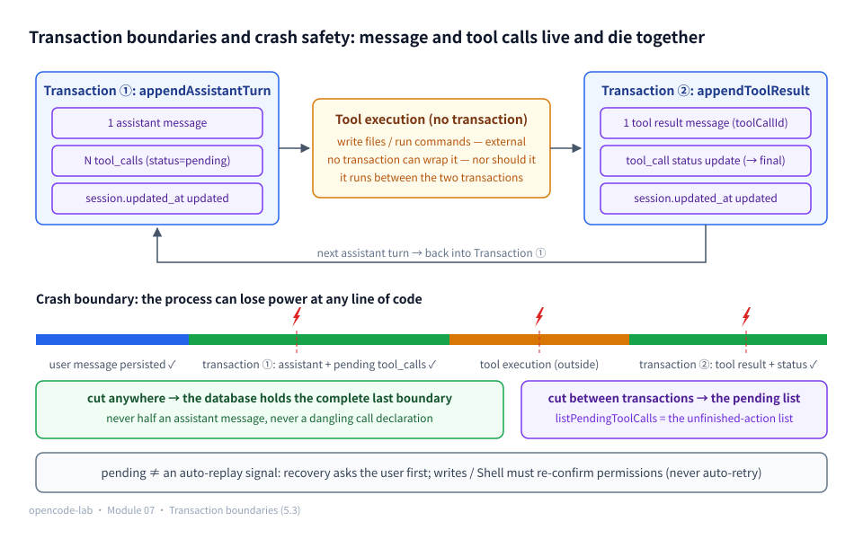
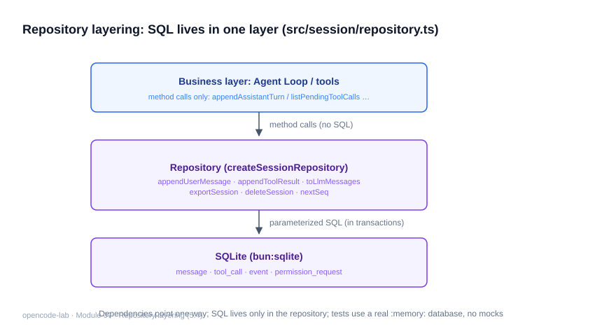
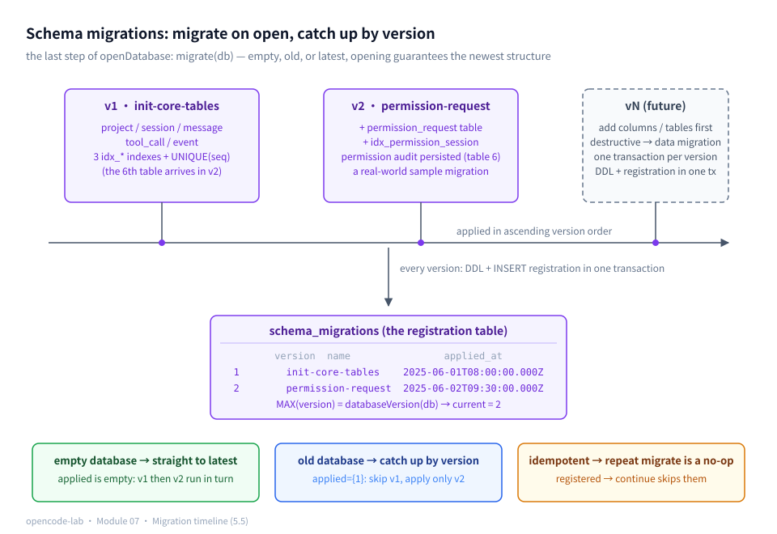
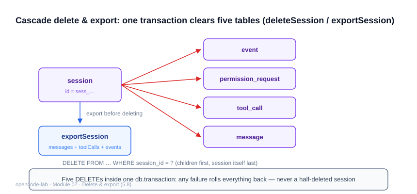

# Chapter 7: Session, the message model, and SQLite — resumable persistent sessions

## 1. Where this chapter fits

- Module: 07 Session and SQLite
- Study time: 10–12 hours (including Section 2's SQL and persistence foundations primer)
- Difficulty: medium-high — this chapter has the steepest "SQL cliff" in the course: Section 2 builds the entire database foundation — tables, primary keys, foreign keys, indexes, transactions, projections — from zero with a contacts book (2.2 is the longest foundations section in the book); readers who have never touched SQL should finish it before entering the main text
- Prerequisites: Chapter 4 (the loop's message chain), Chapter 6 (permission audit)
- Corresponding OpenCode commit: `70a24697ea0028e19f22712fd63059538cb4bee7`
- Corresponding project milestone: `v0.9-session`

## 2. Prerequisites

> The main text of this chapter designs six tables, writes transactions, and discusses "what state the database is in after a power cut" — all of which assumes you have seen what a database looks like. Section 2.2 builds the entire foundation from zero with a "contacts book", and every subsection carries a small demo of at most ten lines that runs directly with `bun` (`bun:sqlite` is built in, zero installation). This section is longer than the foundations sections of other chapters because it owes the most debt: tables, keys, indexes, transactions, WAL, JOIN, and projections would normally occupy the first three lectures of a database course.

### 2.1 Glossary for this chapter

| Term | One-sentence plain language | Where it is used in this chapter |
|---|---|---|
| Table / column / row | A two-dimensional grid / one column of like-typed fields / one record | whole chapter |
| SQL / DDL | The language for talking to a database / the "create tables" part of it (CREATE TABLE…) | 5.2, 5.5 |
| Primary key | A row's ID number: never duplicated within the table, so the row can always be found | 5.2 |
| Surrogate key / natural key | An invented number (an employee badge number) / a value that is already unique in the business (an ID number) | 5.2 |
| UUID | A randomly generated globally unique string, `crypto.randomUUID()` | 5.2 |
| Foreign key | Declares the dependency "this row belongs to that row of that table" | 5.2 |
| PRAGMA | SQLite-specific toggle knobs (not standard SQL) | 5.2 the foreign-key trap |
| Constraint / UNIQUE | A rule the database enforces for you / "this column (group) must not contain duplicates" | 5.2, 5.7 |
| Index | A book's table of contents: slower writes traded for faster queries | 5.2 |
| Composite index | A directory sorted by several columns — by surname first, then given name | 5.2 |
| Transaction | A group of writes packed into an indivisible unit: all take effect or none does | 5.3 |
| Atomicity | "Atomic" = indivisible: half a transaction is never left in the database | 5.3 |
| Commit point | The instant COMMIT succeeds; from then on these writes "count" | 5.3 the power-cut walkthrough |
| WAL | Write-Ahead Log: write the log first, then the database; writes never block reads | 5.2, 5.7 |
| journal mode | SQLite's default logging scheme; a write locks the whole database | 5.7 |
| JOIN | Joining two tables side by side on a shared key | 5.1 self-check |
| Hash / SHA1 | A "fingerprint" where the same input always yields the same output | 5.2, 5.7 |
| Idempotency key | A deterministic ID that makes "doing it many times equal doing it once" | 5.7 |
| Repository / DAO | Confine SQL to a dedicated room; the business layer sees only methods | 5.4 |
| Anti-corruption layer | A translator at the boundary: external formats (the SQL dialect) never leak into the business layer | 5.4 |
| snake_case / camelCase | SQL column-name style / TS field-name style | 5.4 |
| `ReturnType<typeof f>` | "whatever the factory returns, the type is inferred as that interface" | 5.4 |
| Event / append-only | A record stream that allows only INSERT, never UPDATE/DELETE | 5.6 |
| Projection | The current view derived from a stream of facts | 5.6 |
| Event sourcing | Store "what happened"; derive "what is true now" at query time | 5.6 |
| Complete prefix | A contiguous, complete stretch of records starting from the beginning | 4, 5.3 crash boundary |
| AUTOINCREMENT | SQLite's auto-incrementing integer id; strictly increasing by nature | 5.2, 5.6 |
| Orphan row | A child row still pointing at a parent row that no longer exists | 5.8 |
| ON DELETE CASCADE | When a parent row is deleted, the database automatically deletes the child rows too | 5.8 |

### 2.2 Foundations (the SQL and persistence groundwork)

First, "where do I run this": every SQL snippet in this section fits into the six-line scaffold below (save as `demo.ts`, run `bun demo.ts`; the main text of this chapter uses the very same `bun:sqlite`):

```ts
import { Database } from "bun:sqlite"
const db = new Database(":memory:")          // in-memory database: throwaway, good for practice
db.run("CREATE TABLE contact (name text, phone text)")
db.run("INSERT INTO contact VALUES ('小明', '13800000000')")
console.log(db.query("SELECT * FROM contact").all())
```

#### 2.2.1 Tables, columns, rows: data lives in cells

The core abstraction of a database is astonishingly plain: **a table is a two-dimensional grid**, and a contacts book is the most apt example —

```text
contact (table)
┌────────┬───────────────┐
│ name   │ phone         │   ← column: one column holds one kind of information
├────────┼───────────────┤
│ 小明   │ 13800000000   │   ← row: one row is one person's complete record
│ 小红   │ 13900000000   │
└────────┴───────────────┘
```

There is only one rule: **data lives in cells** — every row has the same number of columns, and the information in one column is all of the same type. Declaring a type for each column at table creation (`text`/`integer`…) lets the database query for you, validate for you, and guarantee consistency for you (SQLite is lax about types, but the annotation remains a contract for humans and tools). SQL has exactly four common verbs, plus one category of table-definition statements:

| Statement | What it does | Example |
|---|---|---|
| `SELECT` | fetch rows by a condition | `SELECT * FROM contact WHERE name = '小明'` |
| `INSERT` | add a row | `INSERT INTO contact VALUES ('小明', '138…')` |
| `UPDATE` | change columns of existing rows | `UPDATE contact SET phone = '137…' WHERE name = '小明'` |
| `DELETE` | delete rows | `DELETE FROM contact WHERE name = '小明'` |
| `CREATE TABLE` | define the cells (DDL) | `CREATE TABLE contact (name text, phone text)` |

One more value you must understand: **NULL — "this cell is unfilled"**. It is not the empty string and not 0, but a separate "unknown" marker, and it behaves strangely: **comparing NULL with any value yields neither true nor false but NULL** (three-valued logic). Run these three lines by hand:

```sql
SELECT NULL = NULL;        -- the result is NULL, not "true" — unknown cannot be compared with unknown
SELECT NULL IS NULL;       -- the result is "true" — a null check must use IS NULL
SELECT COALESCE(NULL, 0);  -- 0 — the idiomatic way to give NULL a default
```

So an empty-cell lookup cannot be written `WHERE phone = NULL` (it never matches); write `WHERE phone IS NULL`. `COALESCE(x, default)` means "use the default if x is NULL" — this chapter's `nextSeq` uses exactly it in `COALESCE(MAX(seq), 0) + 1` (an empty session draws number 1); see 5.7.

#### 2.2.2 Primary keys: surrogate vs. natural keys

With cells in place, the next question: **how do you identify "a particular row"**? With the **primary key** — a column (or a few columns) that never repeats within the table, like each row's ID number. Two schools on what to use:

- **Natural key**: a value that is already unique in the business — a person's ID number. Sounds convenient, but business uniqueness cannot be trusted: numbers get mistyped, formats change with policy, merging two systems causes collisions, and real values exposed in URLs/logs can be enumerated and guessed ("how many users signed up today? Try ids 1 through 10000 and you'll know").
- **Surrogate key**: a business-independent invented number — a company badge number. It carries no meaning; its only job is to be unique. It never moves when the business changes, and system merges never collide (with UUIDs the random space is so large that collisions are effectively impossible).

The main text will put three entities in front of these two options: message chooses a surrogate key, tool_call a natural key, project a "hash natural key" — why each one, argued one by one in 5.2.

Engineering practice leans overwhelmingly toward surrogate keys (UUIDs: `crypto.randomUUID()`, one line each). A primary key comes with three bundled clauses: **unique within the table** (a duplicate id cannot be inserted — it errors outright), **never NULL**, and **an index comes for free** (looking up a row by primary key naturally goes through the directory, 2.2.4).

```sql
CREATE TABLE contact (
  id text PRIMARY KEY,      -- surrogate key: a program-generated UUID
  name text NOT NULL        -- NOT NULL: a constraint — this cell may not be empty
);
INSERT INTO contact VALUES ('u1', '小明');
INSERT INTO contact VALUES ('u1', '小红');   -- errors: UNIQUE constraint failed: contact.id
```

The first bundled clause later becomes a treasure: **"error on primary-key collision" is the natural foundation of idempotency** — inserting the same id a second time needs no check on your part; the database blocks it for you (5.7's toolCallId and path SHA1 both harvest this dividend).

#### 2.2.3 Foreign keys and SQLite's PRAGMA trap

Two tables often have a **dependency**: a contact belongs to some owner. A **foreign key** **declares** that relationship to the database: values in this column must be the primary key of some row in another table.

```sql
CREATE TABLE owner (id text PRIMARY KEY, name text);
CREATE TABLE contact (id text PRIMARY KEY, owner_id text REFERENCES owner(id));
INSERT INTO contact VALUES ('c1', 'ghost');   -- ghost does not exist in owner
SELECT * FROM contact;                        -- the insert went through?!
```

Those last two lines are the famous **SQLite trap**: foreign-key constraints are **off by default**; `REFERENCES` is a declaration on paper only, and SQLite by default never verifies it — **orphan rows** (child rows pointing at nonexistent parents) sneak in this way. To make it actually guard the door, every connection must flip the switch:

```sql
PRAGMA foreign_keys = ON;   -- PRAGMA: a SQLite-specific knob, not standard SQL
INSERT INTO contact VALUES ('c2', 'ghost');   -- this time it errors: FOREIGN KEY constraint failed
```

Why off by default? Historical baggage: foreign-key constraints were added to SQLite late, and the default behavior was left as-is so old programs would not break. "Every connection" is the pit within the pit: this is a **connection-level** setting, not a database-level one — reopening a connection resets it, so it must be flipped again. To confirm whether the current connection has it on, you can query the knob (it returns 0 or 1); but the sturdier engineering practice is "flip it on open" rather than "check first, patch later" — the first thing this chapter's `db.ts` does after opening a connection is exactly that (5.2).

#### 2.2.4 Indexes: a book's table of contents and a phone book's ordering

A book without a table of contents forces you to leaf from the first page to the last — the database's **full table scan**: finding one value in a ten-thousand-row table flips five thousand rows on average. An **index** is the table's table of contents: a separately stored, **sorted** "value → row location" lookup for one column, turning a search from "leaf through the whole book" into "binary jumps" — sorted order is why it is fast, and it is the entire secret of indexes.

The cost is just as intuitive: every new edition means re-sorting the contents — **every INSERT/UPDATE/DELETE must maintain the index in step**, writes get slower, and extra space is taken (this is "write amplification"; 5.2's pitfalls section will quiz you on it). So build indexes only for queries that really exist: add one when a slow full-table query shows up; do not build them preemptively.

```sql
CREATE INDEX idx_contact_owner ON contact(owner_id);
-- queries with WHERE owner_id = ? now go through the directory instead of scanning the whole table
```

A **composite index** is a directory sorted by several columns; the best analogy is a phone book: sorted **by surname first, then given name** (index columns `(surname, given name)`). It brings one important rule — **prefix matching**:

| Query condition | Can it use the phone book's directory |
|---|---|
| surname = Wang | fast — surname is the first sort key, so all Wangs sit physically together |
| surname = Wang and given name = Xiao | fast — both columns hit the sort keys |
| given name = Xiaoming | slow — "Xiaoming" is scattered across every surname; the second column **cannot act alone** |

Hold on to this sorting intuition and it becomes obvious why 5.2's `UNIQUE(session_id, seq)` incidentally serves "list messages by session": the UNIQUE constraint is itself a composite index sorted by (session_id, seq), and the query "messages of one session" hits its first column. Sorted order has a bonus too: `ORDER BY seq` results are already ordered, so the database need not sort again (this chapter's `listMessages` with its `ORDER BY seq ASC` pockets exactly this freebie).

#### 2.2.5 Transactions and WAL: all or nothing

Chapter 4 planted half a sentence about "landing in the database"; now it unfolds in full. A **transaction** packs a group of writes into one **indivisible unit**: every write between `BEGIN` and `COMMIT` either all takes effect or all is as if it never happened — this "indivisibility" is **atomicity** ("atom" here in its older sense of "that which cannot be split"). The classic example is a money transfer:

```sql
BEGIN;
UPDATE account SET balance = balance - 100 WHERE id = 'a';
UPDATE account SET balance = balance + 100 WHERE id = 'b';
COMMIT;   -- commit point: at this instant, both writes count together
```

If the second UPDATE fails, or power is cut before COMMIT, the first leaves no trace on its own — the intermediate state "a is short 100 while b gained nothing" can never appear. To back out midway, `ROLLBACK` voids the whole package:

```sql
BEGIN;
UPDATE account SET balance = balance - 100 WHERE id = 'a';
ROLLBACK;   -- a's balance untouched — the UPDATE above is as if it never happened
```

(Transactions actually have four properties, together called ACID: atomicity, consistency, isolation, durability; this chapter leans on atomicity repeatedly, isolation appears in 5.7's concurrency discussion, and knowing the other two by name is enough.) **Commit point** is the keyword for understanding crash safety: before the instant COMMIT succeeds, everything may be discarded; after it, everything counts.

In `bun:sqlite` you do not hand-write `BEGIN/COMMIT`; you wrap a group of operations in a function and hand it to `db.transaction` — the repository code in this chapter uses exactly this; an early look:

```ts
const transfer = db.transaction(() => {
  db.run("UPDATE account SET balance = balance - 100 WHERE id = 'a'")
  db.run("UPDATE account SET balance = balance + 100 WHERE id = 'b'")
})
transfer()   // calling it runs the transaction: a normal return auto-COMMITs, a thrown error auto-ROLLBACKs
```

"A thrown error auto-ROLLBACKs" deserves first-hand verification: deliberately hit the primary key with the transaction's second INSERT, catch the exception, and check where the first UPDATE ended up.

```ts
import { Database } from "bun:sqlite"
const db = new Database(":memory:")
db.run("CREATE TABLE account (id text PRIMARY KEY, balance integer)")
db.run("INSERT INTO account VALUES ('a', 100), ('b', 50)")

try {
  const tx = db.transaction(() => {
    db.run("UPDATE account SET balance = balance - 100 WHERE id = 'a'")
    db.run("INSERT INTO account VALUES ('a', 999)") // deliberately hit the primary key
  })
  tx()
} catch (e) {
  console.log("捕获:", e.message)
}
console.log("a 的余额:", db.query("SELECT balance FROM account WHERE id = 'a'").get().balance)
```

Output (excerpt):

```text
捕获: UNIQUE constraint failed: account.id
a 的余额: 100
```

The second INSERT inside the transaction errors and the first UPDATE is voided wholesale — a's balance is untouched, with no "money deducted but never delivered" intermediate state. This is the executable proof of "all or nothing", and the underlying mechanism of 5.3's "one turn, one transaction".

**WAL (Write-Ahead Log) in one sentence**: first write the changes into a side "log", and at the commit point merge the log's content into the main database file — while the log is written the main database is not locked, so **writes never block reads** (reading the main file and writing the log do not disturb each other). Contrast SQLite's default journal mode: a write must lock the entire database, and readers and writers queue on each other. The difference on a timeline (W wants to write, R wants to read):

| Moment | journal mode | WAL mode |
|---|---|---|
| t1 | W starts writing → locks the whole database | W writes to the log → main database untouched |
| t2 | R wants to read → **queues for the lock** | R reads the main file → **gets the old value as usual** |
| t3 | W commits and unlocks | W writes the commit marker |

A single-process Agent seems to have no use for concurrency, but "writes never block reads" pays off the moment tests and the CLI open the database at the same time. These two plain lines about WAL set up the entire 5.3 walkthrough of "after a power cut the database holds a complete prefix".



*Figure 7-P2: The WAL timeline — changes are first appended sequentially into the log (fast, and writes never block reads); once the log is complete a commit marker is written (the commit point); if power is cut at any moment after that, a restart replays the log from the last commit point, so the main file always receives a complete prefix with no torn half page.*

#### 2.2.6 JOIN: joining two tables side by side on a shared key

**JOIN in one sentence: join two tables side by side on a shared key.** The contact table holds only owner_id (a number); to learn the owner's name you must take that key to the owner table and look up its row:

```sql
SELECT contact.name, owner.name AS owner_name
FROM contact JOIN owner ON contact.owner_id = owner.id;
```

Two rows of data to see what the result looks like:

```text
contact                          owner
┌────┬──────────┬──────────┐     ┌────┬──────┐
│ id │ name     │ owner_id │     │ id │ name │
│ c1 │ 小明     │ o1       │     │ o1 │ 张三 │
│ c2 │ 小红     │ o2       │     │ o2 │ 李四 │
└────┴──────────┴──────────┘     └────┴──────┘

Result of JOIN ON contact.owner_id = owner.id:
c1 小明 o1 张三     c2 小红 o2 李四     ← two narrow tables joined into one wide table
```

JOIN's opposite is the **redundant column**: since joining costs a computation, why not just store an extra copy of "the value you would get by joining"? Say contact gains an owner_name column — queries get faster, but when the owner renames, every contact row must change, and the two copies of the data can clash at any time. When redundancy is worth it and when JOIN is right is a classic table-design tradeoff.

The main text of this chapter almost never writes a JOIN and deliberately avoids it with "redundant columns" (the tool_call table stores both session_id and message_id). Why? 5.1's self-check questions will quiz you on this.

#### 2.2.7 Hashes and idempotency keys

A **hash function** (SHA1, say) computes a fixed-length "fingerprint" for any input; three properties suit it as a deterministic ID: **the same input always yields the same output** (determinism); different inputs almost never collide; the original cannot be recovered from the fingerprint. Touch it with bun first-hand:

```ts
Bun.SHA1.hash("/tmp/project-a", "hex")   // always the same string
Bun.SHA1.hash("/tmp/project-a", "hex")   // run it again: still the same
Bun.SHA1.hash("/tmp/project-b", "hex")   // change one input character and the output is unrecognizable
```

The three properties in those comments only count once they run:

```ts
const a1 = Bun.SHA1.hash("/tmp/a", "hex")
const a2 = Bun.SHA1.hash("/tmp/a", "hex")
const b = Bun.SHA1.hash("/tmp/b", "hex")
console.log("同输入两次相同:", a1 === a2)
console.log("不同输入不同:", a1 !== b)
console.log("a =", a1)
```

Output (excerpt):

```text
同输入两次相同: true
不同输入不同: true
a = c1ec8028549d000c0b5f40f7fd6b076b1c926a66
```

Determinism (the first true) and the avalanche effect (the second true) cash out on the spot; that 40-character hex fingerprint `a1` is exactly what `ensureProject` takes as the project's primary key — the same path hashes to it on any machine at any time. Idempotency follows from this.

Combine this with 2.2.2's "error on primary-key collision" and you get the **idempotency key**: use "the SHA1 of the path" as the project table's primary key — the same path always yields the same id, so "ensure this project exists" has the same effect no matter how many times it runs: either the existing row is found or the primary key collides; either way the database holds exactly one row. That is where `ensureProject`'s idempotency comes from (5.7). While at it, tell the two brothers apart: **a UUID is "random uniqueness"** (every generation differs — suited to issuing identity to new entities); **a hash is "deterministic uniqueness"** (same input, same output — suited to issuing identity to "things that already exist", and a path is exactly that).

#### 2.2.8 Repository and the anti-corruption layer: confining SQL to a dedicated room

What happens when business code writes SQL directly? Three months later, the INSERT that "appends a message" is scattered across five files, changing the table means searching strings across the whole codebase, and switching databases (to PostgreSQL, say) means rewriting every file. The **repository** solution: confine "how things are stored" to a dedicated room (one module, one set of functions) — the business layer speaks plain language only ("append one assistant turn"), never SQL; all SQL lives inside the room, so changing dialects touches one room. Another common industry name, **DAO** (Data Access Object), means the same thing — no need to panic at either term.

The companion term is the **anti-corruption layer** (from Domain-Driven Design, DDD): **"corruption" means the seepage of external formats** — the snake_case of SQL rows and the JSON strings stuffed into text columns are dialects of the database world; let them flow into the business layer and the business code is "corroded" into a tight coupling with this one storage scheme (the day `row.project_id` lies scattered across the codebase, switching databases becomes major surgery). **Anti-corruption = station a translator at the room's door**, and external formats never leave:

```ts
// what the translator looks like: SQL rows never leave the repository boundary (teaching sketch)
const toOwner = (row: { id: string; owner_id: string }) => ({
  id: row.id,
  ownerId: row.owner_id,   // snake_case becomes camelCase at the door
})
```

In 5.4 you will see that `toSession` is this translator's official appointment.

#### 2.2.9 Projections and event sourcing: from a ledger of entries to a balance

Keeping money accounts has two styles. **Store the current value**: the ledger reads only "balance 120" — each change erases the old number and writes the new one (UPDATE). **Store the ledger of entries**: record only "deposit 100, deposit 50, spend 30", and the balance is **computed**: 100+50−30=120. The second style is the idea of **event sourcing**: **store "what happened"; derive "what is true now" at query time**; the derived view is called a **projection** — the word's intuition comes from casting light into an image: the events are the solid object, the view is its shadow on the wall, and the shadow can be struck again at any time.

```text
event table (append-only: append nothing but appends)   projection (a view recomputable at any time)
id=1  deposit 100                                   →    balance = 100 + 50 − 30 = 120
id=2  deposit 50
id=3  spend 30
```

The two styles' reconciliation sheet:

| | Storing the current value (UPDATE) | Ledger of entries (events + projection) |
|---|---|---|
| How writes happen | erase old, write new | append only (append-only) |
| History | overwritten; the path here is invisible | naturally complete, immutable |
| Query "the current value" | read directly | compute on demand (replay) |
| Audit / reproduction / crash recovery | missing evidence | just replay from zero |

The ledger of entries' advantage points exactly where this chapter's three demands (audit, crash recovery, reproduction) converge; the price is that queries must be computed on demand. It also donates one ability for free: **to know the state at any moment, replay only the events before that moment** — "what was the balance at t2?" = compute only the events with id ≤ 2. In 5.6, using this chapter's real event-table fields, three events will be projected into one message chain, walking through this minimal "ledger becomes view" example.



*Figure 7-P1: Projection — the event table on the left is append-only and stores "what happened" (the fact stream); the projector derives the message view on the right ("what is true now") in session_id order. Storing the view directly = maintaining two sources of truth, which clash sooner or later; storing the fact stream = a single source of truth, with the view recomputable at any time. 5.6 walks this chain with real fields.*

#### 2.2.10 From the contacts book to this chapter's six tables

Mapping the contacts-book vocabulary onto what this chapter actually builds — one last look before the main text. While comparing, note that the section number on the right of each row is where the main text expands it; for preview or review this table is a direct route.

| Contacts-book world | This chapter's counterpart | Concepts used |
|---|---|---|
| owner (the owner) | project (id = SHA1 of the path) | natural key as primary key, idempotency key (2.2.2, 2.2.7) |
| contact (a contact) | message (id = `msg_`+UUID) | surrogate key (2.2.2) |
| contact belongs to owner | message belongs to session | foreign key + PRAGMA switch (2.2.3) |
| phone book by surname, then given name | the `UNIQUE(session_id, seq)` composite index | prefix matching (2.2.4) |
| the transfer package | "message + tool calls" live and die together | transaction, atomicity (2.2.5) |
| two ledgers kept in parallel | writing the log never blocks reads | WAL (2.2.5) |
| looking up seats with owner_id | tool_call redundantly stores session_id to skip the JOIN | JOIN and why to avoid it (2.2.6) |
| a dedicated room + a translator | repository + `toSession` | Repository, anti-corruption layer (2.2.8) |
| computing the balance from the ledger | the event table projected into messages | event sourcing, projection (2.2.9) |
| the database's toggle knobs | `PRAGMA foreign_keys` / `journal_mode` | PRAGMA (2.2.3, 2.2.5) |

Every row is a section of the main text — now the real work begins.

### 2.3 Recap of the previous module

- Chapter 6's audit is **dual-written**: every permission decision goes both into `audit.jsonl` (a JSONL file) and into the database's permission_request table — the sixth table created by this chapter's v2 migration exists precisely for it, and `addPermissionRequest` is its repository entry point.
- Chapter 6's **read-only roles** (`readOnlyAgents`: plan/explore/review may execute only low-risk tools) and **five-level evaluation pipeline** (dangerous-command floor → role → path → config → risk default; order is priority) remain in force in this chapter: permission-denied paths are persisted too (the tool call status is recorded as denied).
- After this chapter, look back at Figure 6-2 of Chapter 6, "the audit dual write to the JSONL file and the session permission_request table" — the right half now has a physical home.

---

## 3. Learning objectives

- Understand: why "message + tool calls" must be transactionally consistent; the crash boundary (crash-only consistency — the program may be killed at any moment and power may be lost at any moment, and consistency does not depend on a "graceful exit"; for the plain-language definition see the complete prefix in the "Problem statement" section) — at any moment of power loss the database holds a complete prefix; the meaning of versioned migrations.
- Be able to implement: the six-table schema (project/session/message/tool_call/event/permission_request), a transactional repository, Agent Loop persistence hooks, resume (continuing from history), and export plus cascading delete.
- Be able to test: simulating a v1 database upgrading to v2; simulating a mid-run Provider failure to verify the crash boundary; recovering from persisted history and continuing.
- Be able to explain: why the `toLlmMessages` round trip is the heart of recovery; why pending tool calls are the "unfinished action" signal.

## 4. Problem statement

Until now the Agent has lived only in memory — the process exits and the task history is gone. OpenCode's persistence has two layers: `packages/opencode/src/storage/` (file/JSON storage) and `packages/core/src/database/` (SQLite + migrations + projection). The teaching version implements the single-process variant directly with `bun:sqlite` (built in, zero dependencies).

First, a table answering "why a database rather than a JSON file" — the question this chapter's reflection exercises left themselves without an answer (the concepts of each 2.2 subsection now take their seats):

| Need | JSON file | SQLite |
|---|---|---|
| **Query**: fetch one session's messages, in order | read the whole file into memory every time, filter and sort yourself | `WHERE session_id = ? ORDER BY seq` uses the index (2.2.4) |
| **Transaction**: message + tool calls either all written or not at all | hand-roll a temp file plus an atomic rename; multi-writer packing is impossible | `BEGIN...COMMIT` is natively atomic (2.2.5) |
| **Concurrency**: two code paths writing at once | the later whole-file write clobbers the earlier one, silently losing data | writes are serialized; the unique constraint backstops (5.7) |
| **Crash consistency**: power cut mid-write | a half-written JSON, the whole file ruined | WAL recovers from the last commit point (2.2.5, 5.3) |

Of the four rows the third and fourth are the deadliest: during an Agent run, session data is **continuously appended from multiple places**, and the JSON file's "whole-file overwrite" model is mismatched at the root.

The core design question is **when to write**. Writing too eagerly (every streamed token) is expensive and produces crowds of half-finished artifacts; writing too sparsely (once at the end of a run) loses everything on a crash. The teaching version chooses **writes at safe boundaries**: each complete message (a user message / an assistant turn / a tool result) lands once, one transaction per landing. The acceptance criterion "the database holds a **complete prefix**" deserves its plain-language statement up front: **a prefix = a contiguous stretch starting from the beginning**. The message chain `[user, assistant, tool]` has exactly four complete prefixes — empty, `[user]`, `[user, assistant]`, `[user, assistant, tool]`; after a power cut the database must hold one of these, and never a "torn mid-cell" form like `[user, half an assistant]`. Whenever the process crashes, the database retains the complete last boundary — recovery continues from the boundary and does not replay unfinished actions.

## 5. Core concepts

The design blueprint's Section 8.8 lists 8 knowledge points for this chapter. First the "knowledge point ↔ source file ↔ test file" mapping table, then each point in turn: one section per point, always covered in the same four parts — "Concept → How this project implements it → Common pitfalls → Self-check questions".

| # | Blueprint knowledge point | Main source (relative to opencode-lab/) | Matching tests |
|---|---|---|---|
| 1 | The relationship among Session, Message, Part, Tool Call, Event | `src/providers/types.ts`, `src/session/repository.ts` | `test/session/repository.test.ts` (toLlmMessages round trip, pending query) |
| 2 | SQLite table design, primary keys, indexes, and foreign keys | `src/session/migrate.ts`, `src/session/db.ts` | `test/session/repository.test.ts` (database and migration groups, reopening the file database) |
| 3 | Transactions and state consistency | `src/session/repository.ts` | `test/session/repository.test.ts` (turn transaction born together), `test/session/persistence.test.ts` (crash boundary) |
| 4 | Repository/DAO separated from the business layer | `src/session/repository.ts`, `src/session/persistence.ts`, `src/agent/loop.ts` | `test/session/persistence.test.ts` (Loop integration group) |
| 5 | Database migrations and version management | `src/session/migrate.ts` | `test/session/repository.test.ts` (v1→v2 upgrade, idempotency) |
| 6 | Event recording and projection | `src/session/migrate.ts` (event table), `src/session/repository.ts` | `test/session/repository.test.ts` (events recorded append-only) |
| 7 | Concurrent writes, idempotency, and retries | `src/session/db.ts`, `src/session/repository.ts` | `test/session/repository.test.ts` (stable seq ordering, ensureProject idempotency) |
| 8 | Privacy, deletion, and export | `src/session/repository.ts` | `test/session/repository.test.ts` (export and cascading delete) |

### 5.1 The relationship among Session, Message, Part, Tool Call, and Event

> 📊 Figure: for where these five concepts physically land, see Figure 7-1 in Section 5.2 (the six-table ER diagram); for the "fact stream → view" relationship, see Figure 7-P1 in Section 2.2 (projection).

**Concept**

These five entities are the persistence layer's noun vocabulary; telling them apart is what gives the later design decisions their footing. A **Session** is the container of one resumable run: it hangs under some project and carries an agent, a title, and a state machine (active/completed/failed/aborted). A **Message** is one record on the conversation chain — one each for the user, assistant, and tool roles — and assembled in order they form the complete input for the next model request. A **Part** is the internal structure of an assistant message: the model can say a stretch of text and launch several tool calls in one turn, so one assistant message mixes text parts and tool_call parts.

**Tool Call** deserves a few more words — it lifts "one tool call" out of the messages into its own table because it has a life cycle of its own: it starts as pending and ends as one of success/error/denied/skipped. And that life cycle **spans multiple messages**; taken apart, three phases:

| Phase | What happens | Where it lands |
|---|---|---|
| The model initiates | a tool_call part appears in the assistant message (toolCallId, tool name, input) | message (assistant row) + tool_call row (status=pending) |
| The program executes | your code actually runs the tool | **not persisted** — an external side effect, happening between two transactions (5.3) |
| The result returns | a tool message carries the execution result and the call status is rewritten | message (tool row) + tool_call row (status rewritten) |

"Declared in the assistant message, result in the tool message" is exactly rows one and three of this table: the head and the tail of the same call live in two different messages, meshing through the shared toolCallId. An **Event**, meanwhile, is the append-only audit stream running parallel to the conversation chain (2.2.9's ledger of entries), recording "what happened" and never entering model requests.

Why split it this way? The core insight: **the message chain serves the model; the tool_call and event tables serve recovery and audit**. Storing only the message chain, you cannot answer "did call c1 succeed?" or "how many permission denials happened in this session?"; storing only the tool_call table, you cannot assemble the message array for the next request. Both coexisting, meshed by toolCallId, satisfies "resumable" and "traceable" at once.

**How this project implements it**

The message and Part type definitions live in `src/providers/types.ts`:

```ts
// one assistant turn can carry text and several tool calls at once
export type AssistantPart = TextPart | ToolCallPart

export type LlmMessage =
  | { role: "system"; content: string }
  | { role: "user"; content: string }
  | { role: "assistant"; parts: AssistantPart[] }
  // each tool result is its own message, linked to the assistant's tool_call by toolCallId
  | { role: "tool"; toolCallId: string; content: string; isError?: boolean }
```

Tool Call's stored form is in `src/session/repository.ts`; note that it redundantly carries both foreign keys, session_id and message_id:

```ts
export type StoredToolCall = {
  id: string
  sessionId: string
  messageId: string
  tool: string
  input: Record<string, unknown>
  status: ToolCallStatus
  result: unknown
  createdAt: string
  finishedAt: string | null
}
```

`toLlmMessages` (same file) annotates the relationship between the two sides best: it restores stored messages into Provider input — the assistant row's parts JSON deserializes directly, and the tool row's toolCallId is taken from its parts. At the protocol level, the message chain and the call records associate through this id; the "toLlmMessages round trip" case in `test/session/repository.test.ts` pins down the exact restored shape.

What does that "exact shape" look like? Persist one full conversational turn for real (user → assistant initiates a tool call → tool returns the result) and restore it:

```ts
import { openDatabase } from "./src/session/db"
import { createSessionRepository } from "./src/session/repository"

const db = openDatabase(":memory:")
const repo = createSessionRepository(db)
const projectId = repo.ensureProject("/tmp/proj-demo")
const session = repo.createSession({ projectId, agent: "build" })

repo.appendUserMessage(session.id, "把 src/a.ts 里的函数改成导出")
repo.appendAssistantTurn(
  session.id,
  [
    { type: "text", text: "好的，我来修改这个函数。" },
    { type: "tool_call", toolCallId: "call_9x2", tool: "edit", input: { path: "src/a.ts" } },
  ],
  [{ toolCallId: "call_9x2", tool: "edit", input: { path: "src/a.ts" } }],
)
repo.appendToolResult(session.id, "call_9x2", "已修改 src/a.ts", false, "success")

console.log(JSON.stringify(repo.toLlmMessages(session.id), null, 2))
```

Output (excerpt):

```json
[
  {
    "role": "user",
    "content": "把 src/a.ts 里的函数改成导出"
  },
  {
    "role": "assistant",
    "parts": [
      {
        "type": "text",
        "text": "好的，我来修改这个函数。"
      },
      {
        "type": "tool_call",
        "toolCallId": "call_9x2",
        "tool": "edit",
        "input": {
          "path": "src/a.ts"
        }
      }
    ]
  },
  {
    "role": "tool",
    "toolCallId": "call_9x2",
    "content": "已修改 src/a.ts",
    "isError": false
  }
]
```

The three persisted messages restore into the Provider protocol's three elements unchanged: the user's content is unpacked from its parts, the assistant's parts deserialize as they were, and the tool row meshes with the assistant's call declaration through `toolCallId` — this array is exactly the history spliced into the second request at resume time (Section 7).

**Common pitfalls**

- Storing tool calls only inside the assistant message's JSON, with no dedicated table. Symptom: finding "which calls never finished" requires parsing every message; fix: tool_call gets its own table, and the status column turns the pending query into one filter (`listPendingToolCalls`).
- Using array indexes as message IDs. Symptom: after inserting or pruning messages the IDs shift and tool results attach to the wrong messages; fix: use `msg_` + UUID (`insertMessage`), so the id is position-independent.
- Confusing Event with Message. Symptom: audit events land in the message table and the next request sends "events" to the model; fix: the event table is separate, append-only, and never enters `toLlmMessages`.

**Self-check questions**

1. Why is a tool result its own tool message instead of being stuffed back into the assistant message? — Reference answer: the Provider protocol requires tool results to return under their own role, and a result is produced later in time than the assistant message; only as separate messages can they be persisted in order and replayed in order.
2. The tool_call table already has a message_id foreign key — why also a redundant session_id column? — Reference answer: calls-per-session lookups (such as `listPendingToolCalls`) are high-frequency queries; the redundant column plus the `idx_tool_call_session` index skips the JOIN with the message table.
3. Why does the event table's payload store a JSON string instead of split columns? — Reference answer: event types are diverse and their shapes vary by type, so JSON preserves write-side flexibility; the read side's `listEvents` uniformly restores them with `JSON.parse`.

### 5.2 SQLite table design, primary keys, indexes, and foreign keys

**Concept**

Table design must answer three questions: what serves as the primary key, what the foreign keys guarantee, and which queries the indexes serve — the full groundwork for all three is in 2.2.2–2.2.4; here we go straight to this chapter's choices. **Primary keys** have two schools: surrogate keys (self-generated UUIDs) and natural keys (values already unique in the business). This project's message uses `msg_` + UUID because messages have no naturally unique attribute; tool_call instead takes the model-returned toolCallId as its primary key — it is the protocol-level naturally unique identifier, recovery needs it to match results back to calls, and the natural key brings idempotency as a bonus (inserting the same toolCallId twice must hit the primary key). project uses the SHA1 of the workspace path as its primary key, likewise aimed at idempotency: the same path always yields the same id. **Foreign keys** (REFERENCES) declare row-to-row dependency, but SQLite has a famous trap: foreign-key constraints are off by default and only truly take effect with `PRAGMA foreign_keys = ON`. **Indexes** are built for real queries: `listSessions` filtering by project needs `idx_session_project`; and `UNIQUE(session_id, seq)` is itself an index that doubles as the "sequence numbers never repeat" invariant.



*Figure 7-1: The ER diagram of the Session storage model. Six tables and their references (column names taken from the real DDL in `src/session/migrate.ts`): project (1)—(N) session (the self-referencing `parent_session_id` supports child Agent sessions), session (1)—(N) message (1)—(N) tool_call (id = toolCallId; status moves from pending to success/error/denied/skipped), and event plus permission_request are parallel records hanging under session.*

**How this project implements it**

The v1 table-creation SQL is in `src/session/migrate.ts` (excerpt):

```sql
CREATE TABLE session (
  id text PRIMARY KEY,
  project_id text NOT NULL REFERENCES project(id),
  parent_session_id text REFERENCES session(id),
  agent text NOT NULL,
  title text,
  status text NOT NULL DEFAULT 'active',
  created_at text NOT NULL,
  updated_at text NOT NULL
);
CREATE INDEX idx_session_project ON session(project_id);
CREATE TABLE message (
  id text PRIMARY KEY,
  session_id text NOT NULL REFERENCES session(id),
  seq integer NOT NULL,
  role text NOT NULL,
  parts text NOT NULL,
  created_at text NOT NULL,
  UNIQUE(session_id, seq)
);
```

`parent_session_id text REFERENCES session(id)` is a self-referencing foreign key, reserved for Module 10's child Agent sessions. The foreign-key and WAL switches are concentrated in `src/session/db.ts`:

```ts
export function openDatabase(path: string): LabDatabase {
  const db = new Database(path, { create: true })
  if (path !== ":memory:") db.exec("PRAGMA journal_mode = WAL;")
  db.exec("PRAGMA foreign_keys = ON;")
  migrate(db)
  return db
}
```

The `create` option in `new Database(path, { create: true })` means the file is created on the spot when it does not exist — at the CLI's first start no .db file exists on disk yet, and without it the very first step fails to open; once created, `migrate(db)` immediately lifts the empty database to the latest version (5.5).

In `test/session/repository.test.ts`, "messages sort stably by seq" and "the file database works in WAL mode" verify index ordering and reopen persistence respectively.

**Common pitfalls**

- Declaring REFERENCES but never running `PRAGMA foreign_keys = ON`. Symptom: you believe the foreign keys are blocking orphan rows while SQLite by default waves them through — delete a session and its messages remain; fix: enable it explicitly when opening the connection (see `db.ts`).
- Using auto-incrementing integer primary keys everywhere. Symptom: merge conflicts across environments and guessable, enumerable IDs; fix: UUIDs for entities referenced across processes, natural keys for naturally idempotent entities (path SHA1, toolCallId).
- Indexing every column. Symptom: write amplification — every persistence gets slower; fix: build only for real WHERE/ORDER BY queries — this project's three `idx_*` each map to one query method.

**Self-check questions**

1. With `UNIQUE(session_id, seq)` in place, why not also build an `idx_message_session`? — Reference answer: the UNIQUE constraint itself already creates the (session_id, seq) composite index, and queries with a session_id prefix use it directly; a second index is pure waste.
2. Why is session.status a text column without a CHECK enum constraint? — Reference answer: the teaching version guards enum validity at the TypeScript layer (the `SessionStatus` union type), trading leniency on the SQLite side for simpler migrations; a production version could add CHECK.
3. The parts column stores JSON text — what is sacrificed and what is gained? — Reference answer: SQL-level field queries and column-level constraints are sacrificed for schema-evolution freedom (new part types need no table change) — exactly the tradeoff behind "the teaching version does not split out a message_part table".

### 5.3 Transactions and state consistency

**Concept**

Transactions guarantee the atomicity of a group of writes: all take effect, or it is as if nothing happened. For Agent persistence, the transaction is the physical carrier of the "crash boundary" — this chapter's acceptance criterion: cut power at any line of code, and what the database retains is the **complete last boundary** (the complete prefix defined in the "Problem statement" section), with no half an assistant message and no tool_call that was declared but can never be found.

"Guaranteed even through a power cut" is not a slogan; three steps at the WAL level make it visible (2.2.5's log and commit point cash out here):

1. **Write into the log**: every INSERT/UPDATE in the transaction first lands in the side WAL log file; the main database file is untouched at this point. Power cut midway? The main database still looks old, and the log holds only traces;
2. **Commit point**: on restart SQLite inspects the log — a log segment found **without a commit marker** (COMMIT was never reached) is discarded wholesale; a segment with one has its changes merged into the main database from the marker on;
3. **Recovery starts from the last commit point**: so a power cut at any moment leaves the database's content precise to "the last COMMIT" — a sequence of complete transactions, i.e. a complete prefix. The form "half a transaction" cannot exist mechanically.

The key is choosing the right transaction boundaries: one model reply produces "1 assistant message + N tool-call declarations", and those N+1 writes must live and die together (a tool_call row references a message row; writing them separately can leave only half in existence); one tool execution produces "1 tool result message + 1 tool_call status update", likewise. But **the tool's execution itself** (writing files, running commands) is an external side effect that no database rollback can undo, so it must never be wrapped in a transaction — the transaction wraps only "the factual record of that execution".

"Factual record" deserves translation into plain words: **the database records "that something happened", not "the doing of it"**. The world and the database are two ledgers — once the tool has run, the file is on disk; that is the world's ledger, and `ROLLBACK` cannot touch it; what a transaction can wrap is one record in the database's ledger ("at such a time write ran, succeeded"). Separate the two ledgers and you see why execution must sit **between** two transactions: first land the "declaration" (transaction one) → actually execute (touch the world's ledger) → then land the "result" (transaction two).

**How this project implements it**

The two core transactions of `src/session/repository.ts`. First, persisting an assistant turn (message and call declarations in one transaction):

```ts
// one assistant turn = one message + N pending tool calls, in the same transaction
const tx = db.transaction(() => {
  const seq = nextSeq(sessionId)
  db.query("INSERT INTO message (id, session_id, seq, role, parts, created_at) VALUES (?, ?, ?, 'assistant', ?, ?)").run(
    messageId,
    sessionId,
    seq,
    JSON.stringify(parts),
    at,
  )
  for (const call of calls) {
    db.query(
      "INSERT INTO tool_call (id, session_id, message_id, tool, input, status, created_at) VALUES (?, ?, ?, ?, ?, 'pending', ?)",
    ).run(call.toolCallId, sessionId, messageId, call.tool, JSON.stringify(call.input), at)
  }
  db.query("UPDATE session SET updated_at = ? WHERE id = ?").run(at, sessionId)
})
tx()
```

Second, persisting a tool result (tool message + status update in one transaction); the status-update statement within it:

```ts
db.query("UPDATE tool_call SET status = ?, result = ?, finished_at = ? WHERE id = ?").run(
  status,
  result === undefined ? null : JSON.stringify(result),
  at,
  toolCallId,
)
```

The `result === undefined ? null : JSON.stringify(result)` before binding is a type normalization: SQLite does not know undefined, so a missing result lands as NULL and other objects serialize to text — the read side's `listToolCalls` restores them with the symmetric `JSON.parse`. The anti-corruption layer's "translation" runs once in each direction, on write and on read.

Atomicity must not remain "rollback in theory"; demo `ch07/05-transaction.ts` proves it to you two ways (the fifth Studio 7.1 unit). The first is a hand-written raw SQL transaction — `BEGIN`, execute one by one, `COMMIT` on success, `ROLLBACK` the moment anything throws — which is exactly the skeleton `db.transaction(...)` wraps for you inside the repository:

```ts
raw.exec("BEGIN")
try {
  raw.query("INSERT INTO item (id, note) VALUES (?, 'kept')").run(first)
  raw.query("INSERT INTO item (id, note) VALUES (?, 'kept')").run(second)
  raw.exec("COMMIT")
} catch (err) {
  raw.exec("ROLLBACK")
  throw err
}
```

It first inserts ids 1 and 2 normally; then id 3 deliberately collides with the existing id 2 on the primary key. The second half switches to the real repository: one `appendAssistantTurn` is handed two call declarations with the same toolCallId, so the second batch of tool_call hits the `(session_id, id)` primary key. Output:

```text
运行结果（bun demos/ch07/05-transaction.ts）：
raw SQL transaction failed: UNIQUE constraint failed: item.id
raw SQL rows kept: 1,2 (expected 1,2 — id 3 rolled back with the failed batch)
transaction failed: UNIQUE constraint failed: tool_call.session_id, tool_call.id
message count after rollback: 1 (expected 1, only user left)
tool call count after rollback: 0 (expected 0)
✓ Cell done: raw BEGIN/COMMIT/ROLLBACK and db.transaction give the same atomicity — when any statement fails, everything in that transaction rolls back together
```

Read the six lines of output line by line: line 1 is the raw SQL batch failure error (id 3 hitting id 2); line 2 is the on-scene survey after the rollback — id 3 **vanishes together with the same-batch inserts that had already succeeded before it**, leaving only 1,2 in the database; "as if it never happened" means exactly this. Line 3 reproduces the same event through the repository: the `tool_call.session_id, tool_call.id` in the error is precisely the composite primary key established by 5.5's migration v3. Lines 4 and 5 are the crucial evidence: from that failed `appendAssistantTurn` **not even the assistant message remains** (count 1 = only the earlier user message) — the message INSERT succeeded first and the duplicate tool_call INSERT failed after, but both live in one transaction, so the failure drags the former back too. Without a transaction, this spot would hold "an assistant message with no call declarations" — exactly the broken pairing from the common-pitfalls section.

`deleteSession` is likewise a transaction (five child tables wiped in one go; see 5.8). The test "appendAssistantTurn transaction: message and tool calls born together" asserts that after persisting, messages and calls reference each other and the status is pending; the "crash boundary" case in `test/session/persistence.test.ts` verifies that after a mid-run Provider failure the database holds only the complete prefix `["user", "assistant", "tool"]` and no pending.

The "unfinished action" signal between the two transactions can be queried for the eyes to see: track the length of `listPendingToolCalls` before and after persistence with the real repository (`:memory:` database; for constructing the repo and session see 5.1's example):

```ts
console.log("assistant 轮落库前 pending:", repo.listPendingToolCalls(session.id).length)
repo.appendAssistantTurn(session.id, [{ type: "tool_call", toolCallId: "c1", tool: "shell", input: {} }], [{ toolCallId: "c1", tool: "shell", input: { command: "bun test" } }])
console.log("appendAssistantTurn 后 pending:", repo.listPendingToolCalls(session.id).length)
repo.appendToolResult(session.id, "c1", "42 pass", false, "success")
console.log("appendToolResult 后 pending:", repo.listPendingToolCalls(session.id).length)
```

Output (excerpt):

```text
assistant 轮落库前 pending: 0
appendAssistantTurn 后 pending: 1
appendToolResult 后 pending: 0
```

Declaration persisted (pending=1) → actual execution → result persisted (pending=0): if the process is killed exactly between the 1 and the 0, that 1 is the "unfinished action list" the recovery protocol must review after restart (this section's self-check 2, consumed in Chapter 8).



*Figure 7-2: Transaction boundaries and crash safety. appendAssistantTurn (1 assistant message + N pending tool_calls) and appendToolResult (1 tool message + the tool_call status update) each run in their own transaction; the tool's execution is an external side effect sandwiched between the two transactions. Cut power at any moment and the database holds the complete last boundary — no half-finished artifacts; leftover pending between the two transactions is the unfinished-action list.*

**Common pitfalls**

- Wrapping tool execution inside a transaction. Symptom: locks held for a long time, plus the illusion of "the transaction rolled back but the file is already written"; fix: tool execution is an external side effect — the transaction wraps only the factual record, and execution happens between two transactions.
- Writing in steps: insert the message and commit, then insert the tool_call. Symptom: a crash in between leaves an assistant message with no call declarations, breaking the pairing at recovery; fix: one and the same `db.transaction`.
- Believing async/await is atomic by nature. Symptom: the process is killed between two awaits with half a write done; fix: atomicity is a property of database transactions, not of language runtimes.

**Self-check questions**

1. Why are `appendAssistantTurn` and `appendToolResult` two transactions rather than one big one? — Reference answer: tool execution (an external side effect of uncontrolled duration) sits between them, and a big transaction would hold locks for a long time; moreover the "declaration" must already be persisted before execution — only leftover pending gives recovery its signal.
2. The crash lands exactly between the two transactions — what state is the database in? — Reference answer: the assistant message plus pending tool_call rows exist and the tool result message is missing — precisely the recovery signal of `listPendingToolCalls` (consumed in Chapter 8).
3. Why must `UPDATE session SET updated_at` go inside the same transaction? — Reference answer: the session list sorts by updated_at; if the message write succeeded but the timestamp update was lost, the ordering would detach from the content. It belongs to the fact "this turn happened".

### 5.4 Repository/DAO separation from the business layer

**Concept**

The repository (Repository/DAO, defined in 2.2.8: confine SQL to a dedicated room) is a wall between persistence details and business logic: the business layer calls domain actions like "append one assistant turn", never knowing whether SQL, files, or remote storage sit behind them. Layering has three motives. First, **consistency rules concentrate**: rules like "message and calls must share one transaction" are written once, hidden inside the repository, and hard for callers to violate even by accident. Second, **testability**: tests build the repository against an in-memory database, so business tests need not mock an entire database. Third, **anti-corruption** — the anti-corruption layer's full definition is in 2.2.8 ("corruption" = external-format seepage; anti-corruption = a translator at the boundary) — whose concrete move here is that the database dialects of SQL-row snake_case and JSON strings in text columns **never leave the repository boundary**: mapping functions like `toSession` do the snake_case → camelCase and JSON-string → object translation at the door, and the business layer sees no trace of SQL. The Agent Loop then depends on the repository through the narrower persistence interface: it knows only five methods (see the `SessionPersistence` type in Section 7), does not even import the repository's concrete type, and injection is entirely optional (`deps.persistence?.`).

**How this project implements it**

The repository is a factory function returning a set of closure methods, with the type inferred rather than hand-written:

```ts
export function createSessionRepository(db: Database, now: () => Date = () => new Date()) {
```

```ts
export type SessionRepository = ReturnType<typeof createSessionRepository>
```

The second line's `ReturnType<typeof createSessionRepository>` is a TS idiom whose plain meaning is "**whatever the factory returns, the type is inferred as that interface**": `createSessionRepository`'s return is an object literal full of closure methods, and `ReturnType<typeof ...>` has TS register that literal's shape as the type automatically. Against hand-writing an interface, its advantage is **staying in sync with the implementation forever** — add a method to the factory and the type follows automatically; a hand-written interface can be left stale, and the staleness surfaces only when a call site fails to compile.

The boundary mapping function `toSession` (bottom of the same file) is the anti-corruption layer's concrete shape:

```ts
function toSession(row: SessionRow): Session {
  return {
    id: row.id,
    projectId: row.project_id,
    parentSessionId: row.parent_session_id,
    agent: row.agent,
    title: row.title,
    status: row.status as SessionStatus,
    createdAt: row.created_at,
    updatedAt: row.updated_at,
  }
}
```

The Agent Loop's call sites are in `src/agent/loop.ts` — they appear only at safe boundaries, and optional chaining guarantees behavior identical to Chapter 4 when persistence is not injected:

```ts
messages.push({ role: "assistant", parts })
await deps.persistence?.appendAssistantTurn(
  parts,
  collected.toolCalls.map((c) => ({ toolCallId: c.toolCallId, tool: c.tool, input: c.input })),
)
```

`src/session/persistence.ts`'s `createSessionPersistence` adapts the repository into those five methods: it closes over the sessionId and forwards one by one, making no judgments — the adapter does only "timing wiring".



*Figure 7-4: Repository layering — the business layer calls methods and never sees SQL; SQL lives only inside the repository layer and acts downward on SQLite; dependencies point one way, downward; tests verify the round trip against a real :memory: database instead of mocking the database.*

**Common pitfalls**

- Repository methods returning raw SQL rows (SessionRow). Symptom: the business layer scatters `row.project_id`-style snake_case, and SQL shape changes ripple through the whole codebase; fix: route everything through `toSession` / `JSON.parse` before leaving the repository.
- Assembling SQL directly in the loop because "it's just this one spot". Symptom: a second and a third spot appear quickly, and transaction discipline collapses; fix: the loop sees only `SessionPersistence`'s five methods, and SQL stays in the repository forever.
- Mixing business judgment into the adapter. Symptom: "should this be persisted?" decision logic appears inside persistence, making both sides hard to test; fix: judgment stays in the loop (it decides when to call), and the adapter remains pure forwarding.

**Self-check questions**

1. Why are persistence's methods all async while the repository is synchronous? — Reference answer: to reserve the same interface for future asynchronous storage (remote/queue); the loop programs against the interface, while the teaching version's implementation completes synchronously inside.
2. Which files change when switching to PostgreSQL? — Reference answer: rewrite the inside of `repository.ts` (SQL dialect + transaction API) and the open logic of `db.ts`; the `persistence.ts` interface and the loop stay untouched — that is exactly layering's payoff.
3. What is the `now: () => Date` parameter for? — Reference answer: injecting the clock; tests use `fixedNow` to pin timestamps so assertions are reproducible (top of `repository.test.ts`).

### 5.5 Database migrations and version management

**Concept**

A schema can never be designed right in one pass: six tables today, and tomorrow recording permission audits demands another table. Migrations turn "structural evolution" into controlled operations: each version gets a number, a stretch of DDL, and one registration record; at startup the program compares the registration table against the migration list in code and fills in the missing versions in order. Three properties are indispensable: **ordered** (applied by version number — v2 may depend on tables v1 created); **idempotent** (repeating neither errors nor re-applies — decided by the "already applied" set in schema_migrations); **atomic** (each migration executes and registers inside a transaction; a half-executed state cannot exist). The teaching version chooses the "**migrate on open**" strategy: the last line of `openDatabase` is `migrate(db)`, so a database file in any environment is guaranteed the latest structure — eliminating the most common delivery accident, "it won't start on another machine".

**How this project implements it**

The migration list in `src/session/migrate.ts` is a plain array: v1 creates the six tables and indexes, v2 adds permission_request, and v3 changes tool_call's global primary key to the (session_id, id) composite — the latter two are both real increments: v2 proves the mechanism, v3 fixes a real bug (the Mock's deterministic toolCallId collided across sessions on the global primary key; a second run in the same workspace failed outright with UNIQUE constraint failed).

```ts
export type Migration = { version: number; name: string; sql: string }
```

The core `migrate` function:

```ts
export function migrate(db: Database) {
  db.exec(`CREATE TABLE IF NOT EXISTS schema_migrations (
    version integer PRIMARY KEY,
    name text NOT NULL,
    applied_at text NOT NULL
  )`)
  const applied = new Set(
    (db.query("SELECT version FROM schema_migrations").all() as { version: number }[]).map((r) => r.version),
  )
  for (const migration of MIGRATIONS) {
    if (applied.has(migration.version)) continue
    const apply = db.transaction(() => {
      db.exec(migration.sql)
      db
        .query("INSERT INTO schema_migrations (version, name, applied_at) VALUES (?, ?, ?)")
        .run(migration.version, migration.name, new Date().toISOString())
    })
    apply()
  }
}
```

`databaseVersion(db)` returns `MAX(version)` for easy testing and diagnostics. The test "a v1 old database upgrades to the latest version" hand-builds a database with only v1 applied, then calls `migrate` and asserts it climbs to the latest version, permission_request is queryable, and repeating migrate is idempotent; the dedicated "v2 upgrades to v3" test verifies old tool_call data survives, the same id can be inserted in another session, and duplicates within one session are still refused.

"Migrate on open" can be verified directly: run one `openDatabase` against a brand-new `:memory:` database and see where the version number and the tables come from —

```ts
import { openDatabase } from "./src/session/db"
import { databaseVersion } from "./src/session/migrate"

const db = openDatabase(":memory:") // migrate on open
console.log("databaseVersion:", databaseVersion(db))
const tables = db.query("SELECT name FROM sqlite_master WHERE type='table' AND name NOT LIKE 'sqlite_%' ORDER BY name").all()
console.log("tables:", tables.map((t) => t.name).join(", "))
```

Output (excerpt):

```text
databaseVersion: 2
tables: event, message, permission_request, project, schema_migrations, session, tool_call
```

An empty database, not one hand-written line of DDL: v1's five core tables, the registration table `schema_migrations`, and v2's `permission_request` all in place, with the version number resting at 2 — the table list corresponds one-to-one with 5.2's ER diagram.



*Figure 7-3: The migration timeline. v1 `init-core-tables` creates the 5 core tables and indexes, v2 `permission-request` incrementally adds the sixth table, and future vN versions keep appending; each version registers in schema_migrations (version number + applied time), with the DDL and the registration in one transaction. Empty databases jump straight to latest, old databases catch up version by version, and repeats are idempotent.*

**Common pitfalls**

- Running DDL without registering the version. Symptom: on the second start `CREATE TABLE` fails with "already exists"; fix: put the DDL and the INSERT registration in the same transaction (see `migrate`).
- Stuffing several migrations into one big transaction. Symptom: looks safe but actually loses version granularity — when something breaks it is hard to pin which version introduced it; fix: one transaction per version, applied in order.
- Shipping destructive changes (DROP TABLE, column type changes) directly. Symptom: user data lost; fix: prefer adding columns/tables; when destruction is unavoidable, write a data migration of "create new table → move data → rename" (especially true given SQLite's many column-change restrictions).

**Self-check questions**

1. What happens on an empty database's first `openDatabase`? — Reference answer: `CREATE TABLE IF NOT EXISTS` builds the registration table; applied is the empty set; v1 and v2 each execute and register in their own transaction in turn; `databaseVersion` returns 2.
2. When the test's hand-built v1 database upgrades, does v1 run again? — Reference answer: no — the applied set contains 1, the loop's `continue` skips it, and only v2 applies.
3. Why must the migration registration and the DDL share one transaction? — Reference answer: so that "the structural change" and "the version record" live and die together — after a crash, either both happened (skipped next time) or neither did (rerun next time); no half-migrated state exists.

### 5.6 Event recording and projection

**Concept**

The event table is an append-only event stream: INSERT only, never UPDATE/DELETE, with AUTOINCREMENT keeping ids strictly increasing. Its value is decoupling "what happened" from "what the current state is": the message/tool_call tables answer the latter (they get compacted, deleted, exported), the event table answers the former (immutable history). Audit (which tools this session ran, how many permission denials), chronological reproduction, and a future **projection** all build on it. Projection is event-sourcing vocabulary: rather than storing a query-friendly view directly, store the fact stream and derive the view from the facts — OpenCode's `packages/core/src/session/projector.ts` projects events into a message view. The teaching version simplifies: the message table stores directly (a simpler write path), with the event table alongside as an audit stream; "projecting messages from events" is left as a take-home challenge so you feel both models' consistency costs first-hand.

**How this project implements it**

The event table DDL (v1 of `src/session/migrate.ts`):

```sql
CREATE TABLE event (
  id integer PRIMARY KEY AUTOINCREMENT,
  session_id text NOT NULL REFERENCES session(id),
  type text NOT NULL,
  payload text NOT NULL,
  at text NOT NULL
);
CREATE INDEX idx_event_session ON event(session_id);
```

Writing and reading in order (`src/session/repository.ts`):

```ts
function addEvent(sessionId: string, type: string, payload: unknown) {
  db.query("INSERT INTO event (session_id, type, payload, at) VALUES (?, ?, ?, ?)").run(
    sessionId,
    type,
    JSON.stringify(payload),
    now().toISOString(),
  )
}

function listEvents(sessionId: string): SessionEvent[] {
  const rows = db.query("SELECT * FROM event WHERE session_id = ? ORDER BY id ASC").all(sessionId) as EventRow[]
  return rows.map((r) => ({ id: r.id, sessionId: r.session_id, type: r.type, payload: JSON.parse(r.payload), at: r.at }))
}
```

Export carries the events along: `exportSession`'s return value includes `events: listEvents(id)`. The test "events recorded append-only with permission requests" asserts that both events return in id order and the payloads restore into objects.

While we are at it, walk a **minimal projection worked example** — what take-home challenge two, "project messages from events", looks like, laid out with this chapter's real event-table fields (session_id, type, payload, at; payload holds a JSON string). Suppose a session appended three events in turn:

```text
id=1  type=message_appended      payload={ seq:1, role:"user",      parts:[{kind:"user",content:"写文件"}] }
id=2  type=message_appended      payload={ seq:2, role:"assistant", parts:[{kind:"tool_call",toolCallId:"c1",tool:"write"}] }
id=3  type=tool_result_recorded  payload={ toolCallId:"c1", content:"创建 a.ts", isError:false }
```

The projection function is exactly 2.2.9's "derive what is true now at query time" made concrete: `listEvents` fetches the event stream with `ORDER BY id ASC` and converts them one by one into rows of the message table —

| Event | Projection action |
|---|---|
| `message_appended(seq:1)` | insert the user message row (seq=1) |
| `message_appended(seq:2)` | insert the assistant message row (seq=2) |
| `tool_result_recorded(c1)` | insert the tool message row + rewrite tool_call c1's status to success |

Three events project into one complete message chain, `["user","assistant","tool"]` — exactly the prefix the 5.3 "crash boundary" test asserts. Facts (events) and views (messages) thereby separate: events are immutable, and the view can be recomputed from them at any time; the teaching version stores both sides directly, with consistency maintained by transaction boundaries — the costs and benefits are reconciled in self-check 2.

This worked example need not stay on paper: write the three kinds of messages and their events into a `:memory:` database with the real repository, and compare the event order with the message order —

```ts
import { openDatabase } from "./src/session/db"
import { createSessionRepository } from "./src/session/repository"

const db = openDatabase(":memory:")
const repo = createSessionRepository(db)
const projectId = repo.ensureProject("/tmp/proj-demo")
const session = repo.createSession({ projectId, agent: "build", title: "投影演示" })

repo.addEvent(session.id, "message_appended", { seq: 1, role: "user" })
repo.addEvent(session.id, "message_appended", { seq: 2, role: "assistant" })
repo.addEvent(session.id, "tool_result_recorded", { toolCallId: "c1" })

repo.appendUserMessage(session.id, "写文件")
repo.appendAssistantTurn(session.id, [{ type: "tool_call", toolCallId: "c1", tool: "write", input: { path: "a.ts" } }], [{ toolCallId: "c1", tool: "write", input: { path: "a.ts" } }])
repo.appendToolResult(session.id, "c1", "创建 a.ts", false, "success")

console.log("事件流 type:", repo.listEvents(session.id).map((e) => e.type).join(" -> "))
console.log("消息链 role:", repo.toLlmMessages(session.id).map((m) => m.role).join(" -> "))
```

Output (excerpt):

```text
事件流 type: message_appended -> message_appended -> tool_result_recorded
消息链 role: user -> assistant -> tool
```

Both sequences run side by side: the event ledger (three append-only types) and the message view (user → assistant → tool) agree in content — in the teaching version's "store both sides" form, events serve as the audit stream while the message chain is directly usable; if you take on take-home challenge two, your projection function's output should converge to this same role sequence.

**Common pitfalls**

- Using events as messages: writing "what the user said" into the event table and expecting it to join the next request. Symptom: `toLlmMessages` contains no events and the model "cannot see" them; fix: events are the audit stream, and conversation state lives in the message table.
- Allowing event edits or single-row deletes. Symptom: the audit loses credibility and projections can no longer be replayed; fix: append-only is the event table's reason to exist (in `deleteSession` events are deleted whole with the session, never edited row by row).
- Sorting events by the at timestamp. Symptom: events from the same millisecond order unstably; fix: `ORDER BY id ASC` — AUTOINCREMENT's monotonic order is the real order.

**Self-check questions**

1. Why does event.id use AUTOINCREMENT while message.id uses a UUID? — Reference answer: events only need strict within-session ordering (sorting, pagination, future projection positions), which an auto-incrementing integer provides naturally; message ids are referenced across processes and must not leak positional information, so a semantics-free globally unique string fits.
2. What differs between this chapter's event table and OpenCode's projector? — Reference answer: OpenCode treats events as the source of truth with messages as projection products; the teaching version keeps both side by side and stores messages directly, with events only for audit — simpler writes, at the cost of keeping two record sets consistent (both pinned to transaction boundaries).
3. To implement "project messages from events", which event types are still needed? — Reference answer: at least message_appended, tool_call_created, and tool_result_recorded, with payloads carrying complete fields — that is take-home challenge two.

### 5.7 Concurrent writes, idempotency, and retries

> 📊 Figure: for the underlying mechanism by which concurrent writes never block each other (WAL append and the commit point), see Figure 7-P2 in Section 2.2.

**Concept**

SQLite's concurrency model is "many readers, one writer": readers may be many, but there is exactly one writer globally. In the default journal mode a write blocks reads; with WAL enabled (2.2.5's timeline comparison) reads and writes run in parallel while writes stay serialized — enough for the teaching version's single-process Agent. Under that premise, "concurrency safety" converges to one core question: **the message order of one session must never scramble**. The teaching version's answer is seq (the sequence number): each message insert takes `MAX(seq)+1` inside the transaction, backed by `UNIQUE(session_id, seq)` — even if two write paths race, the later committer hits the unique constraint and errors instead of silently interleaving. **Idempotency** means doing the same operation many times equals doing it once (2.2.7's idempotency key): `ensureProject` achieves it by "SHA1 of the path, check first then insert". **Retry** semantics come from the recovery protocol — after a restart, do not blindly replay; first consult the pending list to decide where to continue (Chapter 8 expands this into a full recovery strategy).

**How this project implements it**

The WAL and foreign-key switches are in `src/session/db.ts` (see the 5.2 quotation): `PRAGMA journal_mode = WAL;` runs only for file databases, and memory databases skip it. Sequence allocation lives in `src/session/repository.ts`:

```ts
function nextSeq(sessionId: string): number {
  const row = db.query("SELECT COALESCE(MAX(seq), 0) + 1 AS next FROM message WHERE session_id = ?").get(sessionId) as { next: number }
  return row.next
}
```

Note that `nextSeq` is called only inside transaction callbacks (within `appendAssistantTurn` / `insertMessage`), making "draw a number + insert the row" atomic. project's idempotent creation:

```ts
function ensureProject(path: string): string {
  const id = Bun.SHA1.hash(path, "hex")
  const existing = db.query("SELECT id FROM project WHERE id = ?").get(id) as { id: string } | null
  if (existing) return id
  db.query("INSERT INTO project (id, path, created_at) VALUES (?, ?, ?)").run(id, path, now().toISOString())
  return id
}
```

The second argument of `Bun.SHA1.hash(path, "hex")` fixes the output as a 40-character lowercase hex string — constant length, a character set friendly to both SQL and logs, just right for a text primary key (2.2.7's "deterministic uniqueness"); the UNIQUE constraint on the `path` column (5.2's DDL) backstops, from the other direction, every accident other than "two paths hashing to one id".

The test "messages sort stably by seq" asserts seq is exactly `[1, 2, 3]`; "ensureProject idempotency" asserts the same path returns the same id on both calls.

**Common pitfalls**

- Ordering messages by created_at (an ISO string timestamp). Symptom: messages from the same millisecond drift in order and conversations scramble after recovery; fix: seq integer order, timestamps for display only.
- Querying MAX outside the transaction and then inserting. Symptom: under concurrency two writes draw the same seq; fix: draw the number inside the transaction callback, doubly insured by SQLite's serialized writes plus UNIQUE.
- Replaying pending calls unconditionally at recovery. Symptom: a shell command with unknown outcome re-runs after a crash and side effects double; fix: pending is the "completion unconfirmed" signal — before any retry it must pass the recovery policy ("no automatic retries", Chapter 8).

**Self-check questions**

1. In WAL mode, what happens when two processes write the same session at once? — Reference answer: writes serialize, and the later one may hit `UNIQUE(session_id, seq)` and error — take-home challenge three has you design an explicit rejection strategy on this basis.
2. Why does `nextSeq` use COALESCE? — Reference answer: for a session's first message `MAX(seq)` is NULL, and `COALESCE(NULL, 0) + 1` gives 1.
3. What happens when two connections both run `ensureProject` on the same path for the first time? — Reference answer: the path column has a UNIQUE constraint, so the later one receives a constraint error; in the single-process teaching version, check-then-insert suffices, and multi-process would need to catch the conflict and fall back to reading.

### 5.8 Privacy, deletion, and export

**Concept**

Session records hold the user's code, file paths, and shell commands — as sensitive as the project itself. Two symmetric needs follow: **export** (data portability: switching tools, backups, showing a human) and **deletion** (the right to be forgotten: thorough erasure when a task ends or the user asks). The biggest pit in implementing deletion is **orphan rows**: the session is gone while message/tool_call/event still point at a session that no longer exists. Two defenses: the `ON DELETE CASCADE` foreign key lets the database delete child rows automatically, or the application deletes explicitly in order. The teaching version picks the latter and puts it in one transaction — deletion is also a consistency boundary: either all five tables clear or all remain; a crash halfway leaving wreckage is not an option. Export is the "complete snapshot": session, messages, toolCalls, events, and permissionRequests — five kinds of data fetched in one go — so that the export file alone can reconstruct the session's full course.

**How this project implements it**

`src/session/repository.ts`:

```ts
function exportSession(id: string) {
  const session = getSession(id)
  if (!session) return null
  return {
    session,
    messages: listMessages(id),
    toolCalls: listToolCalls(id),
    events: listEvents(id),
    permissionRequests: listPermissionRequests(id),
  }
}

function deleteSession(id: string) {
  const tx = db.transaction(() => {
    db.query("DELETE FROM event WHERE session_id = ?").run(id)
    db.query("DELETE FROM permission_request WHERE session_id = ?").run(id)
    db.query("DELETE FROM tool_call WHERE session_id = ?").run(id)
    db.query("DELETE FROM message WHERE session_id = ?").run(id)
    db.query("DELETE FROM session WHERE id = ?").run(id)
  })
  tx()
}
```

The test "exportSession full export and deleteSession cascading delete" asserts that after deletion `getSession` is null and messages and events are zeroed. Note that 5.2's v1 SQL does **not** declare `ON DELETE CASCADE` on its foreign keys — the cascade is done explicitly by the application layer, and this is deliberate: writing "which tables deletion touches" in code is more visible and easier to teach than hiding it in schema behavior.



*Figure 7-5: Deletion and export — deleteSession wipes all five tables with five DELETEs in one transaction, children before parents (event → permission_request → tool_call → message → session), rolling back wholesale on any mid-way failure; data subject to privacy demands can first be exported to JSON via exportSession — what can be carried away can safely be deleted.*

**Common pitfalls**

- Deleting only the session row. Symptom: with foreign keys off or no cascade, the database fills with orphan data; fix: delete the five tables in an explicit transaction (or declare `ON DELETE CASCADE` in the schema and ensure `foreign_keys=ON`).
- Exporting messages without toolCalls. Symptom: call statuses and results are lost, and the export file cannot answer "did that execution succeed?"; fix: `exportSession` fetches all five kinds of data at once.
- Treating "clearing messages" as "deleting the session". Symptom: the session shell and the permission audit remain, and the privacy demand goes unmet; fix: make the deletion semantics explicit = the session and all its dependent rows vanish together.

**Self-check questions**

1. Why does `deleteSession` delete "children before parents"? — Reference answer: this project's schema declares no cascade and the order is mere style — but once `foreign_keys=ON` with future cascades/immediate constraints added, deleting a parent row first would violate the reference constraint instantly; children-first is correct under both configurations.
2. Can `exportSession`'s return value reconstruct `toLlmMessages`' input? — Reference answer: yes — messages store the parts JSON and toolCalls supply the call statuses; together they are exactly the shape the recovery protocol needs (guarded by the round-trip test).
3. The user asks to "delete the content but keep the statistics" (such as messageCount) — what then? — Reference answer: archive via `exportSession` before deleting, or persist the aggregates into a session summary and then delete the details — the tradeoff is how fresh and how fine-grained the statistics must be.

## 6. Reading the OpenCode source

| File | Reading focus | Think about |
|---|---|---|
| `packages/core/src/database/` | opening SQLite, migrations, transaction style | how does it differ from this chapter's openDatabase+migrate? |
| `packages/core/src/session/store.ts` | the session storage interface | why an interface instead of exposing SQL directly? |
| `packages/core/src/session/sql.ts` | the SQL model and message projection | what problem does the projection solve? |
| `packages/opencode/src/storage/schema.ts` | the file-storage schema | when is file storage better than SQLite? |
| `packages/core/src/session/projector.ts` | the event → message projection | how does this chapter's event table relate to projection? |

## 7. Minimal walkthrough

### 7.1 Studio demo units for this chapter

> 💡 Launch the interactive Playground: `cd opencode-lab && bun src/index.ts studio`, open `http://localhost:7800` in a browser, and pick this chapter to run the units below. Each unit lets you edit the code, click ▶ to run and see real output, and click 🔍 Core to inspect the core source implementation.

| # | Unit | What it demonstrates | Lesson anchor | Core source |
|---|---|---|---|---|
| 1 | `migrate` | Auto Migrate — version & tables | §5.5 | `session/migrate.ts` |
| 2 | `write-message` | Write Message — user/assistant/tool | §5.3 | `session/repository.ts` |
| 3 | `to-llm` | toLlmMessages — round trip | §5.1 | `session/repository.ts` |
| 4 | `pending` | Pending Lifecycle — 1 then 0 | §5.3 | `session/repository.ts` |
| 5 | `transaction` | Transaction Rollback — atomic | §5.3 | `session/repository.ts` |
| 6 | `projection` | Projection — events to messages | §5.6 | `session/repository.ts` |
| 7 | `hash-id` | Hash ID — deterministic project key | §5.2 | `session/repository.ts` |

The table relationships:

```text
project (id = sha1(workspace path))
  └── session (parent_session_id self-reference → child Agent)
        ├── message (seq uniquely ordered, parts JSON)
        │     └── tool_call (id = toolCallId, status)
        ├── event (append-only audit)
        └── permission_request
```

The loop hooks (`src/session/persistence.ts`):

```ts
export type SessionPersistence = {
  sessionId: string
  appendUserMessage(content: string): Promise<void>
  appendAssistantTurn(parts, calls): Promise<void>      // message + tool calls in one transaction
  appendToolResult(toolCallId, content, isError, status, result?): Promise<void>
  updateStatus(status): Promise<void>
}

// Agent-side wiring
const persistence = createSessionPersistence(repo, session.id)
await runAgent({ prompt }, { provider, registry, systemPrompt, workspace, persistence })
```

Recovery after a crash (Module 13 turns this into a CLI command):

```ts
const history = repo.toLlmMessages(sessionId)      // complete prefix
await runAgent({ prompt: "继续之前的任务", history }, { ..., persistence })  // resume the same session
```

## 8. Exercises

1. **Task one**: hand-build a v1 database (ready-made code in the tests), call `migrate`, and watch the v2 tables appear; then run migrate again on the v2 database to confirm idempotency.
2. **Task two**: run the "crash boundary" tests, then deliberately split `appendAssistantTurn`'s `db.transaction` apart (insert the message first, the calls after, throwing in between), and watch how the consistency tests expose the problem.
3. **Task three**: use the SQLite CLI (`sqlite3 /tmp/xxx.db .dump` or `select * from message`) to eyeball the persisted results of one full run.

## 9. Implementation steps

1. **`migrate.ts`**: the migration array + `schema_migrations` registration. v1 creates the six tables and indexes; v2 incrementally adds permission_request — the two-version structure makes "incremental migration" concrete instead of abstract.
2. **`db.ts`**: migrate on open; WAL (file databases) improves crash safety; `foreign_keys = ON`.
3. **`repository.ts`**: write the row types and the `toSession` mapping first, then implement the three groups of transactional methods (turn/result/delete). `nextSeq` draws MAX+1 inside the transaction, with `UNIQUE(session_id, seq)` backstopping concurrency.
4. **`persistence.ts`**: a thin adapter — the loop knows the five methods, never the SQL.
5. **`loop.ts` extension**: `input.history` is spliced before the user message; the five persistence hooks are inserted at their matching safe boundaries; each of the four final states calls its own `updateStatus`. The changes are a backward-compatible extension of Chapter 4 (without persistence injected, behavior is unchanged).

## 10. Testing and debugging

```bash
bun test test/session/    # 17 test cases
```

Output (excerpt):

```text
  …（前面用例略，各行末尾的耗时随机器浮动）…
(pass) Session Repository > pending 工具调用可查询（崩溃恢复信号） [0.27ms]
(pass) Session Repository > 事件追加式记录与权限请求 [0.29ms]
(pass) Session Repository > exportSession 完整导出与 deleteSession 级联删除 [0.35ms]
(pass) Session Repository > listSessions 带 messageCount 统计 [0.29ms]

 19 pass
 0 fail
 50 expect() calls
Ran 17 tests across 2 files. [50.00ms]
```

| Test group | Key scenarios |
|---|---|
| Migrations | empty database to latest, **v1→v2 upgrade**, idempotency, data survives reopening the file database |
| Repository | project idempotency, parent/child sessions, stable seq ordering, **turn transaction born together**, result status updates, **toLlmMessages round trip**, pending query, events/permissions, **export and cascading delete**, messageCount statistics |
| Loop integration | full run fully persisted, **crash boundary (no half-finished artifacts, no pending after failure)**, **resume and continue (history enters the second request)**, permission denials persisted as denied |

Debugging tips:
- `sqlite3 <file> 'select seq, role from message where session_id="..."'` shows the message chain directly.
- For recovery anomalies, first diff `toLlmMessages` against `result.messages` (guarded by the round-trip test).

## 11. Milestone acceptance

- [x] Empty databases migrate; old v1 databases upgrade; migrations are idempotent.
- [x] After process interruption, the last complete boundary is recoverable (no half-finished messages, no leftover pending).
- [x] Message + tool calls are transactionally consistent; the tool result and status share one transaction.
- [x] `resume`: continue the same session from history, with the second request containing the full context.
- [x] 19 test cases (including the v2→v3 migration and a real-bug regression; the full baseline grows with the course).

## 12. Common errors

| Symptom | Cause | Locate | Fix |
|---|---|---|---|
| the model "forgets" after recovery | history never entered the second request | assert the resumed.messages prefix | wire up the history argument |
| half an assistant message appears in the database | step-by-step writes bypassing the transaction | the crash boundary test | turn/result in one transaction |
| a dangerous tool ran again after recovery | pending calls replayed blindly | listPendingToolCalls | the recovery strategy reviews pending first (Module 08) |
| it won't start on another machine | no migrations / version mismatch | databaseVersion | migrate on open |
| message order drifts | ordering by created_at | the seq ordering test | seq + the UNIQUE index |
| a second run in the same workspace fails with UNIQUE constraint failed: tool_call.id | tool_call.id was once a global primary key, so duplicate toolCallIds across sessions hit the constraint (a real bug, found while adding output samples to this lesson) | reproduce with a second run in the same workspace | migration v3 moves to the composite primary key (session_id, id), and repository UPDATEs carry session_id |

## 13. Take-home challenges

- Foundation: implement the `session export <id> > file.json` CLI subcommand (exportSession is already in place).
- Advanced: project the event table into a message stream (event sourcing) and compare consistency with storing messages directly.
- Research: what happens when two processes write the same session at once? Design a rejection strategy based on seq conflicts.

## 14. Chapter summary

The Agent has gained memory: every run leaves a complete, auditable, recoverable trail. The `toLlmMessages` round-trip protocol makes "interrupt → resume" a first-class capability. The next chapter handles the other end of history — what to do when history grows too long: compaction.

## 15. Generation metadata

```yaml
module_id: "07-session-sqlite"
lesson_id: "07-session-sqlite"
source_commit: "70a24697ea0028e19f22712fd63059538cb4bee7"
source_paths:
  - packages/core/src/database/
  - packages/core/src/session/store.ts
  - packages/core/src/session/sql.ts
  - packages/core/src/session/projector.ts
  - packages/opencode/src/storage/schema.ts
prerequisites: ["06-permission"]
outputs:
  - src/session/db.ts
  - src/session/migrate.ts
  - src/session/repository.ts
  - src/session/persistence.ts
  - src/agent/loop.ts (history + persistence extensions)
tests:
  - test/session/repository.test.ts
  - test/session/persistence.test.ts
acceptance:
  - the complete boundary is recoverable after a crash
  - resume continues from history
  - migrations work on both empty and old databases
```
