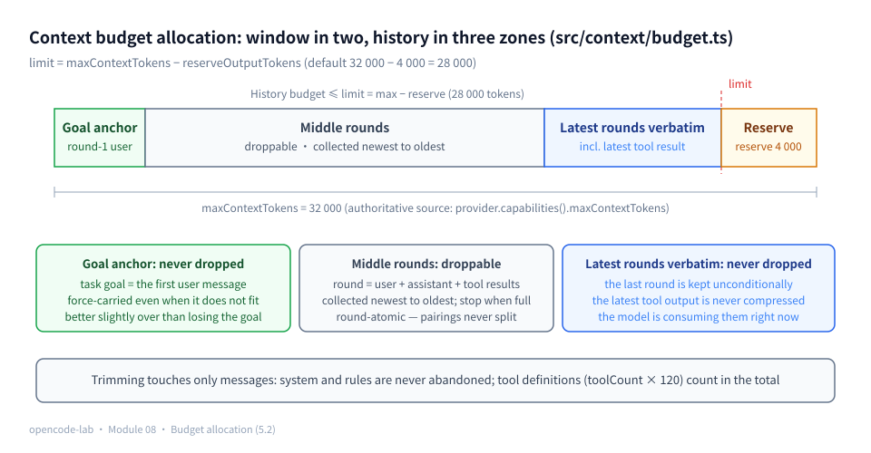
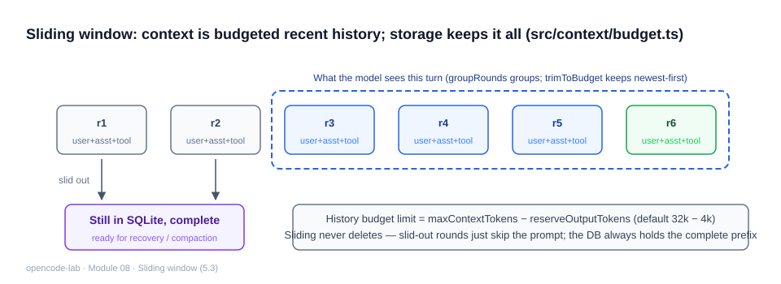
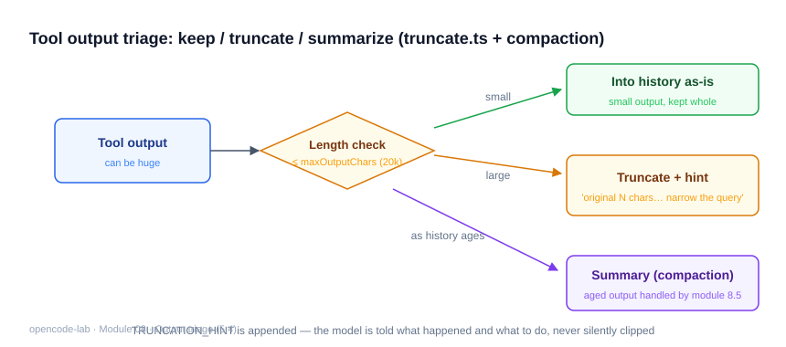
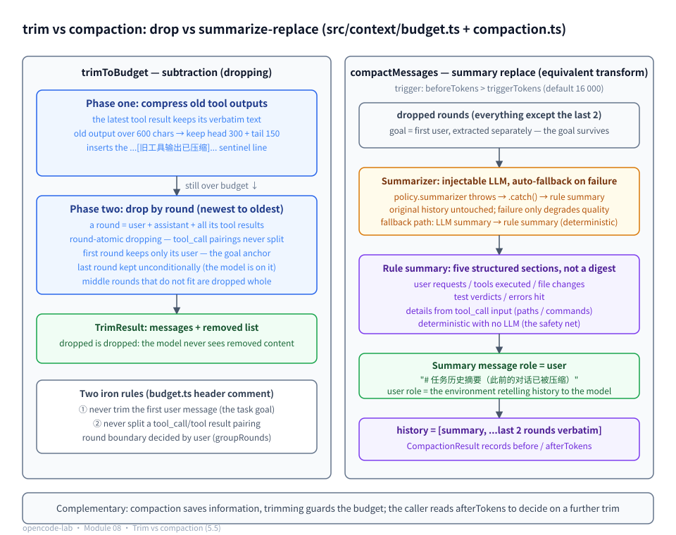

# Chapter 8: Context, Compaction, and Recovery — Long Tasks and Interrupt Recovery

## 1. Where this chapter fits

- Module: 08 Context, Compaction, and Recovery
- Study time: 8 hours (including the Section 2 prerequisites)
- Difficulty: medium-high
- Prerequisite chapter: Chapter 7 (persisted history is the input to compaction and recovery)
- Corresponding OpenCode commit: `70a24697ea0028e19f22712fd63059538cb4bee7`
- Corresponding stage in this project: `v0.10-context`

## 2. Prerequisites

> This chapter tackles two problems: "the history is too long to fit" and "how to keep running after a process interruption". The main text uses terms like token conversion, context window, sliding window, and monotonicity — Section 2.2 builds them from zero (where the token conversion rate comes from, and why estimates do not need to be exact); Section 2.3 reviews the three pieces of luggage Chapter 7 left for this chapter (the toLlmMessages round trip, transaction boundaries, and pending unfinished actions). Readers already familiar with LLM context mechanics can skim Section 2.2 and jump straight to Section 5.

### 2.1 Glossary for this chapter

| Term | One-line plain description | Where it is used in this chapter |
|---|---|---|
| token | The smallest slice of text the model processes: a common English word is 1 slice; one Chinese character is usually about one slice | 5.1, whole chapter |
| Context budget (ContextBudget) | A set of pure data: window cap + output reserve, passed in with the model rather than hardcoded | 5.2, 5.7 |
| Tool definitions | The list of tools available to this request (name/description/schema); they consume tokens too | 5.2 |
| Tokenizer / BPE | The component that splits text into tokens; BPE statistically learns to merge high-frequency character combinations into one slice | 2.2.1, 5.1 |
| Context window | The total token cap a single model request can hold; everything shares this one allowance | 5.1, 5.7 |
| Sliding window | The strategy of keeping only the most recent N history entries (the term is borrowed from TCP's receive window) | 5.3 |
| Monotonicity | The measuring stick's reliability floor: longer text never estimates smaller; removed content always estimates smaller | 2.2.3, 5.1 |
| Message framing (structural overhead) | Fixed tokens consumed by protocol wrapping (role names, toolCallId and similar fields); +4/+8 in the teaching version | 5.1, 5.4 |
| Character class (regex) | Square brackets delimit "which characters may appear at this position", e.g. `[\x20-\x7E]` | 5.1 |
| Nullish coalescing `??` | Takes the right-hand value when the left side is null/undefined | 5.1 |
| Round | One (optional) user message plus all following assistant messages and tool results; the atomic unit of trimming | 5.3 |
| Goal anchor (goalAnchor) | The first-round user message is the task goal and is never dropped | 5.3 |
| tool_call pairing | An assistant's declared call and the tool result match one-to-one via toolCallId; splitting them is a protocol error | 5.3, 5.8 |
| trim | Subtraction: over-budget messages are simply dropped; once dropped, they are gone | 5.3, 5.4 |
| compaction | An equivalent transform: condense the old rounds about to be dropped into one summary message and replace them | 5.5 |
| Summarizer / rule-based summarizer | The function that produces the summary; the rule-based version needs no LLM and extracts facts by fixed rules | 5.5 |
| Fallback (degradation) | When the high-quality component fails, automatically switch to the lower-quality safety net so the whole flow does not die | 5.5 |
| Trigger threshold (triggerTokens) | Compaction only fires once the history exceeds this token count | 5.5, 5.7 |
| Output reserve (reserveOutputTokens) | Space carved out of the window up front for the model's reply | 5.2, 5.7 |
| Sentinel value | A special marker string inserted into the data (e.g. `...[旧工具输出已压缩]...`) announcing that the content was modified | 5.4 |
| checkpoint | A persisted point meaning "from here on, nothing before it needs to be redone" | 5.6 |
| Pending tool call | A tool call that was declared but whose result never arrived; the core signal of a process interruption | 2.3, 5.6 |
| Idempotent | Running the same operation multiple times has the same effect as running it once | 5.6 |
| Continuation prompt (continuationPrompt) | A piece of text telling the model "where it broke off, what is unfinished, and how to continue" | 5.6 |

### 2.2 Foundations

#### 2.2.1 How text gets split into tokens: tokenizers and conversion rates

Models do not read characters directly; they read tokens. The **tokenizer** is the component that splits text into token slices; the mainstream approach is **BPE (byte-pair encoding)**: it first mines a huge corpus for statistics on "which character combinations often appear together", then merges high-frequency combinations into single slices. A few intuitions fall out of this:

- Common English words (`read`, `file`) are a single token; rare words get split into several slices (`unbelievable` → `un` + `believ` + `able`); spaces usually attach to the following word.
- The conversion rate is a **statistically derived empirical average, not a physical constant**. Different model families ship different tokenizer vocabularies; the same Chinese character counting as 0.6 tokens in family A and 1.5 in family B is both normal. Engineering rule of thumb: roughly 4 English characters per token, and one Chinese character is about 0.8–1 tokens — this course's teaching version uniformly adopts "**1 Chinese character ≈ 0.8 tokens**", matching the semantics of the code `other * 0.8` (tokenizers differ; a middle value is fine — see Section 2.2.3 for why).

A few examples to get a feel for the splitting:

```text
"read"          → ["read"]                  1 token (a common word stays whole)
"unbelievable"  → ["un","believ","able"]     3 tokens (rare combination split up)
"你好"          → ["你","好"]                2 tokens (or merged into 1, depends on the vocabulary)
"a b c"         → ["a"," b"," c"]            3 tokens (spaces attach to the next word)
```

The point: the token count equals neither the character count nor the word count — it is decided by the tokenizer's vocabulary. That is why estimation multiplies empirical rates per character class instead of simply counting things.

#### 2.2.2 Context window and sliding window

**Context window**: the total token cap a single model request can accept. The key is that it is one shared pot — the system prompt, all history messages, tool definitions, and the space left for the model's reply are all deducted from this single allowance (the full four-compartment split is in Section 5.2).

**Sliding window**: keep only the most recent N messages and drop older ones outright — the window is like a frame that advances with the conversation. The term is borrowed from the TCP network protocol: for reliable transport, TCP maintains a "window" that only tracks the most recent N sent/received byte sequence numbers; anything earlier slides out of the window and is no longer tracked (acknowledged bytes can be forgotten). Conversation history management borrows the same shape:

```text
Message stream:  [goal] [round 1] [round 2] [round 3] [round 4] [round 5]
Window N=3:                       └── kept ──┘         ← only the latest 3 count
Chat advances:               └── kept ──┘              ← the window slides right; [goal] has slid out of view
```

Why call the bare sliding window naive? It has three blind spots: it counts by "number of messages", yet one message may be 200 tokens or 20,000, so the window alternately feels loose and tight; the cut can land exactly between an assistant(tool_call) and its tool result, which is an immediate protocol error; and the task goal is usually the earliest message, so it slides out first — the model loses its memory. The fix (rounds as the atomic unit + two iron rules) is developed in Section 5.3.

#### 2.2.3 Monotonicity: why "estimating" is enough

Budget control only has to answer two **relative questions**: "will this one overflow?" and "did trimming make it lighter?" — both are comparisons, not billing for the model. Since we only compare, the measuring stick need not be exact; it only has to satisfy **monotonicity**:

- if the text grows, the estimate never shrinks;
- if content is removed, the estimate definitely shrinks.

Given these two, "estimate A > estimate B" reliably implies "A is very likely heavier than B". The error's impact is confined to **trigger timing**: overestimating by 10% just compacts a bit earlier; underestimating by 10% just triggers a bit later — correctness is unaffected either way. That is why the teaching version dares to use a heuristic estimate and introduces no tokenizer dependency (per-token counting has its own overhead).

Two text samples to feel the order of magnitude between "estimate" and "exact":

```text
estimateTextTokens("abcdefgh")      = ⌈8 / 4⌉   = 2
estimateTextTokens("一二三四五六七八") = ⌈8 × 0.8⌉ = 7
```

Same 8 characters: English estimates 2, Chinese estimates 7 — the quantified version of "Chinese scenarios double the token count" (the test "estimate Chinese and English separately" pins down this relative relation). An exact tokenizer might give 6 or 9, but for budget control it makes no difference: which is heavier and which is lighter has already been answered correctly by the stick; the missing 1–2 tokens only shift compaction half a round earlier or later.

#### 2.2.4 Message framing: the fixed per-message wrapping cost

What is sent to the model is not bare text but **protocol messages**. Besides content, each message carries "wrapping": role names (`user`/`assistant`/`tool`), quotes and colons of field names, the toolCallId linkage markers on tool messages, and so on. This wrapping is a **fixed cost** — no matter how short the content, the wrapping is there, worth roughly a few tokens under a real tokenizer.

The teaching version models this cost with constants: +4 per user/assistant message, +8 per tool message (it carries an extra toolCallId field, so thicker wrapping and therefore more expensive). Why the compensation is necessary: counting text only systematically underestimates; "the budget looked exactly at the line yet still overflowed" usually means framing overhead and tool-call argument JSON were omitted (the latter in Section 5.1).

Look at the real wire shape of a tool message (OpenAI-style JSON) and the wrapping becomes concrete:

```json
{ "role": "tool", "tool_call_id": "call_1", "content": "文件内容…" }
```

Compare with the wire shape of a user message — the difference is one field:

```json
{ "role": "user", "content": "修复登录 bug" }
```

`"role"`, `"tool"`, `"tool_call_id"`, `"call_1"`, plus quotes, colons, commas — these wrapping characters are there verbatim no matter how short the content is, and to a tokenizer they are several tokens. That is the **order-of-magnitude origin** of the +8/+4 constants: not an exact measurement but a reasonable rounding of "the wrapping is worth about a few tokens"; a tool message carries one more `tool_call_id` field than a user message, hence 8 > 4.

#### 2.2.5 Worked example: hand-computing mixed Chinese/English text

Take a genuinely mixed sentence and hand-compute it with the teaching-version formula (printable ASCII ⌈÷4⌉ + other characters ⌈×0.8⌉):

```text
Estimate estimateTextTokens("读取 config.json 后更新 a.ts")

Step 1  count the characters: 23 characters in total
  printable ASCII: 3 spaces + "config.json" (11) + "a.ts" (4) = 18
  other characters: 5 Chinese characters (读, 取, 后, 更, 新)
Step 2  convert by class:
  ASCII:   ⌈18 / 4⌉ = ⌈4.5⌉ = 5
  Chinese: ⌈5 × 0.8⌉ = ⌈4⌉ = 4
Step 3  add up: 5 + 4 = 9 tokens
```

This matches what `estimateTextTokens` in `src/context/tokens.ts` actually outputs; verify it yourself (run in the opencode-lab directory):

```bash
bun -e 'import("./src/context/tokens").then(m => console.log(m.estimateTextTokens("读取 config.json 后更新 a.ts")))'
```

```text
Output:
9
```

Measured: 9, exactly matching the step-by-step hand calculation — the estimate formula is pure character statistics with no tokenizer dependency, so any environment reproduces the same number.

The tests pin down the same-direction relative relation (`test/context/context.test.ts`):

```ts
  test("中文与英文分别估算", () => {
    const en = estimateTextTokens("abcdefgh") // 8 ascii -> 2
    const zh = estimateTextTokens("一二三四五六七八") // 8 cjk -> 7
    expect(zh).toBeGreaterThan(en)
  })
```

The `8 cjk -> 7` in the comment is exactly "1 Chinese character ≈ 0.8 tokens" put into practice: ⌈8 × 0.8⌉ = 7, less than 8. Note the direction of conversion: it is "**1 Chinese character converts to 0.8 tokens**" (multiply the character count by 0.8), not "0.8 Chinese characters per token" — wherever the code is quoted below, the code's semantics prevail.

### 2.3 Recap of the previous module

Chapter 7 stored the conversation history in SQLite; this chapter's compaction and recovery both stand on it. The three pieces of luggage:

1. **The toLlmMessages round trip**: `repository.toLlmMessages(sessionId)` restores the message rows in the database into `LlmMessage[]` — the assistant rows' parts JSON deserializes back, tool rows carry their toolCallId. Recovery in Section 5.6 feeds it straight back in as the resume history; protocol-seamless.
2. **Transaction boundaries**: Chapter 7 wraps writes in two transactions — `appendAssistantTurn` (1 assistant message + N pending tool_calls in one transaction) and `appendToolResult` (1 tool message + status update in one transaction). Lose power at any moment and the database is left sitting at a complete last boundary, never half a message.
3. **pending = unfinished actions**: tool_call rows whose call was declared but whose result never arrived stay in the pending state, and `listPendingToolCalls` finds them in one query. A crash landing exactly between the two transactions leaves precisely these rows — Section 5.6 turns them into the core input of the recovery strategy.

Before reading on, confirm the baseline is intact:

```bash
cd opencode-lab && bun test test/session/   # all 17 cases green = the recovery input surface is intact
```

## 3. Learning goals

- Understand: the three-way split of the token budget (system + history + output reserve); the two classic accidents — "dropping the oldest message drops the task goal" and "splitting a tool_call pairing breaks the protocol"; and the essential difference between trim (drop) and compaction (summarize + keep).
- Be able to implement: mixed Chinese/English token estimation, round grouping, two-phase trimming (compress old tool outputs first, then drop middle rounds), the rule-based summarizer (with an injectable LLM summarizer that degrades on failure), and session recovery state construction.
- Be able to test: the budget never overflows, the goal always survives, pairings stay intact, a summarizer crash leaves the original history untouched, and the recovery prompt explicitly forbids auto-retrying high-risk tools.
- Be able to explain: why pending tool calls are the core signal of the recovery strategy.

## 4. Problem statement

The longer an agent works, the longer its history: dozens of tool calls, file contents and test outputs of several thousand characters each — it soon slams into the model's context window. In OpenCode this corresponds to `packages/opencode/src/session/compaction.ts` + `overflow.ts` + `packages/core/src/session/history.ts` (history selection) + `packages/core/src/session/context-epoch.ts` (context epochs).

The teaching version's four components each own one stretch:

```text
tokens.ts      Estimation: how many tokens does this message cost?
budget.ts      Trimming: over budget — what gets dropped, what gets kept?
compaction.ts  Compaction: condense what would be dropped into a summary; goal, file changes, and test verdicts survive
recovery.ts    Recovery: after an interruption, build the state and prompt needed to "keep running"
```

## 5. Core concepts

The design blueprint's Section 8.9 lists 8 knowledge points for this chapter. First the "knowledge point ↔ source file ↔ test file" mapping table, then each point expanded in its own subsection, always in the same four beats: "Concept → How this project implements it → Common pitfalls → Self-check questions".

| # | Blueprint knowledge point | Main source (relative to opencode-lab/) | Corresponding tests |
|---|---|---|---|
| 1 | Tokens and the context window | `src/context/tokens.ts` | `test/context/context.test.ts` (token estimation group) |
| 2 | Priority of system prompt, project rules, history messages, tool results | `src/context/manager.ts`, `src/context/budget.ts` | `test/context/context.test.ts` (prepareContext assembly group) |
| 3 | History selection and the sliding window | `src/context/budget.ts` | `test/context/context.test.ts` (groupRounds, trimToBudget groups) |
| 4 | Tool output truncation, summary, and reference | `src/context/budget.ts` (compressOldToolResults) | `test/context/context.test.ts` (old tool output head+tail compression) |
| 5 | Compaction: summary, old-message replacement, and continuing execution | `src/context/compaction.ts` | `test/context/context.test.ts` (compactMessages group) |
| 6 | Checkpoint, recovery boundary, and idempotency | `src/context/recovery.ts`, `src/session/persistence.ts` | `test/context/recovery.test.ts` |
| 7 | Adapting to different model context limits | `src/context/budget.ts`, `src/providers/types.ts` | `test/context/context.test.ts` (custom budget cases) |
| 8 | Context quality assessment and information-loss risk | `src/context/compaction.ts`, `src/context/budget.ts` | `test/context/context.test.ts` (goal survival / pairing integrity assertions) |

### 5.1 Tokens and the context window

> 📊 Figure: the window budget allocation is diagrammed in Figure 8-1 (Section 5.2); how the window slides with the conversation is diagrammed in Figure 8-3 (Section 5.3).

**Concept**

A token is the smallest unit of text the model processes — text is split into tokens before it enters the model; for the full story of splitting rules and conversion rates see Section 2.2.1. In one plain sentence: a common English word is about 1–2 tokens, and one Chinese character usually counts as about one token under mainstream tokenizers. The **context window** is the total token cap a single model request can accept (Section 2.2.2), and it is one shared pot: the system prompt, all history messages, tool definitions, and the output space left for the model are all deducted from this single allowance. Once the window overflows, the request is either rejected outright by the Provider or silently truncated — the latter is more dangerous, since the model keeps working in earnest on mangled input. So the agent must answer two questions before sending a request: "roughly how many tokens is this request?" and "if it overflows, what gets dropped?". The engineering answer to the first is estimation, not exact counting: a full tokenizer dependency is heavy, and per-token counting has its own overhead; budget control only needs **monotonicity** — longer text never estimates smaller, removed content always estimates smaller (for why that suffices, see the relative-comparison argument in Section 2.2.3). Mixed Chinese/English text distorts a single conversion rate, so count separately per character class (worked example in Section 2.2.5).

**How this project implements it**

Text estimation in `src/context/tokens.ts`:

```ts
export function estimateTextTokens(text: string): number {
  const ascii = (text.match(/[\x20-\x7E]/g) ?? []).length
  const other = text.length - ascii
  return Math.max(1, Math.ceil(ascii / 4) + Math.ceil(other * 0.8))
}
```

Read these five lines with the same convention as the Section 2.2.5 hand calculation: printable ASCII converts at 4 characters per token, and Chinese characters and the rest at **about 0.8 tokens per character** (the semantics of `other * 0.8` — the direction is "1 character = 0.8 tokens", not "0.8 characters per token"; 0.8 is an empirical statistical value and tokenizers differ); `Math.max(1, …)` guarantees non-empty text counts at least 1. Two syntax points on the first line: `[\x20-\x7E]` is the **character class** for "printable ASCII" (hex 0x20 space through 0x7E tilde, 95 characters in total), and `?? []` is **nullish coalescing** — `match` returns null when nothing matches, in which case we take an empty array and count 0. Message-level estimation adds **structural overhead** on top of the text (`src/context/tokens.ts`):

```ts
    case "tool":
      return estimateTextTokens(message.content) + 8
    case "assistant":
      return (
        message.parts.reduce((sum, part) => {
          if (part.type === "text") return sum + estimateTextTokens(part.text)
          return sum + estimateTextTokens(part.tool) + estimateTextTokens(JSON.stringify(part.input ?? {})) + 8
        }, 0) + 4
      )
```

The constants — +8 for tool messages, +4 for assistant — model **message framing** (the protocol wrapping from Section 2.2.4: role markers, toolCallId and similar fixed costs under a real tokenizer) — the order of magnitude comes from the common sense that "this wrapping is worth a few tokens"; single digits, good enough. The assistant tool_call part also counts the **tool name and argument JSON** — when the arguments embed an entire file's content, this term is exactly the dominant one. Tests pin down only monotonicity and relative size (Chinese estimates larger than same-length English, messages with calls larger than plain text), not specific numbers.

How much does the estimate differ for the same text as messages of different roles? Measured with the Section 2.2.5 sentence (run in the opencode-lab directory):

```bash
bun -e 'import("./src/context/tokens").then(m => {
  const text = "读取 config.json 后更新 a.ts"
  const user = { role: "user", content: text }
  const assistant = { role: "assistant", parts: [
    { type: "text", text },
    { type: "tool_call", toolCallId: "c1", tool: "edit", input: { path: "a.ts", content: "export const a = 1" } },
  ] }
  console.log("user      =", m.estimateMessageTokens(user))
  console.log("assistant =", m.estimateMessageTokens(assistant))
})'
```

```text
Output:
user      = 13
assistant = 34
```

The accounting behind the gap: user message = text 9 + framing 4 = 13; beyond the same 9 tokens of text, the assistant message's tool_call part adds four items — tool name "edit" = 1, argument JSON (46 ASCII characters) = 12, tool_call framing 8, assistant framing 4, totaling 34. The argument JSON item (12) alone exceeds the whole sentence (9): "arguments dominate" is measured here, not guessed.

**Common pitfalls**

- Treating character counts as token counts. Symptom: budgeting by "6000 characters = 6000 tokens"; in Chinese scenarios the real token count doubles and the limit overflows mysteriously. Fix: convert per class — ASCII at 4 characters per token, Chinese at about 0.8 tokens per character (direction per the Section 2.2.5 hand calculation).
- Counting only text, ignoring tool-call argument JSON and framing overhead. Symptom: the budget sits exactly at the line yet still overflows. Fix: the +8/+4 and argument serialization in `estimateMessageTokens` exist to cover exactly this (framing cost origin in Section 2.2.4).
- Chasing an exact tokenizer. Symptom: heavy dependencies introduced and the assembly path slowed by per-token counting. Fix: budget control needs monotonicity and relative accuracy (Section 2.2.3); a 10% error only affects trigger timing, not correctness.

**Self-check questions**

1. Why is the framing overhead of a tool message (8) larger than a user message's (4)? — Reference answer: tool messages carry the toolCallId linkage marker, so more protocol wrapping fields (Section 2.2.4).
2. What does `estimateTextTokens("a")` return, and why is it designed this way? — Reference answer: 1 (the Math.max floor); it guarantees the monotonicity lower bound, so very short text does not compute 0 and disturb the "did trimming make it lighter" comparison.
3. Which code changes when swapping in an exact tokenizer? — Reference answer: only the internals of `tokens.ts`; the signatures and semantics of the three estimate functions are unchanged — that is precisely why estimation lives in its own module.

### 5.2 Priority of system prompt, project rules, history messages, and tool results

**Concept**

A model request is assembled from four kinds of content: the system prompt (agent persona and hard constraints), project rules (domain instructions injected by Module 05), history messages (the conversation chain), and tool definitions (the list of tools available this time). When the budget gets tight, who is sacrificed first? This project's priority order: **system and rules are never abandoned** (they define "who you are and by what rules you work"; lose them and the agent changes); **the first user message (the task goal) is never abandoned**; **the latest round and the most recent tool output keep their verbatim text** (the model is working on them right now); next come **newer middle rounds**; only then touch **the verbatim text of old tool outputs** (compressed to head+tail fragments); and only as a last resort **drop the oldest middle rounds**. In one sentence: the closer to the "current decision", the higher the priority; identity and goal content outrank process content. One easily missed item — tool definitions also consume tokens (each tool's name/description/JSON schema easily tops a hundred tokens), and they must be counted in the total budget.

**How this project implements it**

The assembly entry point, `src/context/manager.ts`:

```ts
export function prepareContext(input: ContextInput): PreparedContext {
  const system = [input.baseSystemPrompt, input.rulesSection ?? ""].filter((s) => s.trim() !== "").join("\n\n")
  const trimmed: TrimResult = trimToBudget(input.messages, input.budget)
  return {
    system,
    messages: trimmed.messages,
    estimatedHistoryTokens: trimmed.estimatedTokens,
    trimmed: trimmed.removed,
  }
}
```

After concatenation, the system prompt and rules **do not participate in trimming** — trimming only applies to messages. The total accounting includes system, history, and tool definitions (same file):

```ts
export function totalEstimatedTokens(prepared: PreparedContext, toolCount = 0): number {
  return estimateTextTokens(prepared.system) + prepared.estimatedHistoryTokens + toolCount * 120
}
```

Picture one request's 32_000 tokens (DEFAULT_BUDGET's maxContextTokens) as a pie cut into four compartments, and walk through it with concrete numbers:

| Compartment | Content | Value in this example |
|---|---|---|
| Output reserve | Space left for the model's reply (carved out first) | 4_000 (reserveOutputTokens) |
| system + rules | Persona and project rules | est. 2_600 (system 2_000 + rules 600) |
| Tool definitions | 9 tools × 120 | 1_080 |
| History messages | The only compartment that gets trimmed | cap = limit |

Combined arithmetic: `limit = 32_000 − 4_000 = 28_000` (the subtraction on `trimToBudget`'s first line, excerpted in Section 5.7); if history fills exactly 28_000, then `totalEstimatedTokens(prepared, 9) = 2_600 + 28_000 + 9 × 120 = 31_680` — beyond the history there is still 3_680 tokens of "hidden spending". `120/tool` is an **order-of-magnitude estimate**: a tool's name + description + JSON schema easily tops a hundred tokens under a real tokenizer; get the magnitude right, no need to nail the single digits (the production direction of self-check question 3).

An honest note on the teaching version's simplification: `trimToBudget`'s limit only subtracts the output reserve, not the system and tool compartments — the full accounting is provided separately by `totalEstimatedTokens` so callers can check the complete request size (the Module 13 application-layer integration will use it); a stricter implementation would subtract all four compartments at once before capping history.

Read backwards, the example is that function's purpose: if `totalEstimatedTokens` comes out at 34_000 > 32_000, history is stuffed too full and hidden spending was ignored — the right move then is compaction (triggerTokens fires early, see Sections 5.5/5.7), not forcing more in.

The priority within history is implemented by `src/context/budget.ts`'s two-phase trimming (developed in Section 5.3); the file-header comment is the priority manifesto:

```ts
// Context budget and trimming. Two iron rules:
// 1. Never trim the first user message (the task goal) — "drop the oldest" is the classic accident
// 2. Never split an assistant(tool_call) from its tool result pairing — it breaks the protocol
```



*Figure 8-1: Context budget allocation. maxContextTokens first carves out the output reserve (reserveOutputTokens); the history budget is ≤ limit = max − reserve; within history there are three zones: the goal anchor (first-round user, never dropped, force-carried even when it does not fit), middle rounds (droppable, collected newest to oldest), and the latest-round verbatim text (never dropped, including the most recent tool output).*

**Common pitfalls**

- Including system/rules in the trimming targets. Symptom: late in a long task the agent's tone suddenly shifts and it violates project conventions. Fix: `prepareContext` only calls `trimToBudget` on messages.
- Believing "the earlier the content, the less it matters". Symptom: the task goal happens to be the earliest message in history; after the window slides, the model starts doing unrelated things. Fix: the goalAnchor is force-retained (Section 5.3).
- Accounting for messages but not tool definitions. Symptom: 9 tools ≈ 1000+ tokens of hidden spending push the actual request past the window. Fix: the `toolCount` parameter of `totalEstimatedTokens`.

**Self-check questions**

1. Where does rulesSection come from? — Reference answer: generated by the Module 05 config/rules module (e.g. AGENTS.md content), injected via `ContextInput`; the manager does not care about the source.
2. What is system when there are no rules? — Reference answer: only baseSystemPrompt — the test "system has only the base prompt when there are no rules" asserts `prepared.system` equals "基础".
3. What precision level is `toolCount * 120`? — Reference answer: a rough constant; getting the magnitude right suffices. In production, compute from the registry's actual serialized length.

### 5.3 History selection and the sliding window

**Concept**

The sliding window (keep only the most recent N entries; its TCP ancestry and three blind spots covered in Section 2.2.2) is the most primitive history selection strategy, but the raw "slide by message count" has two fatal flaws: the cut can land exactly between an assistant's tool_call and its tool result — an immediate protocol error (the model sees a result with no matching call); and the task goal can be cut out — the model loses its memory. "Immediate protocol error" deserves half a sentence of expansion, because it is often underestimated as a soft "the model will be confused" problem — it is not: when the Provider receives a tool message, it takes the toolCallId and looks back through the earlier assistant messages for the matching tool_call declaration; if trimming happened to cut that assistant, the id becomes an orphan — the server rejects the whole request with a hard error like "no matching tool_call found", and not a single request goes through. The fix is upgrading the selection unit from "message" to "**round**": a round = one (optional) user message + the assistant messages after it and all their tool results. Dropping with the round as the atomic unit keeps pairings intact by construction; add the two iron rules (keep the first-round goal, keep the last round) and window sliding is safe. The collection direction matters too: **collect from newest to oldest**, stop when it no longer fits — guaranteeing that what remains is the history "closest to now", not a lucky middle stretch.

**How this project implements it**

Round grouping (`src/context/budget.ts`):

```ts
// A round = user (optional) + assistant + all of its tool results. The next user starts a new round.
export function groupRounds(messages: LlmMessage[]): LlmMessage[][] {
  const rounds: LlmMessage[][] = []
  for (const message of messages) {
    if (message.role === "user" || rounds.length === 0) rounds.push([])
    rounds[rounds.length - 1].push(message)
  }
  return rounds.filter((r) => r.length > 0)
}
```

The `rounds.length === 0` branch handles the degenerate "history does not start with a user message" case — it still groups, no throw. `trimToBudget` phase two collects by round:

```ts
  // collect newest to oldest until over budget; first round handled separately (keep only its user message as the goal anchor)
  const lastRound = rounds[rounds.length - 1]
  const firstRound = rounds[0]
  const middleRounds = rounds.slice(1, -1)

  let acc: LlmMessage[] = [...lastRound]
  const keptMiddle: LlmMessage[][] = []
  for (let i = middleRounds.length - 1; i >= 0; i--) {
    const candidate = [...middleRounds[i], ...acc]
    if (estimateMessagesTokens(candidate) > limit) break
    acc = candidate
    keptMiddle.unshift(middleRounds[i])
  }

  // goal anchor: first-round user (when present and not the last round)
  const goalAnchor = firstRound.length > 0 && firstRound !== lastRound && firstRound[0].role === "user" ? [firstRound[0]] : []
  // carry the anchor if it fits; force-carry it even when it does not (the goal outranks history) — the budget may run slightly over; better a little over than losing the goal
  kept.push(...goalAnchor, ...keptMiddle.flat(), ...lastRound)
```

The three conditions on the goalAnchor line each exclude one situation; take them apart one by one:

- `firstRound.length > 0` — excludes empty groups. The grouping function already guarantees non-empty rounds; this is defensive style, making the condition self-sufficient;
- `firstRound !== lastRound` — excludes "the whole history is a single round". That only round is already kept unconditionally as lastRound; adding the anchor too would make the same message appear twice;
- `firstRound[0].role === "user"` — excludes the degenerate "history does not start with a user message" case. Then the first round does not open with the task goal, and force-keeping it would only stuff in an unrelated message.

Enough paper rules — run the two-phase trim on real data (run in the opencode-lab directory; `longHistory` is exactly isomorphic to the same-named helper in `test/context/context.test.ts` — 1 task goal + N rounds, each round user + assistant(tool_call) + tool, with tool results being 1200 characters of repeated text):

```bash
bun -e '
const { trimToBudget } = await import("./src/context/budget")
const { estimateMessagesTokens } = await import("./src/context/tokens")
const longHistory = (rounds) => {
  const messages = [{ role: "user", content: "目标：为项目实现用户登录功能并保证测试通过" }]
  for (let i = 0; i < rounds; i++) {
    messages.push({ role: "user", content: `第 ${i} 个子任务：检查模块 ${"x".repeat(50)}` })
    messages.push({ role: "assistant", parts: [
      { type: "text", text: `处理子任务 ${i}` },
      { type: "tool_call", toolCallId: `c${i}`, tool: "read", input: { path: `m${i}.ts` } },
    ] })
    messages.push({ role: "tool", toolCallId: `c${i}`, content: "文件内容 ".repeat(200) })
  }
  return messages
}
const messages = longHistory(30)
const result = trimToBudget(messages, { maxContextTokens: 3_000, reserveOutputTokens: 500 })
console.log("before:", messages.length, "条 /", estimateMessagesTokens(messages), "tokens")
console.log("after :", result.messages.length, "条 /", result.estimatedTokens, "tokens / removed", result.removed.length, "条")
console.log("first :", result.messages[0].role, "-", result.messages[0].content)
'
```

```text
Output:
before: 91 条 / 22421 tokens
after : 16 条 / 2280 tokens / removed 75 条
first : user - 目标：为项目实现用户登录功能并保证测试通过
```

Mapping the numbers back onto the implementation: 91 messages = goal 1 + 30 rounds × 3; phase one's compression cannot save it (each tool result is 1200 characters; 30 rounds far exceed the 2500 limit), so phase two kicks in — collecting the 29 middle rounds newest to oldest, only 4 fit before hitting the line; together with the last round, 16 messages are kept, and the dropped 25 rounds × 3 = 75 messages go into `removed`; the first output message is still the task goal — the anchor works, cutting about 90% of the tokens while pairings and the goal stay intact.



*Figure 8-3: Sliding window — the history entering the model each round is only the most recent rounds that fit the budget (maxContextTokens − reserveOutputTokens) (groupRounds groups by round, trimToBudget keeps newest to oldest); slid-out rounds merely skip the prompt — SQLite always holds the complete prefix.*

**Common pitfalls**

- Using assistant messages as round boundaries. Symptom: tool results of the same intent get grouped into the next round, and dropping "middle rounds" splits pairings. Fix: the user-starts-a-new-round rule (Exercise 1: delete it and watch which tests go red).
- Keeping middle rounds but dropping the last round. Symptom: the last round's tool result is gone, and the model believes the call never ran or the result is stale. Fix: `lastRound` is kept unconditionally.
- Sizing the window by message count. Symptom: one message may be 200 tokens or 20,000, so a count-based window alternates loose and tight. Fix: measure the window in tokens (`estimateMessagesTokens(candidate) > limit`).

**Self-check questions**

1. When the whole history is one round, what is goalAnchor? — Reference answer: an empty array (the `firstRound !== lastRound` condition fails and is excluded); the round is already kept as lastRound, so the task goal is not lost.
2. What if the goal anchor does not fit? — Reference answer: it is still force-carried; the budget may run slightly over — "better a little over than losing the goal" (verbatim code comment); the tests leave a +200 tolerance for the overflow.
3. Why is `keptMiddle.unshift` necessary? — Reference answer: collection runs in reverse order; unshift puts older rounds back at the front, preserving chronological order.

### 5.4 Tool output truncation, summary, and reference

**Concept**

The number-one culprit of history bloat is tool output: one read returns thousands of characters of file content, one test returns screens of logs, and a few dozen rounds easily swallow the whole window. There are three remedies, increasing in force. **Truncation**: keep the head and tail of the output, drop the middle — cheapest, and a good fit for log-like output where "the key information is at both ends and the repetition is in the middle". **Summary**: condense the output into a verdict with rules or a model — fits output with a clear semantic structure. **Reference**: store the original outside the message (database/file) and put only a "where to fetch it back" pointer in the message — most economical, but it needs an extra retrieval hop. This project implements truncation (head+tail kept plus an explicit "[旧工具输出已压缩]" marker — that marker string is the **sentinel value**, Section 2.1 glossary), plus one fine-grained rule: **the most recent tool output always keeps its verbatim text** — it is the information the model is consuming right now, and truncating it directly causes a wrong next decision.

**How this project implements it**

`src/context/budget.ts`:

```ts
const OLD_TOOL_RESULT_CHARS = 600

// truncate old tool results (keep head+tail, elide the middle) — the most recent keeps its verbatim text
function compressOldToolResults(messages: LlmMessage[]): LlmMessage[] {
  let lastToolIndex = -1
  for (let i = messages.length - 1; i >= 0; i--) {
    if (messages[i].role === "tool") {
      lastToolIndex = i
      break
    }
  }
  return messages.map((message, i) => {
    if (message.role !== "tool" || i >= lastToolIndex) return message
    if (estimateMessageTokens(message) * 4 <= OLD_TOOL_RESULT_CHARS) return message
    const head = message.content.slice(0, OLD_TOOL_RESULT_CHARS / 2)
    const tail = message.content.slice(-OLD_TOOL_RESULT_CHARS / 4)
    return { ...message, content: `${head}\n...[旧工具输出已压缩]...\n${tail}` }
  })
}
```

Three details worth reading: `lastToolIndex` scans back to front for the most recent tool message, and messages with `i >= lastToolIndex` (including that latest one) pass through untouched; `estimateMessageTokens(message) * 4` converts the token estimate back to character magnitude before comparing with 600 — **why multiply back by 4**: the estimation stick is "4 ASCII characters ≈ 1 token" (Section 2.2.5), so multiplying by 4 folds the token count back into "equivalent ASCII character count", putting it in the same dimension as the 600-character threshold; without it you would be comparing token counts against character counts directly. Short outputs under 600 after conversion are left alone — compressing them saves few tokens and needlessly loses information. The compression ratio is a 300-character head + 150-character tail — the head usually holds the command echo or the file opening, the tail the summary line or error stack, and the repetitive middle is the most disposable. This function is `trimToBudget`'s **phase one**: try the cheap compression first; if it fits, no round is dropped at all.



*Figure 8-4: Three-tier triage of tool output — under maxOutputChars (20k) it enters history verbatim; anything longer is truncated immediately with a TRUNCATION_HINT attached (stating the original length, suggesting a narrower parameter range); old output pushed far back in history is further covered by compaction summaries. Truncation is always announced to the model — never silently clipped.*

**Common pitfalls**

- Compressing the most recent tool output too. Symptom: the read result the model just requested gets clipped, and what it cites next is missing pieces. Fix: the `i >= lastToolIndex` exemption.
- Keeping only the head. Symptom: the decisive test-failure error (usually at the end) is discarded, and the model carries on with an illusion of "success". Fix: the tail segment `slice(-OLD_TOOL_RESULT_CHARS / 4)`.
- No marker after compression. Symptom: the model does not know the content was altered and cites fragments as the full text. Fix: explicitly insert the "...[旧工具输出已压缩]..." sentinel line.

**Self-check questions**

1. Why does the length check use `token estimate * 4` instead of measuring characters directly? — Reference answer: it reuses the same estimation stick as the budget; CJK characters have high token density, so the same allowance holds fewer Chinese characters and Chinese output triggers compression earlier — intentional conservatism.
2. Where in `trimToBudget` is it called? — Reference answer: phase one, before dropping rounds; phase two (dropping rounds) only begins if the budget is still exceeded after compression.
3. Which outputs suit "reference" rather than "truncation"? — Reference answer: reproducible ones (file contents can be re-read) and fetchable-on-demand ones (logs can be re-run); referencing requires a retrieval tool (e.g. calling read again), which the teaching version does not implement.

### 5.5 Compaction: summary, old-message replacement, and continuing execution

**Concept**

trim is subtraction: once dropped, it is dropped — the model never sees it again. compaction is an **equivalent transform**: the old rounds about to be dropped are condensed into one summary message that replaces them in place — the history gets shorter, but the information survives "for the most part". The trigger is a token threshold (triggerTokens), not a message count; after compaction the most recent keepLastRounds rounds keep their verbatim text (the recent context the model needs to keep working cannot be summarized away). The summary message uses the user role. First, a protocol fact-check: consecutive assistant messages are legal in the chat protocol — "assistant messages cannot appear consecutively" is simply false. The real reason is **role semantics** — the summary is not something the model said; it is the runtime environment's retelling of the history, and user is exactly the existing channel for "the environment speaking to the model" (system is already taken by the system prompt). With the assistant role, the model would treat the summary as "things it said itself", confusing retelling with memory. The summarizer has two implementations: the injected LLM summarizer (high quality, can fail) and the built-in rule summarizer (no LLM, deterministic extraction). The key engineering decision is **fallback**: when the LLM summarizer throws, automatically fall back to the rule summary — compaction is routine for long tasks; one failure must not kill the whole session, and must never damage the original history.

**How this project implements it**

The compaction core in `src/context/compaction.ts`. The entry first makes the trigger check — veto-style: return unchanged if under the threshold, `needed: false`:

```ts
  const beforeTokens = estimateMessagesTokens(messages)
  if (beforeTokens <= policy.triggerTokens) {
    return { needed: false, messages: [...messages], summary: "", compactedRounds: 0, beforeTokens, afterTokens: beforeTokens }
  }
```

Only past the threshold does the compaction flow begin:

```ts
  const rounds = groupRounds(messages)
  const keptRounds = rounds.slice(-policy.keepLastRounds)
  const droppedRounds = rounds.slice(0, -policy.keepLastRounds)

  let summary: string
  if (policy.summarizer) {
    // an LLM summary failure must not damage the original history: fall back to the rule summary
    summary = await policy.summarizer(droppedRounds.flat()).catch(() => ruleBasedSummary(droppedRounds.flat()))
  } else {
    summary = ruleBasedSummary(droppedRounds.flat())
  }

  const goal = firstUserMessage(droppedRounds.flat())
```

`goal` is extracted separately (not dependent on the summarizer) — the task goal is the highest-priority information and must survive regardless of summarizer quality. Constructing the summary message:

```ts
  const summaryMessage: LlmMessage = {
    role: "user",
    content: [
      "# 任务历史摘要（此前的对话已被压缩）",
      goal ? `## 任务目标\n${goal}` : "",
      summary,
      "## 说明\n以上是历史轮次的摘要；其后的消息是未压缩的最近轮次。请基于摘要与最近消息继续任务。",
    ]
      .filter((s) => s !== "")
      .join("\n\n"),
  }

  const compacted = [summaryMessage, ...keptRounds.flat()]
```

The rule summarizer `ruleBasedSummary` (same file) extracts five sections of structured facts: user requests (deduplicated, each truncated to 160 characters), tools executed (`toolDetail` extracts path/command details, capped at 40 entries), file changes (targets of write/edit/apply_patch), test verdicts (the most recent containing `[exit 0` or `1 pass`), and errors encountered (first line, capped at 10 entries) — structured extraction, not an essay digest; deterministic and usable without any LLM.

The "equivalent transform" is lossy. Take a 20-round long history (1 task goal + 20 subtask rounds, each reading one file, isomorphic to the test's `longHistory(20)`) and spread out the losses:

| | Before compaction (20 rounds verbatim) | After compaction (summary + last 2 rounds verbatim) |
|---|---|---|
| Message shape | Each round: user + assistant(tool_call) + tool verbatim | 1 role=user summary message + rounds 19/20 verbatim |
| The model can still answer | — | "what is the task goal" (goal extracted separately into the summary); "which files were read" (executed-tools list); "which files were changed" (file-changes section); "did the tests pass" (test-verdict section); file content details of the last two rounds (kept verbatim) |
| The model will forget | — | verbatim details of tool outputs from rounds 1–18 (only path/command lists remain); the original wording of early conversation (user requests truncated to 160 characters each); full stacks of failed output (first line only, capped at 10); the timing details of "which step happened in which round" (the lists carry no round numbers) |

This table is the yardstick for "should a given kind of information enter the summary": if it is lost, would the model redo work, answer off-target, or contradict itself? Verbatim details can be dropped (reproducible: just read again); fact lists must stay (non-reproducible process memory).



*Figure 8-2: trim vs compaction. Left, the two trimToBudget phases: first compress old tool outputs (head+tail kept, 600-character threshold, the most recent stays verbatim), then — still over budget — drop rounds newest to oldest (tool_call pairings never split); right, compactMessages: dropped rounds are condensed into a role=user summary message (five-section structured extraction) while the last 2 rounds stay verbatim; a throwing summarizer automatically falls back to the rule summary and the original history is never damaged.*

The table is a thought experiment; actually run it (reusing the same `longHistory` construction from the Section 5.3 demo; run in the opencode-lab directory; `DEFAULT_COMPACTION_POLICY = { triggerTokens: 16_000, keepLastRounds: 2 }`):

```bash
bun -e '
const { compactMessages } = await import("./src/context/compaction")
/* …longHistory identical to the Section 5.3 demo (the same isomorphic 1 goal + N rounds construction), omitted here… */
const messages = longHistory(30)
const result = await compactMessages(messages)   // default policy: trigger 16000 / keepLastRounds 2
console.log("needed =", result.needed, " compactedRounds =", result.compactedRounds)
console.log("beforeTokens =", result.beforeTokens, " afterTokens =", result.afterTokens)
console.log("messages:", messages.length, "->", result.messages.length)
console.log("--- 摘要消息前 7 行 ---")
console.log(result.messages[0].content.split("\n").slice(0, 7).join("\n"))
'
```

```text
Output:
needed = true  compactedRounds = 29
beforeTokens = 22421  afterTokens = 2358
messages: 91 -> 7
--- 摘要消息前 7 行 ---
# 任务历史摘要（此前的对话已被压缩）

## 任务目标
目标：为项目实现用户登录功能并保证测试通过

## 用户请求
- 目标：为项目实现用户登录功能并保证测试通过
```

Mapping numbers and structure back onto the implementation: of the 31 rounds, the first 29 (including the goal round) are condensed into one summary while the last 2 rounds stay verbatim — 91 → 7 messages, and afterTokens is only about one tenth of the pre-compaction total; the verbatim text under the "任务目标" heading never passes through the summarizer — goal is extracted separately. One more detail: the first entry under "用户请求" is also the task goal — the goal round also lands in droppedRounds and gets collected again by the rule summarizer; the mutual redundancy gives the goal double insurance.

The summarizer fallback is also measured — inject a summarizer guaranteed to throw and see whether `.catch()` holds the line (run in the opencode-lab directory; same `longHistory` as above, 10 rounds this time):

```bash
bun -e '
const { compactMessages } = await import("./src/context/compaction")
/* …longHistory identical to the Section 5.3 demo, omitted here… */
const result = await compactMessages(longHistory(10), {
  triggerTokens: 1_000,
  keepLastRounds: 1,
  summarizer: async () => { throw new Error("summarizer down") },
})
const first = result.messages[0]
console.log(first.role === "user" && first.content.includes("任务历史摘要") && first.content.includes("登录功能")
  ? "OK: messages[0] 仍是 role=user 的摘要（含「任务历史摘要」标题与任务目标），原历史未被破坏"
  : "FAIL")
'
```

```text
Output:
OK: messages[0] 仍是 role=user 的摘要（含「任务历史摘要」标题与任务目标），原历史未被破坏
```

The "summarizer down" thrown by the summarizer is swallowed by `.catch`, silently falling back to `ruleBasedSummary`; the caller still receives a complete, usable compaction result — "compaction failure does not damage the original history" is not a slogan in a comment but behavior reproducible with one command.

**Common pitfalls**

- Using the assistant role for the summary message. Symptom: the model treats the summary as "things it said itself", citing memories that do not exist. Fix: `role: "user"` plus an opening "has been compacted" note. Be careful not to misremember the reason as "the protocol forbids consecutive assistant messages" — the protocol allows it (multiple assistant messages are legal); user is chosen for retelling semantics and confusion prevention, not because of a protocol hard constraint.
- Summarizing only text messages. Symptom: file paths and executed commands go missing — they live in the assistant's tool_call parts, not in any text. Fix: the rule summarizer specifically walks the tool_call parts to extract `toolDetail`.
- Letting the exception bubble up on compaction failure and losing the original history along with it. Symptom: one Provider hiccup destroys a long task. Fix: one-line fallback `.catch(() => ruleBasedSummary(...))`.

**Self-check questions**

1. What question does each of `compactedRounds`, `beforeTokens`, `afterTokens` answer? — Reference answer: how many rounds were compacted, how heavy before compaction, how heavy after — the data basis for judging whether compaction worked (after < before) and the scale of the loss (see Section 5.8).
2. What happens with `keepLastRounds` set to 0? — Reference answer: the entire history is summarized, the model loses recent verbatim detail (e.g. the file it just read), and continuation quality collapses; the default of 2 balances "summary saves enough, verbatim suffices".
3. Can `afterTokens` still exceed triggerTokens? — Reference answer: yes — summary plus kept rounds is not necessarily under the threshold; the caller reads `CompactionResult` to decide whether to also trim — the two complement rather than replace each other.

### 5.6 Checkpoints, recovery boundaries, and idempotency

> 📊 Figure: for the walkthrough of crash points and unfinished actions see Figure 4-P2 in Chapter 4 — the checkpoint is its counterpart in the storage layer.

**Concept**

A checkpoint is a persisted point meaning "from here on, nothing before it needs to be redone". For the agent, every persistence hook from Chapter 7 (appendUserMessage / appendAssistantTurn / appendToolResult / updateStatus) is a checkpoint — they are only called at safe boundaries, so after a crash the database always rests on some checkpoint. The **recovery boundary** answers "continue from which checkpoint": the database holds the complete prefix, and recovery = read the prefix + determine where it broke. The signal for that determination is **pending tool calls** (the "declared but result never arrived" from the Section 2.3 recap): the assistant declared the call, but the tool_call row is still pending — the process died right around execution. **Idempotency** is the safety belt of recovery: performing the same recovery operation multiple times yields the same result; actions already confirmed complete are never redone. This is not a nice-to-have but a hard safety requirement — a pending item may be a shell command, and blind retry means executing a dangerous action twice.

**How this project implements it**

`src/context/recovery.ts`:

```ts
export function recoverSession(repository: SessionRepository, sessionId: string): RecoverableState | null {
  const session = repository.getSession(sessionId)
  if (!session) return null
  const history = repository.toLlmMessages(sessionId)
  const pendingToolCalls = repository.listPendingToolCalls(sessionId)
  const interrupted = session.status === "active" || session.status === "failed" || pendingToolCalls.length > 0
```

The three `interrupted` conditions: active (exited before reaching a terminal state), failed (terminal but possibly via the crash path), or pending present (the strongest signal). The continuation prompt writes the safety clauses in plain text:

```ts
    sections.push(
      `进程在执行以下工具调用前中断：\n${lines.join("\n")}\n` +
        "这些调用**未执行完成**。恢复策略：先向用户确认是否继续执行；其中写入文件、执行 Shell 等高风险动作必须重新走权限确认，不得自动重试。",
    )
```

`test/context/recovery.test.ts` asserts that `continuationPrompt` simultaneously contains "未执行完成", "bun test", "不得自动重试", and the agent's last statement before the interruption — the recovery prompt both explains the breakpoint and hands the pre-break context back to the model. The last test verifies the recovered history can be fed directly into `runAgent` (`history` + `continuationPrompt`), protocol-seamless.

The tests assert at the text level; what does the real prompt look like? Build a "crashed right before a tool call" session on an in-memory database and print the prompt's opening (isomorphic to the first test case above; run in the opencode-lab directory):

```bash
bun -e '
const { openDatabase } = await import("./src/session/db")
const { createSessionRepository } = await import("./src/session/repository")
const { recoverSession } = await import("./src/context/recovery")
const db = openDatabase(":memory:")
const repo = createSessionRepository(db)
const projectId = repo.ensureProject("/tmp/recovery-demo")
const session = repo.createSession({ projectId, agent: "build", title: "恢复演示" })
repo.appendUserMessage(session.id, "运行测试并修复")
repo.appendAssistantTurn(session.id,
  [
    { type: "text", text: "我先运行测试看看失败情况" },
    { type: "tool_call", toolCallId: "p1", tool: "shell", input: { command: "bun test" } },
  ],
  [{ toolCallId: "p1", tool: "shell", input: { command: "bun test" } }],
)  // simulate a crash: after appendAssistantTurn, before appendToolResult
const state = recoverSession(repo, session.id)
console.log("interrupted =", state?.interrupted, " pendingToolCalls =", state?.pendingToolCalls.length)
console.log("--- continuationPrompt 前 4 行 ---")
console.log(state?.continuationPrompt.split("\n").slice(0, 4).join("\n"))
'
```

```text
Output:
interrupted = true  pendingToolCalls = 1
--- continuationPrompt 前 4 行 ---
【会话恢复】
进程在执行以下工具调用前中断：
- shell bun test
这些调用**未执行完成**。恢复策略：先向用户确认是否继续执行；其中写入文件、执行 Shell 等高风险动作必须重新走权限确认，不得自动重试。
```

The "不得自动重试" clause sits right on line 4 — the safety clause is not a wish in a document but text written verbatim into the prompt, appearing before the model at every recovery; `pendingToolCalls = 1` is the strongest `interrupted` signal (session.status still reads active here; pending is the decisive evidence).

**Common pitfalls**

- Recovery = replaying the whole session from scratch. Symptom: every tool re-executes, side effects and wall time both double. Fix: the checkpoint prefix + continuationPrompt continue from the breakpoint.
- Judging interruption by status alone. Symptom: on a hard crash status has no time to update; the status field alone misses or misjudges. Fix: OR the two signals — status and pending.
- The recovery prompt not mentioning the pending state. Symptom: the model assumes the tools finished and keeps reasoning on phantom results. Fix: state "未执行完成" explicitly + require reconfirmation.

**Self-check questions**

1. Why does "a completed session must not falsely report interruption" need a dedicated test? — Reference answer: with status completed and no pending, `interrupted` must be false — misreading a normal completion as an interruption sends the recovery flow off on a fool's errand (the second case in recovery.test.ts).
2. Why does continuationPrompt carry the "last statement"? — Reference answer: to give the model continuity — the self-description from just before the interruption is the most direct "what was I doing" clue, far better for resuming than a bare call list.
3. Which layers guarantee recovery idempotency? — Reference answer: the storage layer (repeated `recoverSession` is pure read, zero side effects), the protocol layer (pending is never auto-retried), and the semantics layer (the prompt demands "do not repeat actions already completed").

### 5.7 Adapting to different model context limits

**Concept**

Real model windows range from 8k to a million tokens, and the same agent must run on all of them. The right way to adapt is **parameterization**, not branching: the budget is not an if-else in code but a set of data (maxContextTokens, reserveOutputTokens) passed in with the model. The authoritative source for the cap is the Provider capability declaration — the `ProviderCapabilities` from Chapter 1 already has a `maxContextTokens` field; when wiring up, read it from `provider.capabilities()` and fill it into ContextBudget. The **output reserve** (reserveOutputTokens) is the often-ignored item: the window is not all for history — space must be left for the model's reply, and an undersized reserve produces "history crowding out output, replies cut off mid-sentence". Compaction and trimming parameters (triggerTokens, keepLastRounds) should likewise scale with the model's class — smaller models compact earlier and keep less verbatim text.

**How this project implements it**

The budget is a pure data structure (`src/context/budget.ts`):

```ts
export type ContextBudget = {
  maxContextTokens: number
  reserveOutputTokens: number
}

export const DEFAULT_BUDGET: ContextBudget = { maxContextTokens: 32_000, reserveOutputTokens: 4_000 }
```

The effective cap = max − reserve; `trimToBudget`'s first line does the subtraction:

```ts
const limit = budget.maxContextTokens - budget.reserveOutputTokens
```

The Provider-side capability declaration lives in `src/providers/types.ts`:

```ts
export type ProviderCapabilities = {
  streaming: boolean
  toolCalling: boolean
  maxContextTokens: number
}
```

How the three wire together: `capabilities().maxContextTokens` bounds the legal values of `ContextBudget.maxContextTokens`; ContextBudget determines `trimToBudget`'s limit; the limit determines when compaction and round-dropping fire. The small budgets sprinkled through the tests (e.g. `{ maxContextTokens: 3_000, reserveOutputTokens: 500 }`) simulate "small-window models" — the adaptation mechanism is itself the thing under test.

A set of reference values scaled by model class (the teaching version's defaults come from `DEFAULT_BUDGET` and `DEFAULT_COMPACTION_POLICY`; the rest are tuning starting points, not code facts):

| Model class | maxContextTokens | reserveOutputTokens | triggerTokens (suggested starting point) |
|---|---|---|---|
| Small window (8k) | 8_000 | 2_000 | 4_000 |
| Medium window (32k, teaching default) | 32_000 | 4_000 | 16_000 (`DEFAULT_COMPACTION_POLICY`) |
| Large window (128k+) | 128_000 | 8_000 | around 60_000 |

Pattern: the smaller the window, the earlier the trigger should fire (compact earlier, keep less verbatim text) — otherwise every run falls through to the blunt instrument of dropping rounds.

**Common pitfalls**

- All models sharing one hardcoded budget. Symptom: switching to an 8k model gets the request rejected by the Provider outright. Fix: generate the budget from Provider capabilities; DEFAULT_BUDGET is only the fallback.
- Setting reserveOutputTokens to 0 or forgetting it. Symptom: history stuffed right up to the window cap, model output cut off by length, task abandoned halfway. Fix: a mandatory reserve (this course's default 4_000).
- Forgetting that tool definitions vary with the tool set. Symptom: after registering 20 tools, a small model suddenly overflows. Fix: `totalEstimatedTokens(prepared, toolCount)` counts the tool count in the accounting.

**Self-check questions**

1. Switching to an 8k-window model: which two numbers must change at minimum? — Reference answer: `maxContextTokens` down to within 8192, and `reserveOutputTokens` kept as needed (e.g. 2_000); compaction's `triggerTokens` should come down accordingly too.
2. Why take `maxContextTokens` from `provider.capabilities()` instead of hardcoding it? — Reference answer: the capability declaration is the single source of truth maintained by the Provider adapter; hand-filling drifts from the real model.
3. What is the relation between `triggerTokens` and `maxContextTokens`? — Reference answer: trigger is the lead time — compact proactively before approaching the hard cap, usually well below max−reserve, avoiding the blunt round-dropping every time.

### 5.8 Context quality assessment and information-loss risk

**Concept**

Budget control answers "does it fit"; quality assessment answers "will what got lost prove fatal". Information loss is not uniform: losing a stretch of mid-task small talk is fine, losing the task goal is a disaster, losing a pairing is a protocol error, and losing "which files did I just change" makes the model redo work or contradict itself. Engineering-wise, quality risk is decomposed into observable quantities: the **removed list** (exactly which messages this trim dropped — auditable and testable), **compactedRounds / beforeTokens / afterTokens** (compaction scale and ratio), and the most practical one, **survival assertions** — build a long history containing the goal, file changes, and test verdicts in a test, then assert after compaction that these key items are still in the summary. That is the embryo of "context quality regression testing": baseline context quality the way you baseline performance; run it whenever the trimming strategy changes, and a red tells you what you lost. The qualitative basis is the Section 5.5 before/after table — the two columns "can still answer / will forget" are exactly what survival assertions must pin down item by item.

**How this project implements it**

Observable data first — the return types in `src/context/budget.ts` and `src/context/compaction.ts`:

```ts
export type TrimResult = {
  messages: LlmMessage[]
  removed: LlmMessage[]
  estimatedTokens: number
}
```

```ts
export type CompactionResult = {
  needed: boolean
  messages: LlmMessage[] // the complete post-compaction history (summary + kept rounds)
  summary: string
  compactedRounds: number
  beforeTokens: number
  afterTokens: number
}
```

Survival assertions are quality assessment made concrete (excerpt from `test/context/context.test.ts`):

```ts
      expect(summaryMsg.content).toContain("任务历史摘要")
      expect(summaryMsg.content).toContain("登录功能") // 任务目标存活
      expect(summaryMsg.content).toContain("用户请求")
      expect(summaryMsg.content).toContain("已执行的工具")
      expect(summaryMsg.content).toContain("m0.ts") // 工具细节存活
```

On the trimming side there are pairing-integrity assertions: the "trimming does not break the tool_call/tool result pairing" case walks every tool message in the result, whose toolCallId must be findable in some assistant's parts; "trimming middle rounds when over budget" also asserts `afterTokens` stays controlled and the goal is still first.

**Common pitfalls**

- Testing only "estimatedTokens <= limit" and not content survival. Symptom: the budget is all green while the model has amnesia — a passing number masking an information disaster. Fix: give goal/pairing/key-detail survival assertions equal weight with budget assertions.
- No cap on summarizer output. Symptom: with a verbose LLM summarizer, the result is longer after compaction than before. Fix: assert `afterTokens < beforeTokens` (a test already does); stricter output truncation is left as a take-home challenge.
- Treating compaction as zero-cost and running it constantly. Symptom: every turn compacts, information gets re-summarized layer upon layer, distortion accumulates. Fix: compact only past triggerTokens, and keep the CompactionResult trail for later inspection.

**Self-check questions**

1. What fixed ingredients does a context quality regression test need? — Reference answer: a fixed long-task history script (with goal/tool calls/file writes/test output), a fixed compaction policy, and assertions on survival keywords — that is take-home challenge 3.
2. Besides testing, what else is the removed list good for? — Reference answer: debugging (see exactly what the trim dropped), audit (answer "why does the model not know X"), and advanced archiving (persist dropped content for later inspection).
3. What does the beforeTokens/afterTokens ratio tell you? — Reference answer: the compaction ratio; near 1 means compaction did nothing (summary too long or too much kept), far below 1 warns that the summary may be too coarse — the basis for tuning keepLastRounds and the summarizer.

## 6. Reading the OpenCode source

| File | Reading focus | Thought question |
|---|---|---|
| `packages/opencode/src/session/compaction.ts` | Compaction triggering and summary injection | What role is its summary message? |
| `packages/opencode/src/session/overflow.ts` | Emergency handling of context overflow | How does it divide work with budget trimming? |
| `packages/core/src/session/history.ts` | History selection strategy | What does the "epoch" concept solve? |
| `packages/opencode/src/agent/prompt/compaction.txt` | The prompt used for compaction | What information does the prompt require the summary to retain? |
| `packages/core/src/session/context-epoch.ts` | Context epoch persistence | How is compacted history persisted? |

## 7. Minimal walkthrough

### 7.1 Studio demo units for this chapter

> 💡 Launch the interactive playground: `cd opencode-lab && bun src/index.ts studio`, open `http://localhost:7800` in a browser, and pick this chapter to run the units below. Each unit lets you edit the code, click ▶ to run and see real output, and click 🔍 Core to view the core source implementation.

| # | Unit | Demo | Lesson anchor | Core source |
|---|---|---|---|---|
| 1 | `token-estimate` | Token Estimate — CJK vs ASCII | §5.1 | `context/tokens.ts` |
| 2 | `trim` | Trim to Budget — keep goal anchor | §5.3 | `context/budget.ts` |
| 3 | `compaction` | Compaction — structured summary | §5.5 | `context/compaction.ts` |
| 4 | `degrade` | Degrade — summarizer fallback | §5.5 | `context/compaction.ts` |
| 5 | `recovery` | Recovery — pending tool calls are breakpoints, not a replay queue | §5.6 | `context/recovery.ts` |

The trimming guarantee (`budget.ts`):

```ts
// two phases: compress old tool outputs first, then drop middle rounds
const compressed = compressOldToolResults(messages)
if (estimateMessagesTokens(compressed) <= limit) return { messages: compressed, ... }
// first-round user = the goal anchor, never dropped; last round never dropped; middle rounds collected newest to oldest
kept.push(...goalAnchor, ...keptMiddle.flat(), ...lastRound)
```

Compaction (`compaction.ts`):

```ts
const result = await compactMessages(history, { triggerTokens: 16_000, keepLastRounds: 2,
  summarizer: async (dropped) => myLlmSummarize(dropped) })   // injectable; a throw falls back automatically
// result.messages = [summary message, ...last 2 rounds verbatim]
```

Recovery (`recovery.ts`):

```ts
const state = recoverSession(repo, sessionId)
// state.pendingToolCalls → unfinished actions
// state.continuationPrompt → "process interrupted before the following tool calls… must not auto-retry"
await runAgent({ prompt: state.continuationPrompt, history: state.history }, deps)
```

## 8. Exercises

1. **Exercise 1**: run the "trimming does not break pairing" test; then manually delete groupRounds' user check and watch which tests go red — understand why the round boundary is drawn at user.
2. **Exercise 2**: write a 50-round long history containing write/edit/test calls, run compaction, and check whether the summary's "file changes" and "test verdicts" are complete; whichever type of information is missing, extend the extraction rules.
3. **Exercise 3**: construct a session that "crashes with exactly one pending shell call" (Chapter 7's tests have ready-made code), read the continuationPrompt, and confirm it requires re-running permission confirmation.

## 9. Implementation steps

1. **`tokens.ts`**: write the estimation before the modules that depend on it; tests pin only monotonicity and relative size, not specific numbers (the heuristic is allowed to evolve).
2. **`budget.ts`**: groupRounds is a pure function (test grouping before trimming); the meaning of the two-phase order — compression is usually enough, dropping rounds is the last resort.
3. **`compaction.ts`**: the rule summarizer is the no-LLM safety net (structured extraction, not an essay digest); the summarizer injection point falls back via `.catch()` — one line guaranteeing "compaction failure does not damage the original history".
4. **`manager.ts`**: `prepareContext` is the assembly entry point (base prompt + rules + budget trimming); the Module 13 application-layer integration calls only it.
5. **`recovery.ts`**: a synchronous function (reads the database); continuationPrompt's wording is the safety policy — "不得自动重试" goes straight into the prompt.

## 10. Testing and debugging

```bash
bun test test/context/    # 21 cases
```

```text
Output (tail summary):
 21 pass
 0 fail
 63 expect() calls
Ran 21 tests across 2 files. […ms]
```

| Test group | Key scenarios |
|---|---|
| tokens | monotonicity, Chinese/English estimated separately, tool-call arguments counted |
| Grouping and trimming | round grouping, over budget trims middle rounds, **goal survives**, **pairing intact**, old tool output head+tail compression |
| Compaction | untouched below threshold, **summary contains goal/requests/tool details**, last rounds verbatim, **summarizer throw falls back**, injecting a custom summarizer, file-change and error extraction |
| Assembly | rules concatenated into system, budget takes effect |
| Recovery | pending list and the "不得自动重试" prompt, completed sessions not misreported, null handling, **recovered history fed straight into runAgent** |

Debugging tips:
- If the trim result is not what you expect, first print `groupRounds`' grouping — most problems are wrong round boundaries.
- Summary missing information: console.log `ruleBasedSummary`'s input to see whether the extraction rule is missing or the input never had it.

## 11. Stage acceptance

- [x] Context assembly never exceeds the budget (the small overshoot the goal anchor is allowed has a comment and a test explaining it).
- [x] After compaction the task goal, file changes, test verdicts, and unfinished actions all survive in the summary.
- [x] Summarizer failure falls back to the rule summary; the original history is not damaged.
- [x] The recovery prompt explicitly requires reconfirmation of pending high-risk actions and no auto-retry.
- [x] 21 new tests pass (265 in total).

## 12. Common errors

| Symptom | Cause | Location | Fix |
|---|---|---|---|
| Late in a long task the agent "forgets the goal" | first-round user trimmed | goal-survival test | goalAnchor force-retained |
| Model reports a tool message with no matching call | trimming split a pairing | pairing-integrity test | drop by round |
| Summary loses file changes | only text was summarized | summary-content test | extract paths from tool_call input
| After recovery a dangerous command auto-reran | the recovery prompt had no constraint | continuationPrompt assertion | "不得自动重试" written into the prompt |
| Longer after compaction | unbounded summarizer output | afterTokens assertion | truncate the summary in segments (challenge) |

## 13. Take-home challenges

- Basic: add a length cap to the summarizer output (truncate when too long).
- Advanced: implement importance-scored history selection (error messages > file changes > plain reads).
- Research: write a "context quality regression test" — a fixed long-task script asserting the model can still answer early details after compaction.

## 14. Chapter summary

The agent can now work long: budget trimming protects the protocol and the goal, compaction makes history condensable, and recovery makes interruption safely resumable. The next chapter adds the final safety catch to the act of "changing code" — Git Snapshot and Diff.

## 15. Generation metadata

```yaml
module_id: "08-context-compaction"
lesson_id: "08-context-compaction"
source_commit: "70a24697ea0028e19f22712fd63059538cb4bee7"
source_paths:
  - packages/opencode/src/session/compaction.ts
  - packages/opencode/src/session/overflow.ts
  - packages/core/src/session/history.ts
  - packages/core/src/session/context-epoch.ts
prerequisites: ["07-session-sqlite"]
outputs:
  - src/context/tokens.ts
  - src/context/budget.ts
  - src/context/compaction.ts
  - src/context/manager.ts
  - src/context/recovery.ts
tests:
  - test/context/context.test.ts
  - test/context/recovery.test.ts
acceptance:
  - budget respected, goal/pairing never broken
  - compaction keeps key information and degrades gracefully on failure
  - recovery never auto-retries high-risk actions
```
