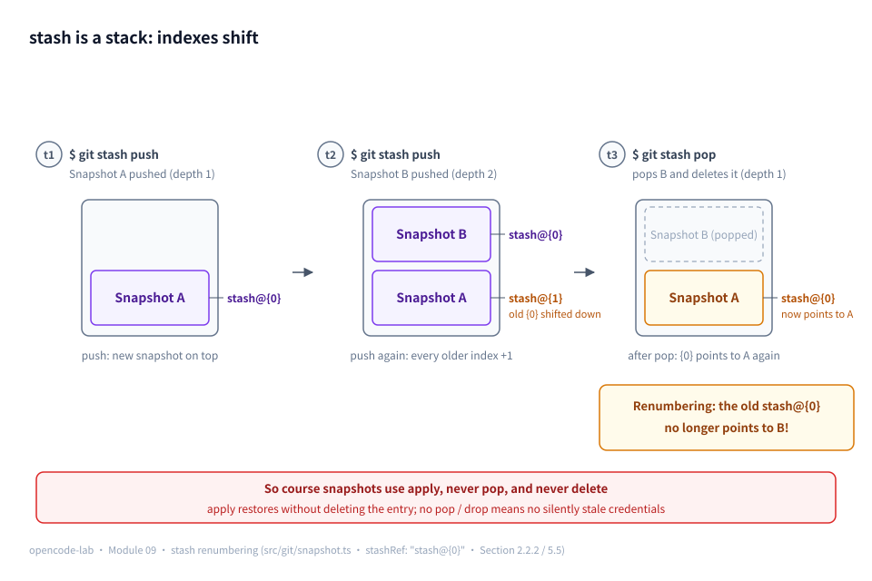
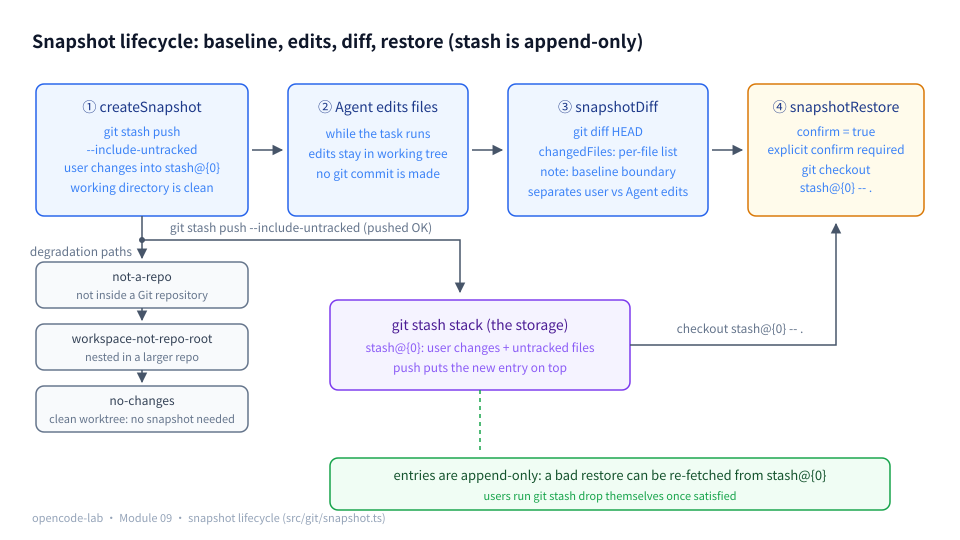
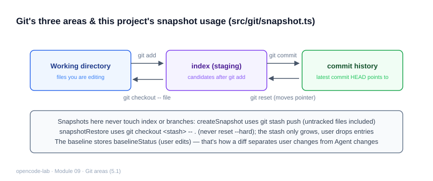
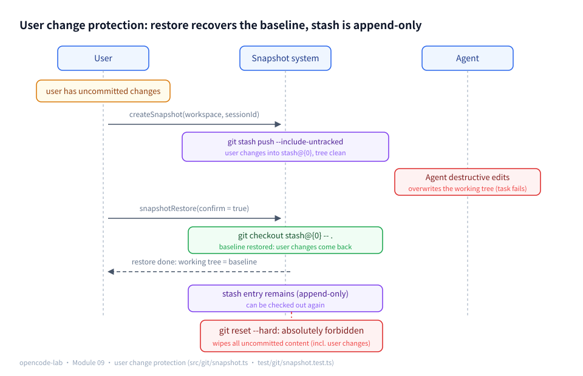

# Chapter 9: Git, Snapshot, and Diff — Making Changes Observable and Recoverable

## 1. Where this chapter fits

- Module: 09 Git, Snapshot, and Diff
- Study time: 6 hours (including the Section 2 prerequisites)
- Difficulty: intermediate
- Prerequisite chapters: Chapter 3 (shell/file tools), Chapter 7 (sessionId correlation), Chapter 8 (Section 2.3 recaps its compaction and recovery)
- Corresponding OpenCode commit: `70a24697ea0028e19f22712fd63059538cb4bee7`
- Corresponding project milestone: `v0.11-git`

## 2. Prerequisites

> This chapter's snapshot primitive is `git stash`, and the body text reads unified diffs directly and compares against the production tree-object design — all of this is Git's "deep water", while Chapter 0 only covered the basic commit/branch/diff model. Section 2.2 builds those deep-water topics from zero: stash's stack semantics, how to read a diff line by line, what tree objects and refs are, and what shell quoting protects. Section 2.3 recaps the three pieces of luggage from Chapter 8. Readers who already work with stash/tree daily can skim 2.2 and jump straight to Section 5.

### 2.1 Glossary for this chapter

| Term | Plain-language one-liner | Where it is used |
|---|---|---|
| working tree | The files on disk you are editing | 5.1, whole chapter |
| index (staging area) | The candidate content for the next commit — the "shopping cart" that `git add` registers changes into | 2.2.1, 5.1 |
| HEAD | The most recent commit | 5.1, whole chapter |
| porcelain format | The machine-friendly output of `git status --porcelain`: one `XY path` per line | 5.1, 5.4 |
| untracked file (`??`) | A new file present in neither HEAD nor the index | 5.2 |
| stash | The primitive that stores uncommitted changes "onto a stack and leaves the working directory clean" | 2.2.2, whole chapter |
| `stash@{0}` / stash stack | The top-of-stack index; each push bumps every existing entry's index by one | 2.2.2, 5.2, 5.5 |
| push / pop / apply / drop | store / restore-and-delete / restore-only / delete-only | 2.2.2, 5.5 |
| `--include-untracked` | Makes stash also store new untracked files | 5.2 |
| unified diff | The standard output format of `git diff`: `-`/`+`/context lines | 2.2.3, 5.4 |
| hunk | One contiguous block of changes in a unified diff, opening with `@@ -l,n +l,n @@` | 2.2.3, 5.4 |
| tree object | Git's internal directory-snapshot object; every commit captures the whole project as a tree | 2.2.4 |
| ref | A name for a Git object: branch, tag, and `stash@{0}` are all refs | 2.2.4 |
| write-tree | Writes the current index into a tree object and returns its hash (the production snapshot's primitive) | 2.2.4, 5.2 |
| checkout's dual semantics | `checkout <branch>` switches branches; `checkout <ref> -- <path>` copies content into the working directory | 5.5 |
| worktree | A second independent working directory for the same repository (shared object store) | 2.2.5, 5.6 |
| word-splitting | bash splits the command line into arguments at spaces; quotes protect the whole string | 2.2.6, 5.8 |
| realpath | Resolves symlinks to real paths before comparing | 5.6 |
| baseline | The archived working-directory state before the Agent starts (including the user's uncommitted changes) | 5.2, 5.5 |
| `reset --hard` | Blows the working directory and index straight back to a commit, discarding all uncommitted content — banned in this chapter | 5.5, 5.8 |

### 2.2 Foundations

#### 2.2.1 The three trees, plus a primer on the index

Chapter 0 covered commit (an immutable checkpoint) and diff (comparing two checkpoints). At any moment Git actually maintains three "trees" at once:

- **working tree**: the files on disk you are editing;
- **index (staging area)**: the candidate content for the next commit — `git add` registers working-tree changes here. It is the "shopping cart" between the working directory and a commit: if you edit but never add, it never makes the next commit;
- **HEAD**: the most recent commit.

The two status columns `XY` of `git status --porcelain` are exactly pairwise comparisons across the three trees: X is the index relative to HEAD, Y is the working directory relative to the index — so at a glance you can see "which changes are already in the cart and which are still in hand". Three typical lines side by side:

```text
 M a.ts           X=space: index matches HEAD; Y=M: working directory changed, not yet added
M  a.ts           X=M: the change is already added to the index; Y=space: no further working-directory changes
?? new-file.ts    a new file in neither HEAD nor the index (untracked)
```

Note that the leading spaces on the first two lines are part of the format — porcelain is always "two status columns + one space + path", and the space itself carries information. The Agent only ever edits the working directory (it never adds/commits on the user's behalf), so the standard answer to "what did the Agent change" = every difference of the working directory relative to HEAD, staged and unstaged together.

To watch the X and Y columns move, make one change and verify with your own eyes (in the scratch repo, tracked.ts is already in the initial commit):

```bash
echo x >> tracked.ts
git status --porcelain tracked.ts
git add tracked.ts                    # register the change into the index (the cart)
git status --porcelain tracked.ts
```

```text
Output:
 M tracked.ts
M  tracked.ts
```

For the same edit to the same file, the before/after `git add` lines mirror each other exactly: before add, ` M` — X is a space (index matches HEAD) and Y is M (working directory changed, not added); after add, `M ` — X becomes M (the change is in the index) and Y returns to a space (working directory matches the index). When reading porcelain, look at X first and then Y, and "what's in the cart vs. what's still in hand" is immediately obvious.

#### 2.2.2 git stash: the primitive that parks state on a stack

**Plain definition**: `git stash push` packs all current uncommitted changes (working directory + index) into a **stack**, then leaves the working directory clean (back at HEAD). Nothing is deleted — it just moved onto the stack, retrievable at any time.

Four things, explained in one pass:

- **The `stash@{0}` numbering rule**: stash is a stack; the top is always `stash@{0}`, then `stash@{1}`, `stash@{2}`, ... Each new push bumps every existing entry's index by one.
- **The four verbs**, their semantics and effect on the stack:

| Verb | Semantics | Stack effect |
|---|---|---|
| `git stash push` | Stores the current uncommitted changes on top of the stack | One entry added (all older entries shift down one slot) |
| `git stash pop` | Restores the **top** entry and **deletes** it | One entry fewer (everything below moves up, all indexes change) |
| `git stash apply` | Restores the given entry but **does not delete** it | Unchanged |
| `git stash drop` | Deletes the given entry without restoring it | One entry fewer |

- **`--include-untracked`**: by default stash only covers modifications to tracked files; new files (status `??`) are only stored together when you add this flag.
- **A renumbering thought experiment** (the foundation of several safety designs in this chapter): take two snapshots S1 and S2. After pushing S1, S1 = `stash@{0}`; after pushing S2, S2 = `stash@{0}` and S1 is squeezed down to `stash@{1}`. Now run one `git stash pop` (restores and deletes S2): only S1 remains in the stack, and it **returns to** `stash@{0}`. Corollary: **a `stash@{0}` written into a credential changes meaning as the stack is manipulated** — S2's credential says `stash@{0}`, but after the pop that slot refers to S1, and the credential silently goes stale. Every stash-based design has to face this problem; this chapter's teaching build sidesteps the shifting with "apply only, no pop, no drop" (5.5).

Watch the shifting once more with real output (`git stash list` prints the stack, newest first):

```bash
$ git stash list
stash@{0}: On main: opencode-lab snapshot sess-2
stash@{1}: On main: opencode-lab snapshot sess-1

$ git stash pop            # restore and delete the sess-2 entry
$ git stash list
stash@{0}: On main: opencode-lab snapshot sess-1
```

After the pop, `stash@{0}` already refers to sess-1 — if sess-2's restore credential had hardcoded `stash@{0}`, it has silently gone stale. Section 5.5's "apply only, no pop" and the write-tree approach from the post-lesson challenges (which names snapshots with immutable hashes) are both answers to this problem.

Readers unfamiliar with stash can first walk the minimal loop by hand in any scratch repo to build a feel for it:

```bash
echo change >> a.ts
git stash push -m "试一下"   # store: the working directory becomes clean
git stash list               # look: stash@{0}: On <branch>: 试一下
git stash apply              # restore (the entry stays)
git stash drop               # delete (working directory untouched)
```

What does the minimal loop look like when it runs? In a scratch repo whose initial commit is a single-line a.ts, edit one file, create one untracked file, then walk push → look → show (showing the real behavior of `--include-untracked`):

```bash
git init -q stash-lab && cd stash-lab
echo 'console.log("original")' > a.ts
git add -A && git -c user.email=lab@test -c user.name=lab commit -qm init   # the scratch repo's initial commit
echo 'console.log("changed")' >> a.ts   # edit a tracked file
echo 'lab note' > new.txt               # create an untracked file
git stash push --include-untracked -m "lab test"
git status --porcelain
git stash list
git stash show -p stash@{0} | head -5
```

```text
Output:
保存工作目录和索引状态 On master: lab test
stash@{0}: On master: lab test
diff --git a/a.ts b/a.ts
index 52aa714..621a028 100644
--- a/a.ts
+++ b/a.ts
@@ -1 +1,2 @@
```

Line by line: the first line is `stash push`'s confirmation output (its wording is localized to git's locale); `git status --porcelain` prints nothing at all — the working directory is clean again; the `stash list` line is the "push credential" (top-of-stack `stash@{0}` + branch + message). Finally, the `stash show -p` diff contains only a.ts — `-p` shows tracked-file changes by default; new.txt lives in the stash's third parent commit and only appears with `git stash show -p --include-untracked stash@{0}` (which is exactly what `--include-untracked` means on the push and show sides respectively).



*Figure 9-P1: stash is a stack — when t2 pushes again, Snapshot A's index is squeezed from {0} down to {1}; one pop at t3 removes B, and `stash@{0}` points back to A. Indexes keep shifting with every stack operation, so a `stash@{0}` hardcoded into a credential silently goes stale — which is why the course snapshots use apply instead of pop, and only ever add.*

#### 2.2.3 unified diff and hunks: a line-by-line reading guide

`git diff` outputs the unified diff format. A real sample (matching this chapter's test scenario: one line inserted into a.ts):

```diff
diff --git a/a.ts b/a.ts
index 1e8d197..2c5a3f1 100644
--- a/a.ts
+++ b/a.ts
@@ -1,3 +1,4 @@
 original
+用户新增的一行
 第二行
 第三行
```

Read it block by block:

- The first two lines are the **file header**: `diff --git a/path b/path` declares the two files being compared; `index oldHash..newHash 100644` gives the object hashes and the file mode (`100644` just means "regular file" and can be ignored when reading).
- `--- a/a.ts` / `+++ b/a.ts`: the minus side is the old file, the plus side the new one.
- `@@ -1,3 +1,4 @@` is the **hunk header**: the old file shows 3 lines starting at line 1, the new file shows 4 lines starting at line 1. A hunk is "one sufficiently close cluster of changes"; a large diff has several hunks, each with its own `@@` header — when changes are scattered across the file, reading the diff means jumping hunk by hunk.
- Inside a hunk there are only three kinds of lines: lines starting with a space are **context lines** (present on both sides; they orient you to where the change happened); lines starting with `-` exist only in the old file (deleted/changed away); lines starting with `+` exist only in the new file (added/changed into). A `-` line immediately followed by a `+` line means "one line was modified".
- Reading the sample above: between "original" and "第二行" in the old file's 3 lines, the new file inserts "用户新增的一行".

When this chapter's exercises ask you to "eyeball the diff", this is the format you will be reading.

#### 2.2.4 tree objects and refs: why the production snapshot is exact

Under the hood Git does not "store a chain of diffs" — **every commit photographs the entire project as a content snapshot**: each file's content is stored as a blob object; each directory is stored as a **tree object** (listing the files and subdirectories under it); the commit object points at the root tree. Objects are named by the hash of their content — change the content and the hash changes. A minimal sketch:

```text
commit 9c1f2e…   ← main (a ref) pointing at it
 └─ tree 4a7b…            snapshot of the project root
     ├─ blob 83f1…        the full content of a.ts
     └─ tree 51c9…        snapshot of the src/ directory
         └─ blob c2d0…    the full content of src/index.ts
```

**A ref is a name given to some object**: branch, tag, and `stash@{0}` are all refs. Names can move; objects are immutable.

With this model, why the production OpenCode `write-tree` approach is exact stops being mysterious (in under 10 lines): `git write-tree` writes the current index into a tree object and returns its hash — **snapshot = record that tree's hash**, and restoring is just `checkout <hash> -- .`. It does not depend on the stash stack: a hash is an immutable name, immune to index shifting (contrast the thought experiment in 2.2.2); it occupies no stack slot and never disturbs the user's own stashes; and "which files count as untracked" needs no special handling (the tree records the full content of that moment). The price is maintaining the "hash ↔ session" mapping yourself (OpenCode stores it in the Session record). The teaching build chose stash — trading "borrow a ready-made stack" for "bound by stack semantics"; the key to that trade-off is precisely this section's object model.

#### 2.2.5 worktree in one sentence

`git worktree add ../lab-agent` opens a second working directory for the same repository: the two directories each have an independent HEAD and working files, but share the same object store.

```bash
git worktree add ../lab-agent   # a second working directory outside the main repo
cd ../lab-agent && git status   # independent HEAD: edits here never touch the original directory's working tree
```

Production-grade Agents often have the Agent work in an isolated worktree, physically unable to touch the user's directory. The teaching build skips it (high complexity, and it conflicts with the goal of "working directly on the user's project"), but the isolation mindset survives in the "workspace must be the repository root" guard (5.6). This also settles the teaser planted for 5.1: with worktrees or submodules, `.git` may be a file (recording where the real repository lives) rather than a directory — so to decide "am I inside a repository", ask git itself instead of checking whether `.git` exists.

#### 2.2.6 shell word-splitting and quotes: where arguments end

When bash receives a command line it **splits it into arguments** at spaces — a space is an argument boundary, so a space inside a message splits one argument into two:

```bash
git stash push -m opencode-lab snapshot sess-123
# bash splits out extra arguments: -m only gets "opencode-lab"; "snapshot" "sess-123" become illegal extra arguments -> error

git stash push -m "opencode-lab snapshot sess-123"
# quotes protect the whole string as one argument -> correct
```

This chapter's `gitStashPush` uses `JSON.stringify(message)`: it wraps the message in double quotes (escaping the quotes and backslashes inside the message), and once spliced into `runGit`'s `git ${args.join(" ")}` bash command it forms exactly one quote-protected argument. Here is what the assembled command actually looks like:

```bash
# message = `opencode-lab snapshot sess-1`
# JSON.stringify(message) outputs the quoted "opencode-lab snapshot sess-1"
git stash push --include-untracked -m "opencode-lab snapshot sess-1"
#                                                  └────── one protected argument ──────┘
```

**Injection boundary, stated honestly**: JSON's escaping rules and bash's double-quote rules are **not equivalent** — inside double quotes bash still performs command substitution on `$(...)` and backticks, and `JSON.stringify` does not escape them. So "wrap it in stringify" is not a general anti-injection measure. The teaching build is safe because the sessionId in the stash message is generated inside the program (not user input, no special characters) — **this is a boundary condition, not general safety**. If the message ever needs to accept user content, the right fix is a subprocess call with an argument array (no bash splicing), not continued reliance on quoting (Section 5.8's security argument presupposes this).

### 2.3 Recap of the previous module

Chapter 8 added two safety nets for long-running tasks; this chapter adds the last one for the act of "changing code". Three pieces of luggage:

1. **compaction**: when history grows too long, the old rounds slated for eviction are condensed into one role=user summary message — task goals, file changes, and test conclusions must survive; it complements trim (straight deletion) rather than replacing it.
2. **Two iron rules**: never cut the first user message (the task goal); never split an assistant(tool_call) from its tool result. This chapter protects a different object with the same idea — the "un-loseable target" at the snapshot layer is the user's uncommitted changes.
3. **The recovery prompt's safety posture**: continuationPrompt states explicitly "not fully executed" and "must not auto-retry", writing safety policy into the text given to the model. This chapter's restore takes the same posture — restore is a destructive operation, requires explicit confirmation (confirm), and never runs automatically.

Before reading on, confirm the baseline is intact:

```bash
cd opencode-lab && bun test test/context/   # 21 cases all green = the Chapter 8 foundation is intact
```

## 3. Learning objectives

- Understand: why stash is the teaching build's snapshot primitive (covers untracked files, non-destructive, append-only); why the "Agent diff" and the "user's pre-existing diff" must be distinguished; why `reset --hard` is absolutely forbidden.
- Be able to implement: `createSnapshot` (pre-run baseline), `snapshotDiff` (visible changes), `snapshotRestore` (a restore that requires confirmation), and degradation for non-Git directories.
- Be able to test: the user's uncommitted changes are not mistakenly deleted, untracked files are snapshotted, the snapshot survives a restore, restore requires explicit confirmation.
- Be able to explain: whether restore can overwrite the user's newer edits (yes — hence snapshots are never deleted, so the user can fetch them back again).

## 4. Problem statement

The Agent edited 20 files and the user asks "what exactly did you change? and what if you got it wrong?". Without a snapshot layer, neither question can be answered. In OpenCode this corresponds to `packages/opencode/src/git/index.ts` + `packages/opencode/src/snapshot/index.ts` (the production build stores exactly with tree objects, which is more powerful than stash — what a tree object is and where its power lies, see 2.2.4).

The teaching build's trade-off: use `git stash push --include-untracked` for snapshots. One plain sentence to pin down the "stash snapshot": **before the Agent touches anything, the working directory's current uncommitted content is stored whole onto git's stash stack** — onto the stack means the content is safely saved, the working directory becomes clean, and it can be fetched back at any time via the top-of-stack slot (stack semantics in 2.2.2). That archive is the "baseline": if the Agent later breaks something, the working directory can be overwritten back to the baseline at any time. The lifecycle in pseudocode:

```text
Before the Agent runs:  createSnapshot -> the user's uncommitted changes go whole onto the stash (stash@{0}), working directory back at HEAD
While the Agent runs:    normal file edits
After the Agent runs:    snapshotDiff -> git diff HEAD shows every change (annotated: user changes + Agent changes)
When something breaks:   snapshotRestore(confirm=true) -> git checkout stash@{0} -- . restores the baseline content
                         the stash entry is not deleted — a wrong restore can be fetched again
```



*Figure 9-1: the snapshot lifecycle — createSnapshot builds the baseline with stash (append-only), snapshotDiff shows the changes after Agent edits, and snapshotRestore recovers the baseline when needed; when snapshotting is impossible it degrades with one of three reasons — not-a-repo / workspace-not-repo-root / no-changes — without blocking the task*

Four safety decisions:

1. **The snapshot includes user changes**: before stashing, the user's uncommitted work is saved whole and can never be "accidentally deleted by the Agent".
2. **restore uses checkout, not reset --hard**: reset --hard would blow the working directory back to HEAD without even needing the stash — exactly the common mistake called out in the design doc.
3. **Snapshots are append-only**: the stash entry survives the restore; once the user confirms all is well, they run `git stash drop` themselves.
4. **Explicit degradation outside Git repos**: return `not-a-repo` rather than pretending to have snapshot capability.
5. **Nested-repo protection**: when the workspace is not the repository root (e.g. a monorepo subdirectory), return `workspace-not-repo-root` and skip — git commands act on the whole outer repository and would stash away other directories' uncommitted changes. (This guard comes from a real incident during this course's delivery: while smoke-testing from a subdirectory of the host repo, a snapshot stashed the entire docs/ directory away; the test was added after recovering with `git stash pop`.)

## 5. Core concepts

How this chapter's concepts map to source and tests (paths relative to `opencode-lab/`):

| Concept | Source file | Test file |
|---|---|---|
| Git basics: working directory, index, commit, diff | `src/git/git.ts` | `test/git/snapshot.test.ts` |
| Snapshot before edits, diff after | `src/git/snapshot.ts` | `test/git/snapshot.test.ts` |
| Telling the user's own changes apart from the Agent's | `src/git/snapshot.ts` | `test/git/snapshot.test.ts` |
| File-level and hunk-level diff display | `src/git/git.ts`, `src/git/snapshot.ts` | `test/git/snapshot.test.ts` |
| revert, restore, and conflict handling | `src/git/snapshot.ts` | `test/git/snapshot.test.ts` |
| Temporary branches, worktrees, and isolated workspaces | `src/git/git.ts`, `src/git/snapshot.ts` | `test/git/snapshot.test.ts` |
| Recovery strategy after test failures | `src/git/snapshot.ts` | `test/git/snapshot.test.ts` |
| The safety boundary for running Git commands | `src/git/git.ts` | `test/git/snapshot.test.ts` |

The two source files divide the work cleanly: `src/git/git.ts` answers "how do you run a git command safely" (one function per command, structured results), and `src/git/snapshot.ts` answers "what are the snapshot's business semantics" (the create, diff, restore primitives). All tests live in `test/git/snapshot.test.ts` (11 cases); scratch directories come from the `createWorkspace` fixture in `test/helpers/workspace.ts`, and git repository setup is handled by the `gitWorkspace` helper inside the test file — real git subprocesses, zero mocks.

### 5.1 Git basics: working directory, index, commit, and diff

**Concept**

Git splits repository state into three "trees": the working directory (the files you are editing), the index (staging area, the candidate content for the next commit), and HEAD (the most recent commit) — the three-trees picture and the index-as-"shopping-cart" metaphor were covered in 2.2.1. `git status --porcelain` uses the two status columns `XY` to describe, one path at a time, its differences across these three trees: X is the index relative to HEAD, Y is the working directory relative to the index; `??` marks a new file in neither HEAD nor the index (untracked), `M` marks modified. `git diff HEAD` then outputs a unified diff of the working directory against HEAD (staged and unstaged changes included; how to read a diff line by line, see 2.2.3). Every file modification the Agent makes happens at the working-directory level, so the standard answer to "what did the Agent change" is a porcelain status list plus a `git diff HEAD`. Understanding the three-trees model is the prerequisite for understanding every safety design in this chapter (what a snapshot stores, where restore recovers to).

**How this project implements it**

`src/git/git.ts` builds its picture of the repository with three read-only commands:

```ts
export async function isGitRepo(cwd: string): Promise<boolean> {
  const outcome = await runGit(cwd, ["rev-parse", "--is-inside-work-tree"])
  return outcome.exitCode === 0 && outcome.stdout.trim() === "true"
}

export async function gitStatusPorcelain(cwd: string): Promise<GitResult<string[]>> {
  const outcome = await runGit(cwd, ["status", "--porcelain"])
  if (outcome.exitCode !== 0) return { ok: false, error: `git status 失败: ${outcome.stderr.slice(0, 200)}` }
  return { ok: true, value: outcome.stdout.split("\n").filter((l) => l.trim() !== "") }
}

export async function gitDiff(cwd: string, ref?: string): Promise<GitResult<string>> {
  const args = ref === undefined ? ["diff", "HEAD"] : ["diff", ref]
  const outcome = await runGit(cwd, args)
  if (outcome.exitCode !== 0) return { ok: false, error: `git diff 失败: ${outcome.stderr.slice(0, 200)}` }
  return { ok: true, value: outcome.stdout }
}
```

Three design intents: `isGitRepo` does not check whether a `.git` directory exists but asks git itself (`rev-parse --is-inside-work-tree`) — with worktrees, submodules, and similar setups `.git` may be a file or live elsewhere (2.2.5), and asking git is the most reliable; `gitStatusPorcelain` insists on `--porcelain` rather than the human-facing default format — porcelain is stable across versions, one entry per line, designed for machine parsing; `gitDiff` compares against `HEAD` by default, which is exactly the "working directory relative to the most recent commit" reading of the three trees — precisely the scope the snapshot semantics need.

Feed both commands a real repository (`-c user.email/name` keeps the commands independent of your global git config; after the initial commit, edit one file and create one file):

```bash
rm -rf /tmp/snap-lab && mkdir /tmp/snap-lab && cd /tmp/snap-lab
git init -q
echo 'console.log("original")' > a.ts
echo 'export const t = 1' > tracked.ts
git add -A && git -c user.email=lab@test -c user.name=lab commit -qm init
echo 'console.log("changed")' >> a.ts   # edit a tracked file
echo 'lab note' > new.txt               # create an untracked file
git status --porcelain
git diff --stat
```

```text
Output:
 M a.ts
?? new.txt
 a.ts | 1 +
 1 file changed, 1 insertion(+)
```

The two porcelain lines match 2.2.1's typical lines: ` M a.ts` (working directory changed only) and `?? new.txt` (untracked). Note that the `git diff --stat` below lists only a.ts — the hunk-level diff cannot see untracked files; only the file-level list (porcelain) is complete. That is the evidence behind 5.4's "the file-level list defers to porcelain".

Porcelain parsing has a test-grade exact assertion (`test/git/snapshot.test.ts`, creating b.ts in a repo with an initial commit):

```ts
    const status = await gitStatusPorcelain(ws.dir)
    if (!status.ok) throw new Error(status.error)
    expect(status.value).toEqual(["?? b.ts"])
    expect(parseStatusEntries(status.value)).toEqual([{ status: "??", path: "b.ts" }])
```



*Figure 9-3: the three Git areas — working directory, index (staging area), and commit history advance forward via add / commit and step back via checkout / reset; this project's snapshot deliberately never touches the index or branches: stash push sweeps everything in one go (untracked files included) and checkout <stash> -- . restores, with the baseline kept separately in baselineStatus to tell user changes from Agent changes.*

**Common pitfalls**

- Symptom: assertions parsing `git status` output pass and fail intermittently. Cause: the default format was used (branch header, color codes, localized hints), which varies with the environment. Fix: always add `--porcelain`.
- Symptom: empty-string entries sneak into the parse result. Cause: git output ends with a newline, and `split("\n")` produces a trailing empty string. Fix: filter like the source does, `filter((l) => l.trim() !== "")`.
- Symptom: expecting `git diff` to show files the Agent created. Cause: `git diff` only compares tracked files. Fix: new files must come from porcelain's `??` status (Section 5.4).

**Self-check questions**

- Why doesn't `isGitRepo` just check whether a `.git` directory exists? Reference: with worktrees/submodules `.git` may be a file or live elsewhere (2.2.5); asking git is the most reliable.
- What does the porcelain line ` M a.ts` (leading character is a space) mean? Reference: X = space means the index has nothing staged, Y = M means the working directory is modified relative to the index.
- Which two trees does `gitDiff` compare when no ref is passed? Reference: working directory vs HEAD, including all staged and unstaged changes.

### 5.2 Snapshot before edits, diff after

> 📊 Figure: for the full snapshot lifecycle (create → diff → restore → degradation), see Figure 9-1 in Section 2.3.

**Concept**

The "snapshot before edits" solves the time problem: once the Agent overwrites file contents, the previous state is gone, so it must be archived before work starts; the "diff after edits" solves visibility: when the task ends you must be able to answer "what changed". Together they form the "baseline + delta" model — fix the baseline first, and only then does every later comparison have a reference point. The production OpenCode uses `git write-tree` to write the working directory into a tree object attached to a dedicated ref — exact and independent of stash semantics (why it is exact: the object-model walkthrough in 2.2.4). The teaching build picks `git stash push --include-untracked`: stash is by nature the primitive that "stores uncommitted changes onto a stack and returns the working directory to clean" (2.2.2), inherently non-destructive (content goes onto the stack rather than being deleted), and `--include-untracked` covers the new files stash ignores by default.

**How this project implements it**

`src/git/snapshot.ts` first defines the four exits:

```ts
export type SnapshotResult =
  | { ok: true; snapshot: Snapshot }
  | { ok: false; reason: "not-a-repo" | "workspace-not-repo-root" | "no-changes" | "git-error"; error: string }
```

`createSnapshot` runs its branch checks in order, then pushes and returns the snapshot credentials:

```ts
  const status = await gitStatusPorcelain(workspace)
  if (!status.ok) return { ok: false, reason: "git-error", error: status.error }
  if (status.value.length === 0) {
    return { ok: false, reason: "no-changes", error: "工作区干净，无需快照" }
  }

  const message = `opencode-lab snapshot ${sessionId}`
  const pushed = await gitStashPush(workspace, message)
  if (!pushed.ok) return { ok: false, reason: "git-error", error: pushed.error }
  // after the stash push the new stash sits at stash@{0}
  return {
    ok: true,
    snapshot: {
      sessionId,
      stashRef: "stash@{0}",
      message,
      createdAt: new Date().toISOString(),
      baselineStatus: parseStatusEntries(status.value),
    },
  }
```

The low-level command lives in `src/git/git.ts`:

```ts
export async function gitStashPush(cwd: string, message: string): Promise<GitResult<string>> {
  // stash is a safe operation: it parks the current working directory (the user's uncommitted changes included) without losing anything
  const outcome = await runGit(cwd, ["stash", "push", "--include-untracked", "-m", JSON.stringify(message)])
  if (outcome.exitCode !== 0) {
    // with no changes stash prints "No local changes to save" with exit code 0; failure means a real failure
    return { ok: false, error: `git stash 失败: ${outcome.stderr.slice(0, 200)}` }
  }
  return { ok: true, value: outcome.stdout.trim() }
}
```

Three details worth chewing on. First: a clean working directory returns `no-changes` instead of fabricating an "empty snapshot" — when there is no baseline to speak of, say so honestly; this is the second form of degradation. Second: the stash message carries the sessionId and is quote-wrapped with `JSON.stringify` — the arguments are ultimately spliced into one bash command, and a message containing spaces must be quoted or it gets split (word-splitting and quoting fully dissected in 2.2.6), so that afterwards `git stash list` shows at a glance which entry belongs to which session:

```bash
$ git stash list
stash@{0}: On main: opencode-lab snapshot sess-abc123
```

The prefix `opencode-lab snapshot` plus the Chapter 7 sessionId makes "which snapshot belongs to which session" human-checkable — the message prefix is the crudest but effective index. Third: the returned `Snapshot` carries `stashRef` and `baselineStatus` (the structured status list from before the push); these are the credentials for the later diff annotation and the restore operation.

What does the credential object look like? Run it for real (execute from the opencode-lab directory; `/tmp/snap-lab2` is a scratch repo built the same two-step way: an initial commit with a single-line a.ts, then overwritten with the user's uncommitted change — the literal string in the script below):

```bash
rm -rf /tmp/snap-lab2 && mkdir /tmp/snap-lab2 && cd /tmp/snap-lab2
git init -q
echo 'original' > a.ts
git add -A && git -c user.email=lab@test -c user.name=lab commit -qm init
echo '用户的未提交修改' > a.ts
cd /path/to/opencode-lab   # replace with your opencode-lab directory
bun -e 'import("./src/git/snapshot").then(async m => {
  const r = await m.createSnapshot("/tmp/snap-lab2", "sess_demo")
  console.log(JSON.stringify(r.ok ? r.snapshot : r, null, 2))
})'
```

```text
Output:
{
  "sessionId": "sess_demo",
  "stashRef": "stash@{0}",
  "message": "opencode-lab snapshot sess_demo",
  "createdAt": "2026-09-2… (timestamp at run time)",
  "baselineStatus": [
    {
      "status": "M",
      "path": "a.ts"
    }
  ]
}
```

`stashRef` and `message` are exactly the credentials recognizable later in `git stash list` (`stash@{0}: On master: opencode-lab snapshot sess_demo`); `baselineStatus` records the structured pre-push state — the user's edit is registered as `{status: "M", path: "a.ts"}`. If you now run `git status --porcelain` again: the output is empty, the working directory is back at HEAD, and the user's changes sit whole on the stack.

**Common pitfalls**

- Symptom: files the Agent created cannot be restored. Cause: `git stash push` excludes untracked files by default. Fix: you must add `--include-untracked`.
- Symptom: treating `no-changes` as a failure and retrying. Cause: conflating "the operation failed" with "there was nothing to do". Fix: `SnapshotResult` distinguishes its exits with four reasons; branch on the reason at the call site.
- Symptom: spaces in the stash message shred the command and it errors on arguments. Cause: arguments are spliced into a single bash command at spaces. Fix: `JSON.stringify` the message first to quote it.

**Self-check questions**

- Why stash for snapshots instead of copying files to a temp directory? Reference: stash preserves git semantics (can show, can checkout); copying directories loses metadata and scales poorly for big repos.
- Why can `stashRef` hardcode `stash@{0}`? Reference: stash is a stack, and what was just pushed is necessarily on top (the numbering rule in 2.2.2). Mind the boundary: if another stash is pushed to the same repository later, this credential goes stale through index shifting — the teaching build avoids that with "a single-snapshot flow + apply only, never pop".
- Does `baselineStatus` change after the snapshot is created? Reference: no — it is an archive of the pre-push state, used by snapshotDiff for its boundary note.

### 5.3 Telling uncommitted changes apart from the user's own changes

> 📊 Figure: for how the baseline separates "the user's changes" from "the Agent's changes", see the protection sequence in Figure 9-2 (Section 5.5).

**Concept**

`git diff HEAD` is a whole-working-directory diff: it includes both the Agent's changes and the user's uncommitted changes that already existed before the Agent ran. A real scenario from this chapter's tests shows what "mixed together" looks like (the user edits a.ts first, then the Agent edits the same line):

```diff
diff --git a/a.ts b/a.ts
--- a/a.ts
+++ b/a.ts
@@ -1 +1 @@
-original
+用户改 + Agent改
```

Reading it with 2.2.3: that one line is neither wholly the user's nor wholly the Agent's — `git diff HEAD` only knows "what changed relative to the most recent commit" and cannot split the two sources' contributions. Conflating the two causes two classes of accidents: reporting the user's changes as the Agent's work, and restoring over the user's work as if it were garbage. So the snapshot layer must carry "baseline information", giving the layers above the means to state the boundary. This is also the conceptual basis for the design doc's test requirement that "user changes predating the Agent run must not be mistakenly deleted" — user changes are not merely "tolerated"; stash saves them whole into the baseline, and restore recovers the baseline (user changes + original files), not HEAD.

**How this project implements it**

The `Snapshot` in `src/git/snapshot.ts` carries a `baselineStatus` field (see the 5.2 excerpt); `snapshotDiff` always attaches a boundary note when returning the diff:

```ts
export type DiffSummary = {
  // the working-directory diff after the Agent ran (vs HEAD; the user's pre-existing changes + Agent changes)
  diff: string
  changedFiles: { status: string; path: string }[]
  // baseline delta note: present in the baseline but gone now = the Agent touched it
  note: string
}

export async function snapshotDiff(workspace: string, snapshot: Snapshot | null): Promise<DiffSummary | { error: string }> {
  const status = await gitStatusPorcelain(workspace)
  if (!status.ok) return { error: status.error }
  const diff = await gitDiff(workspace)
  if (!diff.ok) return { error: diff.error }
  return {
    diff: diff.value,
    changedFiles: parseStatusEntries(status.value),
    note:
      snapshot === null
        ? "（无基线快照：以下 diff 同时包含用户在 Agent 运行前的修改）"
        : `基线快照包含 ${snapshot.baselineStatus.length} 个用户修改文件（stash ${snapshot.stashRef}）；当前 diff = 用户修改 + Agent 修改，区分需对照基线。`,
  }
}
```

The `note` is an "honest UI": it returns "where the diff's boundary lies" as one sentence with the result, instead of relying on callers to remember the distinction. When `snapshot` is `null` (the pre-run snapshot failed or was skipped) it does not hide that either — it explicitly says the diff mixes in user changes. The tests assert, for the two cases respectively, that `note` contains "基线快照" and "无基线快照".

**Common pitfalls**

- Symptom: reporting the whole diff to the user as the Agent's work. Cause: no baseline-comparison awareness. Fix: cite `note` and `baselineStatus` to state the boundary; exact attribution requires comparing against the baseline (a post-lesson challenge direction).
- Symptom: expecting restore to bring files back to HEAD. Cause: conflating "baseline" with "most recent commit". Fix: the restore target is the baseline content in the stash, which includes the user's own changes.
- Symptom: assuming the user's uncommitted changes are "still in the working directory" while the Agent runs. Cause: not knowing stash's side effect. Fix: after stashing the working directory is back at HEAD and the user's changes rest in `stash@{0}` — the test "the user's uncommitted changes are saved by the snapshot" asserts `status.value` is empty.

**Self-check questions**

- Which moment does `baselineStatus` capture? Reference: the working-directory state just before the stash push.
- Why return a diff at all when snapshot is null? Reference: the diff is still worth reading; the note just warns that user changes are mixed in.
- After restoring, where do the user's "own changes" go? Reference: back into the working directory — they are part of the baseline content saved in the stash.

### 5.4 File-level and hunk-level diff display

**Concept**

Change display has two granularities. File level: which files were added/modified/deleted — porcelain status, one file per line, good for summary counts ("changed 5 files") and quick locating. Hunk level: hunks of the unified diff (the line ranges marked by `@@ -l,n +l,n @@`, read line by line per 2.2.3), precise to the line, good for human review of specific edits. Each layer has its use: file level answers "scope", hunk level answers "content". When presenting to the Agent or the user, show the file-level overview first, then drill into hunks on demand.

**How this project implements it**

`src/git/git.ts` provides the file-level parsing:

```ts
export function parseStatusEntries(lines: string[]): { status: string; path: string }[] {
  return lines.map((line) => ({
    status: line.slice(0, 2).trim(),
    path: line.slice(3).trim(),
  }))
}
```

The porcelain line format is fixed as `XY space path`: the first two columns are the status codes, the third column is always a space, and the path starts at the fourth character. `slice(0, 2)` takes the status (`trim` handles a leading space as in ` M`), `slice(3)` takes the path. `DiffSummary` (see the 5.3 excerpt) carries both layers: `changedFiles` is file-level (from `parseStatusEntries`), `diff` is the verbatim hunk-level text (from `gitDiff`). The tests assert on both layers:

```ts
    expect(diff.diff).toContain("Agent改")
    expect(diff.changedFiles.map((f) => f.path)).toContain("agent-new.ts")
    expect(diff.note).toContain("基线快照")
```

`agent-new.ts` is an untracked file: it appears in `changedFiles` but not in the diff text — which is exactly the concept "hunk-level diffs cannot see new files; the file-level list can" in action.

**Common pitfalls**

- Symptom: parsing breaks on repositories with renames. Cause: porcelain's rename line format is `R  old -> new`; for example `R  a.ts -> b.ts` through `parseStatusEntries` yields `{ status: "R", path: "a.ts -> b.ts" }` — the teaching build treats the whole string as the path. Paths with spaces are additionally quote-wrapped by porcelain (e.g. `R  "old name.ts" -> "new name.ts"`), and the whole-string parse carries the quotes along. Fix: accept the teaching simplification; the correct direction is to split on `" -> "` and strip the surrounding quotes (`R  a.ts -> b.ts` should parse out the new path `b.ts`, recording the old path `a.ts` separately).
- Symptom: a large diff blows up the context window. Cause: the verbatim hunk-level text enters the message without truncation. Fix: apply Chapter 3's truncate strategy before showing it to the model.
- Symptom: using `git diff --name-only` instead of porcelain for the file-level list. Cause: it cannot see `??` untracked files. Fix: the file-level list defers to `git status --porcelain`.

**Self-check questions**

- What does porcelain line `?? b.ts` become after `parseStatusEntries`? Reference: `{ status: "??", path: "b.ts" }` (the test asserts it exactly).
- Why `trim` the status code? Reference: the first column may be a space (the change is only in the working directory, unstaged).
- What does each of `DiffSummary`'s three fields carry? Reference: `diff` the verbatim hunk-level text, `changedFiles` the file-level list, `note` the boundary note.

### 5.5 revert, restore, and conflict handling

**Concept**

In Git, "undo" has several primitives with vastly different semantics: `git revert` creates a reverse commit (touches history; safe but produces a new commit); `git checkout <ref> -- .` copies the ref's content into the working directory (moves neither HEAD nor history) — note that checkout has two faces: switching branches (`git checkout main`) and restoring paths (`git checkout <ref> -- <path>`) are two different actions, and this chapter uses the second face; `git stash pop` restores and deletes the top entry; `git reset --hard` blows the working directory and index straight back to some commit (discarding all uncommitted content — the design doc's named forbidden command). The essence of a conflict: when the restore target disagrees with the working directory's current content, restoring overwrites the "newer" content — so any restore strategy must first answer "who gets overwritten, and does the overwritten thing still exist elsewhere". The teaching build's restore picks `checkout stash@{N} -- .`: it overwrites the Agent's possibly-wrong edits but never touches HEAD and never deletes the stash — overwrite the wrong thing and you can fetch it from the stash once more; the confirm parameter is a hard gate, because restore is destructive and must be explicitly authorized.



*Figure 9-2: the user-change protection sequence — the snapshot stores the user's uncommitted changes into the stash; after the Agent's destructive edits, restore recovers the baseline (the user's own changes included) via checkout; the stash entry survives so it can be fetched again, and `git reset --hard` is absolutely forbidden*

"Who gets overwritten" is not an abstract question; walk one timeline through it:

```text
t0  the user has uncommitted changes in a.ts (content = "user edit")
t1  createSnapshot — "user edit" is stored into stash@{0}; the working directory is back at HEAD
t2  the Agent breaks a.ts
t3  the user sees the breakage and hand-fixes a new version (content = "user hand-fix" — it exists only in the working directory, in no snapshot)
t4  snapshotRestore — checkout stash@{0} -- . overwrites the working directory with t1's "user edit"
```

Who did t4 overwrite? t2's damage is wiped (goal achieved); t3's "user hand-fix" is overwritten too — and it lives in no snapshot, so once lost it is lost. Ask "does the overwritten thing still exist" layer by layer: t2's content needs no recovery; t3's content cannot be recovered (which is exactly why the confirm hard gate exists — the restore decision must be left to the user); and even if the restore itself restored the wrong thing, stash@{0} is still there (append-only), so you can checkout once more.

**How this project implements it**

The restore entry point in `src/git/snapshot.ts` puts confirmation on the first line:

```ts
export type RestoreResult = { ok: true; restored: true } | { ok: false; error: string }

// 恢复前检查：当前工作区若在快照之后又产生了新修改，恢复会覆盖它们——
// 教学版选择"提示冲突但继续"，因为 stash 快照本身不会丢。
export async function snapshotRestore(workspace: string, snapshot: Snapshot, confirm: boolean): Promise<RestoreResult> {
  if (!confirm) return { ok: false, error: "restore 需要显式确认（confirm=true）" }
  if (!(await isGitRepo(workspace))) return { ok: false, error: "当前目录不是 Git 仓库" }

  const applied = await gitStashApply(workspace, snapshot.stashRef)
  if (!applied.ok) return { ok: false, error: applied.error }
  return { ok: true, restored: true }
}
```

The low-level implementation in `src/git/git.ts` deliberately avoids pop/drop:

```ts
// 恢复到快照：checkout 指定 stash，不 pop、不 drop——用户的快照永远保留
export async function gitStashApply(cwd: string, stashRef: string): Promise<GitResult<string>> {
  const outcome = await runGit(cwd, ["checkout", stashRef, "--", "."])
  if (outcome.exitCode !== 0) return { ok: false, error: `恢复失败: ${outcome.stderr.slice(0, 200)}` }
  return { ok: true, value: outcome.stdout }
}
```

The conflict-handling thinking sits in the comments: a restore may overwrite changes made after the snapshot (including the user's manual edits during the Agent run — t3 in the timeline above); the teaching build does no three-way merge and instead falls back on "snapshots are never deleted" — if you overwrote the wrong thing, restore from the stash once more. confirm is a hard gate, not a suggestion: the test "restore requires explicit confirmation" asserts that with `confirm=false` the returned error contains "确认" and no git command runs (`test/git/snapshot.test.ts`):

```ts
    const denied = await snapshotRestore(ws.dir, snapshot.snapshot, false)
    expect(denied.ok).toBe(false)
    if (!denied.ok) expect(denied.error).toContain("确认")
```

Run the whole t1→t4 timeline of the 5.2 lifecycle for real and see exactly what gets restored (a fresh scratch repo; execute from the opencode-lab directory):

```bash
rm -rf /tmp/snap-lab2 && mkdir /tmp/snap-lab2 && cd /tmp/snap-lab2
git init -q && echo 'original' > a.ts
git add -A && git -c user.email=lab@test -c user.name=lab commit -qm init
cd /path/to/opencode-lab   # 换成你的 opencode-lab 目录
bun -e '
const { createSnapshot, snapshotRestore } = await import("./src/git/snapshot")
const dir = "/tmp/snap-lab2"
await Bun.write(`${dir}/a.ts`, "用户的未提交修改")              // t0 the user's uncommitted change
const result = await createSnapshot(dir, "sess_demo")           // t1 the snapshot is pushed onto the stack
if (!result.ok) throw new Error(result.error)
await Bun.write(`${dir}/a.ts`, "被 Agent 改坏的内容")            // t2 the Agent breaks it
console.log("restore 前 a.ts =", JSON.stringify(await Bun.file(`${dir}/a.ts`).text()))
const restored = await snapshotRestore(dir, result.snapshot, true)   // t4 restore after explicit confirmation
console.log("restored =", JSON.stringify(restored))
console.log("restore 后 a.ts =", JSON.stringify(await Bun.file(`${dir}/a.ts`).text()))
'
git -C /tmp/snap-lab2 stash list
```

```text
Output:
restore 前 a.ts = "被 Agent 改坏的内容"
restored = {"ok":true,"restored":true}
restore 后 a.ts = "用户的未提交修改"
stash@{0}: On master: opencode-lab snapshot sess_demo
```

What came back is the **baseline** (the user's uncommitted change), not HEAD's "original" — 5.3's "the restore target is the baseline" lands here at byte level; the final `stash list` line still shows one entry — append-only, so a wrong restore can be followed by one more checkout. (A small detail: after the restore, `git status --porcelain` shows `M  a.ts` — `checkout <stash> -- .` updates the index as well as the working directory.)

**Common pitfalls**

- Symptom: after restoring, the user's manual changes made during the Agent run are gone. Cause: restore's semantics are precisely "overwrite the working directory with the baseline" (t4 in the timeline). Fix: this is by-design behavior — the snapshot was not deleted, so restoring from the stash again brings the baseline back; but t3-style "new changes made after the snapshot" cannot be fetched back, which is why restore must be user-confirmed; the production build should upgrade this to checking the working-directory state and surfacing a conflict warning.
- Symptom: after "recovering" with `git reset --hard`, the user's own changes are permanently lost. Cause: reset --hard discards the working directory and index without going through the stash. Fix: always checkout the stash — this wrapper does not offer reset at all.
- Symptom: after using `stash pop`, a second restore fails. Cause: pop deletes the top entry, so `stash@{0}` already refers to a different one (the full renumbering walkthrough in 2.2.2). Fix: apply only — no pop, no drop.

**Self-check questions**

- What does `snapshotRestore` return with `confirm=false`? Reference: `{ ok: false, error: "restore 需要显式确认（confirm=true）" }`, and no git command is executed.
- Why checkout instead of revert? Reference: in the snapshot scenario you do not want to produce new commits or touch history — just overwrite the working directory.
- The restore overwrote something it shouldn't have — what is step one? Reference: `git stash list` to find the snapshot, then `git checkout stash@{N} -- .` to restore once more.

### 5.6 Temporary branches, worktrees, and isolated workspaces

**Concept**

This blueprint item covers the full spectrum of "spatial isolation": `git worktree add` can open multiple working directories for the same repository (one-sentence version in 2.2.5), each with an independent HEAD — an Agent working in an isolated worktree physically cannot pollute the user's directory; temporary branches can hang a snapshot off a branch for precise switching. Production-grade Agents often build fully isolated execution environments out of "worktree + temporary branch". The teaching build does not do worktrees (high complexity, and it conflicts with the goal of "working directly on the user's project"), but the isolation mindset cannot be skipped — and it lands on a subtler problem: **the workspace may be nested inside a subdirectory of a larger repository** (a monorepo, or the CLI started from a repo subdirectory). git commands locate themselves via cwd but act on the whole repository — stashing from a subdirectory stashes away every directory's uncommitted changes in the repo. This guard comes from a real incident during course delivery: while smoke-testing from a subdirectory of the host repo, a snapshot stashed the entire docs/ directory away.

**How this project implements it**

`src/git/git.ts` adds a repository-root query:

```ts
// The repository root (null when not inside a repository).
// The key to snapshot safety: the workspace must be the repository root, or git commands act on the whole outer repository —
// e.g. running from a monorepo subdirectory would stash away other directories' uncommitted changes.
export async function gitRepoRoot(cwd: string): Promise<string | null> {
  const outcome = await runGit(cwd, ["rev-parse", "--show-toplevel"])
  if (outcome.exitCode !== 0) return null
  const root = outcome.stdout.trim()
  return root === "" ? null : root
}
```

`createSnapshot` in `src/git/snapshot.ts` hard-checks it before pushing:

```ts
  // Safety guard: when the workspace sits inside a larger repository (e.g. a monorepo subdirectory), never touch the outer repository —
  // git commands locate via cwd but act on the whole repository, and would stash away other directories' uncommitted changes
  const repoRoot = await gitRepoRoot(workspace)
  const workspaceReal = await realpath(workspace).catch(() => workspace)
  if (repoRoot !== null && repoRoot !== workspaceReal) {
    return {
      ok: false,
      reason: "workspace-not-repo-root",
      error: `工作区不是 Git 仓库根目录（仓库根: ${repoRoot}）。跳过快照以免影响仓库其他部分`,
    }
  }
```

Two details: normalize with `realpath` before comparing (realpath resolves symlinks to real paths — symlinks make literal path comparison fail; `/tmp` is a link in some environments); and the test "a subdirectory nested inside a larger repository never snapshots the outer repository" asserts three things at once — it returns `workspace-not-repo-root`, the subdirectory's files are preserved as-is, and `git stash list` is empty (the outer repository truly was not touched).

Trigger each of the two degradation exits once and look at the real returns (execute from the opencode-lab directory; ② reuses the 5.5 scratch repo, with a nested subdirectory created inside it):

```bash
mkdir -p /tmp/not-a-repo /tmp/snap-lab2/packages/sub
echo 'nested' > /tmp/snap-lab2/packages/sub/b.ts
cd /path/to/opencode-lab   # replace with your opencode-lab directory
bun -e 'import("./src/git/snapshot").then(async m => {
  console.log("①", JSON.stringify(await m.createSnapshot("/tmp/not-a-repo", "sess_x")))
  console.log("②", JSON.stringify(await m.createSnapshot("/tmp/snap-lab2/packages/sub", "sess_nested")))
})'
```

```text
Output:
① {"ok":false,"reason":"not-a-repo","error":"当前目录不是 Git 仓库，无法创建快照"}
② {"ok":false,"reason":"workspace-not-repo-root","error":"工作区不是 Git 仓库根目录（仓库根: /tmp/snap-lab2）。跳过快照以免影响仓库其他部分"}
```

① Not inside a repository — it honestly reports having no snapshot capability. ② Inside a repository but not at its root — the error carries the repository root path, making it easy to tell which layer is off. Neither return contains a stack trace or an exception — only structured `reason` + `error`: the caller degrades by branching on reason, and the task is not blocked. After ② runs, b.ts is preserved as-is and the repository gains no new stash entry — the guard fires before the push, and the outer repository truly was not touched.

**Common pitfalls**

- Symptom: run from a repo subdirectory, other directories' uncommitted changes vanish. Cause: git acts on the whole repository, not the subdirectory the cwd sits in. Fix: verify the workspace is the repository root before snapshotting.
- Symptom: sitting at the repo root yet judged "not the repo root". Cause: the path contains symlinks and string comparison fails. Fix: normalize with `realpath` before comparing.
- Symptom: "fixing" this guard as if it were a usability bug. Cause: not understanding that stash's blast radius is the whole repository. Fix: this is collateral-damage prevention — degrade with a message instead of bypassing it.

**Self-check questions**

- The difference between `workspace-not-repo-root` and `not-a-repo`? Reference: the former is inside a repository but not at its root (refused to protect the outer repository from collateral damage); the latter is not inside a repository at all (no snapshot capability).
- Why catch and fall back to the original path when `realpath` fails? Reference: failures are usually upstream problems like a missing path, and the later git command will produce a clearer error.
- If monorepo subdirectory snapshots were truly needed, what is the right direction? Reference: worktree isolation, or snapshotting at repository-root granularity while explicitly stating the blast radius.

### 5.7 Recovery strategy after test failures

> 📊 Figure: recovery after test failures walks the same restore path; see Figure 9-1 in Section 2.3.

**Concept**

"What if the edits broke things" needs a tiered playbook, not a single "roll back" move. The typical decision sequence: (1) the task failed but the diff has value — preserve the scene for human review; (2) the changes are certainly harmful — restore to the baseline; (3) the restore itself errors — restore again from the stash ("append-only" guarantees this path is always open). Organized into a table:

| Situation | Action | Safety net |
|---|---|---|
| Task failed but the diff has value | Preserve the scene for human review | snapshotDiff's diff / changedFiles / note |
| Changes are certainly harmful | restore to the baseline | the confirm hard gate (the working directory is only touched with explicit authorization) |
| The restore itself errors | Restore from the stash once more | Append-only (stash entries never disappear on their own) |

Also guard against two kinds of runaway: the mindless restore + retry loop after a failure, and secondary damage caused by the restore action itself. The key constraint: the restore decision belongs to the user/application layer, and the snapshot layer only provides primitives — "were these changes worth keeping" is a value judgment, and the Agent must not restore automatically.

**How this project implements it**

The snapshot layer catches the worst case with "append-only". The test "restore brings the working directory back to the baseline, and the snapshot is not lost" (`test/git/snapshot.test.ts`) verifies the restore-again capability:

```ts
    const restored = await snapshotRestore(ws.dir, snapshot.snapshot, true)
    expect(restored.ok).toBe(true)
```

```ts
    // the snapshot is still there (can be restored again)
    const stashList = await execAsync("git stash list", { cwd: ws.dir })
    expect(stashList.stdout).toContain("opencode-lab snapshot")
```

The application layer's (Module 13 = application integration) wiring pattern is in this chapter's Section 7 minimal walkthrough: `createSnapshot` before the run (degrade and continue on failure, never blocking the task), `snapshotDiff` after the run to show changes, and only when the user is unhappy `snapshotRestore(workspace, snapshot, true)`. Three layers, three jobs: the snapshot layer guarantees "there is always an undo", the application layer decides "when to take the medicine", and the user keeps the final say.

**Common pitfalls**

- Symptom: after a test failure the Agent loops restore + rerun automatically, making things messier. Cause: treating restore as an automatic repair strategy. Fix: restore must be triggered by confirmation (the confirm parameter), and automatic retries are bounded by the Agent Loop's step cap.
- Symptom: after restoring, the "state you land in" is not what was expected. Cause: the restore target is the baseline (the user's own changes included), not HEAD. Fix: read the restore point against `Snapshot.baselineStatus`.
- Symptom: casually running `git stash clear` while cleaning up disk. Cause: not realizing the stash is the snapshot store. Fix: any cleanup strategy must recognize the `opencode-lab snapshot` message prefix and only clear confirmed old snapshots.

**Self-check questions**

- Why append-only snapshots with cleanup left to the user? Reference: deletion is the only irreversible operation; keeping an entry costs almost nothing, while a mistaken deletion is ruinously expensive.
- Which layer decides the recovery strategy? Reference: the application layer / the user; the snapshot layer only provides the createSnapshot/snapshotDiff/snapshotRestore primitives.
- When a task fails without a restore, what carries the scene? Reference: snapshotDiff's diff/changedFiles/note plus the session record.

### 5.8 The safety boundary for running Git commands

**Concept**

Git is an external process, and commanding it means passing three gates. The command-source gate: only the read-only/safe commands hardcoded inside the wrapper are allowed — never a subcommand dynamically spliced in by the model or the user. The resource gate: timeouts and an environment-variable allowlist, reusing Chapter 3's `runShellCommand` infrastructure. The output gate: stderr truncation, so a large git error cannot flood the context. On top of that there must be a "banned list": destructive commands like `reset --hard`, `clean`, `push --force`, and `filter-branch` should not exist at the wrapper layer at all — making misuse impossible through API design is more reliable than runtime interception. That claim deserves a side-by-side comparison:

| Approach | Shape | How it fails |
|---|---|---|
| Runtime interception | The wrapper offers every command (dangerous ones included) and an `if` inside the function body decides "should this run" | Misuse can still be written down and compile; the defense only lights up when execution (or a test) reaches that line |
| API design blocking misuse (this project) | Destructive commands are simply absent from the wrapper — there is nowhere to call them from; `confirm` is part of the function signature, so the caller must pass `true` explicitly | "Forgot to confirm" is a visible missing argument at the call site; a wrong value is a literal visible at a glance in code review |

The confirm parameter is exactly "signatures blocking misuse" in action: `snapshotRestore(workspace, snapshot, confirm)` turns authorization into part of the parameter list — it is not a global toggle checked sneakily inside the function, but an explicit decision every call site must make.

**How this project implements it**

The first line of `src/git/git.ts` is the ban itself; the whole wrapper exports only 9 functions (runGit, isGitRepo, gitRepoRoot, gitStatusPorcelain, gitDiff, gitStashPush, gitStashList, gitStashApply, parseStatusEntries), all read-only or safe:

```ts
// Git command wrapper: read-only operations + explicit error semantics. Never destructive commands like reset --hard.
import type { ShellOutcome } from "../tools/shell"
import { runShellCommand } from "../tools/shell"

export type GitResult<T> = { ok: true; value: T } | { ok: false; error: string }

export async function runGit(cwd: string, args: string[]): Promise<ShellOutcome> {
  return runShellCommand(cwd, `git ${args.join(" ")}`, { timeoutMs: 15_000 })
}
```

`runGit` always goes through `runShellCommand`: a 15-second timeout (a local git operation should never take longer), an environment allowlist (in-process secrets never leak to the git subprocess), and stdout/stderr captured separately. Errors are normalized to `GitResult`'s `ok: false` plus truncated detail (the `${outcome.stderr.slice(0, 200)}` recurring in every function) — 200 characters are enough to locate the problem (error code, repository name) without flooding the context. Callers always get a structured result instead of a thrown raw exception, in the same spirit as Chapter 2's Registry tool-error protocol.

**Common pitfalls**

- Symptom: splicing model-generated branch/file names into git commands. Cause: dynamic arguments went through string concatenation (`runGit` builds one bash command with `args.join(" ")`). Fix: to be precise — the **overwhelming majority** of this wrapper's command arguments are hardcoded literals (`rev-parse`, `status --porcelain`, `checkout … -- .`); the only dynamic argument is the stash message (carrying the sessionId, quote-wrapped via `JSON.stringify`, see 2.2.6); it is safe on the premise that the sessionId is generated inside the program, not by the user — a boundary condition, not general safety (JSON's and bash's quoting rules are not equivalent). If it ever must accept user content, switch to a subprocess call with an argument array (no bash splicing) rather than relying on quote escaping.
- Symptom: the process crashes or waits forever when git errors. Cause: spawning directly around the wrapper (no structured errors, no timeout). Fix: always go through `runGit` + `GitResult`.
- Symptom: thousands of lines of git errors in the logs. Cause: stderr not truncated. Fix: standardize on `slice(0, 200)`.

**Self-check questions**

- What is `runGit`'s timeout, and which `ShellOutcome` field becomes true after it? Reference: 15 seconds; `timedOut`.
- Why is there no `git add`/`git commit` in the wrapper? Reference: the teaching build expresses all snapshots via stash/checkout and never manufactures commits for the user; automatic commit is a post-lesson challenge direction.
- What does `JSON.stringify(message)` do in the stash push? Reference: quotes a message containing spaces so bash cannot split the argument (word-splitting and the injection boundary in 2.2.6).

## 6. Reading the OpenCode source

| File | What to focus on | Question to ponder |
|---|---|---|
| `packages/opencode/src/snapshot/index.ts` | The production snapshot create/restore implementation | Why does it use a tree object instead of stash? |
| `packages/core/src/snapshot.ts` | The core snapshot model | How is a snapshot tied to a Session? |
| `packages/opencode/src/git/index.ts` | The git command wrapper | How does it handle git missing / being outside a repository? |
| `packages/opencode/src/cli/cmd/debug/snapshot.ts` | The debug command | How does the CLI layer present snapshots? |

## 7. Minimal walkthrough

### 7.1 Studio demo units for this chapter

> 💡 Start the interactive playground: `cd opencode-lab && bun src/index.ts studio`, open `http://localhost:7800` in a browser, and pick this chapter to run the units below. Each unit lets you edit the code, hit ▶ to run and see real output, and hit 🔍 Core to inspect the core source implementation.

| # | Unit | Demonstrates | Lesson anchor | Core source |
|---|---|---|---|---|
| 1 | `setup-git` | Setup Git — init/commit/modify | §5.1 | `git/git.ts` |
| 2 | `porcelain` | Porcelain XY — index vs worktree | §5.1 | `git/git.ts` |
| 3 | `create-snapshot` | Create Snapshot — stash push | §5.2 | `git/snapshot.ts` |
| 4 | `restore` | Restore — content back to baseline | §5.5 | `git/snapshot.ts` |
| 5 | `not-a-repo` | Not a Repo — graceful degradation | §5.2 | `git/git.ts` |
| 6 | `nested-guard` | Nested Guard — workspace-not-repo-root | §5.2 | `git/snapshot.ts` |

```ts
// before the Agent runs (application-layer wiring, Module 13 integration)
const snapshot = await createSnapshot(workspace, sessionId)
if (!snapshot.ok && snapshot.reason === "not-a-repo") {
  logger.warn("snapshot_unavailable", { workspace })   // degrade and continue, never blocking the task
}

// after the Agent runs
const diff = await snapshotDiff(workspace, snapshot.ok ? snapshot.snapshot : null)
io.stdout.write(diff.diff || "（无变更）")

// when the user is unhappy
await snapshotRestore(workspace, snapshot.snapshot, true)
```

## 8. Exercises

1. **Task 1**: reproduce the test "the user's uncommitted changes are saved by the snapshot" by hand — edit a file, createSnapshot, inspect the contents with `git stash show -p`.
2. **Task 2**: build the "after the snapshot, the user manually edits a file again" scenario, run restore, and watch the user's newer changes get overwritten while the snapshot survives — then restore from the stash again to feel the value of "append-only".
3. **Task 3**: swap `gitStashApply` for `git reset --hard`, run the tests, and see which assertions go red; write the red assertions into your course report.

## 9. Implementation steps

1. **`git.ts`**: a thin wrapper, one function per command, returning `GitResult` (errors carry truncated stderr). runShellCommand reuses Chapter 3's timeout and environment allowlist.
2. **`snapshot.ts`**: createSnapshot's three branches (not-a-repo / no-changes / success); snapshotDiff attaches the "baseline note" (the boundary hint separating user changes from Agent changes); snapshotRestore's confirm parameter is a hard gate.
3. **Test fixtures**: the `gitWorkspace` helper does init + initial commit — real git subprocesses, no mocks (this is behavioral testing: the snapshot's value is that data is genuinely never lost).

## 10. Testing and debugging

```bash
bun test test/git/    # 11 cases (real git subprocesses)
```

```text
Output (tail summary):
 11 pass
 0 fail
 28 expect() calls
Ran 11 tests across 1 file. […ms]
```

| Case | Scenario |
|---|---|
| Repository detection | plain directory / git directory / porcelain parsing |
| createSnapshot | no-changes on a clean tree, **non-Git degradation**, **nested-repo protection**, **user changes stashed and the working directory back to clean**, **untracked files included** |
| diff | Agent changes visible + baseline note, the hint when no snapshot exists |
| restore | **explicit confirmation required**, **snapshot survives the restore** (visible via stash list) |

Debugging tip: when snapshot behavior looks weird, eyeball it directly with `git stash list` + `git stash show -p` — that is exactly how the tests assert.

## 11. Milestone acceptance

- [x] The user's pre-existing changes are saved whole before the Agent runs, never mistakenly deleted.
- [x] Added/modified/deleted files are visible in the diff.
- [x] restore requires explicit confirmation; the snapshot entry survives the restore.
- [x] Non-Git directories degrade explicitly without blocking the task.
- [x] 11 new tests pass (327 total, including the incident-driven nested-repo protection case).

## 12. Common errors

| Symptom | Cause | Diagnosis | Fix |
|---|---|---|---|
| The user's uncommitted work disappears | restored without snapshotting / used reset --hard | stash list is empty | snapshot first + restore via checkout |
| Files the Agent created are missing from the snapshot | stash excludes untracked files | check the `??` status | `--include-untracked` |
| The restore overwrites the user's newer changes made during the Agent run | that is restore's semantics | walk the timeline | snapshots are never deleted; restore again to fetch them back |
| Silent failure outside Git repos | pretending to succeed | the not-a-repo branch | explicit degradation + warning log |

## 13. Post-lesson challenges

- Foundation: add "file classification counts" to snapshotDiff (N added / M modified / K deleted).
- Advanced: implement `snapshot list` (index historical snapshots by sessionId, metadata in SQLite).
- Research: implement stash-free snapshots with `git write-tree` + a ref (closer to OpenCode's production implementation; object model in 2.2.4) and compare restore precision.

## 14. Summary

Code changes now have an undo. The three primitives `createSnapshot / snapshotDiff / snapshotRestore` will join the Agent lifecycle at the application layer in Module 13. Next chapter: multi-Agent collaboration.

## 15. Generation metadata

```yaml
module_id: "09-git-snapshot"
lesson_id: "09-git-snapshot"
source_commit: "70a24697ea0028e19f22712fd63059538cb4bee7"
source_paths:
  - packages/opencode/src/git/index.ts
  - packages/opencode/src/snapshot/index.ts
  - packages/core/src/snapshot.ts
prerequisites: ["08-context-compaction"]
outputs:
  - src/git/git.ts
  - src/git/snapshot.ts
tests:
  - test/git/snapshot.test.ts
acceptance:
  - 用户修改不被误删
  - 变更可见可恢复
  - restore 需确认且快照不删
```
