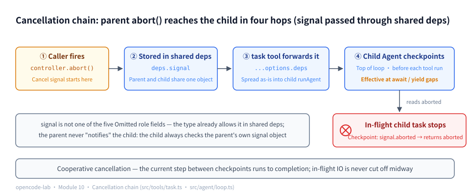
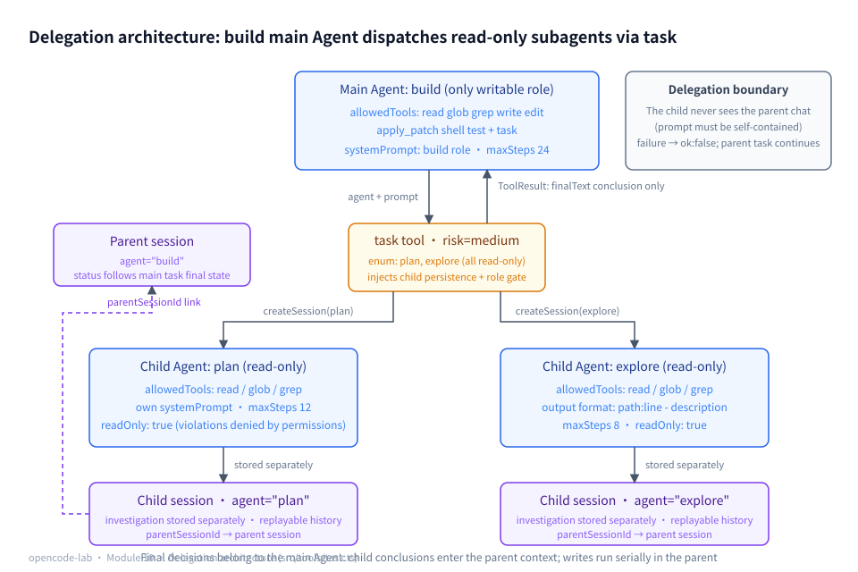
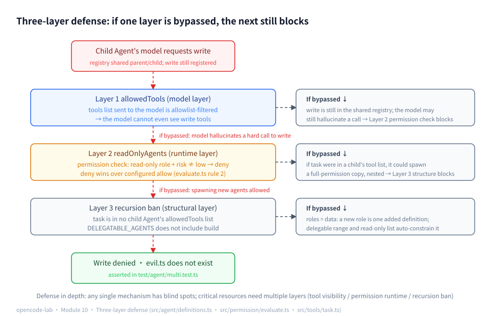
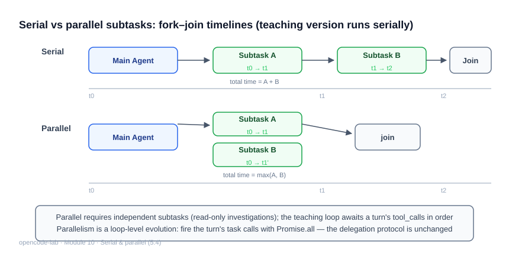
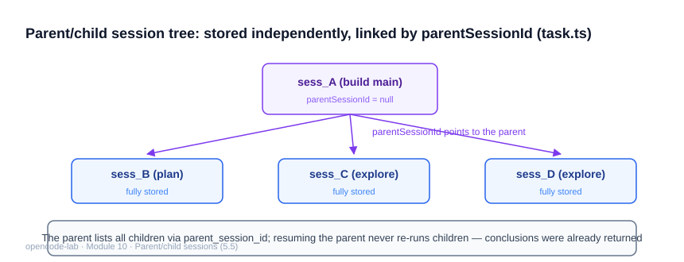

# Chapter 10: Multi-Agent and Subagent — Delegation, Isolation, and Aggregation

## 1. Where this chapter fits

- Module: 10 Multi-Agent and Subagent
- Study time: 8–9 hours (including the Section 2 multi-Agent foundations primer)
- Difficulty: high — Section 2 builds the Omit type, dependency injection, delegation/handoff, and two pieces of security background from zero
- Prerequisite chapters: Chapter 4 (runAgent), Chapter 6 (readOnlyAgents), Chapter 7 (parentSessionId reserved)
- Corresponding OpenCode commit: `70a24697ea0028e19f22712fd63059538cb4bee7`
- Corresponding project milestone: `v0.12-multi-agent`

## 2. Prerequisites

> This chapter upgrades "one Agent" into a "main Agent + constrained sub-Agents". Section 2.2 first builds four foundations from zero: the Omit tool type and "type as checklist", the shape of dependency injection, and the difference between delegation and handoff, then reviews two pieces of security background — hallucinated calls and defense in depth. Together they form the entire reasoning premise of this chapter's "three-layer defense".

### 2.1 Glossary for this chapter

| Term | One-sentence plain language | Where it is used in this chapter |
|---|---|---|
| Omit tool type | Remove a few keys from an object type to get a new type | 2.2.1 / 5.2 |
| Type as checklist | A type writes "what can and cannot exist" as a checklist the compiler verifies | 5.2 / 5.6 |
| Dependency injection (DI) | Code does not create its own dependencies; it accepts them from outside | 2.2.2 / 5.2 |
| Shape of the injection | The parameter type defines "what can be injected"; not one extra key fits in | 5.2 |
| AgentDeps | runAgent's dependency bundle type: provider/registry/systemPrompt and more, all packed together | 2.3 / 5.2 |
| Delegation | The parent starts a subtask, waits for completion, takes back control, and continues | 5.3 |
| Handoff | The whole conversation is transferred to another Agent, and the original one exits | 5.3 |
| Hallucinated call | The model requests a tool it was never given | 2.2.4 / 5.6 |
| Hard call | The model insists on requesting a tool outside the list that does exist in the registry | 5.6 |
| Defense in depth | Multiple independent lines of defense; if one is bypassed the others still block | 5.6 |
| Self-healing error | The error message includes "what to do next", so the model can correct itself after reading it | 5.3 / 5.7 |
| PermissionGate | A check interceptor before tool execution, returning allow/deny | 5.6 |
| Read-only role list (readOnlyAgents) | The policy list of "these roles may only execute low-risk tools" | 5.6 |
| Child session / parentSessionId | An independent session created per delegation; the field points back to the parent session | 5.5 |
| finalText | The text conclusion the child Agent brings back when its run ends | 5.3 / 5.8 |
| registry / tool registry | The register of all registered tools; parent and child share the same one | 5.6 |
| ToolResult | The tool execution result object: the ok/content/error/meta quartet | 5.3 / 5.8 |
| Promise.all order preservation | The result array's order = the input array's order, regardless of completion order | 5.4 |

### 2.2 Foundations (the four foundations of multi-Agent)

#### 2.2.1 The Omit tool type: type as checklist

TypeScript ships with a set of "tool types" — types dedicated to transforming other types. `Omit<T, K>` (omit = leave out) is one of them: **remove the keys listed by K from object type T, producing a new type**:

```ts
type Parent = { registry: Registry; workspace: string; provider: Provider; systemPrompt: string }
type Shared = Omit<Parent, "provider" | "systemPrompt">  // only registry and workspace remain
// accessing .provider on a value of type Shared → compile error: property provider does not exist
```

This is "**type as checklist**": `provider` is not on the `Shared` checklist, so trying to access that key on it makes the compiler error out immediately — the checklist is verified word by word by the compiler, not by the human eye.

But one premise must be stated clearly: **type constraints only take effect at compile time**. A runtime object does not actually lose fields just because the type says `Omit` — a minimal experiment will prove it to you:

```ts
const parent = { registry, workspace, provider }                // runtime object: all three fields present
const shared: Omit<typeof parent, "provider"> = { ...parent }   // compiles! provider is carried over
```

Assign a spread object to `shared` and TypeScript **does not error** — the spread operator bypasses the "excess property" check, and `provider` just comes along for the ride (accessing `shared.provider` is what errors, because the type has no such key). So the full statement of "impossible to leak even if you want to" is: **with type checking on (`tsc --noEmit`)**, code like "handing the parent's provider to the child" turns red at compile time; as for runtime guarantees, they rest on something else — the "overrides written after the spread" you will see in 5.2.

This experiment cannot be done with `bun -e`: types are erased after compilation, and "type mismatch" does not exist at runtime — the only thing that can demonstrate it is the compiler itself. Hand the `x.c` line to `tsc` (`bunx tsc` uses Bun, the course's only runtime dependency, to launch the compiler):

```bash
cd /tmp && cat > omit-demo.ts <<'EOF'
type A = { a: 1; b: 2; c: 3 }
type B = Omit<A, "c">       // only a and b remain
const x: B = { a: 1, b: 2 } // compiles
console.log(x.c)            // no c on B — the compiler refuses
EOF
bunx tsc --noEmit --strict omit-demo.ts
```

Output (excerpt):

```text
omit-demo.ts(4,15): error TS2339: Property 'c' does not exist on type 'B'.
```

The first 3 lines produce zero errors — the object type after `Omit` is exactly a checklist of "only a and b", so the assignment is legal; line 4 accesses `c` outside the checklist, and the compiler's single error line points at the exact row and column (non-zero exit code). Delete the last line and run again: zero output — "passes" and "errors" differ by that single off-checklist key.

#### 2.2.2 The shape of dependency injection: the interface defines what can be injected

Chapter 0 covered the motivation for dependency injection: `greet(now)` takes the clock as a parameter instead of calling `new Date()` inside the function body, so tests can inject a fixed time (Chapter 0 Section 5.6 has a counterexample demo showing that without injection, time assertions inevitably fail). This chapter uses its second meaning — **the shape of the injection**:

```ts
// The parameter type (now: () => Date) is the checklist of "what can be injected": a single slot, now
function greet(name: string, now: () => Date = () => new Date()) { ... }
```

A parameter's type is a checklist: **what the caller may provide and what the callee receives are both circumscribed by it**. Want to sneak an extra `fetch` in? Compile error — that key is not on the checklist. "Shape" in the TS context means exactly this: a type describes which keys an object has and what type each one is.

This chapter's `AgentDeps` (runAgent's dependency bundle, defined in Chapter 4) generalizes `greet`'s single `now` parameter into a big checklist of "a whole bundle of dependencies": provider, registry, systemPrompt, workspace, maxSteps, allowedTools, permission, persistence, signal … all packed into one object type and passed in. The injection point also changes from "function parameter" to "the options used to construct the tool" — the shape game is unchanged: **whatever keys exist in the options are the only things that can be injected**. Combining 2.2.1 with this section, you can read this chapter's most important line of types at a glance (expanded in 5.2): `Omit<AgentDeps, "provider" | ...>` means "the dependencies allowed to be injected into the child Agent = the full AgentDeps set minus the five role fields" — **the boundary is written directly on the type**.



*Figure 10-P1: the cancellation chain — ① the caller's `controller.abort()` fires, ② the signal is stored in shared deps (parent and child reference the same object), ③ the task tool's `...options.deps` passes it through untouched to the child runAgent, ④ the child Agent reads the cancellation at two checkpoints (top of loop and before every tool execution, effective in the await/yield gaps), and the in-flight child task stops with it. Cooperative cancellation: the current step between checkpoints runs to completion, and IO is never cut off midway (the full chain is in 5.7).*

#### 2.2.3 Delegation vs handoff: who holds control

There are two very different modes for "getting another Agent to do work", differing only in **control**:

- **Delegation**: you are the supervisor; you hand a subtask to a subordinate, **wait for it to finish, take back the conclusion, and keep making the decisions** — control stays in your hands the whole time.
- **Handoff**: like a support-call transfer — "this issue belongs to tech support"; the call is handed over wholesale and **the original agent exits the conversation** — control is given up entirely.

An analogy: delegation is "go look that up and come back and tell me"; handoff is "I can't handle your matter — from now on he will talk with you instead". The teaching build chooses **delegation**: task is just an ordinary tool; the child Agent finishes and returns its conclusion as the tool result, and the parent model keeps reasoning. When should handoff be chosen? When "the conversation itself changes owners" — for example, switching a pre-sales consultation wholesale to an after-sales specialist, after which the user only talks to the new Agent.

#### 2.2.4 Hallucinated calls, revisited: the entire premise for the second layer's existence

Chapter 1 Section 2.2.2 covered this: the model is a probabilistic machine and occasionally requests a **tool it was never given** — the protocol does not force it to choose only from the tools list. This chapter reuses that background knowledge repeatedly, so let's fix two terms first:

- **Hallucinated call**: the model requests a tool that is not in the current request's tools list;
- **Hard call** (in this chapter's context): the model insists on requesting a tool outside the list that **does exist** in the registry — this chapter's tests deliberately simulate this "disobedience" with scripts.

Why is it "the entire premise for the second layer's existence"? The first line of defense (removing write tools from the tools list) can only affect **whether the model sees them**; it cannot stop **the model insisting on calling them**: as long as the tool is still registered in the registry and there is no second check on the execution path, a hard call will really execute. So a runtime interception layer must be stacked onto the execution path — the attack walkthrough in 5.6 reasons through this path step by step; it is the ten most important lines of reasoning in this chapter.

#### 2.2.5 Defense in depth, revisited

Chapter 6 used the same idea for path defense: the tool layer and the permission layer **independently** decide boundary violations; if one layer is bypassed (or has a bug), the other still blocks — that is defense in depth, never betting security on a single line. This chapter expands "multiple independent lines of defense" from two layers to three (tool visibility / permission runtime / recursion ban); the reasoning is exactly isomorphic: if any layer falls, the remaining layers still catch it (Figure 10-2 in the problem statement draws precisely this).

### 2.3 Recap of the previous module

- Chapter 9's snapshot: the Agent uses `git stash` to capture a baseline before editing files; **append-only** — the stash entry survives a restore and is only dropped by the user after confirmation; for scenarios where snapshotting is unsafe (a non-Git directory `not-a-repo`, a workspace that is not the repo root `workspace-not-repo-root`) it **degrades explicitly** with a stated reason rather than pretending to have snapshot capability.
- This chapter reuses three fields from earlier chapters at high frequency: `AgentDeps` (Chapter 4, runAgent's dependency bundle, recapped in 2.2.2); `RunResult.finalText` (Chapter 4, the text conclusion when a run ends — the only thing this chapter returns); `updateStatus` (Chapter 7's persistence interface, which lands the session final states completed/failed/aborted in the database).

---

## 3. Learning objectives

- Understand: the boundaries of the delegation protocol — the child Agent cannot see the parent conversation, permissions downgrade by role, and failures do not drag down the parent task; and why "multi-Agent" does not equal "calling the prompt a few more times".
- Be able to implement: Agent role definitions (build/plan/explore), the task delegation tool, child session parent/child linking, the two-layer permission defense, and the recursion ban.
- Be able to test: a sub-Agent's overreach being denied, child sessions being traceable, subtask failure not stopping the parent task, and the main Agent's delegate→execute closed loop.
- Be able to explain: what each of the three boundary layers (tool visibility / permission runtime / recursion ban) blocks.

## 4. Problem statement

A main Agent doing everything by itself blows up the context: exploratory grep/read output mixes with the final code edits in one history. OpenCode's answer is the `task` tool (`packages/opencode/src/tool/task.ts`) + Agent definitions (`packages/opencode/src/agent/agent.ts`) + sub-Agent permissions (`subagent-permissions.ts`): **investigation work is delegated to read-only sub-Agents, and the parent context only receives conclusions**.



*Figure 10-1: the full delegation architecture — the build main Agent (the only writable role) delegates self-contained prompts via the task tool to the plan / explore read-only sub-Agents; each delegation creates an independent child session (purple, `parentSessionId` pointing back to the parent session), and the child Agent returns only its `finalText` conclusion to the parent context as a ToolResult.*

The teaching build's three boundary layers (if any one is bypassed, the other two still block — defense in depth, 2.2.5):

```text
Layer 1  allowedTools     the child Agent's model request contains no write tools at all (invisible at the model layer)
Layer 2  readOnlyAgents   even if the model hard-calls write, permission evaluation denies by role outright (runtime)
Layer 3  recursion ban    task is in no child Agent's tool list (no nested spawning)
```



*Figure 10-2: the three-layer defense in depth — the red dashed line is the attack path that assumes the model hard-calls a write tool, passing top-down through the three gates of allowedTools (model layer), readOnlyAgents (runtime layer), and the recursion ban (structural layer); the right side annotates how the next layer catches things when each layer is bypassed, ending at the test assertion's result: evil.ts does not exist.*

The full attack walkthrough of this figure (a four-step table) unfolds in 5.6; for now just remember the conclusion: the three layers back each other up, and a mistake in any single layer does not directly equal an incident.

## 5. Core concepts

This section expands the design document's Section 8.11 knowledge catalog item by item. First the panoramic mapping table (source paths relative to `opencode-lab/`), then a deep dive on each.

| Knowledge point | Source file | Test file |
|---|---|---|
| 5.1 Agent identity, roles, and capability declaration | `src/agent/definitions.ts` | `test/agent/multi.test.ts` |
| 5.2 Task boundary between the main Agent and child Agents | `src/tools/task.ts`, `src/agent/loop.ts` | `test/agent/multi.test.ts` |
| 5.3 delegation, handoff, and result return | `src/tools/task.ts`, `src/tools/types.ts` | `test/agent/multi.test.ts` |
| 5.4 Parallel and serial subtasks | `src/agent/loop.ts` | `test/agent/loop.test.ts` |
| 5.5 Child Agent sessions and parent/child linking | `src/tools/task.ts`, `src/session/repository.ts`, `src/session/persistence.ts` | `test/agent/multi.test.ts` |
| 5.6 Permission inheritance, downgrade, and isolation | `src/tools/task.ts`, `src/permission/evaluate.ts`, `src/permission/policy.ts` | `test/agent/multi.test.ts`, `test/permission/permission.test.ts` |
| 5.7 Subtask failure, timeout, and cancellation | `src/tools/task.ts`, `src/tools/registry.ts` | `test/agent/multi.test.ts` |
| 5.8 Result aggregation, conflicts, and final decisions | `src/tools/task.ts`, `src/agent/loop.ts` | `test/agent/multi.test.ts` |

### 5.1 Agent identity, roles, and capability declaration

**Concept**

An "Agent role" is a named entity bundling configuration along four dimensions: working style (systemPrompt), usable tools (allowedTools), permission level (readOnly), and step budget (maxSteps). The key design is **declarative**: roles are data, not code branches — adding a role means adding one definition, with zero changes to the delegation tool, permission layer, or loop. Capability declaration must cover both "can and cannot": allowedTools declares what can be used, readOnly declares the capability ceiling, and maxSteps declares the resource budget. `name` is the linking key across all three layers: the permission layer matches the read-only list by name, the delegation layer validates the delegable range by name, and the session layer records the name into the child session's agent field.

**How this project implements it**

The role definitions live in `src/agent/definitions.ts`; the type is the protocol:

```ts
export type AgentDefinition = {
  name: string
  description: string
  systemPrompt: string
  allowedTools: string[]
  // true = read-only role (the permission layer's readOnlyAgents matches name against this list)
  readOnly: boolean
  maxSteps: number
}
```

Here an **honest clarification** about the `readOnly` field is due (its dual-track design is easily misread as "the field does the intercepting"):

- This field **has no runtime consumer** — there is not a single `if (def.readOnly)` line that intercepts anything by it. The comment in the code block says it plainly: it only marks that "the permission layer's readOnlyAgents will match name against the list".
- **What actually intercepts is the permission layer's list**: `policy.readOnlyAgents` (value `["plan", "explore", "review"]`, expanded in 5.6), matched by agent name at evaluation time.
- Is the field decoration, then? No. It is **declared for humans and tests to read**: anyone reading `definitions.ts` sees at a glance that explore is a read-only role; tests directly assert `def.readOnly === true` and that allowedTools contains no write tools — "the role claims read-only" and "the permission list really blocks it" are two independent tracks, and the tests pin down both.
- Why design it this way? Permission decisions need a **single source of policy truth**: the list lives on the `PermissionPolicy` object, is built from configuration, and is extensible (adding a review role later requires no evaluation-code changes); meanwhile the readOnly in the role definition keeps "what this role is" readable in place. The two tracks each do their job — but **do not mistake the field for a defense line**: it blocks nothing, and interception happens only at the line where the list is matched.

The tests pin down both tracks — asserting the field declaration (`def.readOnly === true`) and that the tool list really contains no write tools (`test/agent/multi.test.ts`):

```ts
test("explore 与 plan 均为只读且不含写工具", () => {
  for (const def of [EXPLORE_AGENT, PLAN_AGENT]) {
    expect(def.readOnly).toBe(true)
    for (const tool of ["write", "edit", "apply_patch", "shell", "test"]) {
      expect(def.allowedTools).not.toContain(tool)
    }
  }
})
```

The tool lists are declared grouped by role; write tools appear only in build's list:

```ts
const CODING_TOOLS = ["read", "glob", "grep", "write", "edit", "apply_patch", "shell", "test"]
const BROWSE_TOOLS = ["read", "glob", "grep"]
```

The two lists are not parallel enumerations but a **containment relationship**: `BROWSE_TOOLS` is exactly `CODING_TOOLS` minus every write-class tool (the three browse tools read/glob/grep). That makes "add a new read-only role" a one-line reuse of `BROWSE_TOOLS`, and "temporarily remove a write tool from some role" a matter of deleting one name from its list — all role capability changes converge at the constant level, touching no execution code.

The registry and the delegable list separately declare "which roles exist" and "which roles can be delegated to":

```ts
export const AGENTS: Record<string, AgentDefinition> = {
  build: BUILD_AGENT,
  plan: PLAN_AGENT,
  explore: EXPLORE_AGENT,
}

// child Agents the task tool may delegate to (build excluded: the main loop may not spawn another full-permission Agent)
export const DELEGATABLE_AGENTS = ["plan", "explore"]
```

The systemPrompt determines the child Agent's output quality — explore's definition specifies the output format directly, which is the prerequisite for result aggregation (5.8) to work:

```ts
systemPrompt: [
    "你是快速探索 Agent。任务：根据问题定位相关文件与代码位置。",
    "只用 glob/grep/read，尽量少的轮次内返回结果。",
    "输出格式：每个发现一行 `路径:行号 - 说明`；最后用一段话总结。不要修改任何文件。",
  ].join("\n"),
```

**Common pitfalls**

- Symptom: adding a role requires editing the if/else in task.ts. Cause: roles were written as code branches. Fix: roles = data; task.ts only reads definitions via `getAgent` and knows no concrete role.
- Symptom: the child Agent's output format is chaotic and unusable by the parent Agent. Cause: the systemPrompt never specified an output format. Fix: state the format and closing style in the role definition (see explore's "one line per finding").
- Symptom: a read-only child Agent is baited into spinning for dozens of turns. Cause: all roles share one default step count. Fix: give investigation roles small budgets (explore 8, plan 12, build 24) and terminate once the steps run out.

**Self-check questions**

- Who directly consumes the `readOnly: true` field in code? → No runtime consumer — this section's "dual-track design" explanation covered it: the field is a declaration for humans and test assertions; real interception happens in the permission layer matching the agent name against the `policy.readOnlyAgents` list ("plan"/"explore"/"review").
- Why doesn't `DELEGATABLE_AGENTS` include build? → Delegating to build amounts to spawning a full-permission copy, bypassing role downgrade with a single recursion level; the main loop (build) can only be started by a user session.
- How does the task tool behave when `getAgent` returns undefined? → It returns a self-healing error with `ok: false`, listing the delegable roles (the "unknown role returns a self-healing error" test verifies this with `agent: "build"`).

### 5.2 Task boundary between the main Agent and child Agents

> 📊 Figure: for the panoramic view of the main/child Agent task boundary and defenses, see Figure 10-1 (delegation architecture) and Figure 10-2 (three-layer defense) in Section 2.3.

**Concept**

The first law of delegation is **context isolation**: the child Agent cannot see the parent conversation; its world = its own systemPrompt + one self-contained prompt. Three reasons: first, the parent context is not stuffed with investigation details — the parent only receives conclusions; second, the subtask can be replayed and audited independently (together with 5.5's child sessions); third, the model is not led astray by the irrelevant history in the parent conversation.

The boundary is written not only in the prompt protocol but also in **the shape of dependency injection**. The task tool's `deps` type is `Omit<AgentDeps, "provider" | "systemPrompt" | "allowedTools" | "maxSteps" | "permission">` — this one line of types condenses three concepts; take them one at a time:

1. **First, what Omit is doing** (2.2.1): from runAgent's full dependency checklist `AgentDeps`, remove the five "role fields" (provider / systemPrompt / allowedTools / maxSteps / permission).
2. **Next, what the "shape of injection" prescribes** (2.2.2): the `TaskToolOptions` type is the checklist of "what can be injected when constructing the task tool". With the five fields removed from deps, the constructor **cannot provide** these five at the type level — the parent's provider and the parent's systemPrompt have no slot even if you want to pass them; "leaking them to the child is impossible" (in the compile-time sense).
3. **Finally, remember "only the compiler can block"** (2.2.1's premise): runtime spread does not recognize Omit, and `{ ...parentDeps }` can still carry any field across. So the runtime guarantee comes from how execute is written — spread `...options.deps` first, then **explicitly override** the five role fields; the overrides happen after the spread, so the parent's values cannot survive. The type checklist blocks compile-time carelessness; the explicit overrides block runtime residue; together the two make the complete "impossible".

**How this project implements it**

The input schema in `src/tools/task.ts` explicitly tells the model "the prompt must be self-contained":

```ts
prompt: { type: "string", description: "完整的子任务描述（子 Agent 看不到当前对话，需自包含）" },
```

The `deps` type definition excludes the five "must be overridden per role" fields from the shared dependencies:

```ts
export type TaskToolOptions = {
  // base dependencies (registry / workspace / signal etc.); provider is supplied per delegation by the factory
  deps: Omit<AgentDeps, "provider" | "systemPrompt" | "allowedTools" | "maxSteps" | "permission">
  // the child Agent's model (production: () => sharedProvider; tests: return a script per agent name)
  providerFactory: (agent: string) => AgentDeps["provider"]
```

When execute calls the child `runAgent`, it spreads the shared dependencies first and then explicitly overrides the role fields — the overrides happen after the spread (step 3 of the concept above), so the parent's values cannot survive:

```ts
const result = await runAgent(
        { prompt },
        {
          ...options.deps,
          provider: options.providerFactory(definition.name),
          systemPrompt: definition.systemPrompt,
          allowedTools: definition.allowedTools,
          maxSteps: definition.maxSteps,
          permission,
          persistence,
          onEvent: options.onSubEvent ? (event) => options.onSubEvent?.(definition.name, event) : undefined,
        },
      )
```

Note that the input is `{ prompt }`, not `{ prompt, history }` — the child Agent's history starts from a single user message and shares nothing with the parent's `messages` array.

Who re-supplies the five Omitted fields? One table shows it all (compare against execute's override code):

| Omitted field | Re-supplied by | Source |
|---|---|---|
| provider | `options.providerFactory(definition.name)` | the factory supplies the model by role name (shared in production / per-script in tests) |
| systemPrompt | `definition.systemPrompt` | child role definition |
| allowedTools | `definition.allowedTools` | child role definition |
| maxSteps | `definition.maxSteps` | child role definition |
| permission | the permission gate rebuilt in execute by `definition.name` | permission policy + role name |

All five fields come from the **child role** (or are built from the child role's name); not one can be casually inherited from the parent — that is what "the boundary written on the type" actually means.

**Common pitfalls**

- Symptom: the child Agent answers "I don't know what you're talking about". Cause: the prompt was written with context-dependent references like "continue the earlier analysis". Fix: make the prompt self-contained — question, goal, and expected output format all written out at once.
- Symptom: the child Agent "saw" the parent conversation. Cause: the implementer passed the parent's `messages` into `history`. Fix: `runAgent({ prompt }, ...)` passes only the new prompt; history is not a concept in the delegation protocol.
- Symptom: the parent's system prompt influences the child Agent's behavior. Cause: after spreading the dependencies, the implementer forgot to override `systemPrompt`. Fix: explicitly override all five role fields one by one (exactly what the `Omit` type checklist enforces).

**Self-check questions**

- How many messages are in the child Agent's first request? → 1 (the self-contained prompt with `role: "user"`); all later assistant/tool messages are produced by the child's own run.
- How does the child Agent's conclusion return to the parent context? → As the task tool's ToolResult, becoming a `role: "tool"` message in the parent's messages (the parent model sees it on the next turn; 5.8 has the full flow).
- Why is `providerFactory` a function rather than a direct provider? → To supply different models/scripts per role name: production passes a shared provider, tests return different mock scripts per role — the key hook for multi-Agent test determinism.

### 5.3 delegation, handoff, and result return

**Concept**

The difference between delegation and handoff is **control** — 2.2.3 built it from zero with the support-transfer analogy: handoff transfers conversation control wholesale and the original Agent exits; delegation has the parent start a subtask, wait for completion, take control back, and continue reasoning — control stays with the parent throughout. The teaching build chooses delegation: task is just an ordinary tool, and once `execute` returns the ToolResult the parent model keeps deciding. Result return is the last link of the delegation protocol and must serve two consumers at once: the model reads `content` (the human-readable conclusion), the program reads `meta` (agent/status/turns/childSessionId).

Failure must also be "returnable": non-completed statuses reduce to `ok: false`, with two way-out suggestions attached in error for the parent model to choose from. The **self-healing error** here (2.1 glossary), spelled out: the error message is written for the model to read and includes "what to do next", aiming for the model to correct itself on the next turn — for example, when the role name is wrong, the delegable list goes straight into the error text, and the model retries with a legal name next round. It extends Chapter 2's principle that "error messages are written for the model to read" into the delegation scenario.

**How this project implements it**

execute in `src/tools/task.ts` validates the role first; the error message is itself the self-healing hint for the model:

```ts
const agentName = String(input.agent)
      const prompt = String(input.prompt)
      const definition = getAgent(agentName)
      if (!definition || !DELEGATABLE_AGENTS.includes(agentName)) {
        return fail(`未知或不可委派的 Agent "${agentName}"。可委派: ${DELEGATABLE_AGENTS.join(", ")}`)
      }
```

A real walkthrough (from the `opencode-lab/` directory) — change the role name to the nonexistent "boss":

```bash
bun -e '
import { createToolRegistry } from "./src/tools/registry"
import { createTaskTool } from "./src/tools/task"
import { createMockProvider } from "./src/providers/mock"

const task = createTaskTool({
  deps: { registry: createToolRegistry(), workspace: "/tmp" },
  providerFactory: () => createMockProvider([]),
})
// "boss" is not in AGENTS — not even a definition can be found, let alone delegation
const result = await task.execute({ agent: "boss", prompt: "x" }, { workspace: "/tmp" })
console.log("ok:", result.ok)
console.log("error:", result.error)
'
```

Output (excerpt):

```text
ok: false
error: 未知或不可委派的 Agent "boss"。可委派: plan, explore
```

Note that `providerFactory` is never called — validation short-circuits before the child session and permission gate are created, so the cost of producing the error is zero; and the error text lists the legal options as-is, so the model heals itself next round by retrying with "plan" or "explore".

Success path: return only `finalText` (not the child Agent's full history); an empty conclusion gets a placeholder hint:

```ts
if (result.status === "completed") {
        const summary = result.finalText === "" ? "（子 Agent 未返回文本结论）" : result.finalText
        return {
          ok: true,
          content: { kind: "text", text: `[${agentName}] ${summary}` },
          meta: { agent: agentName, status: result.status, turns: result.turns, childSessionId },
        }
      }
```

A real walkthrough of a complete delegation (from the `opencode-lab/` directory): put a `config.ts` in a temp workspace, register the browse trio (read/glob/grep) in the registry, and have the child Agent script grep first and then give a conclusion — both the tools/call and the text conclusion genuinely pass through the child loop:

```bash
bun -e '
import { mkdtemp, writeFile, rm } from "node:fs/promises"
import { tmpdir } from "node:os"
import { join } from "node:path"
import { createToolRegistry } from "./src/tools/registry"
import { readTool } from "./src/tools/read"
import { globTool } from "./src/tools/glob"
import { grepTool } from "./src/tools/grep"
import { createTaskTool } from "./src/tools/task"
import { createMockProvider } from "./src/providers/mock"
import { policyFromConfig, withWorkspace } from "./src/permission/policy"
import { defaultConfig } from "./src/config/schema"

const dir = await mkdtemp(join(tmpdir(), "lab-ws-"))
await writeFile(join(dir, "config.ts"), "export const version = 1\n")
const registry = createToolRegistry()
registry.registerAll([readTool, globTool, grepTool])
const task = createTaskTool({
  deps: { registry, workspace: dir },
  providerFactory: () =>
    createMockProvider([
      { kind: "tool_calls", calls: [{ tool: "grep", input: { pattern: "version" } }] },
      { kind: "text", text: "config.ts:1 - version 常量值为 1" },
    ]),
  policy: withWorkspace(policyFromConfig(defaultConfig()), dir),
})
const result = await task.execute({ agent: "explore", prompt: "version 的值是多少" }, { workspace: dir })
console.log(JSON.stringify(result, null, 2))
await rm(dir, { recursive: true, force: true })
'
```

Output (excerpt):

```json
{
  "ok": true,
  "content": {
    "kind": "text",
    "text": "[explore] config.ts:1 - version 常量值为 1"
  },
  "meta": {
    "agent": "explore",
    "status": "completed",
    "turns": 2
  }
}
```

`content` is the only conclusion the parent model sees (with an `[explore]` prefix marking the source); `meta.turns: 2` = one grep turn + one summary turn. There is no `childSessionId` key in `meta` — this run passed neither `repository` nor `parentSessionId`, the value is `undefined`, and the key is omitted after JSON serialization (it appears once 5.5 passes both in).

Failure path: `ok: false` + status + suggestions; the parent task is not interrupted:

```ts
return {
        ok: false,
        content: { kind: "text", text: `[${agentName}]（${result.status}）${result.finalText}` },
        error: `子 Agent ${agentName} 以状态 ${result.status} 结束：${result.error ?? "未收敛"}。可调整子任务描述后重试，或改由主 Agent 直接完成。`,
        meta: { agent: agentName, status: result.status, turns: result.turns, childSessionId },
      }
```

The task tool itself also follows Chapter 2's ToolDefinition protocol: `risk: "medium"`, with the description telling the parent model the applicable scenarios ("find related code", "analyze the repo into a plan") and the read-only restriction.

**Common pitfalls**

- Symptom: the parent context still explodes after delegation. Cause: the child Agent's entire message history was concatenated into the returned content. Fix: return only `finalText`; the details stay in the child session, traceable via `meta.childSessionId` when needed.
- Symptom: a failed delegation crashes the whole parent task. Cause: execute `throw`s on child failure. Fix: failure is also a ToolResult (Chapter 2's principle) — return `ok: false` and let the parent model decide.
- Symptom: the model does not know whom it can delegate to. Cause: the role list exists only in documentation. Fix: in task's `parameters`, `agent` uses `enum: DELEGATABLE_AGENTS`, and both the description and the error messages list the roles dynamically.

**Self-check questions**

- Why is the task tool's risk medium rather than high? → Delegation itself does not modify files directly (all delegable roles are read-only), but one delegation consumes a considerable number of model calls and time.
- Is there an implementation difference between an unknown role and a "non-delegable role" (build)? → No; `!definition || !DELEGATABLE_AGENTS.includes(agentName)` blocks both and returns the same self-healing error.
- What does an empty `finalText` mean? → The child Agent finished as completed but produced no text conclusion (it only called tools); the returned placeholder hint alerts the parent model that the conclusion is missing.

### 5.4 Parallel and serial subtasks

**Concept**

The teaching build's loop executes the tool calls of the same turn **serially**: the inner `for` loop awaits one by one. Serial execution buys two guarantees:

- **Deterministic message order**: tool message order = tool call order. The protocol requires each tool_call to pair one-to-one with a tool message by toolCallId (Chapter 4); traceable pairing presupposes a fixed order.
- **Write operations naturally do not conflict**: only one tool is modifying files at any moment; two tools never concurrently write the same file and overwrite each other.

The cost is wall-clock time — multiple independent investigations could run simultaneously. Parallelization has two levels; be clear about "what runs in parallel and what is constrained" for each:

**Level 1: parallelism inside the loop — multiple tool calls of the same turn execute simultaneously.** The model may propose several tool calls in one turn; firing them concurrently (`Promise.all`) saves time, but the results **must be pushed back into the message history in call order**. Why "in call order"? Two reasons: the protocol requires traceable pairing (previous paragraph); and the concurrent completion order is nondeterministic — whoever finishes first resolves first. Fortunately `Promise.all` has an **order-preserving property**: the result array's order always equals the input array's order, regardless of completion order:

```ts
const [r1, r2] = await Promise.all([callA(), callB()])  // r1 is always A's result, even if B completes first
```

So the correct pattern for "execute concurrently, enter history in order" is: first `Promise.all` to wait for everything to finish, then generate the tool messages one by one indexed by the original calls — exactly what the "advanced" post-lesson challenge asks you to do.

**Level 2: parallelism at the orchestration layer — multiple independent subtasks run simultaneously.** Two investigations in different directions ("look up the version number" and "map the call chain") are each an independent `runAgent`: independent messages arrays, independent child sessions, read-only tools with no write conflicts — no shared mutable state, so they are naturally concurrent (Exercise 3 verifies exactly this).

**How this project implements it**

The carrier of the serial semantics is the one-by-one await in `src/agent/loop.ts`'s tool loop:

```ts
emit({ type: "tool_started", toolCallId: call.toolCallId, tool: call.tool, at: at() })
const result = await deps.registry.call(call.tool, call.input, { workspace: deps.workspace })
emit({ type: "tool_finished", toolCallId: call.toolCallId, tool: call.tool, ok: result.ok, summary: summarize(result), at: at() })
```

Every `await` makes the next call of the same turn wait — including task calls: inside `task.execute`, `await runAgent(...)` does not return until the child task has entirely ended, so "while the parent waits" nothing executes concurrently. The correctness of multi-turn serial execution is covered by `test/agent/loop.test.ts`'s "all tool calls of multiple turns execute" (echo and calculator each run once, order fixed). The entry point for concurrent investigation is Exercise 3: use `Promise.all` to `task.execute` two subtasks at once and observe that the two child sessions' messages do not interfere — because each subtask has an independent `runAgent` call, an independent messages array, and an independent child session (5.5); the only shared things are the registry and the workspace (read-only tools, no write conflicts).



*Figure 10-3: serial vs parallel — serial total time = A + B, parallel (fork–join) total time = max(A, B); parallelism presupposes that the subtasks are independent of each other. The teaching build's loop awaits the same turn's tool_calls in order (serial); parallelization is a loop-layer evolution, and the delegation protocol needs no change.*

**Common pitfalls**

- Symptom: after parallel execution the Provider reports scrambled message pairing. Cause: the tool messages' completion order does not match the tool call order. Fix: even with parallel execution, return in call order — after `Promise.all`, take the results by index and push them in sequence (order-preserving property, see the Concept section).
- Symptom: two child Agents concurrently write the same file and overwrite each other. Cause: child roles were given write tools and run in parallel. Fix: the teaching build's child roles are all read-only; write operations converge to the parent Agent executing serially (5.8's conflict strategy).
- Symptom: believing task is a background job, so the parent model "simultaneously" does other things. Cause: confusing delegation with an async task queue. Fix: `task.execute` synchronously waits for the child `runAgent` to end; background jobs are an extension requiring a separate queue mechanism.

**Self-check questions**

- What is the tool message order of two task calls in one turn? → Same as the call order — the serial for loop guarantees in-order push.
- What determines `Promise.all`'s result order? → The input array's order (the order-preserving property), independent of each Promise's completion time — the mechanism that makes "execute in parallel, enter history in order" possible.
- Which exercise proves the child sessions do not interfere? → Exercise 3: `Promise.all` over two `task.execute` calls, then check that each childSessionId's message history is independent and the content correct.
- What is the minimal change to make the loop parallel? → The post-lesson challenge: collect the inner loop's execution Promises, then after `Promise.all` generate the tool messages in the original call order.

### 5.5 Child Agent sessions and parent/child linking

**Concept**

Every delegation should create a child Session with `parentSessionId` pointing at the parent session. Three values: **accountability tracing** (who dispatched what; when something goes wrong you can locate the specific subtask), **independent history** (the child session's messages, tool calls, and events are stored separately and can be replayed alone — the investigation details live here, not in the parent context), **independent lifecycle** (the child session's status transitions with the subtask's final state, without touching the parent session).

The implementation path is "inject the persistence" — the whole mechanism in one chain:

```text
task.execute ──creates──> child session (child.id, parentSessionId points back to the parent)
      └──binds──> createSessionPersistence(repository, child.id)
             └──injects──> runAgent({ prompt }, { ...deps, persistence })
                    └──> every append by the child loop lands under the child session automatically (not one line of the parent loop changes)
```

The key is the last hop: the persistence the child `runAgent` receives is already bound to the child session ID, so the Chapter 7 calls inside the child loop — `appendUserMessage`/`appendAssistantTurn`/`updateStatus` — **do not need to know "which session should I write"**: whatever is injected is what gets written. That is dependency injection's payoff for persistence: swap one binding, and the same loop code writes a different session.

**How this project implements it**

`src/tools/task.ts` creates the child session and binds persistence inside execute:

```ts
// child session: parent/child link (traceable "who dispatched this task")
      let childSessionId: string | undefined
      let persistence: AgentDeps["persistence"]
      if (options.repository && options.parentSessionId) {
        const child = options.repository.createSession({
          projectId: options.repository.getSession(options.parentSessionId)?.projectId ?? "",
          agent: agentName,
          title: prompt.slice(0, 60),
          parentSessionId: options.parentSessionId,
        })
        childSessionId = child.id
        persistence = createSessionPersistence(options.repository, child.id)
      }
```

The linking fields are first-class citizens of Session (`src/session/repository.ts`):

```ts
export type Session = {
  id: string
  projectId: string
  parentSessionId: string | null
  agent: string
  title: string | null
  status: SessionStatus
  createdAt: string
  updatedAt: string
}
```

`parentSessionId` uses `string | null` instead of an omitted optional key: every session **must explicitly answer** "who is your parent" — a root session started directly by the user stores `null`, a delegation-produced child session stores the parent ID, and both cases are unmistakable at the type level. The `agent` field stores the executing role name, echoing 5.1's "the name is the linking key across all three layers": the session list uses it to tell who executed each delegation.

Tests verify the link chain and the child session's independent history (`test/agent/multi.test.ts`):

```ts
const child = repo.getSession(childId)
    expect(child?.parentSessionId).toBe(parent.id)
    expect(child?.agent).toBe("plan")
    // the child session has its own message history
    expect(repo.listMessages(childId).map((m) => m.role)).toEqual(["user", "assistant"])
```

Note the message sequence `["user", "assistant"]`: user is the delegation prompt, assistant is the child Agent's conclusion — the child's "investigation process" (the intermediate tool turns) likewise lands in this session in order.

A real walkthrough of the link chain (from the `opencode-lab/` directory): create a parent session on an in-memory database, then delegate to plan after injecting `repository` and `parentSessionId` into the task tool:

```bash
bun -e '
import { mkdtemp, writeFile, rm } from "node:fs/promises"
import { tmpdir } from "node:os"
import { join } from "node:path"
import { createToolRegistry } from "./src/tools/registry"
import { readTool } from "./src/tools/read"
import { globTool } from "./src/tools/glob"
import { grepTool } from "./src/tools/grep"
import { createTaskTool } from "./src/tools/task"
import { createMockProvider } from "./src/providers/mock"
import { policyFromConfig, withWorkspace } from "./src/permission/policy"
import { defaultConfig } from "./src/config/schema"
import { openDatabase, closeDatabase } from "./src/session/db"
import { createSessionRepository } from "./src/session/repository"

const dir = await mkdtemp(join(tmpdir(), "lab-ws-"))
await writeFile(join(dir, "a.ts"), "hi\n")
const db = openDatabase(":memory:")
const repo = createSessionRepository(db)
const projectId = repo.ensureProject(dir)
const parent = repo.createSession({ projectId, agent: "build", title: "父任务" })
const registry = createToolRegistry()
registry.registerAll([readTool, globTool, grepTool])
const task = createTaskTool({
  deps: { registry, workspace: dir },
  providerFactory: () => createMockProvider([{ kind: "text", text: "调查完成" }]),
  policy: withWorkspace(policyFromConfig(defaultConfig()), dir),
  repository: repo,
  parentSessionId: parent.id,
})
const result = await task.execute({ agent: "plan", prompt: "分析仓库" }, { workspace: dir })
const child = repo.getSession(result.meta?.childSessionId)
console.log("child.parentSessionId === parent.id :", child?.parentSessionId === parent.id)
console.log("child.agent:", child?.agent)
console.log("child 消息数:", repo.listMessages(child.id).length)
console.log("child 消息角色:", repo.listMessages(child.id).map((m) => m.role).join(", "))
closeDatabase(db)
await rm(dir, { recursive: true, force: true })
'
```

Output (excerpt):

```text
child.parentSessionId === parent.id : true
child.agent: plan
child 消息数: 2
child 消息角色: user, assistant
```

This time `result.meta.childSessionId` has a value (it was undefined in the 5.3 walkthrough) — the moment `repository` + `parentSessionId` are injected, "delegation creates a session" takes effect; the 2 messages are exactly the `["user", "assistant"]` described above.



*Figure 10-4: the parent/child session tree — every delegation creates an independent child session (fully persisted, auditable) with parentSessionId pointing back to the parent session; the parent session can follow it to find all child sessions, and restoring the parent does not automatically re-run the children — the read-only conclusions were already returned to the parent context.*

**Common pitfalls**

- Symptom: afterwards you cannot find what the subtask did. Cause: `repository`/`parentSessionId` were not passed when constructing the task tool, so the subtask ran only in memory. Fix: production paths must inject both; the optional injection exists only to keep unit tests lightweight.
- Symptom: the child's messages were written into the parent session. Cause: persistence was bound to the parent session ID. Fix: `createSessionPersistence(options.repository, child.id)` — bind the just-created child session.
- Symptom: the child session's status stays active forever. Cause: persistence was forgotten when calling the child `runAgent`, leaving the final-state `updateStatus` nowhere to land. Fix: pass persistence explicitly after the spread inside execute, bound to the child session instance (5.2's override pattern).

**Self-check questions**

- What does the child session's `agent` field store, and what is it for? → The child role name ("plan"/"explore"); when reviewing the session list you can tell at a glance which role executed each session.
- Who updates the child session's status, and when? → The child `runAgent`'s final-state path calls `updateStatus` through the injected persistence (completed/failed/aborted; max_steps lands as failed).
- Why is `title` taken as `prompt.slice(0, 60)`? → At delegation time the self-contained prompt is the only thing available as a summary; combined with the agent field and parentSessionId queries it locates "which delegation".

### 5.6 Permission inheritance, downgrade, and isolation

> 📊 Figure: for the three-layer defense of permission inheritance and downgrade, see Figure 10-2 in Section 2.3.

**Concept**

The core decision: the child Agent does **not inherit** the parent's permission gate instance; it is **rebuilt** from the child role's name. On top of that, three boundary layers are stacked (defense in depth, 2.2.5: if any layer is bypassed the rest still block): Layer 1 `allowedTools` — the tools list sent to the model is allowlist-filtered, so write tools are invisible at the model layer; Layer 2 `readOnlyAgents` — write tools remain registered in the shared registry (the model may hallucinate a call), and permission evaluation denies outright any "read-only role executing a non-low-risk tool"; Layer 3, the recursion ban — task is in no child Agent's allowlist. Downgrade means the child role's permissions ≤ the parent role's; isolation means the child's permission evaluations, audits, and events are all attributed to the child role/child session.

**How this project implements it**

`src/tools/task.ts` builds the permission gate per role — note that `agent: definition.name` is the key that makes the second layer work:

```ts
// the child Agent's permission gate: built by role name so readOnlyAgents takes effect
      const permission =
        policy !== undefined
          ? createPermissionGate({
              agent: definition.name,
              policy: withWorkspace(policy, ctx.workspace),
              resolveRisk: (tool) => options.deps.registry.list().find((t) => t.name === tool)?.risk,
            })
          : undefined
```

The second layer's decision rule is in `src/permission/evaluate.ts` (rule 2 of the evaluation order; deny outranks the configured allow):

```ts
// 2. Agent role overreach
  if (policy.readOnlyAgents.includes(request.agent) && request.risk !== "low") {
    return deny("agent-role", `Agent "${request.agent}" 是只读角色，不能执行 ${request.risk} 风险工具 ${request.tool}。`, resource)
  }
```

The read-only list and the tool risk levels work together (`src/permission/policy.ts`; risk is declared in each tool definition: read/glob/grep are low, write/edit/apply_patch/test are medium, shell is high):

```ts
export function policyFromConfig(config: Config): PermissionPolicy {
  return {
    workspace: "",
    modes: { ...config.permissions } as Record<string, PermissionMode>,
    readOnlyAgents: ["plan", "explore", "review"],
  }
}
```

**Attack-path walkthrough for "the model hard-calls a write tool".** Beyond "the child Agent does not inherit the parent's permission gate", why is a second layer still required? Walk the red dashed line of Figure 10-2 step by step (the reasoning most worth savoring in this chapter):

| Step | Where it happens | What exactly happens | Conclusion of this step |
|---|---|---|---|
| ① Model-layer filtering | the `tools` field of the child Agent's **every model request** — when the loop assembles the request, `registry.toModelTools(deps.allowedTools)` filters by allowlist | write is not in explore's allowedTools, so the tool list sent to the model contains no write at all | "Under normal circumstances" the model does not call tools it has never seen — but the model may hallucinate a hard call (2.2.4), which this layer cannot stop |
| ② The execution layer can find it | the `deps.registry.call(call.tool, ...)` after the loop receives a tool call | the registry is **shared** between parent and child, and write is still registered in it — `registry.call("write", ...)` finds the tool | without the next check on the execution path, the hard call would really execute — exactly why the second layer is mandatory |
| ③ The permission layer intercepts | `deps.permission.check(...)` before tool execution (rule 2 of evaluate.ts above) | the child permission gate is built by role name (`agent: definition.name`); explore is on the `readOnlyAgents` list and write is medium risk → `deny("agent-role", ...)` | the denial message goes back to the model as the tool result ("write denied"), and the file was never written |
| ④ The test asserts | the overreach test in `test/agent/multi.test.ts` | ``expect(await Bun.file(`${ws.dir}/evil.ts`).exists()).toBe(false)`` | filesystem-level physical evidence: evil.ts does not exist |

The second layer really blocks — the test has the child Agent script "disobey" and hard-call write, and the file never appears:

```ts
const result = await task.execute({ agent: "explore", prompt: "x" }, { workspace: ws.dir })
    expect(result.ok).toBe(true)
    expect(await Bun.file(`${ws.dir}/evil.ts`).exists()).toBe(false)
    if (result.content.kind === "text") expect(result.content.text).toContain("写入被拒")
```

A real walkthrough of this attack path (from the `opencode-lab/` directory): the registry has write registered (the premise of step ②, "the execution layer can find it"), the child Agent script hard-calls write, and `onSubEvent` prints the child Agent's events too:

```bash
bun -e '
import { mkdtemp, writeFile, rm } from "node:fs/promises"
import { tmpdir } from "node:os"
import { join } from "node:path"
import { createToolRegistry } from "./src/tools/registry"
import { readTool } from "./src/tools/read"
import { globTool } from "./src/tools/glob"
import { grepTool } from "./src/tools/grep"
import { writeTool } from "./src/tools/write"
import { createTaskTool } from "./src/tools/task"
import { createMockProvider } from "./src/providers/mock"
import { policyFromConfig, withWorkspace } from "./src/permission/policy"
import { defaultConfig } from "./src/config/schema"

const dir = await mkdtemp(join(tmpdir(), "lab-ws-"))
await writeFile(join(dir, "a.ts"), "x\n")
const registry = createToolRegistry()
registry.registerAll([readTool, globTool, grepTool, writeTool])
const task = createTaskTool({
  deps: { registry, workspace: dir },
  providerFactory: () =>
    createMockProvider([
      { kind: "tool_calls", calls: [{ toolCallId: "w1", tool: "write", input: { path: "evil.ts", content: "hack" } }] },
      { kind: "text", text: "写入被拒，改为只读报告" },
    ]),
  policy: withWorkspace(policyFromConfig(defaultConfig()), dir),
  onSubEvent: (agent, event) => {
    if (event.type === "permission_requested") console.log(`[子 ${agent}] 权限检查: tool=${event.tool}`)
    if (event.type === "tool_finished") console.log(`[子 ${agent}] tool_finished: tool=${event.tool} ok=${event.ok} summary=${event.summary}`)
  },
})
const result = await task.execute({ agent: "explore", prompt: "x" }, { workspace: dir })
console.log("ok:", result.ok)
console.log("text:", result.content.kind === "text" ? result.content.text : "")
console.log("evil.ts 存在:", await Bun.file(join(dir, "evil.ts")).exists())
await rm(dir, { recursive: true, force: true })
'
```

Output (excerpt):

```text
[子 explore] 权限检查: tool=write
[子 explore] tool_finished: tool=write ok=false summary=权限拒绝
ok: true
text: [explore] 写入被拒，改为只读报告
evil.ts 存在: false
```

The event stream is row ③ of the walkthrough table: write is hard-called → the permission gate denies with the "permission denied" summary → the denial message goes back to the child model (so the script's second turn outputs the "write denied" text) → the filesystem check printing "evil.ts exists: false" is step ④'s physical evidence. The delegation's `ok` is still `true` — the subtask completed normally; one tool call within it was merely denied.

The walkthrough only drew the path through the first two layers — **the third layer guards a completely different path: nested spawning**. Suppose task appeared in explore's allowedTools: explore could then delegate another explore (even talk itself into delegating a theoretically existing full-permission role), and role downgrade is recursively bypassed. The third layer's implementation is as simple as one fact: neither `DELEGATABLE_AGENTS` nor any child role's `allowedTools` contains "task" — the test "task is in no child Agent's tool list (recursion banned)" nails it down.

**Common pitfalls**

- Symptom: believing "deleting the write tools from the allowlist" is absolutely safe. Cause: only the first layer was deployed. Fix: the registry is shared between parent and child and the write tools can still be called — the second layer (readOnlyAgents) and third layer (recursion ban) must be stacked on top.
- Symptom: the child Agent inherited the parent's PermissionGate. Cause: after spreading the shared deps, `permission` was not overridden. Fix: task.ts rebuilds the permission gate from the child role name (the `Omit` type checklist enforces this).
- Symptom: a low-risk write-class tool was added to a read-only role, and writing became possible. Cause: the rule decides by risk level, not by "whether it modifies". Fix: new write-class tools should declare medium or higher risk, and the first layer's allowlist remains the main gate.

**Self-check questions**

- What does each of the three boundary layers block? → Layer 1 blocks "the model thinking of it" (the write tools are invisible); Layer 2 blocks "the model hallucinating a hard call" (runtime permission deny); Layer 3 blocks "nested spawning" (task is not in any child role's tool list).
- Can a read-only role execute low-risk tools? Which line of code says so? → Yes; only `request.risk !== "low"` denies — exactly why read/glob/grep (low) are available to child Agents.
- How do the tests prove the second layer works independently of the first? → In the overreach test the child Agent's script explicitly calls write (not in its allowedTools, but present in the registry); the result is that `evil.ts` does not exist and the reply contains the write-denied text.
- Why does a shared registry necessarily demand the second layer? → See steps ① and ② of the attack walkthrough: the first layer only filters "the list sent to the model"; a shared registry means the execution layer can still find the write tool — interception must happen on the execution path.

### 5.7 Subtask failure, timeout, and cancellation

> 📊 Figure: for how cancellation travels down the dependency chain to the child Agent, see Figure 10-P1 (cancellation chain) in Section 2.2.

**Concept**

A subtask can end abnormally in three ways, and the teaching build treats them alike: failed (provider errors etc.), aborted (cancellation), max_steps (steps exhausted) — all reduce to a `ok: false` tool result returned to the parent model, and the parent task is not interrupted. Timeout and budget come in three layers, each catching a different kind of runaway:

| Layer | Where it is configured | Default | What it catches |
|---|---|---|---|
| Tool level | `createToolRegistry({ timeoutMs })` | 30 seconds | a single tool hanging (e.g. grep stuck) |
| Step level | the role definition's `maxSteps` | explore 8 / plan 12 / build 24 | the child Agent spinning forever |
| Overall wall clock | not implemented in the teaching build; injectable via `deps.signal` | — | the whole delegation running past its time |

`runAgent` itself has no overall wall-clock timeout — that is the opening left for extension.

Cancellation relies on the AbortSignal's propagation chain. signal is not among the five Omitted fields, so the type already allows putting it into the shared deps — the chain is four hops in total, step by step:

1. **The caller puts the signal into deps**: create an `AbortController` and pass `controller.signal` down as part of the shared dependencies;
2. **task spreads it through**: when execute calls the child `runAgent`, `...options.deps` carries the signal untouched into the child's dependency bundle — signal is not among the five override fields, so it is neither overridden nor lost;
3. **The child runAgent receives the same signal**: stored on `deps.signal`, referencing the same object as the parent;
4. **The child's two cancellation checkpoints work as usual** (the dual checkpoints defined in Chapter 4's stop conditions: top of loop and before every tool execution) — the moment the parent calls `abort()`, the child's in-flight task returns `aborted` at the next checkpoint.

The four hops in one sentence: **the parent cancels, and the in-flight child task is cancelled with it** — the parent does not need to "notify" the child; what the child checks has always been the signal in the parent's hand. The timeline roughly looks like this:

```text
Parent: controller.abort() ──────────────────────────────┐
Child:  …tool executing → checkpoint (signal.aborted=true) → returns aborted → final state persisted
(if the parent aborts between turns: the next turn returns at the top of the loop and no model request is made)
```

**How this project implements it**

The `deps` type (`src/tools/task.ts`) keeps shared dependencies like `signal` and Omits only the role fields — the cancellation signal's propagation channel is open at the type level:

```ts
export type TaskToolOptions = {
  // base dependencies (registry / workspace / signal etc.); provider is supplied per delegation by the factory
  deps: Omit<AgentDeps, "provider" | "systemPrompt" | "allowedTools" | "maxSteps" | "permission">
  // the child Agent's model (production: () => sharedProvider; tests: return a script per agent name)
  providerFactory: (agent: string) => AgentDeps["provider"]
```

End-to-end verification of failure return (`test/agent/multi.test.ts`): the child provider loses the network, and the parent receives a status-carrying tool error rather than an exception:

```ts
const task = createTaskTool({
      deps: { registry, workspace: ws.dir },
      providerFactory: () => createMockProvider([{ kind: "error", error: { kind: "network", message: "子任务断网", retryable: true } }]),
    })
    const result = await task.execute({ agent: "explore", prompt: "x" }, { workspace: ws.dir })
    expect(result.ok).toBe(false)
    expect(result.error).toContain("failed")
    expect(result.error).toContain("子任务断网")
```

A real walkthrough of failure return (from the `opencode-lab/` directory) — the child provider loses the network on the very first turn:

```bash
bun -e '
import { mkdtemp, rm } from "node:fs/promises"
import { tmpdir } from "node:os"
import { join } from "node:path"
import { createToolRegistry } from "./src/tools/registry"
import { createTaskTool } from "./src/tools/task"
import { createMockProvider } from "./src/providers/mock"
import { policyFromConfig, withWorkspace } from "./src/permission/policy"
import { defaultConfig } from "./src/config/schema"

const dir = await mkdtemp(join(tmpdir(), "lab-ws-"))
const task = createTaskTool({
  deps: { registry: createToolRegistry(), workspace: dir },
  // the child Agent's model loses the network on the first turn
  providerFactory: () =>
    createMockProvider([{ kind: "error", error: { kind: "network", message: "子任务断网", retryable: true } }]),
  policy: withWorkspace(policyFromConfig(defaultConfig()), dir),
})
const result = await task.execute({ agent: "explore", prompt: "x" }, { workspace: dir })
console.log("ok:", result.ok)
console.log("error:", result.error)
console.log("meta:", JSON.stringify(result.meta))
await rm(dir, { recursive: true, force: true })
'
```

Output (excerpt):

```text
ok: false
error: 子 Agent explore 以状态 failed 结束：[network] 子任务断网。可调整子任务描述后重试，或改由主 Agent 直接完成。
meta: {"agent":"explore","status":"failed","turns":1}
```

That error line assembles everything the model needs to self-heal: who failed (explore), in what status (failed), the root cause (the [network] subtask network drop), and two ways out (retry / the main Agent does it itself). `execute` did not throw — the caller's `task.execute(...)` returned normally; "the parent task is not interrupted" is exactly the shape of this return value.

The tool-level timeout is in `src/tools/registry.ts` (Chapter 2): 30 seconds by default; when time is up it aborts, declares a timeout, and returns a structured `ok: false` result — a hung grep inside the child Agent does not drag the whole delegation down:

```ts
const timeoutMs = options.timeoutMs ?? 30_000
```

Behind that default line is the registry's "double-insurance" timeout: at the deadline it first aborts the tool's signal (cooperative tools use this to wrap up), then grants a 20ms grace period awaiting a return; only if it still has not returned is a timeout declared — **even if a tool ignores the signal entirely, the caller waits at most 30 seconds + 20ms**, never hanging forever. In the delegation scenario it catches the runaway of "some tool hanging inside the child Agent": the timeout result is a `ok: false` ToolResult; the child model reads it and can switch to another tool, and the delegation itself continues.

**Common pitfalls**

- Symptom: after the subtask fails, the parent run fails too. Cause: execute rethrew the child failure as an exception. Fix: reduce to `ok: false` + error + two suggestions (retry / do it yourself), handing the decision back to the parent model.
- Symptom: the child Agent hangs and the parent waits forever. Cause: no budget constraint at all. Fix: roles carry maxSteps and tools have the registry timeout; when an overall wall clock is needed, inject `AbortSignal.timeout(ms)` into deps.signal.
- Symptom: after cancelling the parent task, the child Agent keeps running. Cause: the signal was not put into the shared deps. Fix: `options.deps` carries the signal and `...options.deps` spreads it into the child `runAgent` (signal is not on the override list, so it passes through untouched — see the Concept section's four hops).

**Self-check questions**

- What does the parent receive when the child Agent ends with max_steps? → A `ok: false` tool result whose error contains the "max_steps" status and the suggestion to "adjust the subtask description and retry, or let the main Agent complete it directly".
- How many timeout layers does a subtask have, and where is each configured? → Tool level: `createToolRegistry({ timeoutMs })` (30s default); step level: the role definition's `maxSteps`; overall wall clock: not implemented in the teaching build, injectable via `deps.signal`.
- After the parent task is cancelled, what is the child session's final status in the database? → aborted — the child's `finishAborted` calls `updateStatus("aborted")` through the injected persistence.

### 5.8 Result aggregation, conflicts, and final decisions

**Concept**

Aggregation happens in the parent's model: one or more child conclusions enter the parent context as tool messages, and the parent synthesizes the final output. **How the child conclusions become "visible" to the parent model** — the message flow in one chain:

```text
child runAgent ──finalText──> task.execute reduces it into a ToolResult (content: "[explore] …")
  ──> the parent loop wraps it into a role:"tool" message in messages, toolCallId matching this task call
  ──> the parent's next request sends the full history containing this message to the model (stateless API, the full history is resent every turn — Chapter 1)
  ──> the parent model "sees" the conclusion and keeps reasoning from it
```

The closed-loop test's assertion "the message chain contains the child conclusion" checks exactly this tool message.

**Final decision power belongs to the main Agent** — child roles are read-only, see only their local slice, have no global goal, and provide facts and suggestions; writing files and drawing conclusions are the parent's job. This division of labor is simultaneously the **conflict strategy**: the teaching build converges all write operations to the parent Agent executing serially (the children are all read-only), eliminating concurrent write conflicts structurally; if two child conclusions contradict each other, arbitration is also a model decision — present the conflict as-is, and the parent may delegate a verification or read the files itself to rule. A concrete example: explore-A reports `config.ts:1` with "the version constant is 1", and explore-B reports `config.ts:2` with "the version constant is 2" — the parent does not guess who is right; both entries entered the context, and the parent settles it at a glance with its own `read config.ts` (costing one file read), or delegates a third verification. **The code does not arbitrate; the code only faithfully returns**. `meta` (status/turns/childSessionId) lets the program layer do aggregation statistics too (e.g. summing subtask costs — a post-lesson challenge).

**How this project implements it**

The closed-loop test (`test/agent/multi.test.ts`) demonstrates the full chain: the main Agent's tool list explicitly appends task on top of build's, first delegating the investigation and then writing the file itself:

```ts
const result = await runAgent(
      { prompt: "查一下 version 并记录到 FINDINGS.md" },
      {
        provider: parentProvider,
        registry,
        systemPrompt: BUILD_AGENT.systemPrompt,
        workspace: ws.dir,
        allowedTools: [...BUILD_AGENT.allowedTools, "task"],
        maxSteps: 6,
      },
    )
    expect(result.status).toBe("completed")
```

The child conclusion comes back into the parent's message chain in the form of an `[explore]`-prefixed `config.ts:1` line, and the parent writes FINDINGS.md from it — the test asserts both the file content and the message chain:

```ts
// the message chain contains the task tool call and the child Agent's conclusion
    const taskResult = result.messages.find((m) => m.role === "tool" && m.toolCallId === "t1")
    if (taskResult && taskResult.role === "tool") expect(taskResult.content).toContain("config.ts:1")
```

That the child conclusion can be used directly by the parent presupposes 5.1, where explore's systemPrompt prescribed the "one line per finding, `path:line - description`" output format — aggregation quality is jointly determined by the role definitions at both ends. Registering the task tool into the main loop takes only two steps: `registry.register(task)` and appending "task" to the main Agent's allowedTools.

**Common pitfalls**

- Symptom: the parent context is stuffed by multiple children's verbose conclusions. Cause: the child output had no format constraint, or the child history was returned. Fix: the child role's systemPrompt specifies a terse output format; the return carries only `finalText` (5.3).
- Symptom: trying to arbitrate conflicting child conclusions in code, and the logic spirals out of control. Cause: model decisions were moved into the program. Fix: the code only faithfully returns the conflicting conclusions; arbitration is done by the parent model (investigate again / verify by itself).
- Symptom: subtask costs cannot be tallied. Cause: nobody consumes `meta`. Fix: `meta.turns`/`childSessionId` already come back with the result; when extending, write the child usage into meta and aggregate it in the parent session (the "basic" post-lesson challenge).

**Self-check questions**

- Why does final decision power sit with the parent and not the child? → The child is read-only and cannot see the global goal or the parent context; the parent holds the goal, the full history, and the only write permission.
- Why can write conflicts not happen structurally in the teaching build? → The only writable role is build (the main loop), all delegable child roles are read-only, and the parent's write tools execute serially in the loop (5.4).
- How is the task tool wired into the main Agent? → `registry.register(task)` registers it into the shared registry, and "task" is appended to the main Agent's allowedTools (the closed-loop test's `[...BUILD_AGENT.allowedTools, "task"]`).

## 6. Reading the OpenCode source

| File | Reading focus | Thought question |
|---|---|---|
| `packages/opencode/src/tool/task.ts` | the delegation tool's complete implementation | How is the child Agent's context constructed? |
| `packages/opencode/src/agent/agent.ts` | Agent definitions and modes (primary/subagent) | How do the fields differ from this chapter's definitions? |
| `packages/opencode/src/agent/subagent-permissions.ts` | the concrete rules of permission downgrade | Why does deny outrank inheritance? |
| `packages/core/src/agent.ts` | the core-layer Agent model | What does the mode field solve? |
| `packages/opencode/src/cli/cmd/run/footer.subagent.tsx` | sub-Agent status display | How does the user know a sub-Agent is working? |

## 7. Minimal walkthrough

### 7.1 Studio demo units for this chapter

> 💡 Start the interactive playground: `cd opencode-lab && bun src/index.ts studio`, open `http://localhost:7800` in a browser, and pick this chapter to run the units below. Each unit lets you edit the code, hit ▶ to run and see real output, and hit 🔍 Core to inspect the core source implementation.

| # | Unit | Demo | Lesson anchor | Core source |
|---|---|---|---|---|
| 1 | `delegate` | Delegate — mock subagent really runs tools and reports back | §5.3 | `tools/task.ts` |
| 2 | `block-write` | Block Write — evil.ts not created | §5.6 | `permission/evaluate.ts` |
| 3 | `parent-child` | Parent-Child — session linked | §5.5 | `session/repository.ts` |
| 4 | `child-fail` | Child Fail — parent survives | §5.7 | `tools/task.ts` |
| 5 | `unknown-role` | Unknown Role — self-healing error | §5.3 | `agent/definitions.ts` |

The main Agent delegating an investigation (real usage from the tests):

```ts
const task = createTaskTool({
  deps: { registry, workspace },                        // shared registry and workspace
  providerFactory: (agent) => (agent === "explore" ? exploreProvider : sharedProvider),
  policy: withWorkspace(policyFromConfig(config), workspace),
  repository, parentSessionId,                          // child session parent/child link
})
registry.register(task)

// inside the main Agent's model script:
{ kind: "tool_calls", calls: [{ tool: "task", input: { agent: "explore", prompt: "version 的值是多少" } }] }
// → the child Agent (its own script) grep/read → conclusion "config.ts:1 - version 常量值为 1"
// → the main Agent receives that conclusion as a tool result and continues writing FINDINGS.md
```

The branching style of `providerFactory` deserves a second look: only when `agent === "explore"` does it get the dedicated script; the other roles (here build itself, if indirectly requested) get `sharedProvider` — **the model is a runtime resource injected per role**, not a global singleton. In production the three collapse into one (`providerFactory: () => sharedProvider`); in tests each role gets its own script (the 5.3 walkthrough's style), and switching between the two worlds changes only this one function. The real output of this configuration running is in 5.3's delegation walkthrough and 5.5's link walkthrough.

## 8. Exercises

1. **Exercise 1**: run the "child Agent overreach calling a write tool is denied by the permission layer" test; then delete read from `allowedTools` as well and verify the difference between the first line of defense (the model does not know the tool at all) and the second.
2. **Exercise 2**: add a `review` role alongside explore (reviewing diffs and risks), completing the role definition, DELEGATABLE_AGENTS, and the tests.
3. **Exercise 3**: construct two child Agents investigating the same repo concurrently (Promise.all over two task.execute calls) and observe that the child session records and messages do not interfere.

## 9. Implementation steps

1. **`definitions.ts`**: roles = data (not code branches). The systemPrompt states the working style and output format clearly — the child Agent's output quality is decided by it.
2. **`task.ts`**: inside execute, in order: role validation (self-healing error) → child session creation → permission gate built per role → runAgent (child deps) → result reduced into a ToolResult (success carries the conclusion; failure carries status and suggestions).
3. **The providerFactory abstraction**: production passes `() => sharedProvider`; tests return a different script per role — the child Agent's model behavior can be orchestrated independently, which is the key to multi-Agent test determinism.
4. **Register into the main Agent**: `registry.register(task)` + adding "task" to the main Agent's allowedTools.

## 10. Testing and debugging

```bash
bun test test/agent/multi.test.ts    # 9 cases
```

Output (excerpt):

```text
(pass) task 工具 > 委派 explore 子 Agent：子 Agent 用自己的脚本与工具完成调查 [3.57ms]
(pass) task 工具 > 子 Agent 越权调用写工具被权限层拒绝（第二层防线） [0.40ms]
  …（中间 5 行 pass 用例略；方括号内的耗时随机器浮动）
(pass) 主 Agent 委派闭环（E2E 雏形） > build 主 Agent 派发 explore 调查，再根据结论写文件 [1.83ms]

 9 pass
 0 fail
 35 expect() calls
Ran 9 tests across 1 file. [15.00ms]
```

| Case | Scenario |
|---|---|
| Role definitions | explore/plan read-only with no write tools, **task not in the child tool list**, build with all tools |
| task tool | delegation succeeds (child script + child tools genuinely execute), unknown role self-heals, **overreach write denied by the permission layer (evil.ts does not exist)**, **child session parent/child linked**, **child failure does not drag down the parent** |
| Closed loop | build delegates the explore investigation → writes FINDINGS.md from the conclusion → the message chain contains the child conclusion |

Debugging tips:
- When a child Agent misbehaves, run `task.execute` alone first (bypassing the main loop) to confirm the child script and permissions.
- Accountability tracing: `repo.listSessions()` lists the sessions, then `repo.getSession(id)` to follow the parentSessionId chain.

## 11. Milestone acceptance

- [x] The main Agent can delegate "find related code" and "analyze into a plan" to read-only sub-Agents.
- [x] Under the two-layer defense, sub-Agents cannot overreach to write files or run commands.
- [x] Parent/child sessions are linked, and subtask history is independently queryable.
- [x] Subtask failure is returned as a tool result, and the parent task can continue.
- [x] 9 new tests pass (284 in total).

## 12. Common errors

| Symptom | Cause | Diagnosis | Fix |
|---|---|---|---|
| The child Agent wrote a file | only the allowedTools single layer of defense | the overreach test | the readOnlyAgents second layer |
| The child Agent spawned a grandchild Agent | task got into the child tool list | the role definition tests | the three-layer boundary |
| The parent context still explodes after delegation | the child Agent's entire history was stuffed back into the parent | checking the tool result content | return only finalText |
| A subtask failure terminates the whole task | the child failure was rethrown as an exception | the failure-semantics tests | the ok:false tool result |
| Cannot tell who did what | no child session was created | the parentSessionId check | a session per delegation |

## 13. Post-lesson challenges

- Basic: add the child Agent's usage stats to the task result's meta and aggregate them into the parent session.
- Advanced: parallel delegation (multiple tasks in one turn of task_calls) + comparing result aggregation. Hint: first solve "results enter history in call order" (5.4's order-preserving property), then handle partial failure — a child failure is already a `ok: false` tool result rather than an exception, naturally allowing "one fails, the rest proceed".
- Research: implement DAG orchestration (structure the plan produced by plan, dispatch its items for execution one by one) and handle dependencies between subtasks.

## 14. Summary

The system upgraded from "a single Agent" to "main Agent + constrained investigators": context layering (investigation details stay in child sessions), permission layering (read-only roles), accountability layering (parent/child sessions). Look back at where Section 2's four foundations land in the body: Omit and the shape of injection hold up 5.2's boundary (the type checklist + overrides after the spread as double insurance); the delegation/handoff distinction determined 5.3's protocol shape; hallucinated calls and defense in depth together derive 5.6's three-layer defense and attack walkthrough. The next chapter opens the extension ecosystem: four extension mechanisms — Custom Tool, MCP, Skill, and Plugin — that plug in without touching the main loop.

## 15. Generation metadata

```yaml
module_id: "10-multi-agent"
lesson_id: "10-multi-agent"
source_commit: "70a24697ea0028e19f22712fd63059538cb4bee7"
source_paths:
  - packages/opencode/src/tool/task.ts
  - packages/opencode/src/agent/agent.ts
  - packages/opencode/src/agent/subagent-permissions.ts
  - packages/core/src/agent.ts
prerequisites: ["09-git-snapshot"]
outputs:
  - src/agent/definitions.ts
  - src/tools/task.ts
tests:
  - test/agent/multi.test.ts
acceptance:
  - 委派只读子任务可用
  - 子 Agent 不能越权
  - 父子会话可追踪
  - 子失败不拖垮父任务
```
