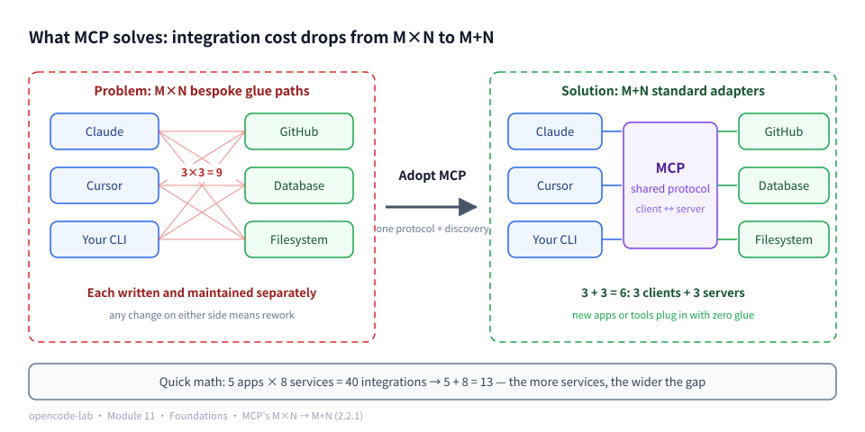
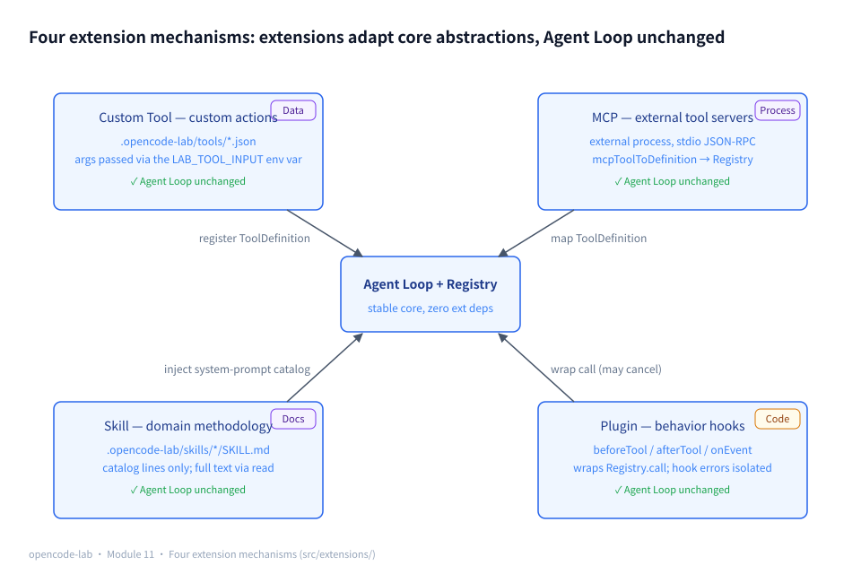
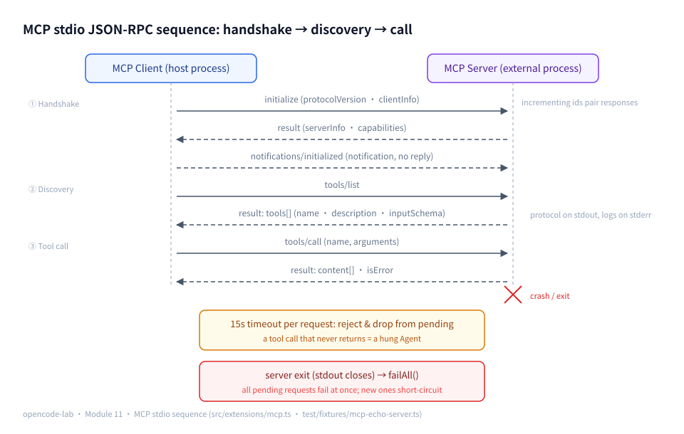
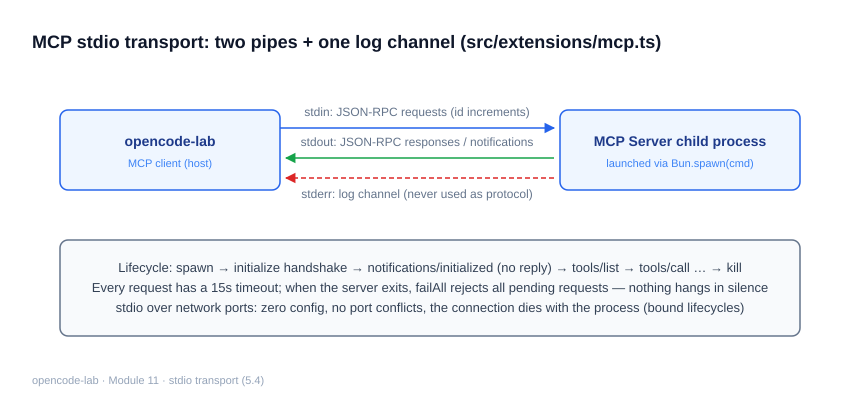
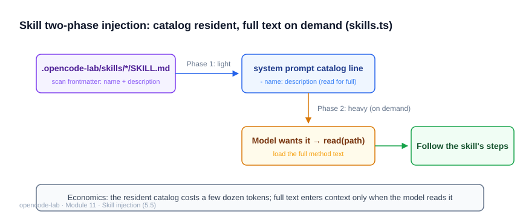
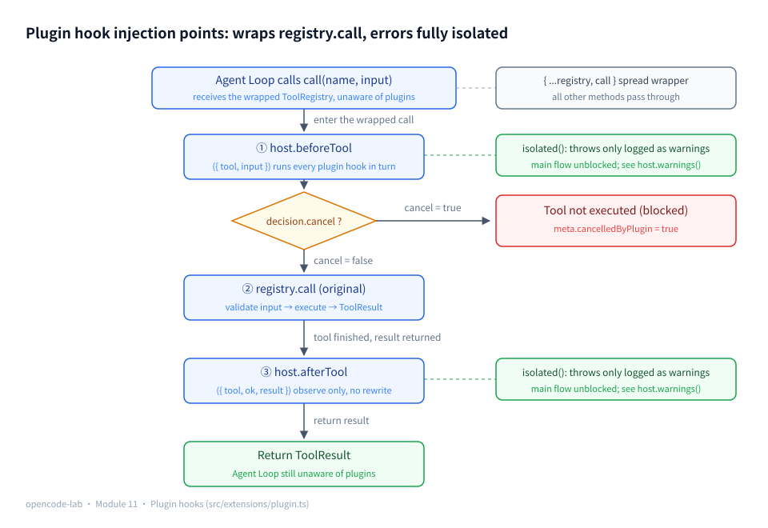

# Chapter 11: Custom Tool, MCP, Skill, and Plugin — the extensible Agent

## 1. Where this chapter fits

- Module: 11 — Extension system
- Study time: 8–9 hours (including Section 2's from-zero primer on protocols and plugins)
- Difficulty: medium-high — Section 2 builds up MCP background, RPC/JSON-RPC, stdio framing, frontmatter, hooks, and the decorator pattern from scratch
- Prerequisites: Chapter 2 (Registry), Chapter 4 (Loop events)
- Corresponding OpenCode commit: `70a24697ea0028e19f22712fd63059538cb4bee7`
- Corresponding stage in this project: `v0.13-extensions`

## 2. Prerequisites

> This is the first chapter that connects the Agent to "the world outside the process". Section 2.2 builds six foundations from scratch: what MCP is, why RPC and JSON-RPC look the way they do, how a stdio pipe carries messages, what frontmatter is, hooks and lifecycle, and the decorator pattern — the first four are the protocol foundations of MCP and Skill, the last two are the design foundations of Plugin.

### 2.1 Glossary for this chapter

| Term | One-line plain-language definition | Where it is used in this chapter |
|---|---|---|
| MCP (Model Context Protocol) | Open standard introduced by Anthropic in 2024: the uniform protocol between the Agent and external tool servers | 2.2.1 / 5.3—5.4 |
| RPC (remote procedure call) | Calling a function in another process by "sending messages" | 2.2.2 / 5.3 |
| JSON-RPC 2.0 | A standard family of RPC message formats written in JSON (request/response/notification) | 5.3 |
| Request id | A number for each request, echoed back verbatim by the response — the pairing token in an out-of-order world | 2.2.2 / 5.3 |
| pending table | The client's roster of "requests still awaiting a response" (indexed by id) | 5.3 / 5.7 |
| failAll | The function that fails every entry in the pending table at once when the server dies | 5.4 / 5.7 |
| Notification | A one-way message with no id that expects no response | 2.2.2 / 5.3 |
| Protocol error / business error | "The call never happened" (the error field) vs "the call happened but failed" (isError) | 5.3 |
| transport / transport layer | How messages actually get delivered: over a pipe or over the network | 5.4 |
| stdio transport | Treating the subprocess's stdin/stdout as a pair of two-way message pipes | 2.2.3 / 5.4 |
| Framing / frame | Cutting "one message" boundaries out of a continuous byte stream (this chapter: the newline) | 2.2.3 / 5.4 |
| Handshake | Both sides exchange versions and capabilities before doing business | 5.2 / 5.7 |
| Capability discovery | Discovering at runtime "which extensions exist and what each can do" | 2.2.1 / 5.2 |
| frontmatter | A metadata block at the top of a Markdown file wrapped in `---` | 2.2.4 / 5.5 |
| Hook | A plugin function the host calls at fixed moments | 2.2.5 / 5.6 |
| Lifecycle | The full span of a plugin from registration to unloading | 2.2.5 / 5.6 |
| Decorator pattern | Wrap the original object to add behavior without changing it | 2.2.6 / 5.6 |
| Shell injection | Untrusted data spliced into a command string and executed as shell syntax | 5.8 |
| fixture | A controlled environment prepared for tests (here: a real subprocess server) | 5.3 / 5.7 |

### 2.2 Foundations (six building blocks of the extension mechanism)

#### 2.2.1 MCP background: what problem does it solve

**MCP (Model Context Protocol)** is an open standard introduced by Anthropic in 2024, positioned as the uniform protocol between Agents and external tool servers. It solves a multiplication problem:

- Without MCP: M Agent applications need to talk to N tool services (databases, browsers, file management, ...), and every application × every service needs its own bespoke integration code — **M×N piles of glue**;
- With MCP: every application implements an "MCP client" once, every service implements an "MCP server" once, and both sides speak the same protocol — **M+N pieces**.

Plug in small numbers to feel the gap: 5 applications × 8 services means 40 integration codebases without MCP versus 5+8=13 with it — the more services, the wider the gap.

The difference from "just write an HTTP endpoint for each tool" comes down to two things: **a uniform protocol** (the formats of requests/responses/errors/capabilities are all standardized, so no service invents its own) and **capability discovery** (once connected you can ask "which tools do you have"; the tool list is reported by the server itself, so the client adopts new tools with zero changes). One-line memory hook: MCP is the USB port of the Agent world — the plug shape is standardized, and any device built to that shape works with any host. Sections 5.3—5.7 of this chapter implement only three of its methods (initialize / tools/list / tools/call), enough to close the loop of "connect, discover, call".



*Figure 11-P1: the multiplication problem MCP solves — left: with no protocol, every pairing of M applications and N tools needs bespoke integration code (3×3=9 glue paths, each written and maintained separately); right: once MCP is adopted, each application implements a client once and each tool implements a server once, converging to M+N=6 pieces, and new applications or tools plug in with zero glue.*

#### 2.2.2 RPC and JSON-RPC 2.0: calling a function in another process

**RPC (Remote Procedure Call)** answers one question: why does "calling a function in another process" need a message protocol? Because a function call requires caller and callee to live in the **same process** (sharing one call stack); the server is a different process with no shared stack, so "calling directly" simply does not exist. The only way is to **simulate the function call with messages**: send "please call method X with arguments Y", and the other side replies "the result is Z".

**JSON-RPC 2.0** standardizes these messages into a fixed format (written in JSON):

```json
{"jsonrpc":"2.0","id":1,"method":"tools/list","params":{}}      ← request: number 1, calls tools/list
{"jsonrpc":"2.0","id":1,"result":{"tools":[...]}}                ← response: the same id comes back
{"jsonrpc":"2.0","id":3,"error":{"code":-32601,"message":"..."}} ← the other shape of a response: an error (protocol errors in 5.3)
{"jsonrpc":"2.0","method":"notifications/initialized"}           ← notification: no id, no reply expected
```

The rules in three sentences: requests carry `id`/`method`/`params`; responses carry the same `id` with exactly one of `result` or `error`; anything without an `id` is a notification.

Before the implementation, consider one **problem** (it is the entire reason ids exist): client and server share one pair of pipes, so the client is free to fire off several requests and wait for the responses together; the server handles them at different speeds, and **responses can come back out of order** —

```text
Client sends: id=1 (tools/list) → id=2 (tools/call)
Server replies: id=2's response arrives first, id=1's later — whoever finishes first replies first
```

When a response arrives, how do you know which request it belongs to? The answer: **every request carries an auto-incrementing id and the response echoes it back verbatim** — the id is the pairing token in an out-of-order world. The pending table in 5.3 stores the "waiting for a reply" roster by id; note the cause here and match it up when you read the implementation.

#### 2.2.3 stdio transport and framing: treating the subprocess as a two-way pipe

For messages to actually be delivered, you must pick a **transport**. The stdio transport works like this: the host spawns the server subprocess, uses **its stdin as the drop-off slot** (whatever the host writes is its input) and **its stdout as the reply slot** — a pair of two-way message pipes, no network needed. Division of roles: the host is the client (sends requests, receives responses) and the server is the server side; stderr is a third, independent pipe which by convention carries logs and never mixes into the protocol (5.4).

Key insight (made in Chapter 1, 2.2.4 about network byte boundaries; the same logic applies to pipes): **one `read()` returns "a chunk of bytes", and the chunk size has nothing to do with message boundaries** — half a message, exactly one, or several messages may arrive squeezed into a single chunk:

```text
Three byte chunks arriving in turn on the subprocess's stdout (unrelated to message boundaries):
chunk 1: {"jsonrpc":"2.0","id":1,"re          ← half a message
chunk 2: sult":{"tools":[...]}}\n{"json       ← chunk 1's tail completes one full message + a new half
chunk 3: rpc":"2.0","id":2,...}\n             ← joins chunk 2's half, another full message
```

So the protocol must agree on **framing** rules — cutting "one message" boundaries out of the byte stream. This chapter frames by line: a line ending in `\n` = one message; the client must keep its own buffer to accumulate half-lines and parse once a full line has arrived (the double while loop of readLoop in 5.4 does exactly this).

#### 2.2.4 frontmatter: the metadata block at the top of a Markdown file

**frontmatter** is a Markdown convention (blog posts and static site generators like Jekyll/Hugo all use it): at the very top of the file, two `---` lines wrap a small **metadata** block ("key: value", one per line); the body starts after the second `---`:

```markdown
---
name: release
description: Release process guide
---
# Release process
1. Run tests …
```

It lets "the human-readable body" and "the machine-readable metadata" coexist in one file — this chapter's Skill uses exactly it to declare name and description (the parser is in 5.5, deliberately regex-only with no YAML library). Why not register the metadata in a config file? Because methodology documents must be hand-written, version-controlled, and travel with the project anyway — a Markdown file natively covers all three; config registration would add one more checklist item that "must be kept in sync with the document".

#### 2.2.5 Hooks and lifecycle: the host calls you at fixed moments

**Hook**: the host program calls a function you registered at **fixed moments**. The mental model in one line — **a VS Code extension**: VS Code does not modify the editor's source for your extension; it calls your registered callbacks at fixed moments such as "file opened" or "save". You cannot create new moments, only subscribe to existing ones. Host and plugin are therefore not equals: the host defines the moments and data formats, and plugins can only plug their implementations into these "sockets". This chapter's host has three moments: before a tool executes (beforeTool), after it executes (afterTool), and when any run event fires (onEvent).

**Lifecycle**: the full span of a plugin from registration to unloading. The teaching build has a single beat — `register` at runtime; the production build adds discovery, installation, loading user JS modules, and unloading (compared in 5.6). The teaching build's whole span in one line:

```text
register → while running, the host repeatedly calls hooks: beforeTool → tool executes → afterTool; an event fires → onEvent → (no unload beat in the teaching build: not wrapping = unloaded)
```

(The production build's full lifecycle — discovery, installation, loading, unloading — has its counterpart in `plugin/loader.ts`, covered in the Section 6 source reading.)

#### 2.2.6 Decorator pattern: wrap the original instead of modifying it

**Decorator pattern**: leave the original object untouched; make a "new object that wraps it" and add behavior around the outside — the original functionality still works, with extra things done before and after. Contrast with Chapter 0's adapter to remember the difference: an **adapter translates formats** (converting A's output into a shape B can read), a **decorator stacks behavior** (same shape, more functionality). Six lines to see it:

```ts
function withLog(fetchFn) {
  return (url) => {                                  // returns a "wrapped" new function, same shape
    console.log("fetch", url)                        // added behavior: before
    return fetchFn(url).then((r) => (console.log("done"), r))  // original behavior + added behavior: after
  }
}
```

Usage is unchanged (still the `fn(url)` shape) while capability grows (logging added) — "shape unchanged" is the decorator's signature; to judge whether a wrapper is a decorator, check two things: the original object was not modified, and the interface shape did not change. This chapter's `withPluginHooks(registry, host)`, which copies the Registry with the spread operator and overrides only `call`, is exactly this pattern.

### 2.3 Recap of the previous module

- Chapter 10's **task delegation**: the main Agent hands investigation work to a read-only subagent with a self-contained prompt, and only the `finalText` conclusion comes back;
- **Three lines of defense**: allowedTools (the model cannot see write tools) → readOnlyAgents (runtime permission denial) → the recursion ban (the subagent has no task); if any layer is bypassed, the rest still hold;
- **Child sessions**: each delegation creates an independent session whose `parentSessionId` points back to the parent, keeping responsibility traceable.

---

## 3. Learning objectives

- Understand: what each of the four extension mechanisms solves (custom actions / external services / domain methodology / behavior hooks), and why "extend without touching the Agent Loop" is an architectural acceptance criterion.
- Be able to implement: JSON-declarative Custom Tools, Markdown Skill discovery, a minimal stdio MCP client (JSON-RPC), and an error-isolated Plugin host.
- Be able to test: MCP end-to-end with a real subprocess fixture server; a plugin crash must not affect the core flow.
- Be able to explain: why timeouts, permissions, and error isolation for external extensions are necessities, not optimizations.

## 4. Problem statement

Once the core Agent is stable, capability growth must come from outside: a user wants to add a "query the database" tool, hook up an external MCP service, teach the Agent a release process, or audit around tool execution. The OpenCode counterparts are `packages/opencode/src/mcp/` + `skill/` + `plugin/`. The teaching build's division of labor across the four mechanisms:

| Mechanism | Problem it solves | Teaching-build implementation | Extension form |
|---|---|---|---|
| Custom Tool | The user defines a custom action | `.opencode-lab/tools/*.json` declaration + shell execution | Data |
| MCP | Connect to external tool servers | A minimal stdio JSON-RPC client | Process |
| Skill | Inject a domain working method | `.opencode-lab/skills/*/SKILL.md` discovery | Docs |
| Plugin | Intercept/observe behavior | beforeTool/afterTool/onEvent hooks | Code |

Security design runs through all four: Custom Tool arguments travel in an environment variable (`LAB_TOOL_INPUT`) to eliminate shell injection; MCP has a per-request timeout and fails all pending requests the moment the server crashes; Plugin hooks are all isolated in try/catch — **no error from an external extension may hang or crash the core Session** (verbatim acceptance criterion). All four defenses are rooted in the Section 2 foundations: processes crash and pipes have boundaries (2.2.3), so MCP needs timeouts and framing; hooks run inside the host process (2.2.5), so they must be isolated; argument content is untrusted, so there is injection defense (5.8).

## 5. Core concepts

The mapping between this chapter's concepts and the source and test files (paths relative to `opencode-lab/`):

| Concept | Source files | Test files |
|---|---|---|
| Conceptual distinction of the four extension mechanisms | the four files in `src/extensions/` | `test/extensions/extensions.test.ts` |
| Open protocols and capability discovery | `src/extensions/custom-tools.ts`, `src/extensions/skills.ts`, `src/extensions/mcp.ts` | `test/extensions/extensions.test.ts` |
| JSON-RPC, request IDs, errors, and transport | `src/extensions/mcp.ts`, `test/fixtures/mcp-echo-server.ts` | `test/extensions/extensions.test.ts` |
| External process startup, stdio, and network connections | `src/extensions/mcp.ts`, `src/tools/shell.ts` | `test/extensions/extensions.test.ts` |
| Skill metadata, scoping, and instruction injection | `src/extensions/skills.ts` | `test/extensions/extensions.test.ts` |
| Plugin lifecycle, hooks, and error isolation | `src/extensions/plugin.ts` | `test/extensions/extensions.test.ts` |
| Timeouts, crashes, and unloading | `src/extensions/mcp.ts`, `src/extensions/plugin.ts` | `test/extensions/extensions.test.ts` |
| Permissions and the trust model for external extensions | `src/extensions/custom-tools.ts`, `src/extensions/mcp.ts` | `test/extensions/extensions.test.ts` |

One dependable directional fact: `src/extensions/` depends only inward on the existing `ToolDefinition` (Chapter 2), `runShellCommand` (Chapter 3), and `RunEvent` (Chapter 4), and the core modules have zero dependencies on extensions — this is "extend without touching the Agent Loop" made visible in the code structure. All tests live in `test/extensions/extensions.test.ts` (16 cases), and the 5 MCP cases run end-to-end through a real subprocess via `test/fixtures/mcp-echo-server.ts`.

### 5.1 Conceptual distinction between the four extension mechanisms

**Concept**

| Mechanism | Problem it solves | Teaching-build implementation | Extension form |
|---|---|---|---|
| Custom Tool | The user defines a callable action | `.opencode-lab/tools/*.json` declaration + shell execution | Data |
| MCP | Connect to external tool servers over a protocol | A minimal stdio JSON-RPC client | Process |
| Skill | Inject a domain working method or instructions | `.opencode-lab/skills/*/SKILL.md` discovery | Docs |
| Plugin | Extend runtime, events, and tool behavior | beforeTool/afterTool/onEvent hooks | Code |

The criterion for telling the four apart is one sentence: **what form does the extension take**. "Data" means adding capability requires no code — one JSON declaration suffices. "Process" means the extension has an independent lifecycle; it can crash and be upgraded independently. "Docs" means it only enters the context, never the execution path — it is never executed. "Code" means it runs inside the host process: maximum capability, highest trust requirement. The form determines every engineering decision that follows — failure modes (processes crash, code throws, docs merely occupy context), testing approaches (real subprocess / unit tests), and defenses (timeouts / isolation / budgets).



*Figure 11-1: panorama of the four extension mechanisms — all four forms, Data (Custom Tool), Process (MCP), Docs (Skill), and Code (Plugin), converge on existing abstractions: tool-like extensions produce a ToolDefinition registered into the Registry, Skill injects the system-prompt catalog, and Plugin wraps Registry.call; the Agent Loop stays unchanged*

**How this project implements it**

The four mechanisms each occupy one file: `src/extensions/custom-tools.ts`, `src/extensions/mcp.ts`, `src/extensions/skills.ts`, and `src/extensions/plugin.ts`. Their interfaces with the core all converge on three existing abstractions: tool-like extensions (Custom Tool, MCP) produce a `ToolDefinition` registered into the Registry; Skill produces a system-prompt text section; Plugin produces hooks hung around Registry.call. The core abstractions change shape for no extension — that is the architectural meaning of "don't touch the main loop": **extensions adapt to the core abstractions, not the other way around**.

**Common pitfalls**

- Symptom: "teach the Agent the release process" is implemented as a Custom Tool so the Agent calls "look up how to do it". Cause: confusing an action with methodology. Fix: methodology is a Skill (enters the context); an action is a Tool (enters the execution path).
- Symptom: an external service is forced into a one-line curl inside a Custom Tool. Cause: missing that this forfeits structured parameter validation, timeouts, and an error protocol. Fix: cross-process services go through MCP and get protocol-level error layering.
- Symptom: the four mechanism types are piled up together and there is no idea where new capability belongs. Fix: first locate the form with the four-way question "data/process/docs/code", then pick the mechanism.

**Self-check questions**

- Which mechanism should "query outdated dependencies" use? Reference: Custom Tool — one shell command (e.g. `pnpm outdated`) declared in JSON.
- Skill and the Chapter 5 Rules are both Markdown — what is the difference? Reference: rules are project constraints injected in full; Skills are optional methodology where only the name and description are injected and the Agent reads the full text on demand.
- Why is Plugin the most dangerous kind of extension? Reference: it runs arbitrary code as the host process, can touch all in-memory state, and demands the highest trust.
- Which form does "hooking up the company's internal Jira query service" belong to? Reference: process — an external service, deployed and upgraded independently, via MCP.

### 5.2 Open protocols and capability discovery

> 📊 Figure: for the protocol sequence of capability discovery (the initialize handshake and tools/list), see Figure 11-2 in Section 5.3.

**Concept**

Capability discovery (2.2.1's "connect and ask what you have") is the extension system's first step: the host finds out at runtime "which extensions exist and what each can do" instead of hard-coding it at compile time. The teaching build has two discovery paths — compare them first, then expand:

| Discovery path | Used by | How to declare "I exist" | How to learn "what I can do" |
|---|---|---|---|
| Directory convention | Custom Tool, Skill | Put files in the right place (`.opencode-lab/tools/*.json`, `.opencode-lab/skills/*/SKILL.md`) | Read the file contents (JSON fields / frontmatter) |
| Protocol handshake | MCP | Start the server process and `initialize` | Ask the server with `tools/list` |

Both paths share one engineering principle: **discovery failure degrades instead of crashing**. A missing directory is the normal state of "no extensions"; a single bad file affects only itself and must not drag down the whole discovery process.

**How this project implements it**

The discovery loop in `src/extensions/custom-tools.ts` demonstrates two patterns, degradation and error accumulation:

```ts
export type DiscoveryResult = { tools: ToolDefinition[]; errors: string[] }

export async function discoverCustomTools(workspace: string): Promise<DiscoveryResult> {
  const errors: string[] = []
  const tools: ToolDefinition[] = []
  const dir = `${workspace}/${CUSTOM_TOOLS_DIR}`
  let files: string[] = []
  try {
    files = [...new Bun.Glob("*.json").scanSync({ cwd: dir })]
  } catch {
    return { tools, errors } // missing directory = no custom tools, which is normal
  }
```

Bad files go into `errors` instead of aborting — every validation failure in the loop body does `errors.push(...)` + `continue`: non-JSON, a name not matching `[a-z0-9_]`, a missing command; every error message carries the file name, and the caller gets `{ tools, errors }` and decides how to present them. On the MCP side, capability discovery is a protocol method:

```ts
    async listTools() {
      const result = await request<{ tools?: McpTool[] }>("tools/list", {})
      return result.tools ?? []
    },
```

`listTools` is a thin typed wrapper over `request("tools/list")` — it makes no capability judgments of its own: **whatever the server reports, the client has**. A missing field falls back to an empty array instead of throwing, so new tools come online with zero client changes. This shares a design principle with the Custom Tool's "read the directory" discovery: discovery logic only collects faithfully and never decides on behalf of the server/directory.

Skill discovery (`src/extensions/skills.ts`) uses the Glob pattern `*/SKILL.md`: the directory name doubles as the skill's default name and the file location is the scope declaration — less sync burden than registering extensions in a config file.

A real end-to-end walkthrough of the Custom Tool "discover → register → execute" chain (run from the `opencode-lab/` directory): a temp workspace declares a `demo_echo` tool whose command template references `$LAB_TOOL_INPUT`:

```bash
bun -e '
import { mkdtemp, mkdir, writeFile, rm } from "node:fs/promises"
import { tmpdir } from "node:os"
import { join } from "node:path"
import { discoverCustomTools } from "./src/extensions/custom-tools"
import { createToolRegistry } from "./src/tools/registry"

const dir = await mkdtemp(join(tmpdir(), "lab-ws-"))
await mkdir(join(dir, ".opencode-lab/tools"), { recursive: true })
await writeFile(
  join(dir, ".opencode-lab/tools/demo.json"),
  JSON.stringify({
    name: "demo_echo",
    description: "回声演示：把参数原样输出",
    parameters: { type: "object", properties: { message: { type: "string" } }, required: ["message"] },
    command: "echo \"demo 收到: $LAB_TOOL_INPUT\"",
  }),
)
const { tools, errors } = await discoverCustomTools(dir)
console.log("发现的工具:", tools.map((t) => t.name).join(", "), "| errors:", errors.length)
const registry = createToolRegistry()
registry.registerAll(tools)
const result = await registry.call("demo_echo", { message: "你好" }, { workspace: dir })
console.log("registry.call:", result.ok, "| text:", result.content.kind === "text" ? result.content.text : "")
await rm(dir, { recursive: true, force: true })
'
```

Output (excerpt):

```text
发现的工具: demo_echo | errors: 0
registry.call: true | text: demo 收到: {"message":"你好"}
```

From one JSON declaration to a callable tool, no code is written and nothing restarts in between — the `LAB_TOOL_INPUT` environment variable in `execute` receives the whole input JSON (5.8 dissects why this prevents injection); capability is added as "data placed in the right location".

**Common pitfalls**

- Symptom: startup errors when the extension directory is missing. Cause: treating "absent" as exceptional. Fix: return an empty list — this is the normal branch.
- Symptom: one bad JSON makes all custom tools disappear. Cause: the discovery loop returns or throws on the first error. Fix: accumulate errors into errors and keep processing the remaining files.
- Symptom: a tool with a bad name only explodes at `registry.register`, with no file name in the stack. Cause: validation happens too late. Fix: move the name regex check up to discovery time and include the file name in errors (the source does exactly this).

**Self-check questions**

- What does `discoverCustomTools` return when `.opencode-lab/tools` is missing? Reference: `{ tools: [], errors: [] }` (the "returns empty with no errors when the directory is absent" test).
- Which specs does discovery reject? Reference: non-JSON, a name not matching `[a-z0-9_]`, and a missing or blank command — all go into errors with the file name.
- Which JSON-RPC method implements MCP capability discovery? Reference: `tools/list`, called after the `initialize` handshake.
- Which scenarios suit directory discovery vs a protocol handshake? Reference: local file-based extensions use directories (static content, travels with the repo, no process needed); cross-process services use the handshake (capabilities are reported by the running server itself).

### 5.3 JSON-RPC, request IDs, errors, and transport

**Concept**

JSON-RPC 2.0 is MCP's message layer (the format of the message trio — request/response/notification — and the root cause of "why ids exist" were built up from zero in 2.2.2). Only two detailed rules are added here, problem first and solution second:

**Problem: concurrency and reordering on a shared pipe.** It is perfectly legal for the client to fire two requests (id=1, id=2) down the same pair of pipes; the server may finish 2 before 1, and response arrival order is decoupled from send order. Without ids, receiving `{"result":...}` tells you nothing about whose answer it is — so the spec requires each request to carry an auto-incrementing id that the response echoes back, and the client pairs them by looking the id up in a table (the pending table below).

**Notifications: messages without an id.** A message without an id is a **notification**, which expects no response. Why have such a thing? Because some messages are just **one-way event pushes** — "initialization done", "config changed" — where the receiver only needs to know and no receipt is required; a notification saves an empty "got it" response round trip. MCP's `notifications/initialized` is the example.

The transport only requires that messages have boundaries — over stdio, frame by line (`\n`), one line per message (2.2.3). Errors must be split into two layers: **protocol errors** (method not found, invalid arguments, carried in the `error` field, e.g. `-32601` Method not found) versus **business errors** (the tool executed but reports failure, `result.isError: true`). Compare them with real examples from the fixture:

| | Protocol error | Business error |
|---|---|---|
| Trigger example (fixture) | Request a method that does not exist | The weather tool queried for "火星" (Mars), a city with no data |
| Message shape | `error: { code: -32601, message: ... }` | A normal response, but `result.isError: true` |
| Client-side result | Promise reject (throws) | `McpCallResult.ok: false` (returns normally) |
| What it means upstream | **The call never happened** | **The call happened, but the tool reports failure** |

Conflate the two layers and upstream cannot distinguish "never called" from "called but the result failed" — the handling strategies are completely different (for the former, check the connection and method name; for the latter, the failure text can be handed to the model for a retry).



*Figure 11-2: the MCP stdio JSON-RPC sequence — after the initialize handshake, notifications/initialized is sent (a notification, no response), tools/list discovers capabilities, and tools/call invokes a tool (the response carries content/isError); every request has a 15s timeout, and when the server exits failAll fails all pending requests immediately*

**How this project implements it**

`request` in `src/extensions/mcp.ts` is the standard "id correlation + pending table" pattern. First, the complete life of one entry in the pending table:

| Moment | pending table state | What happened |
|---|---|---|
| Request sent | `{1: {resolve, reject, timer}}` | id=1 is written to stdin and the timeout timer starts |
| Response arrives first | empty | handleMessage finds the entry by id → settles (resolve or reject) → deletes it + clears the timer |
| Timeout fires first | empty | The timer fires → rejects with a timeout error → deletes the entry (a late response finds no entry and is ignored) |
| Server crashes | empty | failAll rejects every entry one by one and clears the table (5.7) |

Then the code:

```ts
  function request<T>(method: string, params: unknown): Promise<T> {
    if (serverDied) return Promise.reject(new Error("MCP server 已退出"))
    const id = nextId++
    const written = proc.stdin.write(JSON.stringify({ jsonrpc: "2.0", id, method, params }) + "\n")
    if (!written) return Promise.reject(new Error("无法写入 MCP server stdin"))
    return new Promise<T>((resolve, reject) => {
      const timer = setTimeout(() => {
        pending.delete(id)
        reject(new Error(`MCP 请求 ${method} 超时（>${requestTimeoutMs}ms）`))
      }, requestTimeoutMs)
      pending.set(id, { resolve: resolve as (value: unknown) => void, reject, timer })
    })
  }
```

Response dispatch lives in `handleMessage`: look up by id, and remove immediately after settling:

```ts
    if (typeof message.id !== "number") return // notifications / requests (server->client) are ignored by the teaching build
    const entry = pending.get(message.id)
    if (!entry) return
    pending.delete(message.id)
    clearTimeout(entry.timer)
    if (message.error) entry.reject(new Error(`MCP 错误: ${message.error.message}`))
    else entry.resolve(message.result)
```

The fixture server (`test/fixtures/mcp-echo-server.ts`) demonstrates the division of labor between the two error layers: an unknown method gets `error: { code: -32601, message: ... }` (protocol error); when the weather tool cannot find a city it returns a normal response with `isError: true` (business error). The client turns the former into a Promise reject and maps the latter to `McpCallResult.ok: false` — the "isError results map to ok:false" test locks in this boundary.

A real walkthrough of the business-error edge (from the `opencode-lab/` directory) — query a city the fixture has no data for:

```bash
bun -e '
import { createMcpClient } from "./src/extensions/mcp"
const client = createMcpClient({ command: "bun", args: ["test/fixtures/mcp-echo-server.ts"] })
await client.connect()
// business error: no data for the city → the server responds normally but isError: true
const mars = await client.callTool("weather", { city: "火星" })
console.log("callTool(火星):", JSON.stringify(mars))
await client.close()
'
```

Output (excerpt):

```text
callTool(火星): {"ok":false,"text":"未知城市: 火星","isError":true}
```

It is `ok: false` and carries the server's failure text, yet the call **did not throw** — at the JSON-RPC layer this is a successful response (it has an id and a result); the failure is flagged at the business layer by `isError`. Upstream can therefore safely hand `text` to the model for a retry instead of reconnecting to the server.

A note on `handleMessage`'s first line: it returns immediately when `typeof message.id !== "number"` — this filters out not only notifications but also requests the server sends in the client's direction (MCP allows a server to ask the client to do things, such as sampling). The teaching build's fixture server never sends such messages, so ignoring them is the safe minimal implementation.

**Common pitfalls**

- Symptom: after the handshake the server rejects subsequent requests. Cause: the spec requires sending the `notifications/initialized` notification after the initialize response, and the client skipped it. Fix: follow the source's three-step `connect()`.
- Symptom: every response field is undefined. Cause: parsing an `error` response as `result`. Fix: check `message.error` before reading result.
- Symptom: "unknown city" is treated as a protocol failure and the client reconnects. Cause: the two error layers are conflated. Fix: protocol errors reject (the call never happened); isError is `ok: false` (the call happened but failed) — the handling strategies are completely different.

**Self-check questions**

- Why does each request get its own incrementing id instead of sharing one? Reference: multiple requests can be in flight on a shared pipe and responses can return out of order, so correlation is only possible by id (the derivation is in this section's Concept; 2.2.2 has the illustration).
- How does client handling differ between notifications and requests? Reference: notifications have no id, never enter the pending table, and expect no response (e.g. `notifications/initialized`).
- Which error layer is "unknown city" in the fixture? Reference: business error — `isError: true`, which the client maps to `ok: false` instead of rejecting.

### 5.4 External process startup, stdio, and network connections

**Concept**

What the stdio transport means (2.2.3): treat the subprocess's stdin/stdout as a pair of two-way message pipes — the host writes requests into the server's stdin and the server writes responses to stdout. It is MCP's most common transport; in plain words: **no ports to open, no authentication to configure**. A network transport must answer questions like "who may connect to this port, and do they need a token"; stdio reduces security to a much simpler question — **can you start this process**: anyone who can start the subprocess could already run that program directly and see everything it sees, so stacking network authentication on top is unnecessary. For local tool services the trust model naturally lands on "the right to start the process".

Compared with network transports (HTTP+SSE, WebSocket — the production direction), stdio has two unique facts. First, **the server's lifecycle is held by the host**: a process exit shows up immediately as the stdout stream closing, so the host senses a crash at once. Second, **pipes are streaming**: one `read()` may return half a line, one line, or several; line boundaries have nothing to do with chunk boundaries (2.2.3), so you must buffer and split lines yourself. The two transports side by side:

| | stdio (this chapter) | Network (HTTP+SSE / WebSocket) |
|---|---|---|
| Deployment | Local subprocess started by the host | Separate service, ports must be opened |
| Authentication | None — whoever can start the process can talk | Token / certificates required |
| Crash detection | stdout closes, immediate | Heartbeats or timeouts, lagging |
| Suited for | Local tools (database CLIs, file services) | Remote / shared multi-tenant services |

**How this project implements it**

The read loop in `src/extensions/mcp.ts` is this concept's core code:

```ts
  async function readLoop() {
    if (readerStarted) return
    readerStarted = true
    const decoder = new TextDecoder()
    const reader = proc.stdout.getReader()
    let buffer = ""
    while (true) {
      const { done, value } = await reader.read()
      if (done) break
      buffer += decoder.decode(value, { stream: true })
      let newline = buffer.indexOf("\n")
      while (newline !== -1) {
        const line = buffer.slice(0, newline).trim()
        buffer = buffer.slice(newline + 1)
        if (line !== "") handleMessage(line)
        newline = buffer.indexOf("\n")
      }
    }
    failAll(new Error("MCP server 已退出"))
  }
```

The outer while consumes byte chunks, the inner while consumes complete lines from the buffer, and `buffer` holds a half-line until the next chunk — the universal skeleton of every line-protocol client. When the loop ends naturally it calls `failAll`: stdout closed = server exited, and pending requests fail immediately (details in 5.7). The process is started by `Bun.spawn` (`stdin/stdout/stderr: "pipe"`, with the `env: shellEnv()` allowlist from `src/tools/shell.ts`). The peer fixture server consumes stdin via `node:readline`'s `line` event — proof that the protocol peer needs no special library. stderr is an independent pipe: the fixture writes unparseable lines to stderr (`process.stderr.write(...)`) and never pollutes the JSON channel — that is the stdio service convention of "logs on stderr, protocol on stdout".



*Figure 11-4: the stdio transport — after the host spawns the subprocess, stdin carries JSON-RPC requests and stdout carries responses and notifications, while stderr is a log channel never reused for the protocol; the lifecycle spawn → initialize → tools/list → tools/call → kill lives and dies with the process, with a 15s timeout per request and failAll on exit.*

**Common pitfalls**

- Symptom: the client never receives a response. Cause: collecting with `new Response(proc.stdout).text()` — it only returns once the stream closes, so incremental messages are lost. Fix: read chunk by chunk with a reader and split lines manually.
- Symptom: sporadic JSON parse failures. Cause: assuming one `read()` is exactly one line; when a chunk straddles a boundary, a half-line gets parsed as a whole. Fix: buffer + the `indexOf("\n")` loop.
- Symptom: the server's console.log breaks the protocol. Cause: logs written into stdout. Fix: the protocol channel only carries JSON-RPC frames; all logs go to stderr.

**Self-check questions**

- What does the stream option in `decoder.decode(value, { stream: true })` do? Reference: a multi-byte UTF-8 character split across chunks is not mangled into broken characters.
- Which path does the read loop take when the server crashes? Reference: `read()` returns `done: true` → break → `failAll(new Error("MCP server 已退出"))`.
- Which transports does the teaching build support? Reference: stdio only; network transports (SSE/WebSocket) are the production direction.
- Why must stderr be a separate pipe? Reference: if logs mixed into stdout they would corrupt the JSON-RPC framing — the client would try to parse log lines as messages.

### 5.5 Skill metadata, scoping, and instruction injection

**Concept**

A Skill is "documentation as extension": a Markdown file with frontmatter (what frontmatter is: see 2.2.4) declares one domain working method. Three elements: metadata — the name/description in the frontmatter, used for catalog display; scope — it applies to whichever project directory it is placed in (`.opencode-lab/skills/<name>/SKILL.md`); injection strategy — how it enters the model's context.

The injection strategy is the most critical design decision, and the Chapter 5 budget numbers make it obvious (the rules injection budget is 6000 characters, and context is a resource shared by every mechanism):

```text
Full-text injection: 20 skills × 3000 characters of body each ≈ 60000 characters — 10× the 6000 budget, blowing it before any work starts
Catalog injection: 20 catalog lines × ~60 characters each ≈ 1200 characters (capped by maxSkills = 20)
```

Full-text injection is the simplest but does not scale — the skill count multiplies the context cost directly; injecting only the catalog (name + description + how to fetch) compresses each skill's cost from "the whole body" to "one line", and with the `maxSkills = 20` cap the total cost is pinned at a constant level, with the full text fetched by the Agent via the read tool when needed. The complete panorama inside the system prompt:

```text
System prompt = the role definition's systemPrompt (Chapter 10)
              + project rules (Chapter 5: full-text injection, 6000-character budget)
              + skill catalog (this chapter: one line per skill, capped by maxSkills = 20)
```

This contrasts deliberately with Chapter 5's "rules injected in full": rules are constraints that must be obeyed (short, mandatory, full text); a Skill is optional methodology (long, on demand, lazily loaded).

**How this project implements it**

The frontmatter parser in `src/extensions/skills.ts` is kept deliberately tiny and exported for testability:

```ts
export function splitFrontmatter(content: string): { frontmatter: Record<string, unknown>; body: string } {
  if (!content.startsWith("---\n")) return { frontmatter: {}, body: content }
  const end = content.indexOf("\n---\n", 4)
  if (end === -1) return { frontmatter: {}, body: content }
  const block = content.slice(4, end)
  const body = content.slice(end + 5)
  const frontmatter: Record<string, unknown> = {}
  for (const line of block.split("\n")) {
    const match = line.match(/^([a-zA-Z_]+):\s*(.*)$/)
    if (match) frontmatter[match[1]] = match[2].trim()
  }
  return { frontmatter, body }
}
```

Two fallbacks: no frontmatter, or a truncated one with an opening but no closing marker — both return empty metadata plus the original text without throwing; when name is missing the directory name is the fallback (`entry.split("/")[0]`), and when name exists but is not a string it is recorded in errors and the fallback applies. The injection function outputs only the catalog:

```ts
// system prompt injection: names and descriptions only (context-budget friendly)
export function skillsToSystemSection(skills: Skill[], maxSkills = 20): string {
  if (skills.length === 0) return ""
  const lines = skills.slice(0, maxSkills).map((s) => `- ${s.name}${s.description === "" ? "" : `：${s.description}`}（用 read 查看 ${s.path} 获取完整方法）`)
  return [`# 可用技能（Skills）`, "以下领域工作方法可以按需取用：", ...lines].join("\n")
}
```

A real walkthrough of discovery and injection (from the `opencode-lab/` directory): a temp workspace holds a `release` skill with frontmatter, and the injected section is printed verbatim:

```bash
bun -e '
import { mkdtemp, mkdir, writeFile, rm } from "node:fs/promises"
import { tmpdir } from "node:os"
import { join } from "node:path"
import { discoverSkills, skillsToSystemSection } from "./src/extensions/skills"

const dir = await mkdtemp(join(tmpdir(), "lab-ws-"))
await mkdir(join(dir, ".opencode-lab/skills/release"), { recursive: true })
await writeFile(
  join(dir, ".opencode-lab/skills/release/SKILL.md"),
  "---\nname: release\ndescription: 发布流程指南\n---\n# 发布\n1. 跑测试\n2. 打 tag",
)
const { skills, errors } = await discoverSkills(dir)
console.log("errors:", JSON.stringify(errors))
console.log(skillsToSystemSection(skills))
await rm(dir, { recursive: true, force: true })
'
```

Output (excerpt):

```text
errors: []
# 可用技能（Skills）
以下领域工作方法可以按需取用：
- release：发布流程指南（用 read 查看 .opencode-lab/skills/release/SKILL.md 获取完整方法）
```

The injected section is 4 lines (a heading + a lead-in sentence + one line per skill); not a single character of the SKILL.md body ("# 发布\n1. 跑测试\n2. 打 tag") enters — the `read` path in the trailing parentheses is the lazy-loading entrance: the Agent reads the full text itself when needed.

`maxSkills = 20` is the second budget gate. The "injected section contains only names and descriptions" test uses a long body repeated 100 times and asserts `expect(section).not.toContain("很长的正文")` — the lazy-loading strategy is behavior locked down by a test, not a verbal promise.



*Figure 11-5: Skill two-phase injection — phase one scans each SKILL.md's frontmatter and puts only the "name + description" catalog line into the system prompt (a few dozen tokens resident); phase two has the model decide when to read the full method text and follow its steps — the catalog stays resident, the full text is fetched on demand.*

**Common pitfalls**

- Symptom: context quality visibly degrades after installing a few Skills. Cause: full-text injection — before doing any work the Agent has "read" a pile of methodology it never uses. Fix: inject only names and descriptions; read the full text on demand.
- Symptom: a truncated frontmatter crashes the discovery process. Cause: the parser throws on "no closing marker". Fix: fall back to empty metadata + the original text (the "splitFrontmatter boundaries" test covers this).
- Symptom: a YAML dependency is added just to parse frontmatter. Cause: over-engineering. Fix: the teaching build's key-value regex is enough (name/description are simple scalars); one less dependency is one less attack surface.

**Self-check questions**

- Can the instructions body be found in the injected section? Reference: no — only name, description, and the read hint; the body enters the context only when the Agent calls the read tool.
- What is a skill without a name called? Reference: the directory name (test: `.opencode-lab/skills/debug/SKILL.md` has no name → the name is "debug").
- What happens if name in the frontmatter is not a string? Reference: it is recorded in errors ("name 不合法" — invalid name) with the directory name as fallback, and the skill remains usable.
- Per this chapter's arithmetic, how much budget do 20 skills cost under full-text vs catalog injection? Reference: full text ≈ 60000 characters (10× the 6000 budget); catalog ≈ 1200 characters, capped by maxSkills = 20.

### 5.6 Plugin lifecycle, hooks, and error isolation

**Concept**

Plugins inject code into the runtime; their capability and risk are the highest of the four extension types. The host-plugin interface is a set of hooks (background in 2.2.5): `beforeTool` is called before a tool executes and may return `{ cancel: true, reason }` to block execution — the extension point for security plugins and audit policies; `afterTool` runs afterward, for auditing and statistics; `onEvent` subscribes to all run events, for observability. In lifecycle terms the teaching build has only the single "register at runtime" beat; the production build (OpenCode's `plugin/loader.ts`) adds discovery, installation, loading user JS modules, and unloading. **Error isolation is the plugin system's first principle**: plugin code is untrusted — even code the user wrote themselves, whose third-party dependencies can equally throw — and no hook error may affect the core execution path.

**How this project implements it**

The isolator in `src/extensions/plugin.ts` wraps every hook call in try/catch and degrades errors into warnings:

```ts
  function isolated<T>(plugin: Plugin, hook: keyof PluginHooks, fn: () => T): T | undefined {
    try {
      return fn()
    } catch (err) {
      const message = `插件 ${plugin.name} 的 ${hook} 钩子抛错（已隔离）: ${err instanceof Error ? err.message : String(err)}`
      warnings.push(message)
      return undefined
    }
  }
```

The isolation semantics are "**a throw = the hook said nothing**": `isolated` reduces any exception to an `undefined` return value, and the host continues on the basis "this hook abstained from the decision" — a beforeTool throw is equivalent to not blocking, an afterTool/onEvent throw to not observing. The warning message carries both the plugin name and the hook name, and `host.warnings()` makes failures inspectable (the second debugging tip in Section 10 of this chapter) without entering the execution path.

The wiring uses the decorator pattern (2.2.6: don't modify the original, wrap it with added behavior) — `withPluginHooks` copies the Registry with the spread operator and overrides only the `call` method:

```ts
export function withPluginHooks(registry: ToolRegistry, host: PluginHost): ToolRegistry {
  return {
    ...registry,
    async call(name, input, ctx) {
      const decision = await host.beforeTool({ tool: name, input: input as Record<string, unknown> })
      if (decision.cancel) {
        return {
          ok: false,
          content: { kind: "text", text: "" },
          error: `工具 ${name} 未执行：${decision.reason}`,
          meta: { cancelledByPlugin: true },
        }
      }
      const result = await registry.call(name, input, ctx)
      host.afterTool({ tool: name, ok: result.ok, result })
      return result
    },
  }
}
```

What the Agent Loop receives is still a value of type `ToolRegistry`, with zero awareness that plugins exist — the concrete technique behind "extend without touching the main loop" is: **wrap at the boundary of existing abstractions instead of modifying their internals**. Note the hook order: the cancel check happens before `registry.call`, so a blocked tool never executes. The "plugin hook throws are isolated" test makes beforeTool/afterTool both throw and asserts the tool still executes successfully and `host.warnings()` records exactly 2 entries containing the plugin name "buggy".

One real walkthrough each for interception and isolation (from the `opencode-lab/` directory) — the guard plugin blocks echo and the buggy plugin throws (two separate hosts are used so guard's cancel short-circuit does not preempt buggy):

```bash
bun -e '
import { createPluginHost, withPluginHooks } from "./src/extensions/plugin"
import { createToolRegistry } from "./src/tools/registry"
import { echoTool } from "./src/tools/echo"

function registryWithEcho() {
  const r = createToolRegistry()
  r.register(echoTool)
  return r
}

// 1) the guard plugin blocks echo: the tool does not execute
const guardHost = createPluginHost()
guardHost.register({
  name: "guard",
  hooks: { beforeTool: (call) => (call.tool === "echo" ? { cancel: true, reason: "策略：禁止回显" } : undefined) },
})
const guarded = withPluginHooks(registryWithEcho(), guardHost)
const blocked = await guarded.call("echo", { message: "x" }, { workspace: "/tmp" })
console.log("拦截后 ok:", blocked.ok, "| error:", blocked.error, "| meta:", JSON.stringify(blocked.meta))

// 2) the buggy plugin throws: the error is isolated into a warning, the tool executes as usual
const buggyHost = createPluginHost()
buggyHost.register({ name: "buggy", hooks: { beforeTool: () => { throw new Error("插件 bug") } } })
const isolated = withPluginHooks(registryWithEcho(), buggyHost)
const passed = await isolated.call("echo", { message: "正常" }, { workspace: "/tmp" })
console.log("抛错后 ok:", passed.ok)
console.log("host.warnings():", JSON.stringify(buggyHost.warnings()))
'
```

Output (excerpt):

```text
拦截后 ok: false | error: 工具 echo 未执行：策略：禁止回显 | meta: {"cancelledByPlugin":true}
抛错后 ok: true
host.warnings(): ["插件 buggy 的 beforeTool 钩子抛错（已隔离）: 插件 bug"]
```

The first line is the cancel branch's structured result: `ok: false`, the reason in the error text, and `meta.cancelledByPlugin: true` so the program layer can tell "blocked" from "failed". The last two lines are the isolation branch: echo still executes successfully (`ok: true`), and the plugin's exception exists only inside the warnings array — the two defense lines never interfere.



*Figure 11-3: Plugin hook injection points — withPluginHooks spread-wraps the Registry and overrides only call: beforeTool may cancel and block execution (the red branch), and afterTool runs after the original registry.call; every hook passes through isolated(), so a throw is only recorded in warnings and never blocks the main flow*

**Common pitfalls**

- Symptom: one plugin's TypeError makes every tool call fail. Cause: hooks called bare, without the isolated wrapper. Fix: every hook goes through the isolator and errors land in warnings.
- Symptom: interception has no effect and the tool runs anyway. Cause: the cancel check was placed after `registry.call`. Fix: the beforeTool decision must precede execution.
- Symptom: expecting afterTool to rewrite the tool result. Cause: confusion with the production build's transform-style hooks. Fix: the teaching build's afterTool signature takes input only and returns nothing — it is for observation only.

**Self-check questions**

- What must beforeTool return to block the echo tool? Reference: `{ cancel: true, reason: "..." }`; the blocked result's `meta.cancelledByPlugin` is true.
- Where do plugin errors go? Reference: the `host.warnings()` array; the message format includes the plugin and hook names, and execution results are unaffected.
- Why wrap instead of changing the Registry source? Reference: the core abstraction stays stable; hooks apply only at the point of use, and callers who want no plugins skip them at zero cost.
- After `withPluginHooks` wraps it, are the Registry's other methods (register, list, etc.) affected? Reference: no — the spread operator passes them through untouched; only `call` is overridden.

### 5.7 Version compatibility, timeouts, crashes, and unloading

**Concept**

An external process has three abnormal states, each with a dedicated mechanism; first a "state → signal → mechanism" comparison table:

| Abnormal state | Manifestation | The signal that catches it | Dedicated mechanism |
|---|---|---|---|
| Unresponsive | Deadlocked or waiting for input; alive but not talking | No signal — only time can catch it | Per-request timeout: reject when it expires, move the entry out of the pending table, and the caller gets the error immediately |
| Crash | The process exits | stdout closes (the read loop's `done: true`) | `failAll` fails all pending requests immediately; the `serverDied` flag makes subsequent requests short-circuit and fail fast instead of waiting blindly |
| Orderly shutdown/unload | The host wraps up deliberately | Initiated by the host itself | `close()` idempotently clears pending, kills the process, and awaits exit |

Version compatibility rides on the `initialize` handshake's `protocolVersion` field: both sides declare versions before doing business — the benefit is that failure happens early and is explainable: report "version incompatible" during the handshake and you instantly know the problem is the connection; if it only surfaces on the tenth business call as a format difference, the error looks like mysticism and version trouble is the last suspect. ("Idempotent" for `close()` means repeated calls do not error — the second `failAll` faces an empty table and is a no-op, and killing an already-exited process does not throw.) Without these mechanisms, the worst outcome is not "the feature is unavailable" but an Agent hung forever — a tool call that never returns and an entire stuck Session.

**How this project implements it**

failAll in `src/extensions/mcp.ts` kills three birds: sets the flag (subsequent requests short-circuit), clears timers (no leaks), and rejects one by one (pending Promises settle immediately):

```ts
  function failAll(err: Error) {
    serverDied = true
    for (const [, entry] of pending) {
      clearTimeout(entry.timer)
      entry.reject(err)
    }
    pending.clear()
  }
```

```ts
    async close() {
      failAll(new Error("client closed"))
      proc.kill()
      await proc.exited
    },
```

The default `requestTimeoutMs = 15_000` can be adjusted at client creation. Two tests lock down the crash and timeout paths respectively:

```ts
  test("server 崩溃后请求立刻失败而不是挂死", async () => {
    const client = createMcpClient({ command: "bun", args: ["-e", "process.exit(1)"] })
    await expect(client.connect()).rejects.toThrow()
    await client.close()
  })

  test("请求超时不挂死", async () => {
    const client = createMcpClient({ command: "bun", args: ["-e", "readline: process.stdin.resume()"], requestTimeoutMs: 300 })
    await expect(client.connect()).rejects.toThrow("超时")
    await client.close()
  })
```

The first test exercises the crash-signal path: `process.exit(1)` makes the subprocess exit without even answering initialize, stdout closes at once — the read loop's `done: true` → `failAll` rejects the pending initialize request → `connect()` throws. Together the two tests nail down the bottom line "the client never hangs": with a signal (stdout closed) failAll handles it; without a signal (the process lives but never answers) the timeout does.

The second test's fixture uses `process.stdin.resume()` to construct a special state worth tracing link by link: this line keeps the subprocess reading stdin, never exiting and never replying. So **the process is alive → stdout never closes → the client read loop's `reader.read()` never sees `done` → `failAll` is never triggered** — there is no "crash signal" to catch. For this "process healthy but service dead" state, the only mechanism that can catch it is the per-request timeout: implement failAll without the timeout (or the other way around) and this test hangs. The plugin side's corresponding "unload" semantics are pluggable: `withPluginHooks` wraps only at the point of use, and not wrapping is the unload.

**Common pitfalls**

- Symptom: after a server crash every new request still waits 15 seconds for nothing. Cause: only a per-request timeout, no failAll + `serverDied` short-circuit. Fix: you need both; fail fast after a crash.
- Symptom: memory slowly climbs after timeouts, or late responses cause bizarre behavior. Cause: the entry was not removed from the pending table on timeout. Fix: like `request` does, `pending.delete(id)` first, then reject.
- Symptom: in tests, one client's process interferes with the next assertion. Cause: not waiting for exit after `kill()`. Fix: `await proc.exited` so the process fully winds down.

**Self-check questions**

- What happens to already-sent requests when the server crashes? Reference: failAll rejects them with "MCP server 已退出" (the server-exited error) and clears the timers too.
- Is the connect-phase initialize protected by a timeout? Reference: yes — request() applies the timeout uniformly; the "request timeout does not hang" test verifies it through connect.
- Why does close() failAll before kill? Reference: settle the pending requests first so callers are not left waiting on a process about to be killed.
- What problem does the `serverDied` flag solve? Reference: after a crash, new requests no longer queue up to waste a 15-second timeout — they short-circuit and fail fast.

### 5.8 Permissions and the trust model for external extensions

**Concept**

The four extensions' trust levels from high to low; trust level determines defenses — one table to align them (details expanded one by one below):

| Form | Mechanism | Trust level | What harm it can do | This chapter's defense |
|---|---|---|---|---|
| Code | Plugin | Highest | Arbitrary code in the host process, touching all in-memory state | Error isolation as the safety net (5.6) |
| Data+command | Custom Tool | High | Argument content is model-influenced; spliced into a command it becomes injection | Environment-variable arguments + an env allowlist |
| Process | MCP | Medium | An independent process has a protocol boundary, but its external behavior is uncontrolled | Per-request timeout + fail-fast on crash + uniform medium risk |
| Docs | Skill | Lowest | Executes no code; the worst it can do is pollute the context | Catalog-only injection + the maxSkills cap |

Concretely: plugins rely on error isolation as the safety net (5.6); MCP tools are uniformly registered into the Registry with `risk: "medium"`, so the permission layer (Chapter 6) defaults to ask; a Skill executes no code, leaving context pollution as the only risk (a malicious description luring the Agent into reading dangerous content — the production build needs a source-trust mechanism).

The Custom Tool's core line of defense is **how arguments are passed** — if tool arguments are spliced into the command string, that is shell injection (arguments come from the model's JSON with uncontrolled content). A two-line demo to see the difference between injection and defense:

```bash
# spliced arguments: when input.text = 'hi; rm -rf /', the command becomes two — what follows the semicolon is a wipe-the-database command that really runs
echo hi; rm -rf /
# environment-variable arguments: echo prints the value of $LAB_TOOL_INPUT verbatim as data; the semicolon is just an ordinary character
echo "$LAB_TOOL_INPUT"      # output: hi; rm -rf /
```

Why the environment variable is safe: the command template is a string fixed at declaration time and is first parsed completely into shell syntax; `$LAB_TOOL_INPUT` is expanded into its value only **after** parsing — semicolons and quotes in the expansion result are just data and **never go through another round of shell syntax parsing**. Arguments are always read as data and never participate in syntax.

**How this project implements it**

The execute body in `src/extensions/custom-tools.ts` is the injection defense's key code:

```ts
    async execute(input, ctx) {
      // arguments travel in an environment variable instead of being spliced into the command — no injection possible
      const outcome = await runShellCommand(ctx.workspace, command, {
        timeoutMs: 20_000,
        env: { ...shellEnvSafe(), LAB_TOOL_INPUT: JSON.stringify(input) },
      })
```

In Bun.spawn, `env` is a wholesale replacement, not a merge, so the `shellEnvSafe()` allowlist (PATH/HOME/LANG) is spread first and `LAB_TOOL_INPUT` appended — none of the host process's other environment variables (possibly holding API keys) leak to the tool command. The mapping function in `src/extensions/mcp.ts` unifies the risk level and naming of external tools:

```ts
export function mcpToolToDefinition(callTool: McpClient["callTool"], tool: McpTool): ToolDefinition {
  const safeName = tool.name.replace(/[^a-z0-9_]/g, "_").replace(/^([0-9])/, "t$1")
  return {
    name: safeName,
    description: tool.description ?? `MCP 外部工具 ${tool.name}`,
    risk: "medium",
    parameters: tool.inputSchema ?? { type: "object", properties: {} },
```

`inputSchema` is passed through to the Registry untouched, meaning MCP tools also enjoy Chapter 2's parameter validation — the test asserts that a missing required parameter returns "参数校验失败" (parameter validation failed), and that this error comes from the Registry, not the MCP server. Name sanitization keeps external names from breaking the Registry's `[a-z0-9_]` convention (illegal characters become underscores, a leading digit gets a prefix). The MCP server process itself is also started through the `shellEnv()` allowlist — host, Custom Tool, and MCP server can none of them reach each other's sensitive environment variables.

A real walkthrough of calling the mapped tools through the Registry (from the `opencode-lab/` directory) — one legal call and one missing the required parameter:

```bash
bun -e '
import { createMcpClient, mcpToolToDefinition } from "./src/extensions/mcp"
import { createToolRegistry } from "./src/tools/registry"

const client = createMcpClient({ command: "bun", args: ["test/fixtures/mcp-echo-server.ts"] })
await client.connect()
const registry = createToolRegistry()
for (const tool of await client.listTools()) registry.register(mcpToolToDefinition(client.callTool, tool))

const ok = await registry.call("weather", { city: "北京" }, { workspace: "/tmp" })
console.log("registry.call(北京):", ok.ok, "| text:", ok.content.kind === "text" ? ok.content.text : "")
// missing the required city — the error comes from the Registry's parameter validation, not the MCP server
const bad = await registry.call("weather", {}, { workspace: "/tmp" })
console.log("registry.call(缺参数):", bad.ok, "| error:", bad.error)
await client.close()
'
```

Output (excerpt):

```text
registry.call(北京): true | text: {"city":"北京","temp":26,"condition":"晴"}
registry.call(缺参数): false | error: 参数校验失败: 缺少必填参数 "city"
```

The second line is "block it locally first": `{}` lacks the required `city`, and the Registry's `validateInput` returns a structured error **before the request is sent** — not a single JSON-RPC round trip happens, and the server-side process is never disturbed.

**Common pitfalls**

- Symptom: arguments interpolated directly in the command declaration (`"command": "sqlite3 app.db <sql>"` assembled by code). Cause: untrusted model output spliced into shell syntax. Fix: the command references `$LAB_TOOL_INPUT`; arguments always enter as data and never participate in shell parsing.
- Symptom: the external process receives the host's entire environment. Cause: `env` was given `process.env`, or omitted (some implementations inherit by default). Fix: an explicit allowlist, and remember Bun.spawn's env is wholesale replacement.
- Symptom: MCP tools labeled `low` to bypass confirmation. Cause: mistaking "convenient to call" for "low risk". Fix: an external service's behavior is outside the host's control; defaulting to medium so the permission layer asks is the safe default.
- Symptom: a malicious SKILL.md's description lures the Agent into reading sensitive content. Cause: a Skill is untrusted documentation, and context pollution is the only remaining risk layer. Fix: the teaching build accepts this risk (skills are written locally by yourself); the production build needs a source-trust mechanism.

**Self-check questions**

- Why does `LAB_TOOL_INPUT` prevent injection? Reference: the command is a string fixed at declaration time and arguments enter as data via the environment variable, never participating in shell syntax parsing (the two-line demo in the Concept section).
- When an MCP tool is called with missing parameters, which layer does the error come from? Reference: the Registry's validateInput ("参数校验失败" — parameter validation failed), not the MCP server — schema pass-through blocks it locally first.
- Which is more dangerous, a plugin or a Custom Tool? Why does the teaching build only isolate plugins instead of permissioning them? Reference: plugins run inside the host process with the greatest capability; error isolation is the floor-level defense, and fine-grained permissions belong to the production loader.
- Of host, Custom Tool, and MCP server, who can get the host's API key? Reference: nobody — the Custom Tool goes through the explicit `shellEnvSafe()` allowlist and the MCP server starts through the `shellEnv()` allowlist.

## 6. Reading the OpenCode source

| File | Reading focus | Thought questions |
|---|---|---|
| `packages/opencode/src/mcp/index.ts` | Connection management, catalogs, authentication | How does it handle multiple servers and reconnection? |
| `packages/opencode/src/skill/discovery.ts` | Skill discovery and frontmatter | What metadata does it carry beyond this chapter's? |
| `packages/opencode/src/plugin/loader.ts` | Plugin loading (user JS code) | What is the trust model for executing user code directly? |
| `packages/web/src/content/docs/mcp-servers.mdx` | Official MCP documentation | What transports exist beyond stdio? |
| `packages/web/src/content/docs/custom-tools.mdx` | Custom tool documentation | How does the production build pass inputs? |

## 7. Minimal walkthrough

### 7.1 Studio demo units for this chapter

> 💡 Start the interactive playground: `cd opencode-lab && bun src/index.ts studio`, open `http://localhost:7800` in a browser, and pick this chapter to run the units below. Each unit lets you edit the code, hit ▶ to run and see real output, and hit 🔍 Core to inspect the core source implementation.

| # | Unit | Demo | Lesson anchor | Core source |
|---|---|---|---|---|
| 1 | `custom-tool` | Custom Tool — configuration as a tool | §5.2 | `extensions/custom-tools.ts` |
| 2 | `skill` | Skill Discovery — SKILL.md frontmatter | §5.5 | `extensions/skills.ts` |
| 3 | `mcp-full` | MCP Full — listTools + callTool | §5.3 | `extensions/mcp.ts` |
| 4 | `mcp-error` | MCP Error — isError mapping | §5.3 | `extensions/mcp.ts` |
| 5 | `plugin-guard` | Plugin Guard — cancel & isolation | §5.6 | `extensions/plugin.ts` |

A Custom Tool (`.opencode-lab/tools/db-query.json`):

```json
{
  "name": "db_query",
  "description": "查询项目 SQLite（演示）",
  "parameters": { "type": "object", "properties": { "sql": { "type": "string" } }, "required": ["sql"] },
  "command": "sqlite3 app.db \"$LAB_TOOL_INPUT\""
}
```

The three steps of MCP hookup:

```ts
const client = createMcpClient({ command: "bun", args: ["server.ts"] })
await client.connect()
for (const tool of await client.listTools()) registry.register(mcpToolToDefinition(client.callTool, tool))
```

Of the three steps only the middle one is "connecting": inside `connect()` the handshake sequence from 5.3 completes — send the `initialize` request and await the response, then send the `notifications/initialized` notification (no response), after which `listTools`/`callTool` are accepted by the server. The second line's loop is 5.2's capability discovery: the server reports its own tool list and the client maps each into a `ToolDefinition` and registers it — hooking up a new MCP server without changing a line of host code.

A real connection to the project's bundled fixture server (from the `opencode-lab/` directory):

```bash
bun -e '
import { createMcpClient } from "./src/extensions/mcp"
const client = createMcpClient({ command: "bun", args: ["test/fixtures/mcp-echo-server.ts"] })
await client.connect()
const tools = await client.listTools()
console.log("tools/list:", JSON.stringify(tools, null, 2))
const result = await client.callTool("weather", { city: "北京" })
console.log("callTool(北京):", JSON.stringify(result))
await client.close()
'
```

Output (excerpt):

```text
tools/list: [
  {
    "name": "weather",
    "description": "查询城市天气（演示用，只有北京有数据）",
    "inputSchema": {
      "type": "object",
      "properties": {
        "city": {
          "type": "string",
          "description": "城市名"
        }
      },
      "required": [
        "city"
      ]
    }
  }
]
callTool(北京): {"ok":true,"text":"{\"city\":\"北京\",\"temp\":26,\"condition\":\"晴\"}","isError":false}
```

This is not a mock: `bun` really started a subprocess, and four JSON-RPC messages (initialize request/response, the initialized notification, tools/list request/response, tools/call request/response) really traveled the stdin/stdout pipes. The `text` returned by `callTool` is the raw JSON string from the server (temp: 26), and `ok: true` corresponds to `isError: false` — all three pieces of `McpCallResult` in place.

Plugin interception (without touching the Loop):

```ts
const host = createPluginHost()
host.register({ name: "guard", hooks: { beforeTool: (c) => c.tool === "shell" ? { cancel: true, reason: "审计期禁止 shell" } : undefined } })
const guarded = withPluginHooks(registry, host)   // from now on every registry.call goes through the hooks
```

## 8. Exercises

1. **Task 1**: add a Custom Tool (e.g. `pnpm-outdated.json`) to one of your real projects so the Agent can query outdated dependencies.
2. **Task 2**: extend the fixture MCP server with a second tool (`time_now`); modify the server first, then add client assertions.
3. **Task 3**: write a plugin that tallies a token estimate for each run (accumulating usage in onEvent) and writes the summary to the stderr log.

## 9. Implementation steps

1. **`custom-tools.ts`**: discovery is pure IO + validation (every error carries the file name); execution reuses the shell infrastructure. Note that `env` must be passed explicitly — Bun.spawn's env is wholesale replacement, not a merge.
2. **`skills.ts`**: `splitFrontmatter` is exported for testability (fallbacks for missing/truncated frontmatter); the directory name backs up the skill name.
3. **`mcp.ts`**: the read loop uses getReader and splits lines manually (Response().text() waits for the stream to close — no incrementals); `failAll` guarantees a crash cannot hang the client; sanitized names map into the Registry.
4. **`plugin.ts`**: the host holds the plugin array; every hook call is wrapped in `isolated()` (catch + warning collection); `withPluginHooks` wraps call with the spread operator — the Registry's other methods pass through untouched.
5. **fixture server**: a real subprocess (a readline line protocol) — this is the foundation of MCP test credibility; mock the protocol and the pipe semantics go untested.

## 10. Testing and debugging

```bash
bun test test/extensions/    # 16 cases (including real-subprocess MCP)
```

Output (excerpt):

```text
(pass) MCP stdio 客户端（真实子进程） > 握手 -> tools/list -> tools/call 全链路 [12.07ms]
(pass) MCP stdio 客户端（真实子进程） > server 崩溃后请求立刻失败而不是挂死 [2.01ms]
  …（中间 12 行 pass 用例略；方括号内的耗时随机器浮动）
(pass) Plugin 宿主与钩子 > afterTool 拿到执行结果 [0.06ms]

 16 pass
 0 fail
 44 expect() calls
Ran 16 tests across 1 file. [347.00ms]
```

| Test group | Key scenarios |
|---|---|
| Custom Tool | Discovery + execution through the Registry (`LAB_TOOL_INPUT` arguments), bad files into errors, structured non-zero exit codes, silent when no directory |
| Skills | frontmatter parsing, directory-name fallback, skipping empty files, injected section holding only names and descriptions, frontmatter boundaries |
| MCP | **Real-subprocess end-to-end** (handshake/list/call), isError mapping, mapping into the Registry (with parameter validation), **immediate failure on server crash**, **request timeouts never hang** |
| Plugin | beforeTool interception, **hook throws isolated** (inspectable via warnings), onEvent losing nothing, afterTool receiving the result |

Debugging tips:
- For MCP troubleshooting, run the fixture by hand first: `echo '{...initialize...}' | bun test/fixtures/mcp-echo-server.ts`.
- If a plugin misbehaves, look at `host.warnings()` — every isolated error is in there.
- Skill not discovered? First check the directory name and the `SKILL.md` spelling, then the `errors` array — empty files and invalid names are all on record.

Run the first debugging command in its full form (from the `opencode-lab/` directory) — no client code at all; echo pours one JSON-RPC request straight into the server's stdin:

```bash
echo '{"jsonrpc":"2.0","id":1,"method":"initialize","params":{}}' | bun test/fixtures/mcp-echo-server.ts
```

Output (excerpt):

```text
{"jsonrpc":"2.0","id":1,"result":{"protocolVersion":"2024-11-05","capabilities":{"tools":{}},"serverInfo":{"name":"lab-fixture-server","version":"0.1.0"}}}
```

The response comes back along the same path carrying **the same id** (the pairing token, 2.2.2) — the server itself is a purely "one line in, one line out" line-protocol program, and the first step of any MCP client investigation is always confirming this pipe is open.

## 11. Milestone acceptance

- [x] New custom tools can be added without touching the Agent Loop (JSON declaration → Registry).
- [x] The minimal stdio MCP client can list and call tools (verified with a real subprocess).
- [x] Skills are discovered from Markdown directories with a context-budget-friendly injected section.
- [x] Plugin errors are fully isolated; the core flow is unaffected.
- [x] 16 new tests pass (300 in total).

## 12. Common errors

| Symptom | Cause | Diagnosis | Fix |
|---|---|---|---|
| MCP calls hang forever | No request timeout / a dead server nobody notices | The timeout tests | per-request timeout + failAll |
| Custom tools receive mangled arguments | Arguments spliced onto the command line | echo $LAB_TOOL_INPUT | Pass JSON via an environment variable |
| One plugin bug crashes the whole system | Hooks called directly with no isolation | Check warnings | Wrap in isolated() |
| Skills blow up the context | Full-text injection | The injected-section assertions | Inject name+description only |
| MCP tool names rejected by the Registry | Names contain illegal characters | NAME_PATTERN | The sanitizing function |

## 13. Post-lesson challenges

- Foundation: add a `timeoutMs` declaration field to Custom Tools.
- Advanced: implement the MCP server side (expose opencode-lab's tools as an MCP service) and get client/server working both ways.
- Research: implement a registration-style plugin API (`export function activate(host)`) and compare the trade-offs against this chapter's hook objects.

## 14. Summary

The Agent platform's closed core is complete and its open extension done: all four extension forms — Data (Custom Tool), Process (MCP), Docs (Skill), Code (Plugin) — leave the main loop untouched. Look back at where the six Section 2 foundations landed: the MCP background and RPC/JSON-RPC explain why 5.3 gives "every message an id"; stdio framing explains why 5.4's read loop needs the double while; frontmatter underpins 5.5's Skill discovery; and hooks, lifecycle, and the decorator combine into 5.6's Plugin host. The next chapter runs the architecture comparison experiment: rewriting dependency, failure, and resource management with Effect to test another way of steering the Promise mainline.

## 15. Generation metadata

```yaml
module_id: "11-extensions"
lesson_id: "11-extensions"
source_commit: "70a24697ea0028e19f22712fd63059538cb4bee7"
source_paths:
  - packages/opencode/src/mcp/index.ts
  - packages/opencode/src/skill/discovery.ts
  - packages/opencode/src/plugin/loader.ts
  - packages/web/src/content/docs/mcp-servers.mdx
prerequisites: ["10-multi-agent"]
outputs:
  - src/extensions/custom-tools.ts
  - src/extensions/skills.ts
  - src/extensions/mcp.ts
  - src/extensions/plugin.ts
  - test/fixtures/mcp-echo-server.ts
tests:
  - test/extensions/extensions.test.ts
acceptance:
  - 不改主循环新增工具
  - MCP 真实子进程可用
  - Skill 目录发现
  - 插件错误隔离
```
