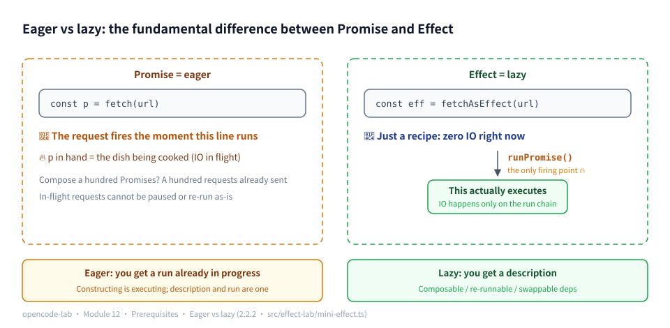
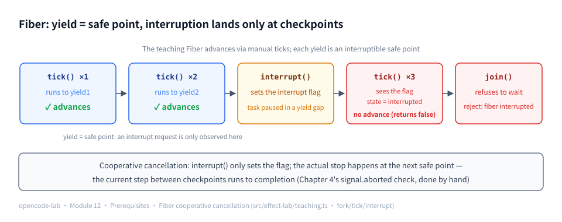
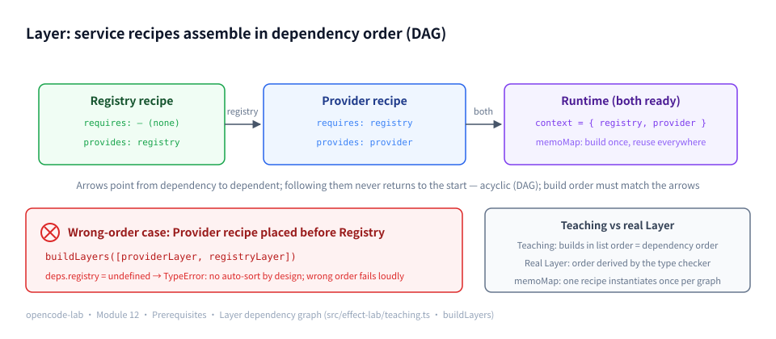
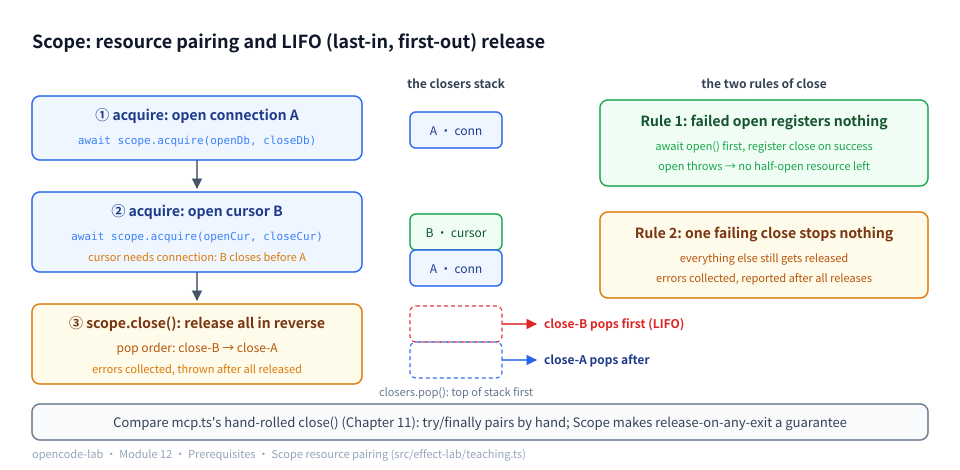
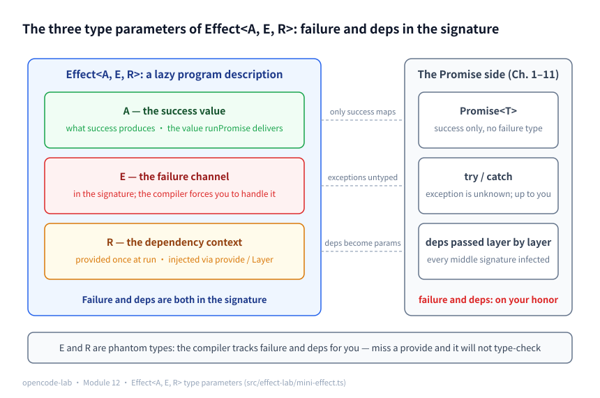
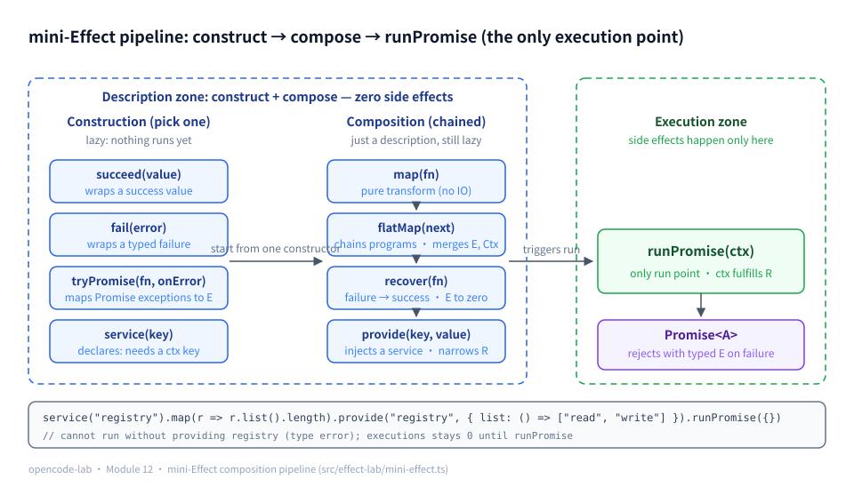
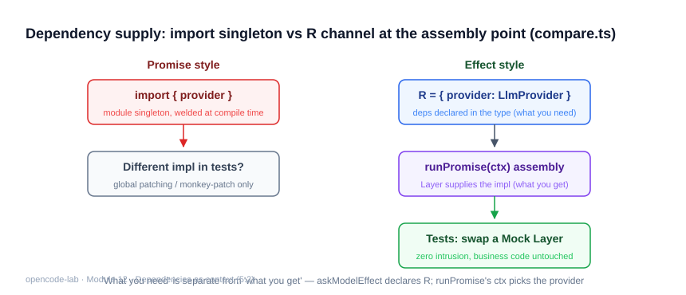
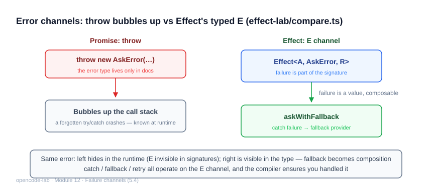

# Chapter 12: The Effect architecture comparison — another way to manage dependencies, failures, and resources

## 1. Chapter overview

- Module: 12 Effect architecture comparison
- Study time: 8–10 hours (including the functional-programming primer at the start of Section 2)
- Difficulty: high (the most abstraction-dense chapter, but the least code)
- **Skippable**: this chapter is an architecture-comparison experiment; skipping it does not affect the main storyline (Chapter 13 does not depend on this chapter's code)
- Prerequisites: Chapter 1 (Provider), Chapter 4 (error handling in the Loop)
- Corresponding OpenCode commit: `70a24697ea0028e19f22712fd63059538cb4bee7`
- Corresponding project stage: `v0.14-effect`

## 2. Prerequisites

> Effect is a school of "managing side effects with the type system", and its vocabulary comes from functional programming (FP). Section 2.2 of this chapter explains those terms from zero — pure functions, laziness, combinators, generators… each gets only "the minimal definition this chapter uses + one example"; no FP background is required.

### 2.1 Glossary for this chapter

| Term | Plain-language one-liner | Where it is used in this chapter |
|---|---|---|
| Pure function | The same input always yields the same output, touching nothing outside itself along the way | 5.1 description/execution separation |
| Side effect | Actions that "affect the outside world": writing files, sending requests, printing logs | 5.1 / 5.4 |
| Eager vs lazy | Starts running the moment it is created vs just an instruction sheet of "how to do it" | 5.1 Promise vs Effect |
| Combinator | Small functions dedicated to assembling small pieces into big ones (map/flatMap…) | all of 5.1 |
| map / flatMap | Chained interfaces for "transform the result" / "the result decides what happens next" | 5.1 / 5.2 |
| Generator / `yield*` | A function that produces values step by step with `yield`; `yield*` hands over another sequence item by item | 5.2 `Effect.gen` |
| Phantom type | A type parameter that lives only at compile time, leaving no trace at run time | 5.1 E and Ctx |
| Dependency injection (DI) | Dependencies are not created inside the function but passed in from outside | 5.2 / 5.7 |
| Tag / Layer | The "key" to a service requirement / the "recipe" for building a service | 5.2 / 5.3 |
| Scope | Where resources register: released automatically in reverse order on close | 5.5 |
| Fiber | A lightweight execution thread: can join (await the result) / interrupt | 5.6 |
| Deferred / Latch | A one-shot mailbox / a waitable latch (concurrency primitives) | 5.6 |
| Backpressure | A mechanism that makes upstream slow down automatically when the queue is full | 5.6 |
| Directed acyclic graph (DAG) | A directed graph where following arrows never returns to the start | 5.3 Layer dependency graph |

### 2.2 Foundations (a minimal functional-programming vocabulary)

#### 2.2.1 Pure functions and side effects

**Pure function**: the same input always produces the same output, and nothing in the outside world changes along the way.

```ts
Math.max(1, 5)        // pure: returns 5 whenever called, changes nothing
new Date().getTime()  // impure: a different result on every call (reads the external state "current time")
console.log("hi")     // impure: changes the outside world (screen/terminal)
```

**Side effects** are actions that "change the outside world": writing files, sending network requests, printing logs, mutating global variables. A program cannot have no side effects (a side-effect-free program could do nothing); FP is not about eliminating side effects but about **fencing them in and managing them** — which is exactly what the name Effect means: "turn side effects into values that can be described, composed, and inspected."

#### 2.2.2 Eager vs. lazy

- **Eager**: the kitchen starts stir-frying the moment you order. `Promise` is eager — by the time the line `fetch(url)` executes, the request **has already been sent**; the Promise you hold is "the dish being cooked".
- **Lazy**: you hold only the recipe; the kitchen has not fired up. Only when you explicitly say "start cooking" (execute it) does anything actually happen.

The benefit of laziness: a recipe (a description) can be passed around, modified, and composed — combining a hundred recipes lights the stove zero times; the same recipe can be cooked tonight, tomorrow night, or with different cookware (re-run with different dependencies). The mini-Effect in Section 5.1 is exactly such a "recipe class".



*Figure 12-P1: Eager vs lazy — left: by the time the line `const p = fetch(url)` executes, the request is already sent and the p in hand is "the dish being cooked"; right: `fetchAsEffect(url)` is just a recipe with zero IO at this moment, `runPromise()` is the only firing point, and only then does execution really happen. Bottom comparison: eager hands you a run already in progress; lazy hands you a description — composable / re-runnable / with swappable dependencies.*

#### 2.2.3 map and flatMap: the two building blocks of chained composition

You may have met them on arrays — `[1,2].map(x => x*2)` transforms every element. Abstract away everything except "transformation", and anything "holding a value" (an array, a Promise, an Effect) can have a map:

```ts
// map: transform "the value inside"; the container is unchanged
const double = (n: number) => n * 2
const xs = [1, 2].map(double)            // the array's map: transform each element
const p = Promise.resolve(3).map?.       // (Promise has no built-in map, Effect does — precisely why it composes like an array)
```

The third line above is **deliberately unfinished**: `Promise`'s prototype has no `map` method (the trailing `?.` just makes the line "safe to access") — to transform "a future value" in Promise-land you can only stack another `.then`. Effect makes map/flatMap first-class citizens: the container (the Effect) itself stays unchanged while only the value inside is transformed — the exact meaning of "composes like an array".

**flatMap** goes one step further: "the transform function itself returns a container", flattening two layers into one. Its real power is **letting the previous step's result decide what the next step does**:

```ts
// read config (async) -> use the config to decide which request to send (async) — chained dependencies need flatMap
getConfig().flatMap((config) => callApi(config.url))
```

In one sentence: **map does a "pure transform"; flatMap does "the next step that depends on the previous result"**. Both appear heavily in this chapter's code.

#### 2.2.4 Combinators

**Combinator** is the most common piece of functional-programming jargon; in plain words: **small functions dedicated to "assembling small pieces into big ones"** — they take functions or values and return a new function/new value, doing no business logic themselves. `map`, `flatMap`, and `recover` (which converts failure into a success value) are all combinators. Think of them as LEGO bricks: each brick does one thing, together they can build complex structures, and the act of assembly itself cannot go wrong (pure operations).

#### 2.2.5 Generators and `yield*`

Section 2.2.5 of Chapter 1 covered `yield`: a generator pauses each time it emits a value. This chapter also needs `yield*` (yield star): **hand over another sequence's values one by one**:

```ts
function* inner() { yield 1; yield 2 }
function* outer() {
  yield 0
  yield* inner()   // hands over inner's 1, 2 in order — yields on its behalf
  yield 3
}
// outer() produces 0, 1, 2, 3
```

Real Effect's `Effect.gen(function* () { const x = yield* someEffect ... })` uses exactly this generator protocol: `yield*`-ing an Effect makes the runtime execute it and assign the **success value** to the left side (failures are thrown through the generator mechanism) — the secret of why Effect code "looks like synchronous code".



*Figure 12-P3: Fiber cooperative cancellation — tick1 / tick2 advance to the yield safe points; interrupt() only sets the interrupt flag (the task is paused in a yield gap at that moment); tick3 sees the flag at the checkpoint, the state flips to interrupted and no longer advances, and join() rejects with "fiber interrupted" to finish. Cooperative cancellation: the current step between checkpoints runs to completion — the manual counterpart of Chapter 4's signal.aborted check (the teaching trio is in 5.6).*

#### 2.2.6 Phantom types

**Phantom types**: types that appear in type-parameter position but leave no trace in the run-time object. Recall Chapter 0's "type narrowing" — types live only at compile time; phantom types push this to the extreme: the `E` and `Ctx` of `MiniEffect<A, E, Ctx>` correspond to no run-time fields at all; they just **make the compiler keep the books for you** ("this program can fail this way and needs these services") and vanish after compilation. Benefit: zero run-time cost; price: they cannot be "read" at run time (the self-check questions will test this).



*Figure 12-P4: Layer recipes assemble into a DAG in dependency order — Registry (no dependencies) → Provider (requires: registry) → Runtime (both ready, memoMap singleton across the whole graph), with arrows pointing from the depended-on to the dependent. Wrong-order counterexample: with Provider placed before Registry, `deps.registry` is undefined and a TypeError is thrown. The teaching version builds in list order; a real Layer derives order from type checking (the dependency shape lives on the types — another place where "the compiler keeps the books"; see 5.3).*

### 2.3 Recap of the previous module

- Chapter 11's extension system proved you can "**add capability without touching the main loop**" (hooks, MCP, Custom Tool);
- The MCP client manages the subprocess lifecycle by hand (start, timeout, crash cleanup) — **resource pairing** is exactly the problem this chapter's Scope solves; when reading 5.5, recall `mcp.ts`'s `close()`;
- The plugin's `withPluginHooks` enhances the Registry by "wrapping a layer around it" — 5.6 shows the typed Effect-world version of the same idea.



*Figure 12-P2: Scope resource pairing and LIFO release — acquire registers connection A, then cursor B (the cursor depends on the connection), and scope.close() pops in reverse order, close-B → close-A (last acquired, first released); on the right, two disciplines: a failed open registers nothing (no half-open resource left behind), and one close throwing does not stop the rest from all being released, with errors reported together at the end (teaching implementation in 5.5).*

---

## 3. Learning objectives

- Understand: Effect's three core values — lazy program descriptions, a typed failure channel (E), dependencies as context (R); why OpenCode introduces Effect for complex async/resource-management scenarios.
- Be able to implement: a hand-written 200-line mini-Effect (combinator style) + the teaching Layer/Scope/Fiber; a side-by-side of the Promise version and the real Effect version of the same "pick Provider → request model → typed failure" flow.
- Be able to test: behavioral parity of the two versions (success / unknown provider / provider error), the fallback composition, swapping the Service layer with zero changes; the teaching trio's behavior (LIFO release, interrupt semantics, memo).
- Be able to explain: when you should **not** use Effect (this chapter's conclusion: with simple business logic, Promise + explicit dependencies is more direct; Effect's payoff appears when cross-layer error propagation and resource lifecycles get complex).

## 4. Problem statement

The previous 11 chapters used async/await throughout: errors via `catch` and result unions, dependencies via parameters, retries via hand-written wrappers. That is entirely sufficient at the teaching project's scale. But OpenCode's production code uses Effect extensively (`packages/core/src/effect/`, `packages/opencode/src/effect/`), and the reasons only become visible in a side-by-side comparison:

| Pain point | Cost of the Promise approach | Effect approach |
|---|---|---|
| Failure types | Callers learn what can throw by reading the docs | The E of `Effect<A, E, R>` is written in the signature |
| Dependency passing | A deps parameter pierces every call layer | Service + Layer, provided once at run time |
| Composing retry/degradation | Hand-written wrappers (Chapter 1's retry.ts) | Declarative composition with `Effect.retry` / `Effect.catchIf` |
| Resource release | Manual pairing with try/finally | Scope pairs automatically (teaching implementation in 5.5) |

This chapter's path: first hand-write a mini-Effect to take apart the three mechanisms of "description / failure / dependency", then fill in the three pieces that production code had no teaching vehicle for with the **teaching Layer/Scope/Fiber** (`src/effect-lab/teaching.ts`, 10 tests all green), and finally compare the same business logic against the real `effect@3` package.

## 5. Core concepts

### Concept ↔ source file ↔ test file map

| # | Concept | Source file (relative to opencode-lab/) | Test file |
|---|---|---|---|
| 1 | Effect and `Effect<A, E, R>`: a lazy program description | `src/effect-lab/mini-effect.ts` | `test/effect-lab/mini.test.ts` |
| 2 | Service and Context: dependencies as context | `src/effect-lab/mini-effect.ts`, `src/effect-lab/compare.ts` | `test/effect-lab/mini.test.ts`, `test/effect-lab/compare.test.ts` |
| 3 | Layer and runtime composition | `src/effect-lab/teaching.ts` (teaching Layer; production reference `packages/core/src/effect/runtime.ts`) | `test/effect-lab/teaching.test.ts` |
| 4 | Error types and the failure channel | `src/effect-lab/mini-effect.ts`, `src/effect-lab/compare.ts` | `test/effect-lab/mini.test.ts`, `test/effect-lab/compare.test.ts` |
| 5 | Resource management, Scope, and cancellation | `src/effect-lab/teaching.ts` (teaching Scope; production reference `packages/opencode/src/effect/runner.ts`) | `test/effect-lab/teaching.test.ts` |
| 6 | Concurrency, Fiber, queues, and backpressure | `src/effect-lab/teaching.ts` (teaching Fiber; production reference `packages/opencode/src/effect/runner.ts`) | `test/effect-lab/teaching.test.ts` |
| 7 | Test Layers and swapping external services | `src/effect-lab/compare.ts` | `test/effect-lab/compare.test.ts` |
| 8 | The cost and payoff of migrating from the Promise style | `src/effect-lab/compare.ts`, `src/providers/retry.ts` | `test/effect-lab/compare.test.ts`, `test/providers/retry.test.ts` |
| 9 | How to avoid over-abstracting for the framework's sake | `src/effect-lab/compare.ts` (the Promise version kept deliberately) | `test/effect-lab/compare.test.ts` |

### 5.1 Effect and `Effect<A, E, R>`: a lazy program description

**Concept**

Definition first, then expansion. **The substance of an Effect is not "a running async task" but a description of the task — an ordinary value.** Each of the three parameters of `Effect<A, E, R>` answers one question:

- **A**: what is produced on success?
- **E**: in which ways can it fail? (the phantom types of 2.2.6 — the compiler keeps the books, no run-time trace)
- **R**: which external services are needed to run?

The essential difference from Promise in one sentence: **Promise is eager (2.2.2), Effect is lazy**. The moment `fetch(url)` executes, the request is already sent; constructing an Effect merely "stores the how-to" — no IO happens until you explicitly call `runPromise`.

Laziness brings three concrete benefits (each can be pinned down by an executable assertion):

1. **Descriptions compose freely** — assembling large programs with map/flatMap triggers zero IO (the two building blocks of 2.2.3);
2. **The number of side effects itself becomes a testable object** — construct the program, assert it "has not run yet", then run and assert the result;
3. **The same description can be run multiple times with different dependencies injected** — the foundation of Section 5.7's "swap-the-layer testing".

**How this project implements it**: the skeleton of `src/effect-lab/mini-effect.ts` — the constructor is private, forcing every program to be built through combinators:

```ts
export class MiniEffect<A, E, Ctx extends Record<string, unknown> = Record<string, unknown>> {
  private constructor(private readonly exec: (ctx: Ctx) => Promise<A>) {}

  static succeed<A>(value: A): MiniEffect<A, never, EmptyCtx> {
    return new MiniEffect(async () => value)
  }
```

Note that `MiniEffect.succeed(2)` merely "stores `async () => 2`" without calling it. `test/effect-lab/mini.test.ts` writes laziness itself as an assertion:

```ts
  test("惰性：runPromise 之前不执行", async () => {
    let executions = 0
    const program = MiniEffect.tryPromise(
      async () => {
        executions++
        return "done"
      },
      () => "failed",
    )
    expect(executions).toBe(0)
    expect(await program.runPromise({})).toBe("done")
    expect(executions).toBe(1)
  })
```

After construction `executions` is still 0 — the observable shape of "description separated from execution". You do not have to take the tutorial's word for this assertion; run it yourself (from the `opencode-lab/` directory, load the same implementation with `bun -e`):

```bash
bun -e '
const { MiniEffect } = await import("./src/effect-lab/mini-effect.ts")
let executions = 0
const program = MiniEffect.tryPromise(async () => { executions++; return "done" }, () => "failed")
console.log("构造后 executions =", executions)
console.log("runPromise 返回:", await program.runPromise({}))
console.log("run 后 executions =", executions)
'
```

**Output (excerpt)**:

```text
构造后 executions = 0
runPromise 返回: done
run 后 executions = 1
```

The first line proves construction only "stores the function away"; the third proves the side effect happens exactly on the one execution triggered by `runPromise` — no more, no less.

**Unroll a composition chain by hand** (applying 2.2.3's flatMap contract to this class, to see clearly "how descriptions nest layer by layer"):

```ts
const program = MiniEffect.succeed(2)
  .map((n) => n * 3)                    // description D2: executes D1, result ×3
  .flatMap((n) => MiniEffect.succeed(n + 1))  // description D3: executes D2, then the "+1" description
// execution order of program.runPromise({}):
//   D1: succeed(2)      -> 2
//   D2: 2 * 3           -> 6
//   D3: 6 + 1           -> 7   (all three layers are just "stored functions"; zero execution at construction)
```

"Three layers of description, zero executions" can be verified on the spot too — light the stove once for the same recipe:

```bash
bun -e '
const { MiniEffect } = await import("./src/effect-lab/mini-effect.ts")
const program = MiniEffect.succeed(2)
  .map((n) => n * 3)
  .flatMap((n) => MiniEffect.succeed(n + 1))
console.log(await program.runPromise({}))
'
```

**Output (excerpt)**:

```text
7
```

The output matches the layer-by-layer derivation D1→D2→D3 exactly: zero execution during construction, and one ignition of `runPromise` walks all three layers.

**Common pitfalls**:
1. Using Effect like a Promise, expecting side effects to happen during construction. Symptom: the counter changes before run; cause: treating the fn in `MiniEffect.tryPromise(fn)` as "something that will run by itself later"; fix: side effects are only allowed on the execution chain triggered by `runPromise`.
2. Doing IO inside a `map` callback. Symptom: composing a program that never runs still produces a file write; fix: map only does pure transforms (2.2.1); when you need side effects, construct a new `tryPromise`.
3. Believing E/Ctx occupy run-time memory or get run-time checks. Symptom: trying to "read" the failure type at run time; fix: they are phantom types (2.2.6); at run time there is only the exception and the ctx parameter.

**Self-check questions**:
1. Why is the type of `exec` `(ctx: Ctx) => Promise<A>` rather than `() => Promise<A>`? (Reference answer: the landing point of dependency injection — at run time the service context is passed into the innermost execution function, and provide merely fills the key into ctx at the outer layer.)
2. If `MiniEffect.succeed(2)` is created and never run, how many function calls happen? (Reference answer: zero — `async () => value` is never called.)
3. In the "manual unrolling" above, how many of the three description layers execute during construction? (Reference answer: zero — all of them are stored functions.)



*Figure 12-1: the three type parameters of `Effect<A, E, R>` each manage one thing — A the success value, E the failure channel, R the dependency context; on the right, the Promise comparison, where failure and dependencies rest entirely on discipline.*



*Figure 12-2: the mini-Effect composition pipeline — constructing and composing are only lazy descriptions; `runPromise(ctx)` is the only execution point, where the dependency context (R) is fulfilled all at once.*

### 5.2 Service and Context: dependencies as context

**Concept**

The R channel answers "what services does this program need". The Promise-style answer is "parameters": every function carries a deps parameter that pierces from the entry point down to the deepest layer (Chapter 4's `AgentDeps` is that style), and the ten middle layers that never use the dependency still get their signatures infected. Effect's answer is **requirement declaration**: the program says "I need a Registry" without caring where it comes from; the runtime (provide/Layer) is responsible for fulfilling it.

`Context.Tag` is that "key to the requirement" — it carries both the service's unique identifier (a string) and the service's shape (a type), being at once a run-time addressable key and a compile-time checkable type. Take apart the strange-looking line of syntax from real Effect:

```ts
class Providers extends Context.Tag("effect-lab/Providers")<Providers, Record<string, LlmProvider>>() {}
//                                 └────── ① string key ──────┘└───────── ② the two type parameters ─────────┘└③ call ③┘
```

① The string is the run-time addressing key (globally unique, conventionally `project/service-name`); ② the first type parameter is the Tag itself (self-referential, converging the type onto this class), the second is the service's shape; ③ a curried generic call — identifier first, then types. The whole line produces the `Providers` class, and `yield* Providers` means "take out that service". mini-Effect reproduces the same idea in the plainest way: `service(key)` declares "I want key K from ctx", and `provide(key, value)` crosses the key off the requirement list (reflected at the type level as `Omit<Ctx, K>`).

**How this project implements it**: the mini version's declaration and injection — `src/effect-lab/mini-effect.ts`:

```ts
  // Declare a dependency: needs Ctx[K], returns an Effect that reads the value from the context
  static service<C extends Record<string, unknown>, K extends keyof C & string>(key: K): MiniEffect<C[K], never, C> {
    return new MiniEffect(async (ctx) => ctx[key])
  }
```

```ts
  // Inject a service: cross one key off the "required" list
  provide<K extends keyof Ctx & string>(key: K, value: Ctx[K]): MiniEffect<A, E, Omit<Ctx, K>> {
    return new MiniEffect(async (ctx) => this.exec({ ...ctx, [key]: value } as Ctx))
  }
```

Run declaration and injection together (`service` declares "I want the registry key"; after `provide` injects it, the remaining requirements are empty, and only then can `runPromise` be called with `{}`):

```bash
bun -e '
const { MiniEffect } = await import("./src/effect-lab/mini-effect.ts")
const program = MiniEffect.service<{ registry: { list(): string[] } }, "registry">("registry")
  .map((r) => r.list().length)
const provided = program.provide("registry", { list: () => ["read", "write"] })
console.log(await provided.runPromise({}))
'
```

**Output (excerpt)**:

```text
2
```

The real Effect version — `src/effect-lab/compare.ts`:

```ts
class Providers extends Context.Tag("effect-lab/Providers")<Providers, Record<string, LlmProvider>>() {}
class Registry extends Context.Tag("effect-lab/Registry")<Registry, ToolRegistry>() {}
```

Inside `Effect.gen`, `yield* Providers` reads the service instance provided by the runtime (2.2.5 covered `yield*`'s hand-over semantics); the "combine multiple service dependencies" case in `test/effect-lab/mini.test.ts` shows how multiple keys merge their requirements via `flatMap` and then get crossed off with `provide` one by one.



*Figure 12-3: dependency supply compared — the Promise style imports module-level singletons, welding dependencies shut at compile time so tests can only mutate globals; the Effect style writes dependencies on the type parameter R (what is needed), runPromise(ctx) supplies implementations via Layers at the assembly point (what is used), and tests swap in a Mock Layer with zero intrusion.*

**Common pitfalls**:
1. Using a Tag as a global singleton variable. Symptom: "reading the service" directly from anywhere without going through program composition; fix: a Tag is only a requirement declaration; reading its value must happen inside an Effect context (`yield*` or `tag.use`).
2. Stuffing the whole application context into one Tag (a god service). Symptom: every service looks like `{ db, config, logger, ... }` and any change sets off everything; fix: split Tags by capability and declare as many as you need.
3. Running without providing. Symptom: real Effect throws a `Service not found`-style run-time error; the mini version's `runPromise` demands a complete Ctx at the type level; fix: treat "unmet requirements" as compile errors and keep the provide action written adjacent to the program definition.

**Self-check questions**:
1. What happens if two `Context.Tag`s use the same string? (Reference answer: a run-time key collision — they overwrite each other; Tag strings must be globally unique.)
2. Why is the mini version's `provide` return type `Omit<Ctx, K>`? (Reference answer: injecting one key satisfies one requirement, narrowing the remaining requirements at the type level; only when all are satisfied can `runPromise` be called with an empty context.)
3. How do deps-parameter threading and Tag declarations differ in refactoring cost? (Reference answer: when adding a dependency, the former changes every function signature along the chain, while the latter changes only the program body and the provide site — zero changes to the middle layers.)

### 5.3 Layer and runtime composition

> 📊 Figure: the rules for Layers assembling into a DAG in dependency order are in Figure 12-P4 of Section 2.2 (including the wrong-order counterexample).

**Concept**

A Layer is "the build recipe for a service": it describes "given the services already ready, which new services to build". **DAG (directed acyclic graph, 2.1 glossary)** refers to the dependency shape among Layers — following "dependency" arrows never returns to the start (acyclic), and construction proceeds layer by layer after a topological sort.

It solves two problems:

1. **The type checker verifies build order and the dependency graph** — service A's recipe declares "I need B"; a Layer combination missing B simply fails to compile, so you never discover "config not initialized" at run time;
2. **Build once, reuse throughout (memo)** — expensive resources like a database connection pool are built when the runtime starts, and all users share the same one, rather than each call site new-ing its own.

**How this project implements it**: `src/effect-lab/teaching.ts` provides the teaching Layer (written into this tutorial only after all tests went green). One recipe = declaring "which keys to provide / which keys are required / how to build":

```ts
export function layer<Ctx extends Record<string, unknown>, R extends Record<string, unknown>>(
  provides: (keyof Ctx & string)[],
  requires: (keyof R & string)[],
  build: (deps: R) => Promise<Ctx>,
): MiniLayer<Ctx, R> {
  return { provides, requires, build }
}
```

`buildLayers` builds layer by layer in list order: keys produced by earlier layers appear in later layers' deps; **the memo hangs directly on the instance** — when the same instance appears a second time, the first build's result is reused:

```ts
  for (const l of layers) {
    if (l.built !== undefined) {
      Object.assign(context, l.built)
      continue
    }
    const fresh = await l.build(context)
    l.built = fresh
    buildCount++
    Object.assign(context, fresh)
  }
```

The corresponding test evidence (`test/effect-lab/teaching.test.ts`) — one case each for the two-layer dependency chain and for memo:

```ts
  test("按列表顺序构建，后层能拿到前层产出的服务", async () => {
    const { context, buildCount } = await buildLayers([registryLayer, providerLayer])
    expect(buildCount).toBe(2)
    expect((context.provider as { name: string }).name).toBe("mock(2 tools)")
  })

  test("memo：同一实例出现两次只构建一次，第二次直接复用", async () => {
    const built: string[] = []
    const shared = layer(["counter"], [], async () => {
      built.push("built-once")
      return { counter: { n: 1 } }
    })
    const { context, buildCount } = await buildLayers([shared, shared])
    expect(buildCount).toBe(1)
```

The memo case can also be run directly (the same `shared` instance appears twice in the list):

```bash
bun -e '
const { layer, buildLayers } = await import("./src/effect-lab/teaching.ts")
const built = []
const shared = layer(["counter"], [], async () => { built.push("built-once"); return { counter: { n: 1 } } })
const { context, buildCount } = await buildLayers([shared, shared])
console.log("buildCount =", buildCount, "| built =", JSON.stringify(built), "| context.counter.n =", context.counter.n)
'
```

**Output (excerpt)**:

```text
buildCount = 1 | built = ["built-once"] | context.counter.n = 1
```

`buildCount` is 1 and `built` has a single element — the second appearance went straight through the `l.built` reuse branch, with no second build.

Note the difference between the teaching version and a real Layer (which is exactly why the production version exists): the teaching version **does not topologically sort automatically** — list order is dependency order, and a wrong order leaves that key missing from deps; a real Layer derives order from type checking, and keeps memo in a separate runtime container (`memoMap`) rather than on the instance. The explicit type annotation on the deps parameter in the tests (`async (deps: { registry: ... })`) is demonstrating "R = the shape you declare you need".

The OpenCode production reference — `packages/core/src/effect/runtime.ts` (relative to the OpenCode repo root):

```ts
export function makeRuntime<I, S, E>(service: Context.Service<I, S>, layer: Layer.Layer<I, E>) {
  let rt: ManagedRuntime.ManagedRuntime<I, E> | undefined
  const getRuntime = () =>
    (rt ??= ManagedRuntime.make(Layer.provideMerge(layer, Observability.layer) as Layer.Layer<I, E>, {
      memoMap,
    }))
```

Three details worth reading: `rt ??=` (assign-if-null: guarantees the runtime is built only once); `memoMap` (the same Layer instantiates only once across the whole dependency graph — connection-pool semantics; the teaching version's `l.built` is its minimal form); `Layer.provideMerge` ("shims" the observability service into every runtime, so all upper-layer services can reference it).

**Common pitfalls**:
1. Stacking Layers without understanding the dependency graph. Symptom: merely reordering Layers produces "missing service" errors; fix: first draw the "A depends on B" arrows on paper — build order must match the arrow directions (the depended-on comes first).
2. Rebuilding the runtime for every request/every test. Symptom: connection pools created over and over, slow tests; fix: the runtime is a long-lived object — build once, reuse (compare `rt ??=`).
3. Calling a Layer like an ordinary factory function. Symptom: bypassing the memo mechanism yields two "singletons"; fix: a Layer only goes into a runtime and is never run by hand (do not manually touch the teaching version's instance-mounted `built` either).

**Self-check questions**:
1. In the teaching `buildLayers`, what happens if `providerLayer` (which needs registry) is placed before `registryLayer`? (Reference answer: `deps.registry` is undefined and building throws a TypeError — exactly the problem that "the teaching version does not auto-sort" is meant to expose to you.)
2. What problem do `memoMap` / `l.built` solve? (Reference answer: when the same Layer is referenced from multiple places, it instantiates only once — singleton semantics guaranteed by the composition layer rather than by a hand-made global variable.)
3. The granularity difference between `Effect.provideService` (used in tests) and Layer (used in production)? (Reference answer: the former injects one already-built service instance; the latter composes a "build recipe".)

### 5.4 Error types and the failure channel

**Concept**

The E channel moves "how can this fail" from the documentation into the signature. Exceptions thrown by Promises have no type registration; callers either `try/catch` an `unknown` or check the result union on their honor — Chapter 1's `askModelPromise` returns `{ ok: true; text } | { ok: false; error }`, and the compiler does not care whether you check. Effect's approach is to make failure a constituent part of the return type: `Effect<A, E>` means "success yields A, failure can only be E".

The companion combinators each do their job: `Effect.fail` enters the failure channel deliberately; `Effect.tryPromise({ try, catch })` **explicitly maps** the outside world's `unknown` exceptions into controlled error types — this is the translation boundary between Promise and Effect; `catchIf(predicate, recovery)` catches only failures satisfying the condition; `recover` converts failure into a success value, and the E channel drops to zero with it. The shape of the error type directly determines recoverability: a discriminated union (a `kind` field) lets each branch handle exactly one kind of failure, while a broad `Error` leaves you reading message strings.

**How this project implements it**: the error shape — `src/effect-lab/compare.ts`:

```ts
export type AskError =
  | { kind: "unknown-provider"; name: string }
  | { kind: "provider-error"; message: string }
```

The two failure entrances — same file:

```ts
    // dependency missing: a typed failure, not returning undefined and carrying on
    if (!provider) return yield* Effect.fail<AskError>({ kind: "unknown-provider", name: providerName })
```

```ts
      catch: (err): AskError => ({ kind: "provider-error", message: err instanceof Error ? err.message : String(err) }),
```

`test/effect-lab/mini.test.ts` verifies the mapping semantics: the "tryPromise maps unknown exceptions into the typed channel" assertion checks that what rejects is `{ kind: "wrapped", message: "raw" }` rather than the raw Error. `runEffect` in `test/effect-lab/compare.test.ts` shows the standard way to retrieve the failure channel — `runPromiseExit` returns both success and failure as **values**, `Exit.match` branches on them, and `Cause.squash` recovers the original error from the failure cause:

```ts
  return Exit.match(exit, {
    onFailure: (cause): { ok: false; error: E } => ({ ok: false, error: Cause.squash(cause) as E }),
    onSuccess: (value): { ok: true; value: A } => ({ ok: true, value }),
  })
```

The comparison test "unknown provider: both versions produce a typed error" asserts that both versions produce exactly the same `{ kind: "unknown-provider", name: "ghost" }` — proof that the E channel only changes the mode of expression, with semantics identical to the result union. Both typical ways of consuming the E channel can be run on the spot: `recover` converts failure into a success value (E drops to zero), and `runPromiseExit + Exit.match` retrieves failure as a **value** (no exception stack involved):

```bash
# Consumption style 1: convert with recover (mini version)
bun -e '
const { MiniEffect } = await import("./src/effect-lab/mini-effect.ts")
const program = MiniEffect.fail<string>("E_TIMEOUT").recover((e) => `降级(${e})`)
console.log(await program.runPromise({}))
'

# Consumption style 2: retrieve with runPromiseExit (real effect package, unknown provider)
bun -e '
const { Cause, Effect, Exit } = await import("effect")
const { askModelEffect, Providers, Registry } = await import("./src/effect-lab/compare.ts")
const { createMockProvider } = await import("./src/providers/mock.ts")
const { createToolRegistry } = await import("./src/tools/registry.ts")
const exit = await Effect.runPromiseExit(
  Effect.provideService(
    Effect.provideService(askModelEffect("ghost", "hi"), Providers, { mock: createMockProvider([{ kind: "text", text: "来自 mock 的回答" }]) }),
    Registry,
    createToolRegistry(),
  ),
)
const out = Exit.match(exit, {
  onFailure: (cause) => ({ ok: false, error: Cause.squash(cause) }),
  onSuccess: (value) => ({ ok: true, value }),
})
console.log(JSON.stringify(out))
'
```

**Output (excerpt)**:

```text
降级(E_TIMEOUT)
{"ok":false,"error":{"kind":"unknown-provider","name":"ghost"}}
```

The first line is `recover` "converting" the failure into an ordinary success value (the E channel drops to zero with it); the second line matches the result union's shape field by field — the failure channel changed where it is expressed, not its semantics.



*Figure 12-4: the failure channel compared — a thrown error's type lives only in the documentation, bubbles up the call stack, and crashes whoever forgot to try/catch; Effect writes failure into the type signature Effect<A, E, R>, where catch / fallback / retry all operate on the E channel — failure is a value too, and fallback turns from a prayer into function composition.*

**Common pitfalls**:
1. Writing `tryPromise` without a catch mapping. Symptom: E degrades to `unknown`/`Error` and the signature loses its power to guide recovery; fix: annotate the catch callback's return type explicitly (e.g. `(err): AskError =>`), narrowing broad exceptions into a discriminated union.
2. Returning `undefined` or an empty object on failure and carrying on. Symptom: the error only explodes as a `TypeError` three layers later; fix: follow `if (!provider) return yield* Effect.fail(...)` — the earlier a failure enters the E channel, the better.
3. Handling Effect failures with `runPromise` + `try/catch`. Symptom: what you catch is a `FiberFailure` wrapping the original error, which is hard to assert on; fix: `runPromiseExit` + `Exit.match` (see the common errors table in Section 12).

**Self-check questions**:
1. What is the purpose of writing the type parameter explicitly in `Effect.fail<AskError>({...})`? (Reference answer: to anchor the failure shape — without it TS infers from the value, and when new failure branches are added later the compiler will not flag the omission.)
2. What does the program's E type become after `recover`, and why? (Reference answer: `never` — the failure was converted into a success value, the E channel drops to zero, and callers no longer need to handle failure.)
3. Why is `Cause.squash` necessary? (Reference answer: Effect's failure cause is a Cause structure (possibly containing interruptions, defects, aggregates of multiple errors); squash presses it back into a single comparable error value.)

### 5.5 Resource management, Scope, and cancellation

> 📊 Figure: Scope's resource pairing and LIFO release are in Figure 12-P2 of Section 2.3.

**Concept**

The classic problem of resource management is **pairing**: every open must have a close, every connect a disconnect, and the pairing must hold on every exit path — normal return, error, even cancellation. Promise-land's `try/finally` has two blind spots: first, cancellation simply does not exist — an in-flight Promise cannot be told "stop doing that"; finally can only wait for it to finish naturally; second, pairing logic rests on human discipline, and one newly added early return can miss the cleanup.

Effect answers with **Scope**: resources register onto a Scope, and when the Scope closes, all release functions run in the **reverse** of their registration order — why reverse? Later-acquired resources may depend on earlier ones (you open a database connection first, then open a cursor on top of it; when closing, the cursor must close first). This semantics holds uniformly on all three paths: success, failure, interruption.

**How this project implements it**: the teaching Scope lives in `src/effect-lab/teaching.ts` (with 10 tests all green). acquire = register close only after open succeeds (an open that throws registers no half-open resource); close = release in reverse order + collect errors raised during release and report them together at the end:

```ts
    // acquire = register close only after open succeeds: an open that throws registers no half-open resource
    async acquire<T>(open: () => Promise<T>, close: (value: T) => void | Promise<void>): Promise<T> {
      if (closed) throw new Error("scope 已关闭，不能再获取资源")
      const value = await open()
      closers.push(() => close(value))
      return value
    },

    // LIFO: last acquired, first released (isomorphic to stack allocation/RAII — inner resources may depend on outer ones)
    async close(): Promise<void> {
      if (closed) return
      closed = true
      const errors: string[] = []
      while (closers.length > 0) {
        const closer = closers.pop()
        if (closer === undefined) continue
        try {
          await closer()
        } catch (err) {
          errors.push(err instanceof Error ? err.message : String(err))
        }
      }
      if (errors.length > 0) throw new Error(`释放资源时出错: ${errors.join("; ")}`)
    },
```

Test evidence (`test/effect-lab/teaching.test.ts`) — two cases: LIFO order, and release even on failure:

```ts
  test("后获取的先释放（LIFO）", async () => {
    ...
    await scope.close()
    expect(order).toEqual(["open-a", "open-b", "close-b", "close-a"])
  })

  test("第二个资源 open 抛错时，第一个仍被释放；scope 不残留半开资源", async () => {
```

The LIFO order is plain once run (a opened first, then b; on close, b goes first):

```bash
bun -e '
const { createScope } = await import("./src/effect-lab/teaching.ts")
const order = []
const scope = createScope()
await scope.acquire(async () => { order.push("open-a"); return "a" }, (v) => { order.push(`close-${v}`) })
await scope.acquire(async () => { order.push("open-b"); return "b" }, (v) => { order.push(`close-${v}`) })
await scope.close()
console.log(JSON.stringify(order))
'
```

**Output (excerpt)**:

```text
["open-a","open-b","close-b","close-a"]
```

Now look at the real form against OpenCode's production code — `packages/opencode/src/effect/runner.ts` (relative to the OpenCode repo root): the Session executor's factory function takes a Scope as its first parameter:

```ts
export const make = <A, E = never>(
  scope: Scope.Scope,
  opts?: {
    onIdle?: Effect.Effect<void>
    onBusy?: Effect.Effect<void>
    onInterrupt?: Effect.Effect<A, E>
  },
): Runner<A, E> => {
```

In the same file, cancellation is a first-class citizen — an interrupted run is not treated as an ordinary failure but as the dedicated `Cancelled` error type:

```ts
  const complete = (done: Deferred.Deferred<A, E | Cancelled>, exit: Exit.Exit<A, E>) =>
    Exit.isFailure(exit) && Cause.hasInterruptsOnly(exit.cause)
      ? Deferred.fail(done, new Cancelled()).pipe(Effect.asVoid)
      : Deferred.done(done, exit).pipe(Effect.asVoid)
```

`Cause.hasInterruptsOnly` distinguishes "failed because of interruption" from "a real error" — the former becomes `Cancelled`, the latter passes through untouched. This is exactly the manual counterpart of Chapter 4's `signal.aborted` check in loop.ts: Effect builds "checkpoint + state transition + cleanup guarantee" into the runtime.

**Common pitfalls**:
1. Believing `try/finally` is equivalent to Scope. Symptom: after the process receives a cancellation signal, the cleanup in finally never executes; fix: cancellation-safe cleanup must run on a mechanism that "knows about interruption" — Scope finalizers or `acquireUseRelease`.
2. Doing possibly-failing async work in a finalizer without handling its failure. Symptom: an error thrown during cleanup masks the original error; fix: follow the teaching close's approach — collect errors, release everything, then report together.
3. Treating "interruption" as an ordinary error. Symptom: cancellation gets caught by a retry wrapper and retried over and over; fix: check `hasInterruptsOnly` first (or whether the error is Cancelled) — never retry an interruption.

**Self-check questions**:
1. In what order do release functions run when a Scope closes, and why? (Reference answer: the reverse of registration order — later-acquired resources may depend on earlier ones, so reverse release is the safe order. The teaching test's `["close-b","close-a"]` is the evidence.)
2. Why does the teaching `acquire` "register close only after open succeeds"? (Reference answer: if open throws, the resource was never really established, and registering would close a nonexistent resource; it also leaves no half-open resource behind.)
3. Why does `runner.ts` take scope as a parameter of `make` instead of building one internally? (Reference answer: the lifecycle belongs to the caller — when the Session shuts down as a whole, it closes its runners together, preventing an executor from outliving the session.)

### 5.6 Concurrency, Fiber, queues, and backpressure

> 📊 Figure: Fiber's cooperative-cancellation timeline is in Figure 12-P3 of Section 2.2.

**Concept**

A Fiber is Effect's lightweight execution thread: fork an Effect to get a Fiber, which you can join (await the result), interrupt, and observe the state of. Compared with the "raw concurrency" of `Promise.all`, the Fiber model turns concurrency into a program that is composable, observable, and intervenable. Two companion concepts:

- **Backpressure**: what to do when tasks arrive too fast. When a bounded queue fills up, "put" suspends — upstream slows down automatically and memory stays under control; `Promise.all(files.map(process))` instead fires all tasks out at once — a thousand files means a thousand in-flight requests.
- **Concurrency primitives**: `Deferred` (a one-shot mailbox — the result can be delivered only once, and multiple waiters all receive it), `Latch` (a latch — wait while closed, pass when open). They replace hand-maintained boolean flags and Promise caches, and they all behave correctly under interruption.

The teaching mainline is a single-flight model (Chapter 4: one Session has at most one drain at a time) and has no need for concurrent queues; OpenCode's production code needs an executor that "does not re-enter while busy and continues once the busy work finishes".

**How this project implements it**: the teaching Fiber lives in `src/effect-lab/teaching.ts` — a minimal model of **cooperative cancellation**: the task is written as a generator, and each `yield` is an "interruptible safe point"; the teaching version advances via **manual ticks** (a real Fiber is scheduled by the runtime; the manual version makes tests fully deterministic, with no timers):

```ts
export function fork<T>(task: () => Generator<unknown, T>): MiniFiber<T> {
  let state: FiberState = "running"
  let result: T | undefined
  const iterator = task()

  return {
    tick() {
      if (state !== "running") return false
      const next = iterator.next()
      if (next.done) {
        state = "done"
        result = next.value
      }
      return state === "running"
    },
    interrupt() {
      if (state === "running") state = "interrupted"
    },
```

Test evidence — "interrupt between yield points" is the mirror image of Chapter 4's "cancellation checkpoint" idea:

```ts
  test("在 yield 点之间 interrupt：状态变为 interrupted，join 拒绝", async () => {
    const fiber = fork(() => countingTask(5))
    expect(fiber.tick()).toBe(true)
    expect(fiber.tick()).toBe(true)
    fiber.interrupt()
    expect(fiber.state).toBe("interrupted")
    expect(fiber.tick()).toBe(false) // no further advance after interrupting
    expect(fiber.join()).rejects.toThrow("fiber 已中断")
  })
```

The interrupt semantics are equally visible in three lines (tick twice, then interrupt inside a yield gap):

```bash
bun -e '
const { fork } = await import("./src/effect-lab/teaching.ts")
function* countingTask(steps) { let done = 0; while (done < steps) { done++; yield } return done }
const fiber = fork(() => countingTask(5))
console.log("tick两次:", fiber.tick(), fiber.tick())
fiber.interrupt()
console.log("interrupt 后 state =", fiber.state, "| 再 tick:", fiber.tick())
'
```

**Output (excerpt)**:

```text
tick两次: true true
interrupt 后 state = interrupted | 再 tick: false
```

Interruption does not cut off the step that is currently running — it only sets the flag, and the next checkpoint (tick) sees the flag and stops advancing: that is precisely what "cooperative" means.

Read this against Chapter 4: `tick` ≈ each step of the loop, `yield` ≈ the `signal.aborted` checkpoint, `interrupt` ≈ AbortController.abort(). The difference is that Effect's interruption also guarantees the Scope cleanup still runs (5.5).

The OpenCode production reference — `packages/opencode/src/effect/runner.ts` (relative to the OpenCode repo root), the executor interface and state machine:

```ts
export type State<A, E> =
  | { readonly _tag: "Idle" }
  | { readonly _tag: "Running"; readonly run: RunHandle<A, E> }
  | { readonly _tag: "Shell"; readonly shell: ShellHandle<A, E> }
  | { readonly _tag: "ShellThenRun"; readonly shell: ShellHandle<A, E>; readonly run: PendingHandle<A, E> }
```

Close-reading points: every run handle carries `fiber: Fiber.Fiber<A, E>` and `done: Deferred.Deferred<A, E | Cancelled>` — the fiber does the real execution and interruption, while the Deferred (mailbox) hands the result (including cancellation) to the waiter exactly once; the `ShellThenRun` state expresses "shell running, follow-up work already queued" — a miniature backpressure design with a **queue depth of one**; `ensureRunning` means "start only when idle, reuse the existing run when busy", turning Chapter 4's constraint "the same Session never runs two copies concurrently" into a typed API.

**Common pitfalls**:
1. Treating `Promise.all`'s unbounded concurrency as the default. Symptom: a thousand-file batch run blows up memory or triggers rate limits; fix: a bounded queue + a fixed worker count, or Effect's `forEach` concurrency-cap parameter.
2. Managing concurrency state with bare boolean flags. Symptom: a race window opens between `isRunning = true` and the actual start; fix: state transitions and checks must be atomic — `SynchronizedRef.modify` or an equivalent primitive.
3. Estimating Fiber cost as if they were OS threads. Symptom: fear of forking, everything serialized; fix: a Fiber is an ordinary lightweight object-level structure (the teaching fork just builds an iterator handle) — parallelize whenever it makes sense.

**Self-check questions**:
1. Which Chapter 4 mechanism is the teaching Fiber's "yield = safe point" isomorphic to? (Reference answer: the `signal.aborted` checkpoint — both check for cancellation "between two steps" instead of forcibly cutting off in-flight IO.)
2. What role does `PendingHandle` play inside `ShellThenRun`? (Reference answer: it parks the work that should continue running after the shell ends — a "queue depth of one" backpressure design.)
3. Which E/Ctx types must the mini-Effect `all` combinator (after-class challenge) handle? (Reference answer: E takes the union of the members, Ctx takes the intersection — consistent with `flatMap`'s merge rules.)

### 5.7 Test Layers and swapping external services

> 📊 Figure: for how tests supply a Mock Layer, see Figure 12-3 in Section 5.2 (swap the implementation at the assembly point, zero changes to business code).

**Concept**: the core move of Effect-style testing is **write the program as usual; inject different service implementations at test time**. The program under test declares "I need Providers and Registry", and the test environment provides mock instances — requirements and supplies line up at the type level, the compiler guarantees you missed no injection, and the program itself does not change by a single line. This eliminates three classic mock pains: module-level mocks (`jest.mock`) hijack the loader and are fragile and implementation-coupled; global-variable swaps (`globalThis.fetch = ...`) pollute one another; hand-written "constructor parameters prepared for tests" explode in signature size as dependencies grow. The Layer/provide mechanism turns "production assembly" and "test assembly" into two configuration files of the same mechanism. The yardstick for a healthy mock: **mock only the boundaries (model, file system, network), never the logic under test itself**.

**How this project implements it**: `test/effect-lab/compare.test.ts` follows this throughout — first build the fake services:

```ts
function makeDeps() {
  const registry = createToolRegistry()
  registry.register(echoTool)
  // two copies of each script: one consumed by the Promise version, one by the Effect version
  const providers = {
    mock: createMockProvider([
      { kind: "text", text: "来自 mock 的回答" },
      { kind: "text", text: "来自 mock 的回答" },
    ]),
    broken: createMockProvider([
      { kind: "error", error: { kind: "rate_limit", message: "限流", retryable: true } },
      { kind: "error", error: { kind: "rate_limit", message: "限流", retryable: true } },
    ]),
  }
```

Then inject via provideService inside `runEffect` (see 5.3). The case that best shows "swap the layer, change nothing" is the "dependency injection difference" case:

```ts
    // swap in an empty Registry layer: same program, same call site, different behavior — that is the value of DI
    const emptyRegistry = createToolRegistry()
    const withEmpty = await runEffect(toolCount, providers, emptyRegistry)
    expect(withEmpty).toEqual({ ok: true, value: 0 })
```

The same `toolCount` program, fed the real Registry, yields 1; fed the empty Registry, 0 — zero changes at the call site; the mini counterpart is the "service declares dependencies; it can run only after provide injects them" case in `test/effect-lab/mini.test.ts`.

**Common pitfalls**:
1. Bypassing the injection mechanism in tests and mutating module internals directly. Symptom: tests pollute each other and fail randomly under parallel execution; fix: converge all mutability into "service implementations" — tests swap implementations and never touch globals.
2. Rebuilding the whole heavyweight runtime for every case. Symptom: the test suite slows down noticeably; fix: distinguish "swapping implementations" (cheap, fine to do per-case) from "swapping runtimes" (expensive, share when possible); the teaching provideService belongs to the former.
3. Mocking the logic under test itself. Symptom: the tests stay green forever while the product is broken; fix: check each double's boundary position against this project's E2E philosophy (Chapter 13, "the only Mock is the model").

**Self-check questions**:
1. What does the R part of `Effect.Effect<A, E, Providers | Registry>` in `runEffect`'s generic signature do? (Reference answer: it declares the program's requirement set; the caller must provide exactly these services — miss one and it does not compile.)
2. Why prepare two identical rounds of the `mock` script? (Reference answer: the Promise version and the Effect version each consume one, ensuring the comparison tests feed the same model behavior.)
3. Why is passing an empty object to `provided.runPromise({})` legal in the mini test? (Reference answer: every key has been crossed off by provide, the remaining Ctx is the empty-record type, and the empty object satisfies it.)

### 5.8 The cost and payoff of migrating from the Promise style

**Concept**: a migration decision must do the accounting on both sides. **Costs**: the learning curve (Fiber/Scope/Cause are a real mental load); signature contagion — R and E propagate up the call chain, and introducing Effect often touches half the repo; ecosystem friction (every boundary with an existing Promise library needs a tryPromise wrapper); team collaboration cost (reviewers must be able to read Effect idioms). **Payoffs**: checkable failure types (E is in the signature, and the compiler holds you accountable for new failure branches); declarative composition (retry, degradation, and timeout are combinators rather than hand-written wrappers); swappable dependencies (testing and multi-environment deployment come for free); resource and cancellation safety (Section 5.5). **The yardstick**: do failure types need to propagate across multiple layers and be handled differently by different callers; does the same service need multiple interchangeable implementations (test/production/multiple backends); are resource lifecycles complex enough that manual pairing starts causing incidents. If none of the three apply, Promise is more direct; if two or more apply, Effect starts paying for itself. OpenCode's choice (Effect for complex execution chains) and this project mainline's choice (Promise at teaching scale) are both reasonable landings of this yardstick.

**How this project implements it**: `src/effect-lab/compare.ts` writes the same business logic in two versions for comparison. The Promise version — dependencies are parameters, failure is a result union:

```ts
export async function askModelPromise(deps: PromiseDeps, providerName: string, prompt: string): Promise<{ ok: true; text: string } | { ok: false; error: AskError }> {
  const provider = deps.providers[providerName]
  if (!provider) return { ok: false, error: { kind: "unknown-provider", name: providerName } }
```

Note this return shape — `{ ok: true; text } | { ok: false; error }` — it corresponds almost field for field with what the Effect version's `Exit.match` produces, `{ ok: true; value } | { ok: false; error }` (see 5.4): the two versions diverge only in "where it is expressed"; the semantics are the same set.

The Effect version's degradation composition corresponds semantically to Chapter 1's hand-written wrapper (`withProviderRetry` in `src/providers/retry.ts`: 86 lines, hand-managing the `emitted` flag and the backoff loop):

```ts
// composition example: on failure, degrade to the backup provider — no try/catch anywhere at the composition point
export const askWithFallback = (primary: string, fallback: string, prompt: string) =>
  askModelEffect(primary, prompt).pipe(
    Effect.catchIf(
      (error) => error.kind !== "unknown-provider",
      () => askModelEffect(fallback, prompt),
    ),
  )
```

`test/effect-lab/compare.test.ts` uses three tests (success, unknown provider, provider error) to assert that both versions behave identically — migration does not change semantics, only the **place of expression** for failure and dependencies. The payoff scenario is proven by the "fallback composition" test: after `broken` rate-limits, it automatically lands on `mock`, with zero try/catch at the composition point. The two real Effect programs can also be run directly outside the test framework (Mock Provider + `provideService` injection, the same assembly as the tests):

```bash
bun -e '
const { Effect } = await import("effect")
const { askModelEffect, askWithFallback, Providers, Registry } = await import("./src/effect-lab/compare.ts")
const { createMockProvider } = await import("./src/providers/mock.ts")
const { createToolRegistry } = await import("./src/tools/registry.ts")
const { echoTool } = await import("./src/tools/echo.ts")
const registry = createToolRegistry()
registry.register(echoTool)
const providers = {
  mock: createMockProvider([{ kind: "text", text: "来自 mock 的回答" }, { kind: "text", text: "来自 mock 的回答" }]),
  broken: createMockProvider([
    { kind: "error", error: { kind: "rate_limit", message: "限流", retryable: true } },
    { kind: "error", error: { kind: "rate_limit", message: "限流", retryable: true } },
  ]),
}
const provide = (program) => Effect.provideService(Effect.provideService(program, Providers, providers), Registry, registry)
console.log("askModelEffect(mock) =>", await Effect.runPromise(provide(askModelEffect("mock", "hi"))))
console.log("askWithFallback(broken, mock) =>", await Effect.runPromise(provide(askWithFallback("broken", "mock", "hi"))))
'
```

**Output (excerpt)**:

```text
askModelEffect(mock) => 来自 mock 的回答
askWithFallback(broken, mock) => 来自 mock 的回答
```

The second line's request first hits `broken` (receiving the rate-limit error); once the `catchIf` predicate matches, it automatically re-targets `mock` — the caller receives the post-degradation success value, and the composition point does not contain a single try/catch.

**Common pitfalls**:
1. Expecting Effect to make the code shorter. Symptom: after migration the line count goes up instead of down, and you abandon ship in disappointment; fix: the payoff is not line count but the checkability and composability of failure paths — what `askWithFallback` buys is "every failure branch explicitly readable".
2. Migrating only half, with the two styles coexisting and rubbing against each other. Symptom: half the modules throw exceptions while half return Effects, with adapters sprouting at every boundary; fix: migrate module by module as a whole, concentrating the Promise/Effect boundary in a few tryPromise wrapper points.
3. Underestimating R's contagion radius. Symptom: introducing one service requirement into a deep function forces signature changes from the entry point down to the depths; fix: draw the dependency graph before migrating (this is exactly the check behind the acceptance criterion "can explain the concrete problems Effect solves").

**Self-check questions**:
1. Why does `catchIf`'s predicate exclude `unknown-provider`? (Reference answer: degradation should apply only to "the provider errored"; a misspelled primary provider name is a program bug, and degrading to the backup provider would only bury the error deeper.)
2. What Effect-world capability corresponds to the `emitted` flag in `withProviderRetry`? (Reference answer: the partial-success problem of streaming retries — the Effect ecosystem has combinators/Scope semantics managing "once emitted, never retried", while the Promise version can only track a flag by hand.)
3. Name two signals that you should not migrate. (Reference answer: only one kind of failure, handled at exactly one call site; a dependency with a single implementation that is never swapped (e.g. only direct SQLite).)

### 5.9 How to avoid over-abstracting for the framework's sake

**Concept**: abstractions introduced by a framework must **pay for themselves**: every Layer, every Tag, every error type is a concept to maintain, and without a matching real problem they are negative assets. Signals for spotting "over-abstraction": running after a single-layer call (no composition, so laziness is meaningless); only one kind of error, handled in place (the E channel carries no information); a single repo-wide dependency implementation that never needs swapping (the R channel yields no benefit); layering in advance for "maybe later" (YAGNI). Conversely, what decides "should use it" is not framework popularity but the three yardsticks of 5.8. Another common trap is the **demonstration effect**: copying Effect just because a production project (like OpenCode) uses it — but a production project's problem scale (many services, long sessions, clustering, cancellation) differs from your script. The right learning path is precisely this chapter's path: first hand-write the mini version to understand the mechanism's essence, then use the teaching trio to get hands-on Layer/Scope/Fiber vehicles, finally compare against production code to understand the scale-driven motives, and decide at your own problem scale.

**How this project implements it**: this project demonstrates "restraint" — `src/effect-lab/compare.ts` deliberately **keeps** the Promise version (the file comment states it up front: "Promise version: dependencies passed layer by layer as parameters; errors expressed as a result union, checked by callers on their honor"), while the production mainline of all 12 modules, `src/app/application.ts` and `src/agent/loop.ts`, stays Promise throughout with the full test suite still all green. Effect enters only the comparison-lab area `src/effect-lab/` (`mini-effect.ts` + `teaching.ts` + `compare.ts`), adding a single `"effect": "^3.22.2"` line to the dependency table.

**Common pitfalls**:
1. Measuring code quality by framework count. Symptom: review comments devolve into "why not use framework X"; fix: the only defense for an abstraction is the concrete incidents or duplication it eliminates, never its fashionability.
2. Introducing a Layer too early, with only one implementation. Symptom: changing one service means touching three places — interface, implementation, and Layer; fix: until a second implementation (usually a test mock) appears, constructor injection suffices.
3. Treating a production project's architecture as the default answer. Symptom: a 50-line script wrapped in three layers of abstraction; fix: first list your own failure/dependency/resource inventory, then decide against the yardstick — this chapter's two-version comparison code is the carrier of that inventory.

**Self-check questions**:
1. Before deciding whether to introduce Effect, which three inventories should you list first? (Reference answer: the failure inventory (what can fail, and whether callers must handle it differently), the dependency inventory (which services need swapping/composing), the resource inventory (which lifecycles need automatic pairing/cancellation).)
2. This project's mainline never uses Effect yet is all green — what does that show? (Reference answer: Promise + explicit dependencies + result unions are entirely sufficient at teaching scale — Effect's payoff is scale-dependent, not correctness-dependent.)
3. Beyond serving as a comparison, what value does `compare.ts` keeping the Promise version have? (Reference answer: it is living proof that "with simple business logic, Promise is more direct" — having both versions side by side gives the migration decision something concrete to compare, instead of staying a slogan.)

## 6. Reading the OpenCode source

| File | Reading focus | Thought question |
|---|---|---|
| `packages/core/src/effect/runtime.ts` | Core Effect runtime assembly | Which services go into the global Layer? |
| `packages/opencode/src/effect/app-runtime.ts` | Application-level runtime | How does it layer against the core runtime? |
| `packages/opencode/src/effect/runner.ts` | The Effect-ized executor | Compare the catch density against Chapter 4's loop.ts |
| `packages/core/src/effect/service-use.ts` | Service usage conventions | How does it relate to AGENTS.md's "bind to a name, then call" rule? |

## 7. Minimal walkthrough

### 7.1 Studio demo units for this chapter

> 💡 To start the interactive Playground: `cd opencode-lab && bun src/index.ts studio`, open `http://localhost:7800` in a browser, and pick this chapter to run the units below. Each unit lets you edit the code, click ▶ to run and see real output, and click 🔍 Core to view the core source implementation.

| # | Unit | Demo | Lesson anchor | Core source |
|---|---|---|---|---|
| 1 | `lazy` | Lazy — executions 0→1 | §5.1 | `effect-lab/mini-effect.ts` |
| 2 | `compose` | Compose Chain — map/flatMap = 7 | §5.1 | `effect-lab/mini-effect.ts` |
| 3 | `di` | Dependency Injection — provide & run | §5.2 | `effect-lab/mini-effect.ts` |
| 4 | `recover` | Recover — E channel to zero | §5.4 | `effect-lab/mini-effect.ts` |
| 5 | `fallback` | Fallback — broken→mock | §5.8 | `effect-lab/compare.ts` |
| 6 | `layer` | Layer Memo — buildCount=1 | §5.3 | `effect-lab/teaching.ts` |
| 7 | `scope` | Scope LIFO — B before A | §5.5 | `effect-lab/teaching.ts` |
| 8 | `fiber` | Fiber Interrupt — at yield point | §5.6 | `effect-lab/teaching.ts` |

mini-Effect's dependency injection (real code from the tests):

```ts
const program = MiniEffect.service<{ registry: { list(): string[] } }, "registry">("registry")
  .map((r) => r.list().length)
const provided = program.provide("registry", { list: () => ["read", "write"] })
await provided.runPromise({})   // 2 — without injecting registry, it cannot even run at the type level
```

One line each for the teaching trio (`src/effect-lab/teaching.ts`):

```ts
const { context, buildCount } = await buildLayers([registryLayer, providerLayer])  // Layer: recipe + memo
await scope.acquire(openDb, closeDb)                                              // Scope: resource pairing
const fiber = fork(countingTask); fiber.tick(); fiber.interrupt()                  // Fiber: cooperative cancellation
```

Each line presses one minimal button: `buildLayers` verifies "recipes build in order + memo builds only once", `acquire/close` verifies "resource pairing and LIFO release", and `fork/tick/interrupt` verifies "cooperative interruption" — the three correspond to the three groups of behavioral assertions in `test/effect-lab/teaching.test.ts` (real output in the Output sections of 5.3, 5.5, and 5.6).

Real Effect's fallback composition (`compare.ts`):

```ts
export const askWithFallback = (primary: string, fallback: string, prompt: string) =>
  askModelEffect(primary, prompt).pipe(
    Effect.catchIf(
      (error) => error.kind !== "unknown-provider",
      () => askModelEffect(fallback, prompt),
    ),
  )
// compare with Chapter 1's hand-written withProviderRetry in retry.ts — same semantics, declarative composition
```

## 8. Exercises

1. **Task 1**: add a `timeout(ms)` combinator to mini-Effect (on timeout, throw into the E channel); write the test first (laziness + timeout short-circuit), then implement.
2. **Task 2**: swap the primary/backup order of `askWithFallback` (mock↔broken), observe how the test results change, and explain why catchIf's predicate excludes `unknown-provider`.
3. **Task 3**: break the Scope in `teaching.ts` — replace `closers.pop()` with `closers.shift()` (FIFO) inside `close`, run `bun test test/effect-lab/teaching.test.ts`, watch the LIFO assertion go red, then change it back (the usual "break it on purpose and watch the test go red" game).

## 9. Implementation steps

1. **`mini-effect.ts`**: one class + nine combinators. Phantom types are the key: E and Ctx exist only at the type layer, letting the compiler remember for you "how this program can fail and what it needs".
2. **`teaching.ts`**: the teaching trio (Layer/Scope/Fiber), tests written before implementation and written into this chapter only after everything was green — especially the three pieces of 5.3/5.5/5.6 that used to exist as "production code only" and now have minimal hands-on vehicles.
3. **`compare.ts` Promise version**: Chapters 1/4 style — deps parameters, result unions, callers checking on their honor.
4. **`compare.ts` Effect version**: the same flow rewritten with `Effect.gen` + Tag + tryPromise; `askWithFallback` demonstrates declarative degradation.
5. **Comparative tests**: the same mock script fed to both versions asserts equivalence; `Exit.match` handles the success/failure dual channel; swapping the Registry layer verifies DI; the teaching trio each get behavioral tests.

## 10. Testing and debugging

```bash
bun test test/effect-lab/    # 23 cases (mini 8 + comparison 5 + teaching 10)
```

**Output (excerpt)**:

```text
 23 pass
 0 fail
 51 expect() calls
Ran 23 tests across 3 files. […]
```

(The timing numbers on the last line vary by machine and are masked; 23 = 8 + 5 + 10, matching the table below group by group.)

| Test group | Key scenarios |
|---|---|
| mini basics | succeed/map, **laziness (zero execution at construction)**, fail short-circuit, tryPromise typing, flatMap, recover |
| mini DI | service+provide, combined multi-service injection |
| teaching Layer | dependency-chain build, **memo builds the same instance only once**, initial context visible |
| teaching Scope | **LIFO release**, failed open leaves nothing behind, acquire rejected after close, **a throwing closer still releases everything** |
| teaching Fiber | tick advance and join, **interrupt at a yield point**, interrupt after completion is a no-op |
| Comparison | success parity, unknown-provider parity, provider-error parity, **fallback degradation**, **swap the layer, swap the implementation with zero changes** |

Debugging tips: an Effect's reject comes wrapped in a `FiberFailure` — in tests use `runPromiseExit` + `Exit.match` to retrieve the original error; the teaching trio are ordinary classes and functions, so just assert on their fields directly.

## 11. Stage acceptance

- [x] Can name the three concrete problems Effect solves (laziness / failure channel / dependency context) and map them onto mini-Effect's combinators.
- [x] Completed dual Promise and Effect implementations of the Provider module, with identical behavioral tests.
- [x] The teaching Layer/Scope/Fiber trio's behavior is pinned down by tests (memo/LIFO/cooperative interruption).
- [x] The fallback composition contains zero try/catch.
- [x] 23 effect-lab tests pass (the full-suite baseline grows with the course).

## 12. Common errors

| Symptom | Cause | Diagnosis | Fix |
|---|---|---|---|
| Wrapping everything in `Effect.runPromise` | Using Effect like a Promise | Scan the call sites | Run once at the boundary; compose everywhere inside |
| Tests get a FiberFailure | runPromise rejects directly | Comparison tests | runPromiseExit + Exit.match |
| Effect for Effect's sake | Wrapping even single-layer calls | The payoff table (the three yardsticks of 5.8) | Keep Promise on simple paths |
| Error types degrade to unknown | tryPromise written without a catch mapping | Check the E signature | Narrow explicitly in catch |
| buildLayers hits undefined | Layer order opposite to the dependency direction | teaching Layer tests | The depended-on goes first (DAG topological order) |

## 13. After-class challenges

- Foundation: implement `all` (parallel composition) for mini-Effect.
- Advanced: rewrite the MCP client's lifecycle with real Effect `Scope` (with a guaranteed close).
- Research: port Chapter 4's Agent Loop to an Effect version, and compare cancellation (signal vs Fiber.interrupt) and test complexity.

## 14. Chapter summary

Effect is not a mandatory "more advanced style" but a tool for a specific level of complexity: failure types visible across layers, swappable dependencies, automatic resource pairing. The teaching mainline stays on Promise (more direct); this chapter gave you the yardstick for judging when to migrate, plus the two minimal hands-on vehicles of mini-Effect and the teaching trio. Final chapter: integrate everything and deliver the graduation project.

## 15. Generation metadata

```yaml
module_id: "12-effect-compare"
lesson_id: "12-effect-compare"
source_commit: "70a24697ea0028e19f22712fd63059538cb4bee7"
source_paths:
  - packages/core/src/effect/runtime.ts
  - packages/opencode/src/effect/app-runtime.ts
  - packages/opencode/src/effect/runner.ts
prerequisites: ["11-extensions"]   # Section 2 of this chapter includes an FP-from-zero primer; skippable without affecting the mainline
outputs:
  - src/effect-lab/mini-effect.ts
  - src/effect-lab/teaching.ts
  - src/effect-lab/compare.ts
tests:
  - test/effect-lab/mini.test.ts
  - test/effect-lab/teaching.test.ts
  - test/effect-lab/compare.test.ts
acceptance:
  - 双实现行为一致
  - 教学三件套（Layer/Scope/Fiber）测试钉死
  - fallback 组合零 try/catch
  - 换 Service 层零改动换实现
```
