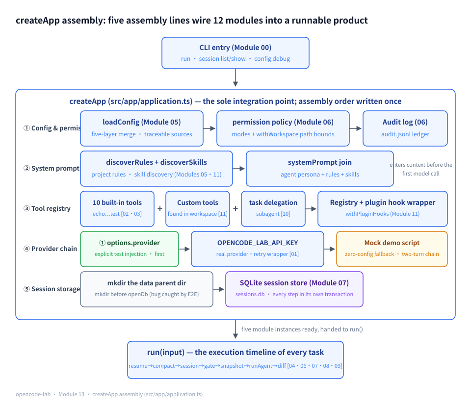
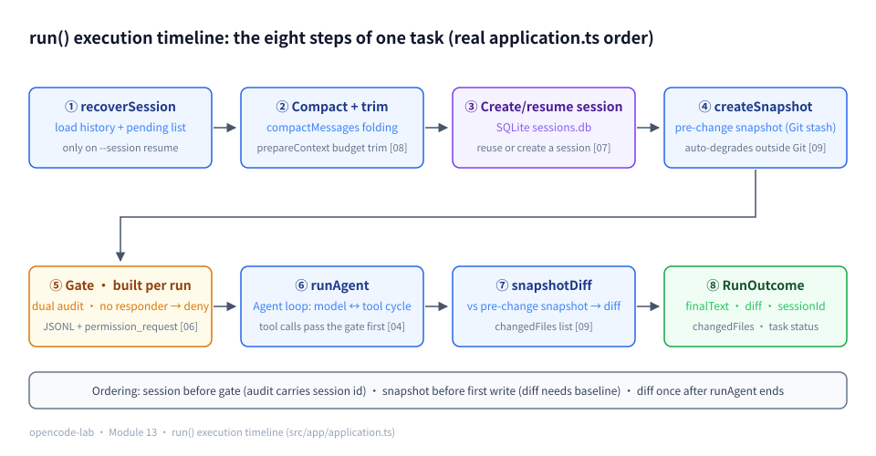
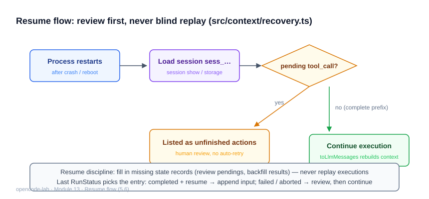
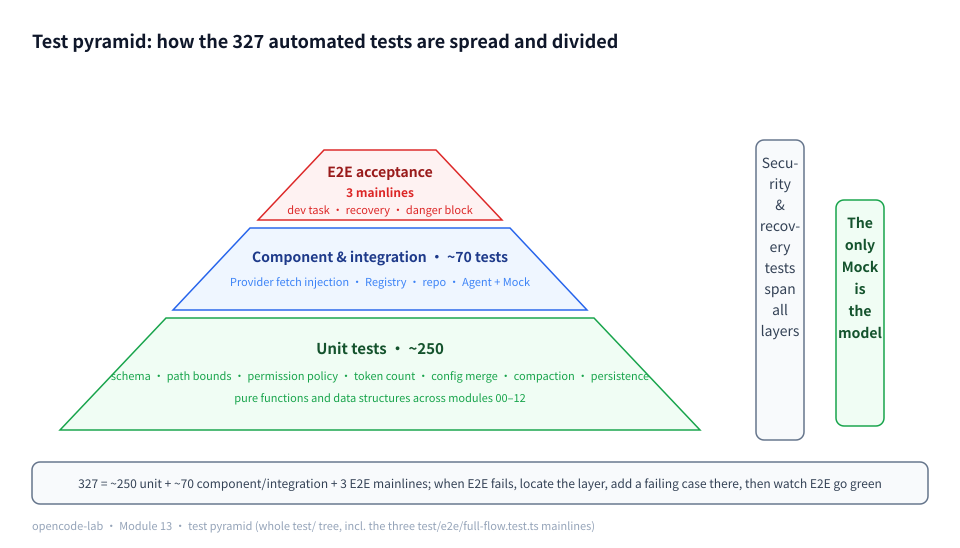

# Chapter 13: Integration, Testing, and the Capstone Project — Delivering OpenCode-Lab

## 1. Where this chapter fits

- Module: 13 — Integration, testing, and the core capstone project
- Study time: 12 hours (two weeks, including the Section 2 prerequisites)
- Difficulty: medium (no individual technique is new; the hard part is "getting everything correct at the same time")
- Prerequisite chapters: all (00–12; Chapter 12 can be skipped, see 2.3)
- Prerequisites: Section 2 teaches from zero — the composition root, the test pyramid, TTY, closure capture, and nested `ReturnType`
- Corresponding OpenCode commit: `70a24697ea0028e19f22712fd63059538cb4bee7`
- Corresponding project milestone: `v1.0-core`

## 2. Prerequisites

> This chapter closes out the whole course: it introduces no new "techniques" — what it introduces is an engineering problem — **how do 12 individually all-green modules get wired together correctly at the same time**. Section 2.2 teaches the five foundational concepts this chapter relies on from zero (composition root, test pyramid, TTY, closure capture, nested `ReturnType`); if any of the first 12 chapters is not solid yet, go back to 2.2 first, then enter the main text. For a quick terminology reference see 2.1; for a recap of the previous module see 2.3.

### 2.1 Glossary for this chapter

| Term | One-sentence plain wording | Where it is used in this chapter |
|---|---|---|
| Composition root | The single place in an application where every dependency is instantiated and wired to the others — the industry-standard name; this chapter's `createApp` is exactly that | 2.2.1 / 5.1 |
| Application layer | An orchestration layer that only does "construction and injection" and never writes the "how to finish the task" logic | 5.1 |
| Narrow interface / contract | Exposes only a handful of methods externally; callers depend on just those methods, and the internals can be refactored freely | 5.1 |
| Integration point | Where two or more modules meet and exchange data — also where bugs cluster | 5.1 / 5.5 |
| Closure capture | A function "remembers" the variables visible at its birth and can use them any time afterwards | 2.2.4 / 5.3 |
| Factory function | A function you call once that returns a set of methods; those methods share the state inside the closure | 2.2.4 / 5.3 |
| TTY | An interactive channel like a terminal where "someone is watching and can answer"; pipes and redirection are not a TTY | 2.2.3 / 5.3 / 5.8 |
| fail-closed (fail-safe) | When something goes wrong, choose "deny" rather than "allow" — unconfirmed = not allowed | 5.3 |
| Test pyramid | The layered shape of "a broad base of fast unit tests, a narrow peak of slow E2E" | 2.2.2 / 5.7 |
| Component test vs integration test | Component = one module + test doubles for its direct dependencies; integration = several real modules assembled together | 2.2.2 / 5.7 |
| E2E (end-to-end test) | A full-chain test from the user's entry point all the way to the final artifact | 5.5 / 5.7 |
| Mock | Replacing a real dependency with a controllable stand-in; the only thing doubled in this chapter is the model | 5.2 / 5.5 |
| Test fixture | A controlled environment built for a test: temp directories, preset files, preset scripts | 5.5 |
| Transaction / persist | Transaction = a set of database writes that "either all succeed or none of them do"; persist = written into the database as a durable fact (Chapter 7) | 5.6 |
| Idempotent / replay | Idempotent = doing the same action twice has the same effect as doing it once; replay = executing historical actions again (Chapter 7) | 5.6 |
| `ReturnType` inference | Let the compiler derive the return type from the function, sparing you a hand-written parallel interface that drifts | 2.2.5 / 5.1 |
| JSON Lines (JSONL) | A file format with one complete JSON object per line (Chapter 0, 2.2.4) | 5.3 |
| Dangerous-command floor | A hardcoded set of deny patterns that neither config nor user approval can loosen (Chapter 6) | 5.3 |
| git stash | Parks uncommitted changes on a stack and restores a clean working directory (Chapter 9) | 5.5 |

### 2.2 Foundations

#### 2.2.1 The composition root: concentrating the "wiring" in exactly one place

As a program grows, two kinds of code appear: "parts" (each module works on its own) and "wiring" (deciding which parts to use, in what order to assemble them, and who gets which). The **composition root** is the industry's common name for the place where wiring code is concentrated: the whole application instantiates all dependencies and injects them into each other in **this one place only**, and everywhere else simply takes them and uses them.

A minimal sketch within 10 lines (teaching example, not this project's code):

```ts
function createService(opts: { dbPath: string; logStream: { write(s: string): void } }) {
  const logger = createLogger(opts.logStream)   // build the logger first — everyone needs it
  const db = openDb(opts.dbPath, logger)        // then the database, wiring the logger into it
  return { serve: (q: string) => db.query(q) }  // the outside world sees only the single serve button
}
```

It buys three things this chapter repeatedly relies on: **the assembly order is written in one place** ("logger first, then database" is not rewritten at every call site); **the substitution point is concentrated** (`opts` is exactly the entry point for tests to swap parts); **assembly correctness has a single acceptance point** (if the assembly is wrong, it can only be wrong in this one file). In 5.1 you will see that `createApp` plays exactly this role.

#### 2.2.2 The test pyramid: why the base is wide and the peak narrow

Layer tests by "how far from the real user" and the shape you get is a pyramid: the base is a large body of unit tests (millisecond-scale, no IO, failures pinpoint a function at a glance), the middle is component and integration tests (second-scale, real dependency combinations), and the peak is a small number of E2E tests (real processes, files, and Git; minute-scale).

Why this shape? Two intuitive reasons:

1. **Higher is slower and costlier** — E2E must spawn processes, build temp Git repositories, and actually run `bun test`; one E2E costs as much as hundreds of base-layer tests; the count must stay small.
2. **Higher is harder to localize** — when an E2E goes red, the breakage may be in any layer; with the base all green and only the peak red, the problem most likely sits at a "module boundary". So the strategy is: pave the base densely (fast, precise), guard the peak sparsely (slow, complete).

**The component/integration boundary** in one sentence: component test = one module + its direct dependencies **replaced by doubles** (in-memory streams, a Mock Provider); integration test = the behavior of several **real** modules assembled together. The more doubles, the faster — but the narrower the proof. That is exactly the coordinate system behind this chapter's line "the only Mock is the model" (5.5, 5.7).

#### 2.2.3 TTY and interactive channels: why every "ask" is denied when the CLI runs in a pipe

**TTY** (TeleTYpewriter, its historical name) refers to an interactive channel like a "terminal": a real human sits at the screen watching output and typing input. The criterion is not "does it look like a terminal" but **what stdin is connected to**:

```bash
bun src/index.ts run "任务"              # run in a terminal: stdin is a TTY, a human can answer y/N
echo hi | bun src/index.ts run "任务"    # run in a pipe: stdin is connected to echo's output pipe, nobody to answer
```

In the second command, the process's stdin is a pipe (upstream is `echo`) — **nobody will ever write "y" into it**. An interactive step like the permission system's "ask" (asking the user y/N) will wait forever for an answer in that environment.

So the engineering convention is **fail-closed**: when the program detects no interactive channel (non-TTY, CI, tests), "ask" is treated as **deny** outright — better the task fails than a write slips through silently. "Unconfirmed = not allowed" (the permission gate in 5.3 and the CLI in 5.8 both do this; for the stdout/stderr division of labor and how pipes work, see Chapter 0, 2.2.3).

#### 2.2.4 Closure capture: a function remembers the variables of its birth

A **closure** is "a function + the variables it could see when it was created". Even after the outer function returns, the inner function still holds those variables (teaching example):

```ts
function makeGreeter(who: string) {
  return () => `hi ${who}`   // this arrow function "remembers" who
}
const g = makeGreeter("lab")
g() // "hi lab" — makeGreeter returned long ago, yet who still lives inside g's closure
```

Chapter 2's tool registry is "factory function + closure": the set of methods returned by `createToolRegistry()` all close over the same tool table. In 5.3 this chapter uses it for something security-relevant — **build the permission gate fresh on every run, and let the audit callback close over the current session id**: every `run()` "gives birth" to a new callback, each remembering its own session.

#### 2.2.5 Nested `ReturnType<ReturnType<...>>`: the "return value of the return value" as a type

`ReturnType<T>` asks the compiler: "what is this function's return type?" It can be nested two levels (teaching example):

```ts
function makeGreeter() {
  return { greet: (name: string) => `hi ${name}` }
}
type Greeter = ReturnType<typeof makeGreeter>      // { greet: (name: string) => string }
type GreetResult = ReturnType<Greeter["greet"]>    // string — "the return value of that method inside the factory's return value"
```

In plain words: nesting two levels means **"the return value of some method of the factory function's return value"**. Its purpose is not showing off but **avoiding a hand-written parallel interface**: types are derived directly from real code, so when the interface changes the type follows automatically; a hand-copied one silently drifts. In 5.1, `App.sessionDetail`'s return type is written exactly this way (self-check questions in 5.1).

### 2.3 Recap of the previous module

**Chapter 11 (extension mechanisms)** — the four extension forms are distinguished by "what form the extension takes": **Custom Tool = data** (a `.opencode-lab/tools/*.json` declaration + shell execution — add capability without writing code), **MCP = process** (a minimal JSON-RPC client over stdio with an independent lifecycle that can crash independently), **Skill = document** (`.opencode-lab/skills/*/SKILL.md` is discovered and injected into context, never entering the execution path), **Plugin = code** (beforeTool/afterTool/onEvent hooks running inside the host process). Two properties to carry into this chapter: **hook error isolation** — an error thrown by a plugin hook is caught by the host and converted into an error result, so one plugin cannot drag down the whole Agent; **the MCP lifecycle is owned by the host** — the host starts the server subprocess, and its exit immediately shows up as a closed stdout stream. This chapter's assembly line wires in three of them: `discoverCustomTools` (Custom Tool), `discoverSkills` (Skill), and `withPluginHooks` (Plugin); the MCP client was Chapter 11's standalone deliverable and is not wired into the main assembly line in the teaching version.

**Chapter 12 (the Effect comparison) in one sentence**: this chapter **does not depend** on any code from Chapter 12 — opencode-lab's integration layer is Promise-style throughout; Chapter 12 is a controlled experiment on "is the other style worth it", skipping it does not affect this chapter, and you can return to it after graduation.

---

## 3. Learning objectives

- Understand: the role of the application layer (`createApp`) as the sole integration point — both the CLI and E2E face only it; the testing philosophy of "the only Mock is the model".
- Be able to implement: the complete CLI (run/session/config commands, streamed output, the JSON protocol, session-resume flags) and the graduation E2E (real file modification + real test execution + permissions + snapshots + recovery + security).
- Be able to test: three E2E mainlines (the dev-task loop, interrupt recovery, dangerous-command interception) plus the process-level full CLI command surface.
- Be able to explain: how each of the course's 12 "final deliverable definition" items maps to code and tests.

## 4. Problem statement

Twelve modules being individually green does not make a usable system: the config layer is not wired to permissions, snapshots are not wired to the run lifecycle, and the CLI still answers with a canned reply. This chapter's core work is one **assembly line** (`src/app/application.ts`) — in the words of 2.2.1, building the **composition root** for the whole application:

```text
createApp(workspace)
  ├─ loadConfig (Module 05) -> permission policy (Module 06)
  ├─ discoverRules + discoverSkills (05/11) -> systemPrompt
  ├─ Registry: 8 coding tools (03) + echo/calculator (02) + custom tools (11) + task delegation (10) + plugin hooks (11)
  ├─ Provider: injection > OPENCODE_LAB_API_KEY (real) > Mock demo script (01)
  ├─ SQLite session store + persistence (07)
  └─ run(): compaction (08) -> snapshot (09) -> runAgent (04) -> diff -> audit
```

The E2E testing principle (this chapter's most important testing belief): **the only Mock is the model**. The filesystem, the shell, `bun test`, Git, and SQLite are all real — only then do claims like "the files the Agent changed really exist, the tests really pass, the user's uncommitted changes really survive" carry probative force (this philosophy expanded in 5.5).

## 5. Core concepts

### Knowledge point ↔ source file ↔ test file mapping table

| # | Knowledge point | Source files (relative to opencode-lab/) | Test files |
|---|---|---|---|
| 1 | Application-layer assembly: createApp as the sole integration point | `src/app/application.ts` | `test/e2e/full-flow.test.ts`, `test/cli.integration.test.ts` |
| 2 | The Provider selection chain and the zero-config demo | `src/app/application.ts`, `src/providers/mock.ts` | `test/cli.integration.test.ts` |
| 3 | Per-session permission gate construction and dual audit writes | `src/app/application.ts`, `src/permission/gate.ts`, `src/permission/policy.ts` | `test/e2e/full-flow.test.ts` (mainlines 1/3) |
| 4 | The nine-step integration scenario (blueprint) | `src/app/application.ts`, `src/context/recovery.ts` | `test/e2e/full-flow.test.ts` |
| 5 | The mandatory E2E flow (blueprint) | `test/e2e/full-flow.test.ts` | `test/e2e/full-flow.test.ts` |
| 6 | Interrupt recovery and "no blind re-execution" | `src/context/recovery.ts`, `src/session/persistence.ts` | `test/e2e/full-flow.test.ts` (mainline 2), `test/context/recovery.test.ts` |
| 7 | The six test layers (blueprint) | the whole `test/` tree | each layer's test files (see 5.7) |
| 8 | The CLI command surface and the process boundary | `src/cli/args.ts`, `src/cli/main.ts`, `src/index.ts` | `test/cli.integration.test.ts`, `test/args.test.ts` |
| 9 | Example projects and the cross-language claim | `examples/typescript-project/`, `examples/go-project/` | `examples/typescript-project/src/server.test.ts` |

### 5.1 Application-layer assembly: createApp, the sole integration point

**Concept**: The problem of integration is not "missing features" but "features not wired together": the permission mode read by the config module is never handed to the permission module, and the snapshot module does not know when a run starts. The standard engineering answer is the **application layer**: a `createApp(options)` function constructs all module instances in the correct order, injects them into one another, and finally returns a narrow interface (narrow interface / contract: exposes only a few methods, and the outside depends only on them). This "single wiring point" has an industry name — the **composition root (see 2.2.1)** — and `createApp` is this project's composition root. The narrow interface is the key — it is what makes "internals refactorable at will, outside dependent only on the contract" possible: the CLI faces a few methods of the `App` type, the E2E tests face the same, and neither `import`s internal modules to assemble things by hand. Three direct benefits follow. First, the assembly order is written in one place; implicit inter-module timing (create directories before opening the database, build the policy before the permission gate) is not re-implemented at multiple call sites. Second, the test injection points are concentrated — `provider`/`ask`/`dbPath` in `AppOptions` are the entire surface for tests to swap boundaries. Third, module-composition correctness has a single acceptance point — both integration bugs this chapter's E2E flushed out (the SQLite parent directory, permission audit reaching the session table) were fixed in this one file.

**How this project implements it**: the narrow interface returned by `src/app/application.ts` — the entire field of view of the CLI and E2E:

```ts
export type App = {
  config: LoadedConfig
  run(input: { prompt: string; resumeSessionId?: string }): Promise<RunOutcome>
  listSessions(): SessionSummary[]
  sessionDetail(id: string): ReturnType<ReturnType<typeof createSessionRepository>["exportSession"]>
  resumeState(sessionId: string): ReturnType<typeof recoverSession>
  configDebug(): string
  close(): void
}
```

This narrow interface maps directly onto the CLI's three read-only commands — `session show <id>` prints exactly the JSON of `sessionDetail(id)`, and likewise for `listSessions`/`configDebug`. After running the zero-config demo once in a temp workspace (command in 5.8's Output), look at the key structure of the `session show` output (key fields excerpted from real output, long text elided):

**Output (excerpt)**:

```text
顶层键 = session, messages, toolCalls, events, permissionRequests
session.id = sess_…（每次运行随机，已遮蔽）
session.status = completed
messages.length = 4          # 演示脚本两轮：user → assistant(tool_calls) → tool → assistant(text)
toolCalls[0] 键 = id, sessionId, messageId, tool, input, status, result, createdAt, finishedAt
toolCalls[0].tool/status = echo / success
```

The message chain, tool calls, events, permission requests — the "four cards" you want when debugging E2E are all in this JSON (this chapter's Section 10 debugging tips start reading from here).

That nested `ReturnType<ReturnType<...>>` line in `sessionDetail` is not showing off — its plain reading and its benefit were taught from zero in 2.2.5: **"the return value of that method inside the factory's return value"**, borrowing the repository's export shape directly and sparing the integration layer a drifting copy of the type definition.

Inside the assembly body, the tool registry is the first wiring point — built-in tools, custom tools, and plugin hooks enter the same table in sequence:

```ts
  const baseRegistry = createToolRegistry()
  baseRegistry.registerAll([
    echoTool,
    calculatorTool,
    readTool,
    globTool,
    grepTool,
    writeTool,
    editTool,
    applyPatchTool,
    shellTool,
    testTool,
  ])
  const custom = await discoverCustomTools(options.workspace)
  baseRegistry.registerAll(custom.tools)
  const pluginHost = createPluginHost()
  const registry = withPluginHooks(baseRegistry, pluginHost)
```

Note that `withPluginHooks` does not replace the registry; it wraps a layer around `call`: invocations first pass the plugins' `beforeTool` (which may cancel), and after execution `afterTool` fires — with no plugins registered, behavior is identical to the original table.

The system prompt works the same way: a concatenation of three sources — the Agent persona (Module 10's BUILD_AGENT), project rules (Module 05), and skills (Module 11):

```ts
  const systemPrompt = [
    BUILD_AGENT.systemPrompt,
    rulesToSystemSection(rules),
    skillsToSystemSection(skills.skills),
  ]
    .filter((s) => s !== "")
    .join("\n\n")
```



*Figure 13-1: The createApp assembly at large — five assembly lines wire the 12 modules into one runnable product; module numbers (00–12) are annotated beside each component, and run() at the bottom is the driver entry for every task.*

**Common pitfalls**:
1. Letting the CLI and the tests each assemble modules themselves. Symptom: the two initializations order things differently — the CLI runs while E2E hangs (or vice versa); Fix: all composition happens only in `createApp`; callers see only `App`.
2. Writing business logic into the integration layer. Symptom: "how to finish the task" branching appears inside `createApp`; Fix: the assembly layer only constructs and injects; task logic belongs to `runAgent` (Module 04).
3. Forgetting to converge resource release. Symptom: on test-process exit, SQLite handles left open; Fix: `App.close()` closes the database in one place; callers must call it in `finally`.

**Self-check questions**:
1. Using 2.2.5's plain explanation ("the return value of that method inside the factory's return value"), explain why `sessionDetail`'s return type is written `ReturnType<ReturnType<...>>` instead of a separately named interface? — Reference answer: it reuses the repository's exported shape directly, so the type is derived from real code — when the interface changes, it follows automatically; a hand-copied parallel interface would drift.
2. Which fields in `AppOptions` are test injection points? — Reference answer: `provider`/`mockScript` (swap the model), `ask` (swap the permission responder), `dbPath` (move the database), `env` (swap environment variables), `signal` (inject cancellation).
3. Why must `await mkdir(dirname(dbPath))` run before `openDatabase` inside `createApp`? — Reference answer: SQLite does not create parent directories — exactly the integration bug the E2E flushed out; with `.opencode-lab/` missing you get SQLITE_CANTOPEN immediately.

### 5.2 The Provider selection chain and the zero-config demo

> 📊 Figure: For the Provider's place in the full-machine assembly, see Figure 13-1 in Section 5.1 (the createApp assembly diagram).

**Concept**: An Agent product meant for delivery must answer "how do we demo without an API key". Hard-depending on a real model makes every new environment fail at the first step and leaves students unable to run any chain offline. The solution is to make "where does the model come from" a **selection chain** in which every level can legitimately fall through: test injection > environment-variable key (real Provider, wrapped in `withProviderRetry` — Chapter 1's retry wrapper, exponential backoff on retryable errors) > Mock demo script. Three design points. First, the chain order encodes determinism first — explicit injection is the most trusted (a test knows exactly what it got), the environment variable comes next, and the Mock fallback makes "demoable with zero config" a hard promise rather than a documentation slogan. Second, the Mock is not an empty shell — `defaultDemoScript` also walks the full two-turn chain of "call a tool → summarize", so `session list`/`session show`/audit all have content to show under zero config. Third, the CLI integration test explicitly empties `OPENCODE_LAB_API_KEY`, forcing the Mock branch so that test determinism is untouched by the developer's machine.

**How this project implements it**: the selection chain itself — `src/app/application.ts`:

```ts
  const apiKey = env[config.config.provider.apiKeyEnv]
  const provider: LlmProvider =
    options.provider ??
    (apiKey
      ? withProviderRetry(
          createOpenAICompatibleProvider({
            baseUrl: config.config.provider.baseUrl,
            apiKey,
            model: config.config.provider.model,
            timeoutMs: config.config.provider.timeoutMs,
          }),
        )
      : createMockProvider(options.mockScript ?? defaultDemoScript()))
```

The zero-config demo script — bottom of the same file; it walks the full chain instead of returning a fixed string:

```ts
function defaultDemoScript(): MockTurn[] {
  return [
    { kind: "tool_calls", calls: [{ tool: "echo", input: { message: "演示：Agent 管线已接通（未配置模型，运行 Mock 脚本）" } }] },
    { kind: "text", text: "这是 Mock Provider 的演示回复。配置环境变量 OPENCODE_LAB_API_KEY（及 opencode-lab.json 的 provider 配置）即可接入真实模型。" },
  ]
}
```

The test side forces zero config — the subprocess environment in `test/cli.integration.test.ts`:

```ts
    env: { ...process.env, OPENCODE_LAB_API_KEY: "" },
```

Together with the assertions in `test/cli.integration.test.ts`: `run --json`'s `parsed.finalText` must contain "Mock Provider", and `detail.toolCalls` must contain an echo call — the demo chain is pinned down by tests, not "working by luck".

**Common pitfalls**:
1. The Mock branch returning one fixed sentence. Symptom: the zero-config demo shows no tool call, the audit table is empty, `session show` has nothing to show; Fix: the demo script must also cover the full "tool call → summary" chain (compare `defaultDemoScript`).
2. The selection chain in the wrong order. Symptom: the test injected a provider yet the code still calls the real API (env outranking injection), or a leftover local key makes tests alternately fast and slow; Fix: `options.provider ??` must be the chain's first link.
3. The real Provider without retry. Symptom: an occasional rate limit fails the whole task; Fix: wrap the real branch in `withProviderRetry`; the Mock branch needs none (the script is deterministic).

**Self-check questions**:
1. Why does `env[config.config.provider.apiKeyEnv]` read the secret's variable name from config instead of hardcoding it? — Reference answer: apiKeyEnv is a user-configurable item (see the examples' opencode-lab.json); different providers use different environment variable names.
2. Why does the CLI integration test explicitly clear `OPENCODE_LAB_API_KEY`? — Reference answer: if a real key lingers on the machine, the tests would take the real branch — slow, costly, non-deterministic; emptying it forces the Mock branch and keeps the assertions stable.
3. What is the division of labor between `mockScript` and `defaultDemoScript`? — Reference answer: the former lets tests inject an exact script; the latter is the fallback demo when nobody injects — one entry point: `options.mockScript ?? defaultDemoScript()`.

### 5.3 Per-session permission gate construction and dual audit writes

> 📊 Figure: The permission gate's evaluation order is Figure 6-1 in Chapter 6, and the dual audit writes are Figure 6-2; their place in the run() timeline is Figure 13-2 in Section 5.4.

**Concept**: First, restate three terms from Chapter 6, which this chapter combines — the **dangerous-command floor**: a set of hardcoded patterns (`rm -rf`-like) that denies on hit; config cannot loosen it and user approval cannot loosen it; it sits at level 1 of the five-level evaluation pipeline. The **five-level pipeline**: dangerous-command → agent-role → path-boundary → config → risk-default; order is priority, and config's allow cannot overturn an earlier deny. **fail-closed / "ask with no interactivity = deny"**: when ask finds no responder, it is treated as a denial. This section compresses them into three maxims and checks the integration implementation: `--allow-all` is an **escape hatch** (it only flips level 4's config mode table from ask → allow, to unstick demos); **config gaming** is the space in which the user bargains with the policy through config files and switches; the **security floor** = the dangerous-command floor + the fail-closed default, which takes no part in that bargaining — the escape hatch cannot touch it.

Two classic mistakes when integrating permissions: making the permission gate a global singleton — audit records then cannot carry "which session produced this decision", so the process cannot be reconstructed from the session afterwards; and letting the "allow all" switch short-circuit the policy entirely, tearing out the dangerous-command floor along with it. The correct approach: build the permission gate **fresh on every run**, closing over the current session id (the closure-capture mechanism in 2.2.4 — every `run()` "gives birth" to a new audit callback, each remembering its own session), and have the audit callback write both places — the JSONL file (a cross-session ledger a human can read directly) and the session table `permission_request` (structured, fully exportable by `session show`). The third point is the fail-safe default: with no interactive channel (non-TTY, tests — see 2.2.3; run the CLI in a pipe and stdin has no responder), ask must be treated as a denial — "unconfirmed = not allowed"; better the task fails than a write slips through silently.

**How this project implements it**: the escape hatch changes only the mode table — `src/app/application.ts`:

```ts
  const modes = options.allowAll
    ? Object.fromEntries(Object.keys(config.config.permissions).map((tool) => [tool, "allow"])) as Record<string, PermissionMode>
    : (config.config.permissions as Record<string, PermissionMode>)
  const policy = withWorkspace({ ...policyFromConfig(config.config), modes }, options.workspace)
  const fileAudit = createAuditLog({ file: `${options.workspace}/.opencode-lab/audit.jsonl` })
```

The escape hatch's blast radius is only the one `modes` table: in the evaluation pipeline the dangerous-command floor is level 1 and config modes are level 4 (first hit stops first), so rewriting every mode to allow still cannot touch the floor — "order is priority" cashes out right here.

The gate is built per run, with dual audit writes — inside `run()` of the same file:

```ts
    const permission = createPermissionGate({
      agent: BUILD_AGENT.name,
      policy,
      resolveRisk: (tool) => baseRegistry.list().find((t) => t.name === tool)?.risk,
      ask: options.ask,
      audit: {
        record: async (entry) => {
          repo.addPermissionRequest(session.id, {
            tool: entry.tool,
            resource: entry.resource ?? undefined,
            decision: entry.decision,
            rule: entry.rule,
            reason: entry.reason,
          })
          await fileAudit.record(entry)
        },
        entries: fileAudit.entries,
      },
    })
```

Dual writes are not a slogan — the file side (JSONL) can be checked on the spot. In the temp workspace where the demo task ran, look at the first line of the audit ledger:

```bash
head -1 /tmp/oclab-demo/.opencode-lab/audit.jsonl
```

**Output (excerpt)**:

```json
{"at":"2026-09-…T…Z","agent":"build","tool":"echo","decision":"allow","rule":"risk-default","reason":"工具 echo 为低风险，默认允许"}
```

The `at` timestamp differs on every run (masked); `rule: "risk-default"` + `decision: "allow"` is exactly the on-disk record of the five-level pipeline's level 5, "low risk defaults to allow" — the same decision is also written into SQLite's `permission_request` table (exportable via `session show`, see 5.1's Output).

The fail-safe default lives inside the gate — `src/permission/gate.ts`:

```ts
    if (evaluated.decision === "ask") {
      const approved = options.ask ? await options.ask(request, evaluated) : false
```

The floor is unaffected by `--allow-all` — `src/permission/policy.ts` (9 entries in total, rest omitted):

```ts
// Dangerous-command floor: cannot be loosened via config. Each entry carries a human-readable reason.
export const DANGEROUS_COMMANDS: { re: RegExp; why: string }[] = [
  { re: /rm\s+(-[a-zA-Z]*[rfR][a-zA-Z]*\s+)+/, why: "递归/强制删除（rm -rf 类）" },
  { re: /sudo\s+rm/, why: "提权删除" },
```

E2E mainline 3 closes the loop on this: with `allowAll: true`, `rm -rf /` is still intercepted, `toolCalls[0]` is `{ tool: "shell", status: "denied" }`, and `audit.jsonl` contains `dangerous-command`.

**Common pitfalls**:
1. Writing the audit only to the file, never into the session table. Symptom: `session show` shows no permission decisions and the session cannot vouch for itself; Cause: the gate was created outside the session context; Fix: build the gate every run and let the `record` closure capture `session.id` for dual writes (exactly this chapter's second E2E-fixed integration bug).
2. Implementing `--allow-all` as a blanket `deny → allow`. Symptom: the dangerous-command floor gets bypassed; Fix: the escape hatch rewrites only the `modes` map; the floor checks inside `evaluatePermission` still run first as usual.
3. Allowing when ask has no responder. Symptom: running the CLI in CI or a pipe, writes slip through silently; Fix: `options.ask ? await options.ask(...) : false` — no interactive channel means deny.

**Self-check questions**:
1. Why write the audit in two places rather than only to SQLite? — Reference answer: the JSONL file spans sessions and can be `cat`ed/`grep`ed directly, while the SQLite side powers `session show`'s structured export — each consumption scenario has its optimal carrier.
2. Why does `resolveRisk` look up the registry instead of hardcoding into the policy? — Reference answer: the risk tier is part of the tool definition (`ToolDefinition.risk`); the registry is the single authority, keeping the policy decoupled from concrete tools.
3. What does `ask: async () => true` in the E2E simulate? — Reference answer: the interactive confirmation being approved by the user — the gate still walks the full evaluate → ask → audit flow; only the answering is automated.

### 5.4 The nine-step integration scenario: from user request to saved session

**Concept**: The "course blueprint" cited throughout this chapter is `docs/OPENCODE_CORE_COURSE_DESIGN.md` at the repo root — the design master plan written down before the course began (what to teach, in what order, and what each module accepts); the nine-step integration scenario, the mandatory E2E flow, and the six test layers all come from its §8.14. The blueprint's integration scenario is a nine-step chain: the user asks to "add a feature to the project" → the Agent first reads the project rules and creates a Session → an Explore/Plan subagent analyzes the relevant files → the Build Agent modifies code → the Permission layer requests approval to write files and run tests → the Agent runs the tests, reads the failing output, and fixes → Compaction handles the longer history → the Git Snapshot outputs a diff of the changes → after the user confirms, things wrap up and the Session is saved.

Its teaching value lies in **ordering constraints** — five rules of the form "X must precede Y". First the constraint table (each with a concrete counter-example of getting the order wrong):

| # | Ordering constraint | Why | Counter-example when ordered wrong |
|---|---|---|---|
| 1 | Project rules enter the system prompt before the first model call | The system prompt rides along with every request; the model only knows what is in it | The fixture AGENTS.md says "run bun test after modifying", but the rules are concatenated into systemPrompt only after the first call → the first-round model edits the file and starts summarizing, never knowing it must run tests → E2E mainline 1's "2 pass" assertion fails and the project rules are dead letters |
| 2 | The session exists before the permission gate is built | The audit callback must close over the session id (2.2.4) | The gate is built once inside `createApp` and shared globally → the `record` closure cannot capture this session's id (or forever captures the first session's) → the second session's permission decisions are booked under someone else's name and `session show` cannot vouch for itself — exactly this chapter's second E2E-flushed-out integration bug |
| 3 | Compaction before request assembly | Fold the long history first, or the trimming budget will not fit | `prepareContext` before `compactMessages` → trimming faces an unfolded history → old tool results eat the budget and recent messages or the system prompt get squeezed out of the window → the model wanders off, amnesia-style |
| 4 | The snapshot before the first write | The diff needs a clean "before" baseline | Snapshot taken after `runAgent` → the baseline already has the Agent's own freshly written files mixed in → the diff under-reports the Agent's changes as if they were baseline, changedFiles misses items; the user's uncommitted changes may also be overwritten by the Agent's writes with no way to recover |
| 5 | The diff computed once, after runAgent has fully ended | A mid-flight diff is doomed to be incomplete | Computing a diff after every tool round → changes made after the last round are missing from the diff and the user's view of "what changed" lacks files; the extra Git calls also slow the task |

The teaching version narrows "subagent analysis" down to the task tool's optional delegation (Module 10); every other step lands in the `createApp` assembly and the linear timeline of `run()`. The best way to read these dozen-odd lines of code is to walk the nine-step list against line numbers — here is that walkthrough.

**How this project implements it: a step-by-step walkthrough of run()**. `run()` in `src/app/application.ts` spans lines 147–221; it splits into four segments (line numbers are the real ones in the current repo, code verbatim). First, **segment zero** — two steps live not in `run()` but in assembly-time `createApp` (lines 79–88 read the rules, lines 131–138 register task delegation):

```ts
  registry.register(
    createTaskTool({
      deps: { registry: baseRegistry, workspace: options.workspace, signal: options.signal },
      providerFactory: () => provider,
      policy,
    }),
  )
```

Rule discovery and task registration happen at assembly time rather than inside every `run()` because they are **App-lifetime** concerns: rules files and custom tools do not change mid-task; read once into the system prompt/registry, they are visible to `runAgent` on every run (satisfying constraint 1: rules must precede any model call — assembly time satisfies that by construction).

**Segment one (lines 147–161): recovery and context preparation** — corresponds to step 7 of the nine-step chain (Compaction); the recovery logic is the "inverse operation" of step 9 (saving the Session): because the previous run persisted everything, this run can rebuild from the database:

```ts
  async function run(input: { prompt: string; resumeSessionId?: string }): Promise<RunOutcome> {
    // Recovery: read the history (including the pending unfinished-action list)
    const resume = input.resumeSessionId ? recoverSession(repo, input.resumeSessionId) : null
    const rawHistory = resume ? resume.history : []
    const prompt = input.resumeSessionId
      ? `${resume!.continuationPrompt}\n\n用户补充：${input.prompt}`
      : input.prompt

    // Compact the long history first, then trim to budget
    const compacted = await compactMessages(rawHistory, DEFAULT_COMPACTION_POLICY)
    const prepared = prepareContext({
      baseSystemPrompt: systemPrompt,
      messages: compacted.messages,
      budget: DEFAULT_BUDGET,
    })
```

Note that lines 156–161 are exactly where constraint 3 lands: `compactMessages` first, `prepareContext` after.

**Segment two (lines 163–167): session creation/reuse and persistence** — corresponds to the second half of step 2 (create the Session) and step 9 (save the Session). "Wrap up after user confirmation and save" degrades, in the teaching version, into "saved all along + status set to completed" — `createSessionPersistence` persists every message and every tool result immediately, each in its own transaction:

```ts
    // Session: resume reuses the original session; a new task creates a new session
    const session = input.resumeSessionId && repo.getSession(input.resumeSessionId)
      ? { id: input.resumeSessionId, isNew: false }
      : { id: repo.createSession({ projectId, agent: BUILD_AGENT.name, title: input.prompt.slice(0, 60) }).id, isNew: true }
    const persistence = createSessionPersistence(repo, session.id)
```

**Segment three (lines 168–190): the permission gate and the snapshot** — corresponds to step 5 (Permission requests approval) and the first half of step 8 (Snapshot takes the baseline). Note that the **order** of these two pieces implements constraints 2 and 4: the session already exists from segment two, so the gate can capture `session.id`; the snapshot is taken before `runAgent`, so the baseline is clean:

```ts
    // Per-run permission gate: the audit writes both the JSONL file and this session's permission_request table
    const permission = createPermissionGate({
      agent: BUILD_AGENT.name,
      policy,
      resolveRisk: (tool) => baseRegistry.list().find((t) => t.name === tool)?.risk,
      ask: options.ask,
      audit: {
        record: async (entry) => {
          repo.addPermissionRequest(session.id, {
            tool: entry.tool,
            resource: entry.resource ?? undefined,
            decision: entry.decision,
            rule: entry.rule,
            reason: entry.reason,
          })
          await fileAudit.record(entry)
        },
        entries: fileAudit.entries,
      },
    })

    // Snapshot before modifications (auto-degrades outside Git repos)
    const snapshot = await createSnapshot(options.workspace, session.id)
```

**Segment four (lines 192–220): runAgent and wrap-up** — corresponds to step 3 (subagent delegation), 4 (the Build Agent modifies code), 6 (run tests, read the failing output, and fix), the second half of 8 (diff), and step 9's status flip. Within `run()`'s field of view, steps 3/4/6 are just "the runAgent loop spinning a few more turns": task delegation is one tool in the registry (segment zero), modifying code is edit/write executing, and test-fixing is the model seeing the test tool's failing output and calling edit again next round — `run()` is unaware of all of it. That is precisely "orchestration separated from business logic":

```ts
    const result = await runAgent(
      { prompt, history: prepared.messages },
      {
        provider,
        registry,
        systemPrompt: prepared.system,
        workspace: options.workspace,
        maxSteps: config.config.agent.maxSteps,
        temperature: config.config.agent.temperature,
        permission,
        persistence,
        onEvent: (event) => {
          options.onEvent?.(event)
          repo.addEvent(session.id, event.type, event)
        },
        signal: options.signal,
      },
    )

    // Diff after modification (changes made visible)
    const diff = await snapshotDiff(options.workspace, snapshot.ok ? snapshot.snapshot : null)
    return {
      ...result,
      sessionId: session.id,
      isNewSession: session.isNew,
      snapshotCreated: snapshot.ok,
      diff: "error" in diff ? "" : diff.diff,
      changedFiles: "error" in diff ? [] : diff.changedFiles,
    }
```

The nine-step ↔ code-location master table (line numbers refer to `src/app/application.ts`):

| Nine-step chain | Location | How it is implemented |
|---|---|---|
| 1 The user asks for a feature | `input.prompt` of `run(input)` (line 147) | The CLI passes the prompt in; `run()` does not care where it came from |
| 2 Read the rules and create the Session | Rules: assembly-time lines 79–88; session: lines 163–166 | Rules are read once in `createApp` into systemPrompt; the session is created or reused at the top of `run()` |
| 3 A subagent analyzes the relevant files | task tool registration: assembly-time lines 131–138; injection: line 196 | The teaching version narrows this to optional task delegation; no forced Explore/Plan phase |
| 4 The Build Agent modifies code | inside the `runAgent` loop, lines 192–209 | Modifications happen in tool executions inside the loop; `run()` merely initiates |
| 5 Permission requests approval | gate build: lines 168–187; injection: line 201 | The gate is built fresh per run, with dual audit writes |
| 6 Run tests, read the failing output, and fix | same as 4; the test tool is in the registry (line 102) | Completed within the multi-turn tool loop; `run()` does not intervene |
| 7 Compaction handles the longer history | lines 156–161 | Fold (compact) before request assembly, then trim (prepare) |
| 8 Git Snapshot outputs the change diff | snapshot: lines 189–190; diff: lines 211–212 | Take the baseline before writes; compute the diff once at the end |
| 9 Wrap up and save the Session | persistence: everything persisted along the way from line 167; return: lines 213–220 | "Save at the end" = already saved all along + status set to completed |



*Figure 13-2: The run() execution timeline — resume/compaction, create or resume the session (SQLite), the pre-change snapshot, the permission gate (dual audit writes), runAgent, snapshotDiff, finally producing a RunOutcome.*

**Common pitfalls**:
1. Compacting after the model call. Symptom: the very first round blows the context budget; Cause: treating compaction as "after-the-fact cleanup" rather than "before-the-fact preparation"; Fix: `compactMessages` is the step before `prepareContext` inside `run()`.
2. Snapshotting later than the first write. Symptom: the diff mixes in the user's own uncommitted changes; Fix: create the snapshot before `runAgent` (and verify the user's content survives in the stash — see E2E mainline 1).
3. The session status lingering at a stale value mid-task. Symptom: after a crash the database says "completed" but the task was not finished; Fix: call the five persistence methods at every step in independent transactions (see 5.6), flipping status only at real boundaries.

**Self-check questions**:
1. Which steps of the nine, if ordered wrong, cause a **security** problem (rather than a functional one)? — Reference answer: a snapshot later than the writes loses the baseline (no rollback possible); a permission gate built before the session leaves the audit with no owner; a floor check placed after the mode check could be bypassed.
2. Why does the `resume` branch concatenate `continuationPrompt` with the user's addition? — Reference answer: the first message of a resumed run must first explain "where it stopped and what must not be redone"; the user's addition comes second — reversed, the model would act on the addition directly.
3. Why is the `task` tool registered in `createApp` rather than in `run()`? — Reference answer: it is a member of the registry with the App's lifetime; register once and every run's `runAgent` sees it.

### 5.5 The mandatory E2E flow: the run command's full chain

> 📊 Figure: The nine-step timeline of the run command's full chain is exactly Figure 13-2 in Section 5.4 — this section turns it into E2E assertions.

**Concept**: The blueprint (`docs/OPENCODE_CORE_COURSE_DESIGN.md` §8.14) defines the E2E flow as a command-level acceptance: `opencode-lab run "为示例项目增加一个 REST endpoint"` → detect the project type and rules → read the relevant code → output a plan → request write permission → modify files → run tests → fix based on the failures → show the diff → save the Session. Its essential difference from unit tests is **completeness of the evidence chain**: not verifying that some function returns the right value, but verifying that "every link the user perceives really happened" — the file really changed, the tests really ran, the permission was really granted, the diff is really viewable. That makes E2E the catcher of integration bugs: it can fail even when every unit test is green, because mismatches only appear at module boundaries (this chapter caught two for real).

Why is "the only Mock is the model" a philosophy rather than a trick? Because **wherever you draw the Mock's boundary is where your proof ends**: mocking the model concedes that "what the model thinks" is uncontrollable and can only be scripted; keeping the real filesystem, shell, `bun test`, Git, and SQLite declares that what you mean to prove is "what the Agent did". The three physical pieces of evidence — `readFileSync` (the file really changed), `git stash show` (the user's uncommitted changes really survive), `audit.jsonl` (the permission decision really was recorded) — carry probative force precisely because everything they inspect lies outside the Mock. The discipline of writing E2E: build fixtures that are "projects with history" (Git commits + the user's uncommitted changes); the Mock script's edit arguments must match the fixture file contents **byte for byte** — otherwise the edit tool cannot match old_string (Chapter 3's matching rule: old_string must equal the file content exactly) and the chain snaps at step two.

**How this project implements it**: the fixture of `test/e2e/full-flow.test.ts` — a real Git repository plus the user's uncommitted changes:

```ts
    await execAsync("git init -q && git config user.email e@t && git config user.name t && git add -A && git commit -qm init", { cwd: ws.dir })
    // Simulate the user's uncommitted changes from before the Agent ran (the snapshot must protect them)
    await Bun.write(`${ws.dir}/README.md`, "# 项目\n用户正在编辑的未提交内容")
```

`git config user.email/user.name` is not ceremony — without an author identity `git commit` refuses outright; committing once before writing README's uncommitted changes creates a "must survive" user asset for the snapshot (the stash assertion below checks exactly that).

The Mock model drives a four-turn chain (read → edit → test → summarize); note that the test turn **really executes** `bun test`:

```ts
        { kind: "tool_calls", calls: [{ toolCallId: "t1", tool: "test", input: { command: "bun test" } }] },
        { kind: "text", text: "已实现 multiply 函数并通过全部测试" },
```

Assertions unfold along the evidence chain — the file really modified:

```ts
      // The file really was modified
      const content = readFileSync(`${ws.dir}/src/calc.ts`, "utf8")
      expect(content).toContain("export function multiply(a: number, b: number) {\n  return a * b\n}")
```

The tests really executed and passed (the "2 pass" comes from real `bun test` output, not mock text):

```ts
      const testCall = detail?.toolCalls.find((c) => c.tool === "test")
      expect(testCall?.status).toBe("success")
      const testResultText = JSON.stringify(testCall?.result)
      expect(testResultText).toContain("2 pass")
```

The permission approval lands in the audit, events are reconstructible, and the snapshot protects the user's changes:

```ts
      // The permission layer stepped in (edit defaults to ask; auto-approved, then allowed)
      expect(detail?.permissionRequests.some((p) => p.tool === "edit" && p.decision === "allow")).toBe(true)
```

```ts
      expect(outcome.snapshotCreated).toBe(true)
      expect(outcome.changedFiles.map((f) => f.path)).toContain("src/calc.ts")
      expect(outcome.diff).toContain("multiply")
```

The third piece of physical evidence uses git stash's inspection subcommand (the stash stack is detailed in Chapter 9): `git stash show -p stash@{0}` = print the patch content of the stack's top entry (`stash@{0}` is the stack top, `-p` shows patch format) — the snapshot mechanism stashed the user's uncommitted changes and protects them as-is; the Agent's changes did not swallow the user's work:

```ts
      // The user's uncommitted changes are intact in the stash
      const stash = await execAsync("git stash show -p stash@{0}", { cwd: ws.dir })
      expect(stash.stdout).toContain("用户正在编辑的未提交内容")
```

**Common pitfalls**:
1. The Mock script and the fixture files out of sync. Symptom: the E2E flakes, edit reports "old_string not found"; Cause: the fixture changed but the script arguments did not; Fix: the `CALC_TS` constant is the single source for both the fixture and the script's old_string (compare the constant definitions at the top of the test file).
2. Asserting the mocked text instead of the real artifact. Symptom: `expect(finalText).toContain("已实现")` passes while the file never changed — zero probative force; Fix: pair every key turn with one "physical evidence" assertion (readFileSync, git stash show, audit.jsonl).
3. E2E cases sharing one workspace. Symptom: the three cases pollute each other (the previous step's diff bleeds into the next); Fix: an independent `projectWorkspace` per mainline, cleaned up together in `afterAll`.

**Self-check questions**:
1. Why does the "2 pass" assertion carry weight? — Reference answer: the test tool really executed the fixture project's `bun test` and the output was produced by Bun — it simultaneously proves that tool execution, path resolution, and the shell environment all really work.
2. What does `git stash show -p stash@{0}` verify? — Reference answer: the snapshot mechanism stashed the user's uncommitted changes and protects them as-is — the Agent's changes did not swallow the user's work.
3. Why can E2E catch "the permission decision never reached the session table" while unit tests cannot? — Reference answer: unit tests test the gate and the session store separately, both green — the mismatch lives at the boundary of "which repository instance the gate's audit callback holds", which exists only after integration assembly.

### 5.6 Interrupt recovery and "no blind re-execution"

**Concept**: Agent processes die: Ctrl-C, power loss, model-service outages. The crash is not the scary part; the scary part is **blind replay** after restart — executing already-executed writes again, or auto-retrying high-risk actions with no permission responder present. The blueprint lists "after a process interruption, high-risk actions are not blindly re-executed" as a hard acceptance clause. The mechanism is **persistence boundaries + a recovery prompt**: the persistence layer writes every message and every tool result as an independent transaction (plain-word versions of transaction/persist/idempotent/replay in 2.1, mechanism in Chapter 7), so after a crash the database always rests at "the last complete boundary"; on recovery, the code first computes `pendingToolCalls` (calls that never got a result when the interruption hit) and writes them, along with constraining wording, into continuationPrompt — explicitly stating "these calls did not finish; high-risk actions must pass permission confirmation again and must not be auto-retried". The teaching scenario also contains a subtler correctness property: when the write already fully persisted (pending is empty), the recovery round **should not** execute the same write again — the file content being unchanged is testable evidence of "not re-executed".

**How this project implements it**: constructing the recovery state — `src/context/recovery.ts`:

```ts
  if (pendingToolCalls.length > 0) {
    const lines = pendingToolCalls.map((call) => `- ${call.tool} ${summarizeInput(call.tool, call.input)}`)
    sections.push(
      `进程在执行以下工具调用前中断：\n${lines.join("\n")}\n` +
        "这些调用**未执行完成**。恢复策略：先向用户确认是否继续执行；其中写入文件、执行 Shell 等高风险动作必须重新走权限确认，不得自动重试。",
    )
  }
```

```ts
  sections.push("请基于以上会话历史继续任务。已完成过的动作不要重复执行。")
```

The transactional promise of persistence boundaries — the header comment of `src/session/persistence.ts`:

```ts
// The loop calls these five methods at the right moments, each step an independent transaction —
// after a process crash, the database always rests at "the last complete boundary".
```

E2E mainline 2's verification (`test/e2e/full-flow.test.ts`) — the model service dies after the first run's write completes, and a new App instance (simulating a restarted process) resumes:

```ts
      const state = app2.resumeState(first.sessionId)
      expect(state?.interrupted).toBe(true)
      expect(state?.pendingToolCalls).toHaveLength(0) // the write fully persisted before the failure

      const resumed = await app2.run({ prompt: "继续完成任务", resumeSessionId: first.sessionId })
      expect(resumed.status).toBe("completed")
```

History complete (five messages, none missing) and the write not re-executed:

```ts
      const roles = detail?.messages.map((m) => m.role)
      expect(roles).toEqual(["user", "assistant", "tool", "user", "assistant"])
      // The completed write was not re-executed (NOTES.md was written exactly once)
      expect(readFileSync(`${ws.dir}/NOTES.md`, "utf8")).toBe("第一部分完成")
```

This five-message sequence assertion deserves a step-by-step walkthrough (against mainline 2's Mock script: script segment one = a write call + an error turn; segment two = a single text):

| Position | Role | Contributed by | Content |
|---|---|---|---|
| 1 | user | first run | "开始任务" ("start the task") |
| 2 | assistant | first run (round-1 model output) | initiates the write tool call (NOTES.md) |
| 3 | tool | first run (tool execution) | write's result persisted |
| — | (no message) | first run (round 2) | model-service error turn — errors are not messages; the failure wraps up directly, nothing persisted |
| 4 | user | recovery round | continuationPrompt + "用户补充：继续完成任务" ("user addition: continue the task") |
| 5 | assistant | recovery round | "已从中断处恢复并完成任务" ("recovered from the interruption and completed the task") — plain text, no tool calls |

3 + 2 makes exactly five: the first run contributes the first three, the error turn contributes zero, and the recovery round the last two. Message 5 is a **plain-text** assistant — the recovery round made no second tool call; paired with the file assertion `toBe("第一部分完成")` (content byte-identical to the first write), the two pieces of evidence together nail down "the completed write was not re-executed".

The sequence above is that test's verbatim assertion — `test/e2e/full-flow.test.ts` literally contains: `expect(roles).toEqual(["user", "assistant", "tool", "user", "assistant"])`.



*Figure 13-4: Interrupt-recovery flow — after restart the session is loaded and pending tool calls are checked first: any found go onto an unfinished-action list for human review (automatic retries forbidden); none means the history is a complete prefix, the context is rebuilt via toLlmMessages, and execution continues. The discipline of recovery is to backfill state records, not to replay execution.*

**Common pitfalls**:
1. Unconditionally replaying pending calls on recovery. Symptom: the pre-interrupt `rm`/`write` executes again with nobody confirming; Fix: pending calls only enter the prompt for the model and the user to decide; high-risk actions pass the permission gate again.
2. Implementing "resume" as "run the prompt from scratch". Symptom: history doubles, actions repeat; Fix: resume reuses the original session id and the full history, swapping only the first message for continuationPrompt + the user's addition.
3. Deciding the interruption state from session.status alone. Symptom: status already says failed but the tool result in fact persisted halfway; Fix: `interrupted` is decided jointly by the status and `pendingToolCalls.length > 0` (compare the expression in `recovery.ts`).

**Self-check questions**:
1. What assertion expresses "NOTES.md was written exactly once"? — Reference answer: `expect(readFileSync(...)).toBe("第一部分完成")` — if the write were re-executed with identical content, the file alone could not tell, but combined with the role sequence `["user","assistant","tool","user","assistant"]` and the table's step-by-step walkthrough, the recovery round provably made no second tool call.
2. What does an empty `pendingToolCalls` mean? — Reference answer: the last tool call before the interruption fully persisted (its result was written) — the recovery round need not, and must not, backfill any action.
3. Why must continuationPrompt list a summary of the pending calls? — Reference answer: the model sees only the message history and does not know where it "died" — only an explicit list of unfinished actions and their handling constraints enables a safe continuation decision.

### 5.7 The six test layers: from unit to E2E

**Concept**: The blueprint (§8.14) prescribes six test layers, each answering a different question: unit tests answer "is this pure function correct" (schema, path boundaries, policy verdicts, message conversion, context trimming); component tests answer "does this module fit its direct dependencies" (Provider stream parsing, the registry, the session repository); integration tests answer "do the modules behave correctly once assembled" (Agent + Mock Provider + a temp project); security tests answer "can malicious or mistaken input overstep" (escaping paths, dangerous shell, permission bypass, plugin errors); recovery tests answer "can it continue after a crash" (interruption, retries, database migration, compaction); E2E answers "is the user's end-to-end experience correct" (input → diff → Session resume). The component/integration boundary in one sentence (see 2.2.2): component = one module + doubled direct dependencies; integration = several real modules assembled. Layering matters in practice for **localization speed and cost allocation** (for the intuitive reasons the layers form a pyramid, see 2.2.2): when an E2E fails, first ask which layer's assumption it broke, go back and add a failing case at that layer, then watch the E2E go green — instead of piling assertions into the E2E. This project's 327 tests are distributed accordingly: the pyramid base (unit/component) is the widest, and the E2E peak has only three mainlines.



*Figure 13-3: The test pyramid — roughly 250 unit tests at the base, about 70 component and integration tests in the middle, and 3 E2E mainlines on top; security and recovery tests cut across the layers, and the only Mock is the model.*

**How this project implements it**: the six layers map one-to-one onto real files —

| Blueprint layer | Blueprint content | Where this project's tests live |
|---|---|---|
| Unit tests | schema, paths, policy, message conversion, context trimming | `test/config/schema.test.ts`, `test/tools/schema.test.ts`, `test/permission/permission.test.ts`, `test/session/persistence.test.ts`, `test/context/context.test.ts` |
| Component tests | Provider, Tool Registry, Session Repository | `test/providers/*.test.ts`, `test/tools/registry.test.ts`, `test/session/repository.test.ts` |
| Integration tests | Agent + Mock Provider + temp project | `test/agent/loop.test.ts`, `test/agent/multi.test.ts`, `test/cli.integration.test.ts` |
| Security tests | escaping paths, dangerous shell, permission bypass, plugin errors | `test/permission/permission.test.ts`, `test/tools/shell.test.ts`, `test/tools/modify.test.ts`, `test/e2e/full-flow.test.ts` (mainline 3) |
| Recovery tests | interruption, retries, database migration, compaction | `test/context/recovery.test.ts`, `test/providers/retry.test.ts`, `test/session/persistence.test.ts` |
| E2E tests | from user input to diff and Session resume | `test/e2e/full-flow.test.ts` (three mainlines) |

The E2E file header writes "the only Mock is the model" as a comment contract — `test/e2e/full-flow.test.ts`:

```ts
// Graduation-grade E2E: from user input to file modification, real test execution, permissions, snapshots, session recovery, security interception.
// The only Mock is model behavior (the MockProvider script); the filesystem, the shell, Git, and SQLite are all real.
```

The security layer's floor verification is E2E mainline 3 — interceptable even under `allowAll`:

```ts
      const detail = app.sessionDetail(outcome.sessionId)
      // The tool call is recorded as denied
      expect(detail?.toolCalls[0]).toMatchObject({ tool: "shell", status: "denied" })
```

```ts
      const auditText = readFileSync(`${ws.dir}/.opencode-lab/audit.jsonl`, "utf8")
      expect(auditText).toContain("dangerous-command")
```

**Common pitfalls**:
1. Substituting E2E quantity for layering. Symptom: hundreds of E2E tests, ten minutes per run, failures with nowhere to start; Fix: each layer tests only its own question; keep E2E "sparse" at the three-mainline scale.
2. Security tests covering only the happy path. Symptom: permission tests all green, yet everything gives way the moment `--allow-all` flips on; Fix: security cases must include the "config error + malicious input" combination (mainline 3 is exactly allowAll × rm -rf).
3. Simulating crashes with sleep in recovery tests. Symptom: timing jitter, randomly red CI; Fix: construct the deterministic scenario directly — "the write persisted, the model turn failed" (mainline 2's mock error turn).

**Self-check questions**:
1. An E2E fails; rerunning each layer individually is all green — what does that tell you? — Reference answer: the mismatch sits at a module boundary (assembly/timing/argument passing) — exactly the pattern of this chapter's two integration bugs; go back and check `createApp`'s wiring.
2. Which layer does `test/cli.integration.test.ts` belong to, and on what grounds? — Reference answer: integration, leaning E2E — it drives the full CLI in a real subprocess, but the target project is a temp fixture and the model is a Mock, covering the "process boundary" integration dimension.
3. Why do compaction tests appear at both the unit layer and the recovery layer? — Reference answer: the unit layer tests "is the folding algorithm correct" (a pure function); the recovery layer tests "after a long session is interrupted, can folding and recovery cooperate" — the same capability asked different questions at different layers.

### 5.8 The CLI command surface and the process boundary

> 📊 Figure: For the full pipeline of the CLI from argv to exit code, see Figure 0-1 in Chapter 0.

**Concept**: The CLI is the product's "user agreement": once published, the command surface (run/session/config + their options) is a compatibility promise, so parsing must be exhaustively testable. Design points of this chapter's command surface: a hand-written parser (Module 00's zero-dependency principle continues — the parsing rules must be exhaustively unit-testable; regex combinations are unreadable and hard to test fully); the result type `ParsedArgs` is a discriminated union whose `ok: false` carries an error message, turning "parse failure" from an exception into a value; the three-value exit-code contract (0 success / 1 runtime error / 2 usage error) lets scripting callers distinguish "the command was typed wrong" from "the task failed". The **process boundary** is the second matter: the stdout/stderr division of labor must be strict — data (streamed text, the JSON result) goes to stdout, logs and diagnostics to stderr — otherwise pipes like `opencode-lab run ... --json | jq` get polluted by log lines (pipes and jq explained in Chapter 0, 2.2.3: `|` connects only stdout, and jq is the command-line JSON processor). `--json` mode therefore forbids streamed output: the structured result must be the only parseable JSON line on stdout.

**How this project implements it**: the exit-code contract and the command-surface types — `src/cli/args.ts`:

```ts
export const EXIT_CODES = {
  ok: 0,
  runtimeError: 1,
  usageError: 2,
} as const
```

Where streaming and JSON become mutually exclusive — `src/cli/main.ts`:

```ts
  // ---- run: a full Agent task ----
  const streaming = !parsed.flags.json
```

```ts
    onEvent: (event) => {
      if (event.type === "text_delta" && streaming) io.stdout.write(event.text)
      if (event.type === "tool_started") logger.info("tool_started", { tool: event.tool })
      if (event.type === "tool_finished") logger.info("tool_finished", { tool: event.tool, ok: event.ok })
    },
```

The structured output of JSON mode — same file; the fields are the machine-readable protocol:

```ts
    if (parsed.flags.json) {
      io.stdout.write(
        JSON.stringify({
          runId,
          sessionId: outcome.sessionId,
          status: outcome.status,
          finalText: outcome.finalText,
          turns: outcome.turns,
          usage: outcome.usage,
          changedFiles: outcome.changedFiles,
          snapshotCreated: outcome.snapshotCreated,
        }) + "\n",
      )
```

This field list is the complete `--json` protocol (all fields come from `RunOutcome`). Run it once for real, zero-config, in a /tmp temp workspace — leaving `OPENCODE_LAB_API_KEY` unset takes the Mock demo script, and `-y` is the short alias of `--allow-all` (skip interactive confirmation):

```bash
mkdir -p /tmp/oclab-demo && cd /tmp/oclab-demo   # temp workspace; delete it wholesale after the demo
OPENCODE_LAB_API_KEY= bun <课程仓库>/opencode-lab/src/index.ts run "演示" --json -y
```

**Output (excerpt)** (exactly one line on stdout; `runId`/`sessionId` are random per run, masked):

```json
{"runId":"run-…","sessionId":"sess_…","status":"completed","finalText":"这是 Mock Provider 的演示回复。配置环境变量 OPENCODE_LAB_API_KEY（及 opencode-lab.json 的 provider 配置）即可接入真实模型。","turns":2,"usage":{"inputTokens":156,"outputTokens":36},"changedFiles":[],"snapshotCreated":false}
```

`status`/`finalText`/`changedFiles` are transcribed as-is. The two "empties" each mean something: `changedFiles` is empty because the demo script only calls echo (it writes no files); `snapshotCreated` is false because the /tmp demo directory is not a Git repository — the snapshot auto-degrades by Chapter 9's design.

Process-level verification — `test/cli.integration.test.ts` spawns a subprocess like a real user:

```ts
async function runCli(args: string[], cwd = projectRoot) {
  const proc = Bun.spawn({
    cmd: ["bun", join(projectRoot, "src/index.ts"), ...args],
    cwd,
    stdout: "pipe",
    stderr: "pipe",
    env: { ...process.env, OPENCODE_LAB_API_KEY: "" },
  })
```

and asserts "stdout is a single parseable line, logs only on stderr":

```ts
    const parsed = JSON.parse(stdout)
    expect(parsed.status).toBe("completed")
    expect(parsed.sessionId).toMatch(/^sess_/)
    expect(parsed.finalText).toContain("Mock Provider")
    expect(stdout.trim().split("\n")).toHaveLength(1)
```

This also answers a common question: why is every confirmation-requiring task denied when the CLI runs outside an interactive terminal (CI, pipes)? The answer is 2.2.3's TTY — the subprocess's stdin is connected to a pipe, not a terminal; `ask` has no responder, and the permission gate applies fail-closed ("unconfirmed = not allowed").

**Common pitfalls**:
1. Logs written into stdout. Symptom: `--json` pipe parsing fails; Cause: the logger and the data share a stream; Fix: `createLogger({ stream: io.stderr })`, leaving stdout data-only.
2. Parse failures expressed as thrown exceptions. Symptom: a typo in the options dumps a whole stack trace on the user; Fix: the `{ ok: false; error }` branch of the `ParsedArgs` union + exit code 2.
3. Missing option-value validation. Symptom: `--max-steps abc` silently becomes NaN; Fix: `requireNumber` validates positive integers; `requireValue` rejects values that "look like the next option".

**Self-check questions**:
1. Why is the exit code 1 and not 2 when `session show` targets a nonexistent session? — Reference answer: the command and argument usage is correct; the session id is a runtime fact — runtime failures take 1; 2 is reserved for parse-level usage errors.
2. Why does the `--verbose` test count the JSON lines on stderr? — Reference answer: to verify that logs go to stderr as structured lines — and simultaneously that stdout stayed unpolluted (`JSON.parse(stdout)` does not throw).
3. What is gained by `main(argv, io)` injecting io instead of using process.stdout directly? — Reference answer: tests can pass in-memory streams to capture the output — besides process-level tests there is a faster function-level test path.

### 5.9 Example projects and the cross-language claim

**Concept**: The capstone's acceptance clauses require "at least one TypeScript project and one Go project demonstrated". This is not formalism: a language-agnostic Agent platform is a claim that needs **evidence** — the tool protocol (the parameters of read/edit/test) contains no TypeScript assumption whatsoever; only the `test` tool's command string differs (`bun test` vs `go test ./...`). The example projects therefore split the work: the TypeScript project is the "really runnable" acceptance vehicle — `bun test` green across three cases, AGENTS.md rules injectable, and opencode-lab.json demonstrating the config layering; the Go project is the "materials complete + environment limited" teaching vehicle — code and tests are complete but the teaching machine has no Go toolchain installed, so the `test` tool receives a structured command-not-found error, which itself demonstrates the design that "tool failures also travel the protocol, and the model can read and relay them". The example projects double as living material on the config hierarchy: the project-level `opencode-lab.json` overrides the defaults (permissions test=allow, write-class ask), and `config debug` can show where each value came from.

**How this project implements it**: the TypeScript example's config — `examples/typescript-project/opencode-lab.json`:

```json
{
  "provider": {
    "name": "openai-compatible",
    "model": "glm-4.6",
    "baseUrl": "https://open.bigmodel.cn/api/paas/v4",
    "apiKeyEnv": "OPENCODE_LAB_API_KEY"
  },
  "agent": { "default": "build", "maxSteps": 16 },
  "permissions": {
    "shell": "ask",
    "write": "ask",
    "edit": "ask",
    "apply_patch": "ask",
    "test": "allow"
  }
}
```

The target test left for the Agent (red initially, all green after the task) — `examples/typescript-project/src/server.test.ts`:

```ts
// The Agent's target test: this test passes once the /health endpoint is implemented
test("/health 返回 ok", () => {
  const server = createServer({ "/health": () => "ok" })
  expect(server.handle("/health")).toEqual({ status: 200, body: "ok" })
})
```

The Go project's environment constraint is stated plainly — `examples/go-project/README.md`:

```markdown
> **环境说明**：当前教学机器未安装 Go 工具链。本目录是"跨语言演示"的完整材料——
> 安装 Go（`sudo apt install golang-go` 或从 go.dev 下载）后即可运行；未安装时，
> Agent 的 `test` 工具会收到"command not found"的结构化错误，本身也是一个教学场景。
```

The task anchor likewise lives in the code — `examples/go-project/stringutil/stringutil_test.go`:

```go
// IsPalindrome is not implemented yet — this is the task left for the Agent
func TestIsPalindrome(t *testing.T) {
```

**Common pitfalls**:
1. Example projects starting all green. Symptom: the tests pass with the Agent doing nothing, so the demo proves nothing; Fix: target tests must start red (/health and IsPalindrome are both "to be implemented"); they turn green only after completion, which closes the loop.
2. Binding the Agent platform to the target project's language. Symptom: the test tool hardcodes `bun test` internally; Fix: commands come from the model's tool arguments; the platform only executes and returns structured results — language differences collapse into a single command string.
3. Deleting the example because the environment is limited. Symptom: the cross-language claim has no vehicle at all; Fix: keep the complete materials + a README explaining the limitation, turning the "structured error round-trip" itself into a teaching point.

**Self-check questions**:
1. Why does the TS example's permission config set `test` to allow while the write-class tools stay ask? — Reference answer: running tests is a routine action (outside read-only-high-risk), and allowing it cuts interactive noise; writing files is what needs human confirmation — permission granularity follows risk, not a blanket rule per tool category.
2. Without the toolchain installed, what does the Agent experience on the Go project? — Reference answer: the `test` tool executes `go test ./...` and gets command not found; the structured error goes back to the model, which relays it to the user — the protocol does not change with the target language.
3. What does the `[project]` marker on `provider.model = glm-4.6 [project]` in `config debug` prove? — Reference answer: layered merging is in effect and sources are traceable — the project file overrode the default, which is visible evidence of Module 05's config-merge algorithm working on a real project.

## 6. Reading the OpenCode source

For side-by-side reading of the integration layer: `packages/opencode/src/index.ts` (command dispatch) → `packages/opencode/src/cli/cmd/run.ts` (run-command orchestration) → `packages/opencode/src/cli/cmd/run/` (streamed display / permission interaction / session display). Think: which interactions does the production run command add over this chapter's (permission UI, subagent status, TUI rendering)?

## 7. Minimal walkthrough

### 7.1 Studio demo units for this chapter

> 💡 Launch the interactive Playground: `cd opencode-lab && bun src/index.ts studio`, open `http://localhost:7800` in a browser, and select this chapter to run the units below. In each unit you can edit the code, click ▶ to run and see real output, and click 🔍 Core to inspect the core source implementation.

| # | Unit | What it demonstrates | Lesson anchor | Core source |
|---|---|---|---|---|
| 1 | `create-app` | Create App — full pipeline | §5.1 | `app/application.ts` |
| 2 | `session-show` | Session Show — 5-key structure | §5.1 | `session/repository.ts` |
| 3 | `audit-line` | Audit Line — JSONL first entry | §5.3 | `permission/audit.ts` |
| 4 | `resume` | Resume — fail then complete | §5.6 | `context/recovery.ts` |

One complete usage (a real terminal session):

```bash
cd 你的项目
export OPENCODE_LAB_API_KEY=sk-xxx          # optional: leave unset for the Mock demo
opencode-lab run "给 utils.ts 加个 debounce 函数并通过测试"
# ...streamed output...
# [changed files this run]
# M  src/utils.ts
# [session] sess_8f3... (resume later with --session)

opencode-lab session list                    # list sessions
opencode-lab session show sess_8f3...        # full messages/tool calls/audit (JSON)
opencode-lab config debug                    # config sources
```

Two of the three read-only commands were really run in 5.8's temp workspace; their output follows. `session list` (one session per line, id masked):

**Output (excerpt)**:

```text
sess_…  [completed]  build       4 条消息  演示
```

`config debug` (source markers in square brackets at line ends; this workspace has no project config file, so every value comes from the default layer):

**Output (excerpt)**:

```text
opencode-lab 配置来源（default < global < project < env < cli，右层覆盖左层）:

  provider.name = openai-compatible  [default]
  provider.model = gpt-4o-mini  [default]
  agent.maxSteps = 12  [default]
  permissions.test = allow  [default]
```

(5 lines excerpted; the full output has 16 config lines. Drop an `opencode-lab.json` into the workspace and overridden keys grow a `[project]` marker at line end — compare 5.9's example project config.)

"The only Mock is the model" in the E2E:

```ts
provider: createMockProvider([
  { kind: "tool_calls", calls: [{ tool: "read", input: { path: "src/calc.ts" } }] },
  { kind: "tool_calls", calls: [{ tool: "edit", input: { ...精确的编辑参数... } }] },
  { kind: "tool_calls", calls: [{ tool: "test", input: { command: "bun test" } }] },  // really executes!
  { kind: "text", text: "已实现 multiply 并通过全部测试" },
])
// Assertions: the file really contains multiply; detail.toolCalls' test result contains "2 pass"
```

## 8. Exercises

1. **Task 1**: In `examples/typescript-project`, run one full task with a real model (configure the API key) and observe the permission confirmation and the diff output.
2. **Task 2**: Manufacture an interruption by hand — Ctrl-C mid-task, then `session list` + `--session` to resume, and observe continuationPrompt's constraining wording.
3. **Task 3**: Add a new option to `createApp` (for example `--dry-run`: permissions all deny but the task still runs) and add CLI tests for it.

## 9. Implementation steps

1. **`application.ts`**: fix the assembly order first (the wiring diagram above), then implement `run()`'s timeline: compaction → create session → snapshot → permission gate (session-level dual audit writes) → runAgent → diff.
2. **CLI extension**: args.ts gains options and the session/config subcommands; main.ts dispatches to the app; dual JSON/text output modes.
3. **E2E**: three mainlines, each with its own fixture; the git fixture reuses Chapter 9's pattern (init + commit + the user's uncommitted changes).
4. **Example projects**: the TS project must run `bun test` (verified 3 pass); the Go project documents the environment limitation and its teaching value.
5. **The fix loop**: the E2E exposed two real integration bugs — the SQLite parent directory missing, and permission decisions never reaching the session table — both fixed in this chapter (that is exactly what E2E is for).

## 10. Testing and debugging

```bash
bun test                     # all 327 tests (including the 3 E2E mainlines)
bun test test/e2e/           # graduation E2E only
cd examples/typescript-project && bun test   # example project self-check
```

One E2E line run for real (all three mainlines green):

**Output (excerpt)**:

```text
 3 pass
 0 fail
 24 expect() calls
Ran 3 tests across 1 file. […]
```

(The last line's timing varies by machine; masked.) The full typecheck is also a delivery gate — `bun run typecheck` passing means no output at all and exit code 0 (no drift at the type layer):

**Output (excerpt)**:

```text
$ bun run typecheck
$ tsc --noEmit
```

(No diagnostic output; exit code 0.)

| E2E | What it proves |
|---|---|
| Full dev task | files really modified, tests really passing ("2 pass"), the permission approval landing in the audit, the snapshot protecting the user's changes, the diff viewable |
| Interrupt recovery | a failed session is resumable, no pending, completed actions are not re-executed |
| Dangerous-command interception | dangerous-command intercepted even under allowAll, the denial landing in the audit, the model receiving the explanation and continuing |

Debugging tip: when an E2E fails, first read the full JSON of `session show <id>` — the message chain, tool calls, events, and permissions: all four cards are there.

## 11. Milestone acceptance (against the course's "final deliverable definition")

- [x] The CLI starts (`opencode-lab` / `bun src/index.ts`).
- [x] A Provider is configured, or the Mock is used — the zero-config demo runs end to end.
- [x] Sessions are created and resumed (`--session` + `session show`).
- [x] The Agent reads the project, modifies files, and runs tests (E2E mainline 1).
- [x] Permission checks run before tool calls (auditable).
- [x] Multi-turn task messages/events are consistent (rebuilt from SQLite).
- [x] Over-long contexts are compacted and continue (Module 08 wired into run()).
- [x] The Git diff is viewable and recovery is safe (Module 09 wired into run()).
- [x] Restricted subagent delegation (the task tool, Module 10).
- [x] All four extension mechanisms (Module 11).
- [x] Logs + SQLite explain one full run (asserted by the E2E).
- [x] Dangerous paths are never executed by accident (E2E mainline 3).
- [x] All 327 tests pass; the TypeScript example project runs.

## 12. Common errors

| Symptom | Cause | Diagnosis | Fix |
|---|---|---|---|
| CLI reports SQLITE_CANTOPEN | the data directory was not created | reproduce with a real run | createApp mkdirs first |
| run has no output and exits 1 | permission ask defaults to deny without interactivity | stderr logs | --allow-all (demo) or wire up interactive confirmation |
| E2E flakes | the Mock script and the real file contents are out of sync | diff the script arguments | the script constant and the fixture share one source |
| No permission records in the session table | the audit only wrote the file | the permissionRequests assertion | session-level dual audit writes |
| Streamed text mixed into JSON mode | text_delta written to stdout | the single-line assertion | streaming only in text mode |

## 13. Take-home challenges

- Basic: implement interactive permission confirmation (readline y/N) wired into `ask`.
- Advanced: a TUI presentation layer (progress, the subagent status tree) — follow the extension roadmap in §15.1 of the course blueprint (`docs/OPENCODE_CORE_COURSE_DESIGN.md`).
- Research: rewire E2E mainline 1 to a real model and get it passing; compare the Mock script's behavior with a real model's and record the robustness gaps.

## 14. Chapter summary (end of the whole course)

You have built, from zero, an AI coding Agent that is runnable, testable, recoverable, and extensible:

```text
CLI(00) -> Provider(01) -> Tools(02,03) -> Agent Loop(04) -> Config(05) -> Permission(06)
  -> Session(07) -> Context(08) -> Git(09) -> Multi-Agent(10) -> Extensions(11) -> Effect(12) -> Integration(13)
```

327 automated tests are the proof of this result, and the acceptance clauses of the course design document (`docs/OPENCODE_CORE_COURSE_DESIGN.md`) can be checked item by item. Next: follow the same document's §15 extension roadmap (TUI/Web/GitHub/LSP), or reread OpenCode's production source — by now you know what every piece corresponds to.

## 15. Generation metadata

```yaml
module_id: "13-integration"
lesson_id: "13-integration"
source_commit: "70a24697ea0028e19f22712fd63059538cb4bee7"
source_paths:
  - packages/opencode/src/index.ts
  - packages/opencode/src/cli/cmd/run.ts
prerequisites: ["00"..."12"]
outputs:
  - src/app/application.ts
  - src/cli/main.ts (Agent wiring)
  - src/cli/args.ts (command-surface extension)
  - test/e2e/full-flow.test.ts
  - examples/typescript-project/
  - examples/go-project/
tests:
  - test/e2e/full-flow.test.ts
  - test/cli.integration.test.ts
acceptance:
  - all 12 final-deliverable criteria met
  - all three E2E mainlines pass
  - the zero-config Mock demo works
```
